# Danh mục hình minh họa trong sách

---

### Hình 1: Hình vuông hệ thống cơ thể người

**Mô tả hệ thống cơ thể người:**
- **Bên trong cơ thể:**
  - Hệ thống chỉ huy
  - Hệ thống cung cấp năng lượng
  - Hệ thống quản lý năng lượng
  - Hệ thống chẩn đoán duy tu
  - Hệ thống thanh lý chất phế thải
- **Hệ thống mạng lưới:**
  - Hệ thống kinh lạc
  - Hệ thống huyết quản
  - Hệ thống thần kinh
  - Hệ thống lympho
- **Bên ngoài cơ thể:**
  - Hệ thống chu biên

---

### Hình 2.1, 2.2, 2.3: Phân bố Ca trên kinh lạc

| Hình 2.1: Phân bố Ca trên kinh lạc | Hình 2.2: Phân bố Ca trên Đảm Kinh |
| :---: | :---: |
| 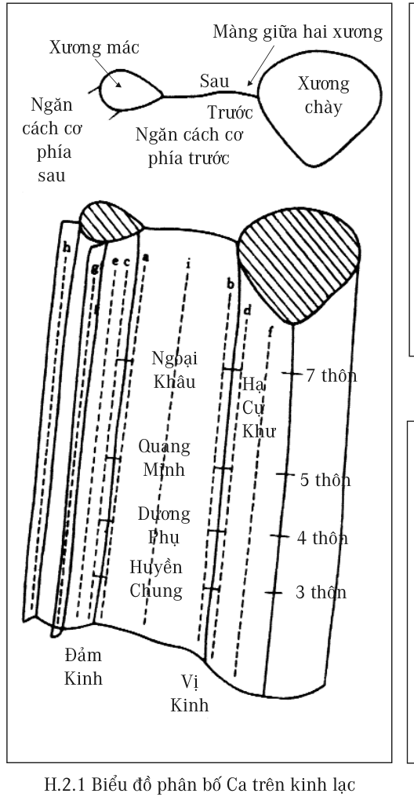 | 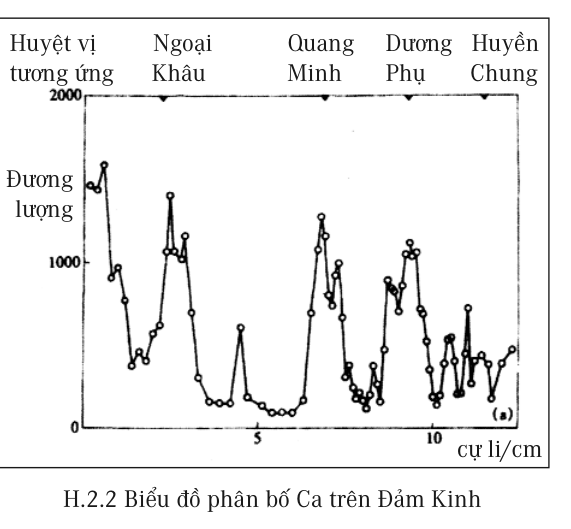 |

| Hình 2.3: Phân bố Ca trên Vị Kinh |
| :---: |
| 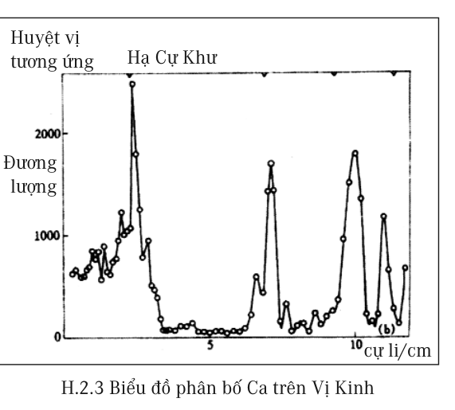 |

- **Hình 2.1:** Mô tả khu vực tập trung rất nhiều huyệt vị trên Đảm Kinh, Vị Kinh ở cẳng chân phải của cơ thể người.
- **Hình 2.2:** Mô tả sự phân bố Ca trên Đảm Kinh.
- **Hình 2.3:** Mô tả sự phân bố Ca trên Vị Kinh. Ở đây thể hiện rất rõ sự khác biệt rất lớn của hàm lượng nguyên tố Ca ở huyệt vị và ngoài huyệt vị.
*(Tư liệu được lấy từ công trình nghiên cứu “Thực nghiệm và triển vọng nghiên cứu đặc trưng cơ sở vật chất kinh lạc và tính năng của nó” của nhóm giáo sư Phí Luân, công bố trên tạp chí “Thông báo khoa học” ở Trung Quốc đại lục, tháng 3 năm 1998.)*

---

### Hình 3: Huyệt Xích Trạch

Huyệt Xích Trạch thuộc Phế Kinh, nằm ở mé bên khuỷu tay.

---

### Hình 4: Sơ đồ biểu thị năng lượng khí huyết

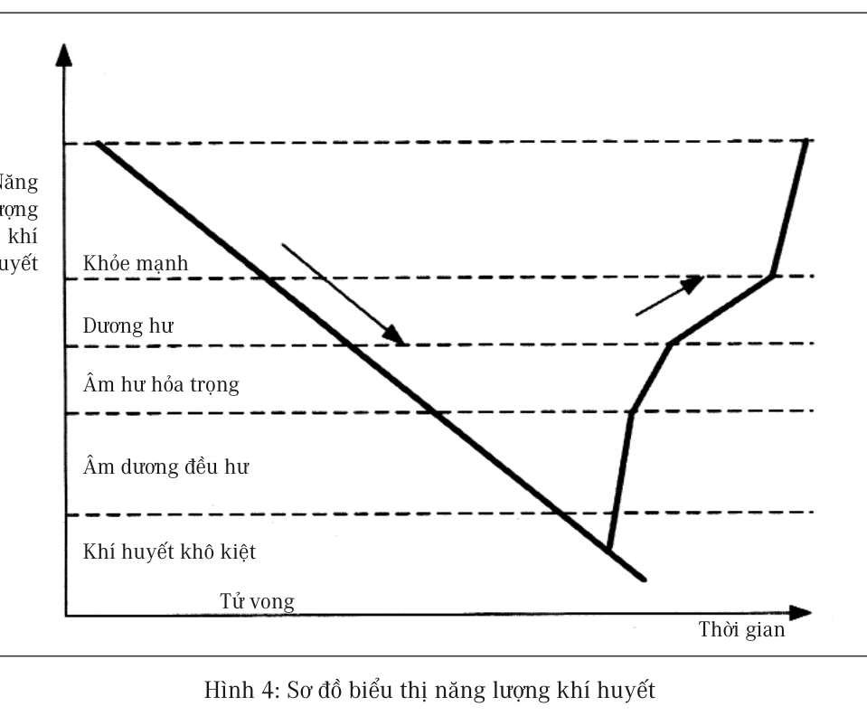

**Năm mức độ năng lượng khí huyết:**
1. Khỏe mạnh
2. Dương hư
3. Âm hư hỏa trọng
4. Âm dương đều hư
5. Khí huyết khô kiệt (Tử vong)

---

### Hình 5: Bàng Quang Kinh

Các huyệt vị chính: Tình Minh, Bàng Quang, Thận, Ủy Trung, Thừa Sơn, Chí Âm.

---

### Hình 6: Phế Kinh

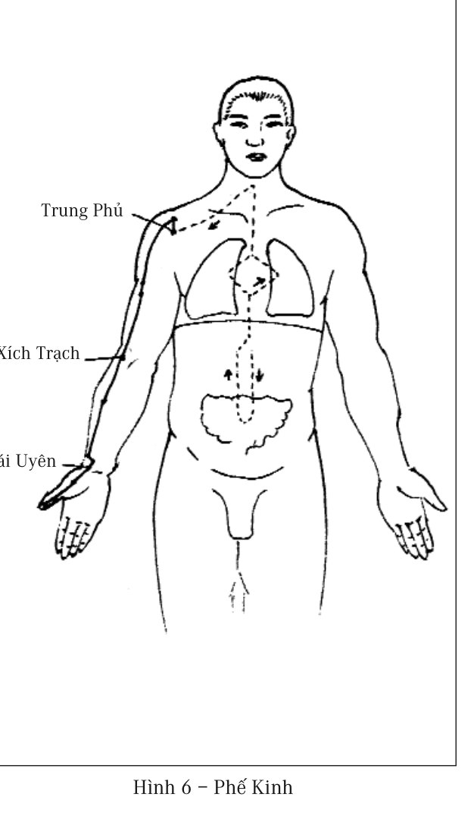

Các huyệt vị chính: Trung Phủ, Xích Trạch, Thái Uyên.

---

### Hình 7: Vị Kinh

Các huyệt vị chính: Thừa Khấp, Nhân Nghinh, Khí Xung, Tỳ Quan, Túc Tam Lý, Xung Dương, Lịch Đoái.

---

### Hình 8: Đảm Kinh

Các huyệt vị chính: Đồng Tử Liêu, Đại Trùy, Hoàn Khiêu, Dương Lăng Tuyền, Khiếu Dương.

---

### Hình 9: Đại Tràng Kinh

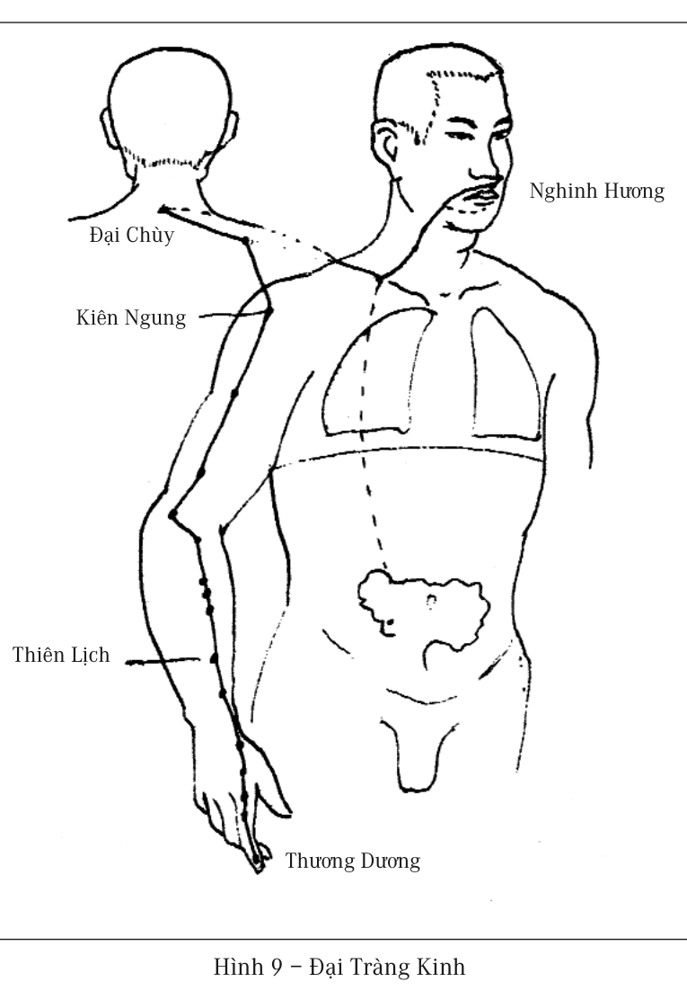

Các huyệt vị chính: Thương Dương, Thiên Lịch, Kiên Ngung, Đại Chùy, Nghinh Hương.

---

### Hình 10: Huyệt Đại Bao

Huyệt Đại Bao ở bên ngực, dưới nách, khe giữa xương sườn thứ 6.

---

### Hình 11: Phương pháp vỗ Đảm Kinh

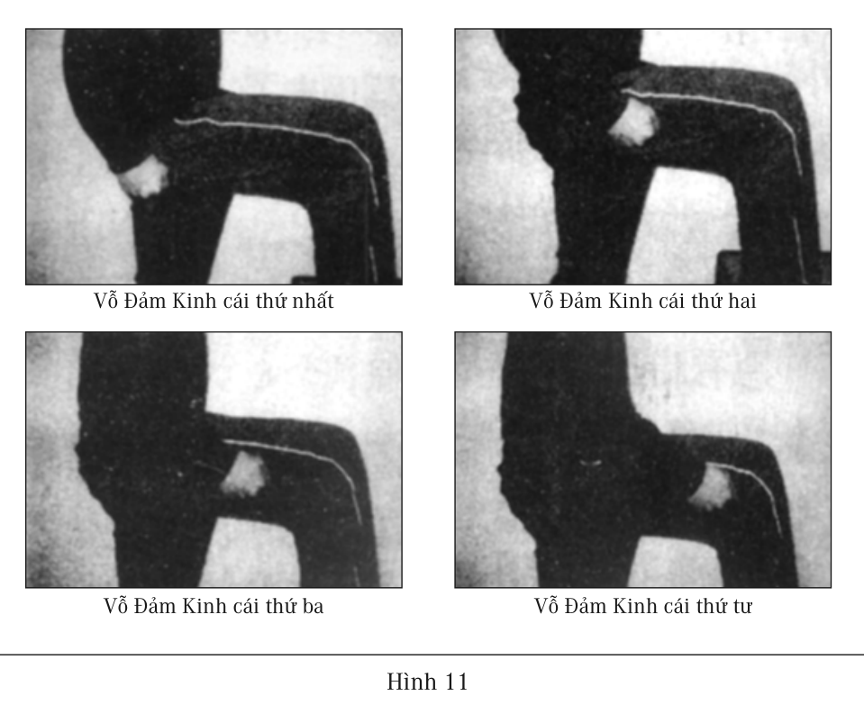

- Vỗ Đảm Kinh cái thứ nhất
- Vỗ Đảm Kinh cái thứ hai
- Vỗ Đảm Kinh cái thứ ba
- Vỗ Đảm Kinh cái thứ tư

---

### Hình 12: Tâm Bao Kinh

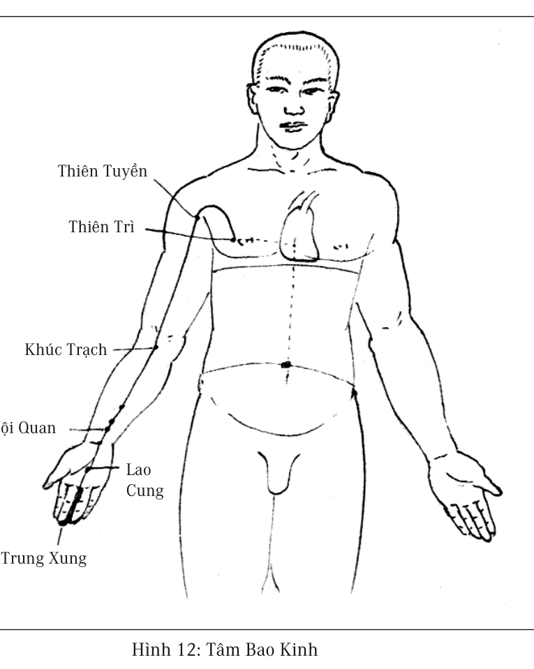

Các huyệt vị chính: Thiên Trì, Thiên Tuyền, Khúc Trạch, Nội Quan, Lao Cung, Trung Xung.

---

### Hình 13: Huyệt Đản Trung

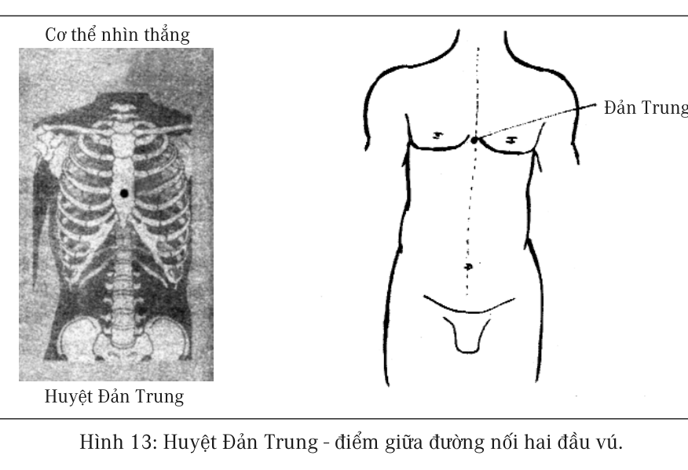

Huyệt Đản Trung – điểm giữa đường nối hai đầu vú.

---

### Hình 14: Huyệt Côn Luân

Huyệt Côn Luân thuộc Bàng Quang Kinh, nằm ở chỗ lõm mé ngoài sau mắt cá chân.

---

### Hình 15: Vị trí nghe tiếng nước khi day ấn Tâm Bao Kinh

Vị trí đặt ống nghe để nghe thấy tiếng nước khi day ấn Tâm Bao Kinh.

---

### Hình 16: Huyệt Thái Xung

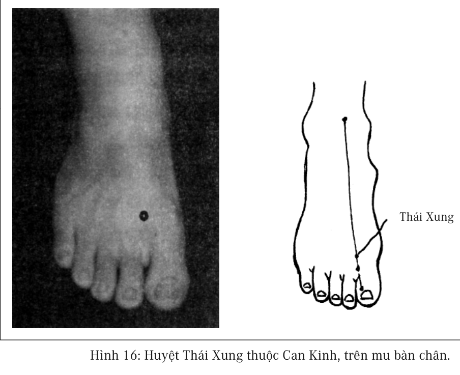

Huyệt Thái Xung thuộc Can Kinh, nằm trên mu bàn chân.

---

### Hình 17: Huyệt Nội Quan

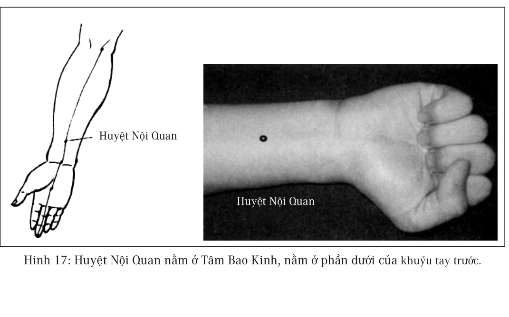

Huyệt Nội Quan nằm ở Tâm Bao Kinh, ở phần dưới của khuỷu tay trước.

---

### Hình 18: Thận Kinh

Các huyệt vị chính: Dũng Tuyền, Thái Khê, Âm Cốc.

---

### Hình 19: Can Kinh

Các huyệt vị chính: Đại Đôn, Khúc Tuyền, Cấp Mạch, Kỳ Môn.

---

## Thông tin xuất bản

- **Tác phẩm:** SÁCH HƯỚNG DẪN SỬ DỤNG CƠ THỂ NGƯỜI
- **Tác giả:** Ngô Thanh Trung
- **Người dịch:** Trần Nghĩa Phương
- **Nhà xuất bản:** Dân Trí (Số 9 - ngõ 26 - Phố Hoàng Cầu - Hà Nội)
- **Chịu trách nhiệm xuất bản:** Bùi Thị Hương
- **Chịu trách nhiệm bản thảo:** Nguyễn Phan Hách
- **Biên tập:** Đặng Thu Hương
- **Vẽ bìa & Chế bản:** Hoàng Tú
- **Sửa bản in:** Phương Linh
- **Giấy phép xuất bản:** 1265-2011/CXB/3-53/DT
- **In và nộp lưu chiểu:** Năm 2012
