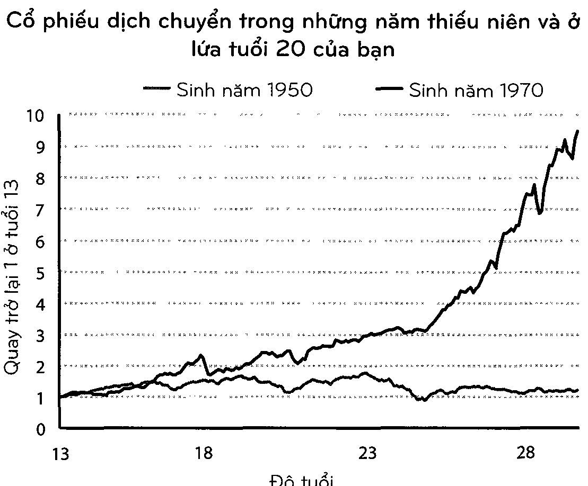
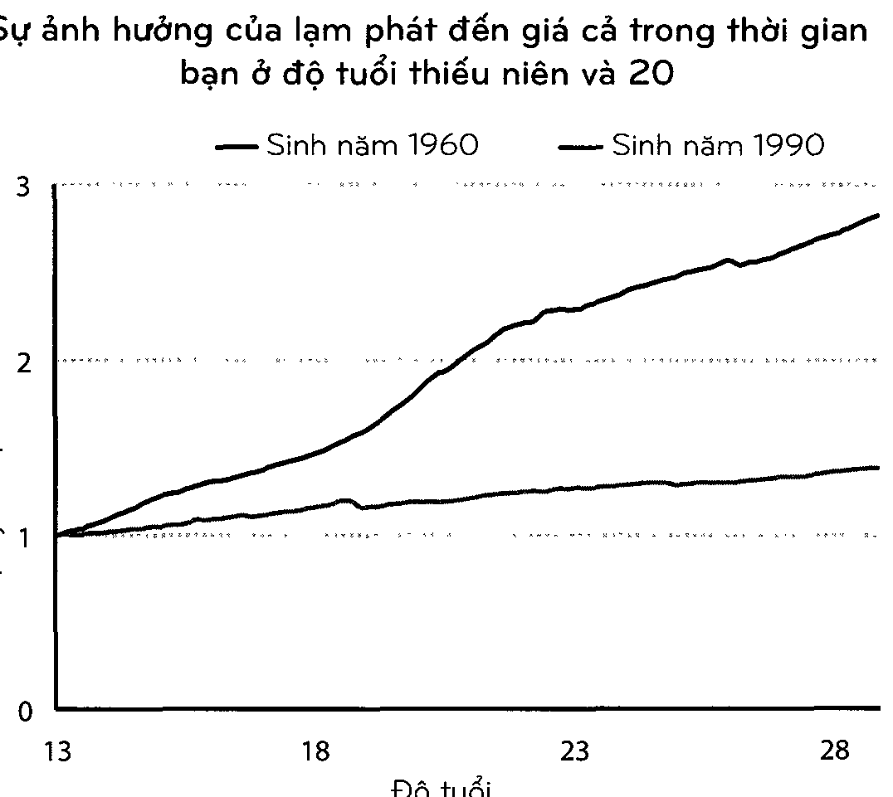
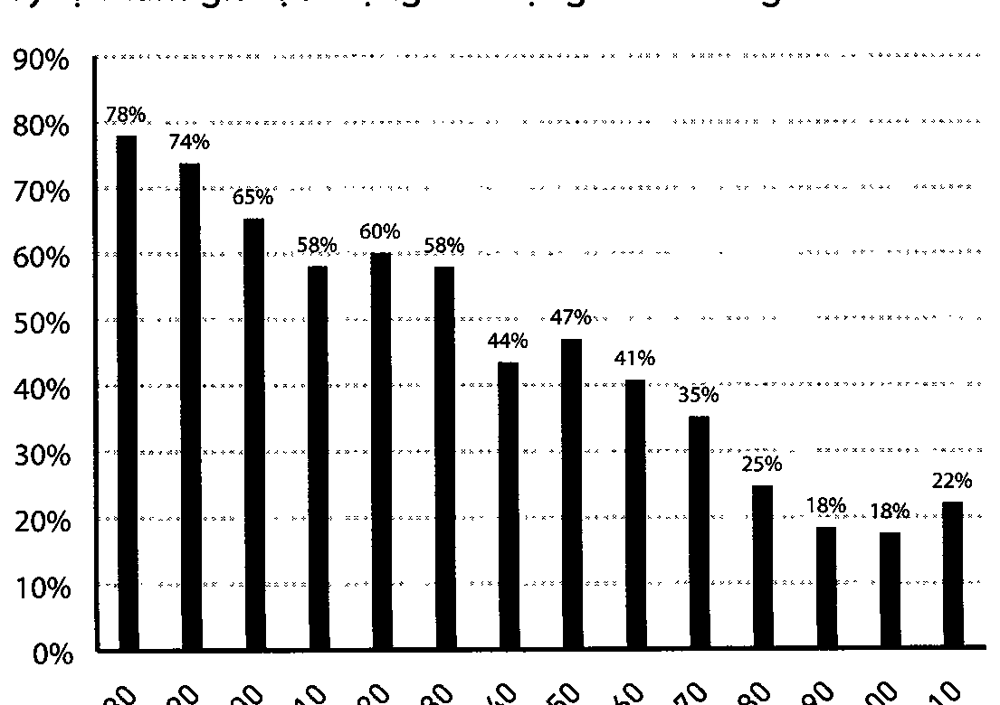

[<< Lời giới thiệu: Buổi trình diễn lớn nhất hành tinh](00_gioi_thieu.md) | [Mục lục](00_muc_luc.md) | [Chương 02: May mắn & Rủi ro >>](02_chuong_02.md)

# Chương 01: KHÔNG AI ĐIÊN RỒ

> *Trải nghiệm cá nhân liên quan đến tiền bạc của bạn đóng góp khoảng 0,00000001% những gì xảy ra trên thế giới, nhưng có lẽ lại chiếm đến 80% cách bạn suy nghĩ về việc thế giới vận hành.*

---

Để tôi nói cho bạn nghe về một vấn đề.

Nó có thể khiến bạn cảm thấy tốt hơn về việc bạn làm với khoản tiền bạn có,. và bớt đánh giá về việc người khác làm với số tiền của họ hơn.

Mọi người đều làm điều gì đó điên rồ với tiền bạc của họ. Nhưng không ai là điên rồ hết.

Vấn đề là như thế này: Mọi người đến từ những thế hệ khác nhau, được nuôi dạy bởi những bậc phụ huynh khác nhau với những khoản thu nhập khác nhau và coi trọng những giá trị khác nhau, ở những phần khác nhau trên thế giới, được sinh ra trong những nền kinh tế khác nhau, trải nghiệm những thị trường việc làm khác nhau với những mục đích và mức độ may mắn khác nhau, học được những bài học rất khác nhau.

Ai cũng có trải nghiệm đặc biệt riêng với cách mà thế giới vận hành. Và điều mà bạn đã trải nghiệm có tác động sâu sắc hơn điều mà bạn học được qua người khác. Vì thế tất cả chúng ta - bạn, tôi, tất cả mọi người - đều đi qua cuộc đời này với một tập hợp những quan điểm vô cùng khác biệt về cách tiền bạc hoạt động. Điều có vẻ điên rồ với bạn lại có thế rất hợp lý với tôi.

Người lớn lên từ sự nghèo đói nghĩ về rủi ro và phần thưởng theo những cách mà đứa con của một chủ ngân hàng giàu có không tài nào hiểu nổi ngay cả khi cậu ta cố gắng.

Người lớn lên khi lạm phát tăng cao đã phải trải nghiệm những điều mà người lớn lên khi giá cả bình ổn không bao giờ biết.

Người môi giới chứng khoán đánh mất mọi thứ trong thời kì Đại suy thoái đã trải qua những điều mà người công nhân công nghệ luôn chìm đắm trong thời kỳ hoàng kim của những năm cuối thập kỷ 1990 không tài nào tưởng tượng được.

Người Úc chưa từng chứng kiến cuộc suy thoái trong 30 năm đã trải nghiệm những điều mà không một người Mỹ nào từng biết đến.

Vân vân và vân vân. Danh sách trải nghiệm kéo dài vô tận.

Bạn biết những điều về tiền bạc mà tôi không biết, và ngược lại. Bạn đi qua cuộc đời với những niêm tin, mục tiêu, và dự đoán khác biệt so với tôi. Điều đó không phải là vì một trong hai chúng ta thông minh hơn người còn lại, hay có thông tin chính xác hơn. Mà đó là bởi vì chúng ta đã có những cuộc đời khác biệt được định hình bởi những trải nghiệm khác nhau những vẫn đầy thuyết phục.

Những trải nghiệm cá nhân liên quan đến tiền bạc của bạn đóng góp khoảng 0,00000001% những gì xảy ra trên thế giới, nhưng có lẽ lại chiếm đến 80% cách bạn suy nghĩ về việc thế giới vận hành. Vì thế những người thông minh ngang nhau có thể bất đồng quan điểm về cách thức và lý do tại sao cuộc suy thoái lại diễn ra, cách mà bạn nên đầu tư tiền, điều mà bạn nên ưu tiên, lượng rủi ro bạn nên chấp nhận, vân vân.

Trong cuốn sách về Mỹ vào thập niên 1930 của ông, Frederick Lewis Allen đã viết rằng cuộc Đại suy thoái “đã để lại dấu ấn khó phai - trong lòng - hàng triệu người dân Mỹ suốt cuộc đời của họ.” Nhưng trong đó lại có những trải nghiệm đa dạng. Hai mươi lăm năm sau, trong khi đang tranh chức tổng thống, John F. Kennedy được một phóng viên hỏi về điều ông nhớ nhất trong cuộc Đại suy thoái. Ông đã hồi tưởng:

Tôi không có kiến thức trực tiếp về cuộc Đại suy thoái. Gia đình tôi sở hữu một trong những khối tài sản lớn trên thế giới và nó đạt giá trị cao hơn bao giờ hết vào thời điểm đó. Chúng tôi đã có những ngôi nhà lớn hơn, nhiều người phục vụ hơn, và chúng tôi đi du lịch nhiều hơn. Chỉ có một điều duy nhất mà tôi tận mắt chứng kiến đó là khi bố tôi thuê thêm một vài người làm vườn chỉ để cho họ có một công việc kiếm miếng cơm manh áo. Tôi thực sự đã không tìm hiểu về cuộc Đại suy thoái cho đến khi tôi đọc về nó ở trường Harvard.

Đây là một điểm lớn trong cuộc bầu cử năm 1960. Mọi người đã nghĩ rằng, làm sao mà một người không hiểu biết gì về câu chuyện kinh tế lớn nhất thế hệ trước lại được đặt vào vị trí cầm quyền của cả nền kinh tế được? Theo rất nhiều cách, nó đã được bỏ qua bởi trải nghiệm của JFK trong Chiến tranh Thế giới thứ II. Đó là trải nghiệm đầy xúc động và lan rộng thứ hai của thế hệ trước, và là điều mà đối thủ chính của ông, Hubert Humphrey, đã không có được.

Thách thức đối với chúng ta đó là không có bất cứ lượng kiến thức hay sự mở mang về đầu óc nào có thể thật sự tái tạo sức mạnh của nỗi sợ hãi và lòng bất an.

Tôi có thể đọc về cảm giác khi đánh mất tất cả trong thời kỳ Đại suy thoái. Nhưng tôi không có những vết sẹo cảm xúc như những người đã thực sự trải nghiệm nó. Và người đã sống sót qua trận đó không thể hiểu nổi tại sao một người như tôi có thể tỏ ra bình thản với những điều như sở hữu cổ phiếu. Chúng ta nhìn thế giới qua những lăng kính khác nhau.

Những trang tính có thể thể hiện tần số mang tính lịch sử khi thị trường cổ phiếu lớn tụt dốc. Nhưng chúng không thể thể hiện cảm giác khi về nhà, nhìn những đứa con của bạn, và tự hỏi liệu có phải bạn đã gây ra một sai lầm có ảnh hưởng đến cuộc đời của chúng hay không. Nghiên cứu lịch sử khiến bạn cảm thấy như bạn hiểu được điều gì đó. Nhưng cho đến khi bạn đã trải qua nó và tự cảm nhận những hậu quả của nó, thì bạn mới có thể hiếu nó đủ nhiều để thay đối hành vi của bạn.

Chúng ta đều nghĩ rằng chúng ta biết cách vận hành của thế giới. Nhưng chúng ta đều chỉ mới trải nghiệm một phần rất nhỏ của nó.

Giống như nhà đầu tư Michael Batnick nói, “một vài bài học cần phải được trải nghiệm trước khi chúng được hiểu rõ.” Chúng ta đều là nạn nhân, theo những cách khác nhau, của sự thật đó.

Năm 2006, những nhà kinh tế học Ulrike Malmendier và Stefan Nagel đến từ Cục Nghiên cứu Kinh tế Quốc gia đã lục lọi Bản Khảo sát về Tài chính Tiêu dùng trong suốt 50 năm — một cái nhìn cụ thể về cách mà người Mỹ sử dụng tiền bạc của họ.

Trên lý thuyết mọi người nên đưa ra những quyết định đầu tư dựa trên mục tiêu của họ và bản chất của những lựa chọn đầu tư mở ra trước mắt họ vào thời điểm đó.

Nhưng đó không phải là điều mà mọi người đã làm.

Những nhà kinh tế tìm ra rằng những quyết định đầu tư trong cuộc đời của mọi người đều được định hướng bởi những trải nghiệm mà những nhà đầu tư đó đã trải qua trong thế hệ của họ - đặc biệt là những trải nghiệm trong những năm đầu trưởng thành.

Nếu bạn lớn lên trong khi lạm phát tăng cao, bạn sẽ đầu tư ít tiền vào trái phiếu hơn trong phần đời còn lại so với những người lớn lên khi lạm phát thấp. Nếu bạn lớn lên khi thị trường cổ phiếu đang vững mạnh, bạn sẽ đầu tư nhiều tiền vào cổ phiếu trong phần đời còn lại hơn so với những người lớn lên trong giai đoạn cổ phiếu yếu kém.

Những nhà kinh tế này đã viết: “Những đúc kết của chúng tôi gợi ý rằng sự sẵn sàng chấp nhận rủi ro của từng nhà đầu tư phụ thuộc vào quá khứ cá nhân của họ.”

Không phải là trí thông minh, hay sự giáo dục, hay sự tỉnh tế. Chỉ đơn giản là sự may mắn đến từ thời gian và địa điểm mà bạn được sinh ra.

Tờ Financial Tunes đã phỏng vấn Bill Gross, vị giám đốc trái phiếu nối tiếng, vào năm 2019. “Gross thừa nhận rằng ông có lẽ đã không ở vị trí ngày nay nếu ông được sinh ra ở một thập niên sớm hơn hoặc muộn hơn”, bài báo nói. Sự nghiệp của Gross trùng hợp một cách khá hoàn hảo với sự sụp đổ mang tính thế hệ của tỷ lệ lãi suất mà qua đó làm tăng giá trị trái phiếu. Những điều kiểu như vậy không chỉ ảnh hưởng đến những cơ hội mà bạn gặp; nó còn ảnh hưởng đến cách suy nghĩ của bạn về những cơ hội đó khi chúng được trình ra trước mắt bạn. Đối với Gross, trái phiếu là cỗ máy sản sinh ra của cải. Đối với thế hệ của cha ông, người đã lớn lên và phải chịu đựng một tý lệ lạm phát cao hơn, thì chúng có thể bị coi là những cố máy đốt tiền.

Sự khác biệt về cách mà mọi người trải nghiệm với tiền bạc là không hề nhỏ, ngay cả giữa những người mà bạn nghĩ rằng khá giống nhau.

Lấy ví dụ về cổ phiếu. Nếu bạn được sinh ra vào năm 1970, chỉ số S&P 500 tăng gần 10 lần, do sự điều chỉnh với lạm phát, trong thời gian thiếu niên và những năm 20 của bạn. Đó là một sự trở lại ngoạn mục. Nếu bạn được sinh ra vào năm 1950, thị trường không dịch chuyển trong suốt thời gian thiếu niên và những năm 20 của bạn do điều chỉnh

> 
>
> *Biểu đồ: Cổ phiếu dịch chuyển trong những năm thiếu niên và ở lứa tuổi 20 của bạn (Sinh năm 1950 vs 1970)*

với lạm phát. Hai nhóm người, ngăn cách tình cờ bởi năm sinh, trải qua cuộc đời với cách nhìn nhận hoàn toàn khác biệt về việc vận hành của thị trường chứng khoán: lứa tuổi 2O của bạn Hay như sự lạm phát. Nếu bạn được sinh ra vào những năm 1960 ở Mỹ, sự lạm phát trong những năm bạn ở độ tuổi thiếu niên và 20 - những năm tuổi trẻ đầy ấn tượng mà bạn đang phát triển nền tảng tri thức về cách vận hành của nền kinh tế - đã khiến giá cả đội lên gấp ba lần. Đó là một con số lớn. Bạn nhớ rằng hàng người xếp hàng chờ đổ xăng và nhận lương ngắn hơn đáng kể so với những hàng trước đó. Nhưng nếu bạn được sinh ra vào năm 1990, lạm phát ở mức thấp suốt quãng đời của bạn đến mức có thể nó chưa từng thoáng qua trong đầu bạn.

> 
>
> *Biểu đồ: Sự ảnh hưởng của lạm phát đến giá cả trong thời gian bạn ở độ tuổi thiếu niên và 20 (Sinh năm 1960 vs 1990)*

bạn ở độ tuổi thiếu niên và 2O

Tỷ lệ thất nghiệp toàn quốc của Mỹ vào tháng Mười Một năm 2009 ở quanh mức 10%. Nhưng tỷ lệ thất nghiệp của những nam giới người Mỹ gốc Phi tuổi từ 16 đến 19 mà không có bằng tốt nghiệp cấp 3 là tận 49%. Đối với những nữ giới da trắng trên 45 tuổi có bằng đại học, tỷ lệ là 4%.

Thị trường chứng khoán địa phương ở Đức và Nhật Bản bị xóa sạch hoàn toàn trong Chiến tranh Thế giới thứ II. Toàn bộ những vùng này đều bị đánh bom. Đến cuối cuộc chiến tranh những nông trại ở Đức chỉ sản xuất được đủ thức ăn để cung cấp cho người dân trong nước với mức 1.000 calo một ngày. So sánh điều đó với Mỹ, nơi mà thị trường chứng khoán tăng hơn gấp đôi từ năm 1941 đến cuối năm 1945 và nền kinh tế ở mức mạnh nhất trong gần hai thập kỷ.

Không nên trông đợi những thành viên của những nhóm này trải qua phần đời còn lại của họ với cùng một suy nghĩ về lạm phát. Kể cả với thị trường chứng khoán. Hay sự thất nghiệp. Hay tiền bạc nói chung.

Không nên trông đợi họ phản ứng trước thông tin tài chính theo cùng một cách. Không nên cho rằng họ đều bị tác động bởi cùng những mục đích giống nhau.

Không nên trông đợi họ tín tưởng những lời khuyên cùng nguồn gốc.

Không nên trông đợi họ đồng tình về điều gì là quan trọng, điều gì là đáng giá, điều gì dễ xảy ra tiếp theo, và con đường tốt nhất để tiến về phía trước là gì.

Cái nhìn của họ về tiền bạc được hình thành ở những thế giới khác nhau. Và khi đó, một cái nhìn về tiền bạc mà một nhóm người nghĩ là thái quá lại có thể hoàn toàn hợp lý với một nhóm khác.

Một vài năm trước đây, tờ T5e Net York Trmes đã làm một câu chuyện về điều kiện nơi làm việc ở Foxcomn, nhà sản xuất các thiết bị điện khống lồ của Đài Loan. Điều kiện ở đây thường cực kỳ tôi tệ. Độc giả bất bình một cách chính đáng. Nhưng một câu trả lời đầy thú vị đối với câu chuyện này đến từ người cháu trai của một công nhân người Trung Quốc, người đã viết trong mục bình luận như sau:

Dì của tôi đã làm việc vài năm ở nơi mà những người Mỹ gọi là “xưởng bán mồ hôi” này. Đó thật sự là một công việc nặng nhọc. Thời gian làm việc kéo dài, lương ít, điều kiện làm việc tồi tệ.

Bạn có biết dì tôi đã làm gì trước khi bà làm việc cho một trong những xưởng sản xuất như thế nào không? Bà là một kỹ ni?.

Ý nghĩ làm việc trong một “xưởng bán mồ hôi” so với lối sống cũ kia là một sự cải thiện, theo tôi nghĩ là vậy. Tôi biết rằng dì tôi thà bị “bóc lột” bởi một tên sếp tư bản độc ác vì một vài đồng đô la còn hơn là bị khai thác cơ thể bởi vài tên đàn ông chỉ để đổi lấy vài đồng xu.

Đó là lý do vì sao tôi thấy tức giận bởi cách suy nghĩ của rất nhiều người Mỹ. Chúng tôi không có những cơ hội tương tự như ở phương Tây. Cơ sở hạ tầng chính phủ của chúng tôi khác biệt. Đất nước của chúng tôi khác biệt. Phải, nhà xưởng là nơi lao động cực nhọc. Nó có thể cải thiện không? Có, nhưng chỉ khi bạn so sánh nó với những công việc ở Mỹ mà thôi.

Tôi không biết phải nghĩ gì về điều này. Một phần trong tôi muốn tranh cãi, gay gắt. Một phần khác lại muốn thấu hiểu. Nhưng phần lớn đây là một ví dụ cho việc làm thế nào mà các trải nghiệm khác nhau có thể dẫn tới những cái nhìn hoàn toàn khác biệt trong những chủ đề mà một bên luôn có trực quan nghĩ rằng nó nên đen trắng rõ ràng.

Mọi quyết định mà con người đưa ra với tiền bạc được biện minh thông qua việc đưa thông tin mà họ có vào thời điểm đó vào cách vận hành của thế giới theo mô hình suy nghĩ độc đáo của họ.

Những người đó có thể đã tiếp nhận thông tin sai. Họ có thể đã nghe những thông tin thiếu sót. Họ có thể không giỏi toán. Họ có thể bị thuyết phục bởi phương pháp tiếp thị ung nhọt. Họ có thể không hề hay biết gì về điều họ đang làm. Họ có thể đánh giá sai hậu quả của những hành động của họ. Ôi, rất nhiều tình huống có thể xảy ra.

Nhưng mỗi quyết định tài chính mà một người đưa ra, đều hợp lý với họ trong thời phút đó và hoàn thành những mục mà họ cần làm. Họ kể cho bản thân một câu chuyện về điều mà họ đang làm và lý do tại sao làm nó và câu chuyện đó đã được định hình bởi những trải nghiệm độc đáo riêng của họ.

Hãy xem một ví dụ đơn giản: vé xổ số.

Người Mỹ tiêu nhiều tiền cho chúng hơn cả vé xem phim, trò chơi điện tử, âm nhạc, các sự kiện thể thao, và sách cộng lại.

Và ai là người mua chúng? Đa phần là người nghèo.

Những hộ gia đình có thu nhập thấp nhất ở Mỹ trung bình tiêu 412 đô la một năm vào xổ số, gấp bốn lần số tiền từ những hộ gia đình thuộc nhóm thu nhập cao nhất. Bốn mươi phần trăm người Mỹ không thể có trong tay 400 đô la trong trường hợp khẩn cấp. Điều này nói lên rằng: Những người mua 400 đô la tiền xổ số nhìn chung cũng chính là những người nói rằng họ không thể xoay sở được 400 đô la trong trường hợp khẩn cấp. Họ đang phí phạm khoản phòng thân của họ vào một thứ chỉ mang lại một - trong - một - triệu khả năng trúng lớn.

Điều đó với tôi thật điên rồ. Nó có lẽ cũng có vẻ điên rỒ với bạn. Nhưng tôi không nằm trong nhóm có thu nhập thấp nhất. Bạn có lẽ cũng không. Vì thế thật khó cho rất nhiều người trong chúng ta hiếu được lý do vô thức của những người mua vé số có thu nhập thấp.

Nhưng cố gắng một chút, và bạn có thể tưởng tượng mọi việc diễn ra đâu đó như sau:

Chúng tôi sống dựa vào từng khoản lương và việc tiết kiệm có vẻ xa vời. Viễn cảnh về mức lương cao hơn có vẻ ngoài tầm với. Chúng tôi không thể trang trải những chuyến du lịch đẹp đẽ, những chiếc xe hơi mới, bảo hiểm sức khỏe, hay nhà cửa ở những khu vực an toàn. Chúng tôi không thể cho con cái đi học đại học mà không ngập ngụa trong đống nợ. Rất nhiều thứ mà những người đọc sách tài chính như các bạn hoặc đang sở hữu, hoặc có cơ hội để sở hữu, thì chúng tôi đều không có. Mua một tấm vé số là thời gian duy nhất trong cuộc sống của chúng tôi mà chúng tôi có thể nắm giữ một giấc mơ hữu hình về việc sở hữu những món đồ tốt mà các bạn đã có và đang không coi trọng. Chúng tôi đang trả tiền cho một giấc mơ, và bạn có thể không hiểu được điều đó bởi vì bạn đã đang sống trong mơ rồi. Đó là lý do vì sao chúng tôi mua nhiều vé số hơn các bạn.

Bạn không cần phải đồng tình với cách lý luận này. Mua vé số khi bạn nhãn túi vẫn là một ý tưởng tôi. Nhưng tôi có thể hiểu được phần nào lý do cho sự tồn tại của việc bán vé số.

Và ý tưởng đó - “Điều mà bạn đang làm có vẻ điên rỒ nhưng tôi có thể hiểu được phần nào lý do bạn làm nó.” - đã phơi bày gốc rễ của rất nhiều quyết định tài chính của chúng ta.

Rất ít người đưa ra những quyết định tài chính chỉ dựa trên một trang tính. Họ đưa ra chúng ở bàn ăn, hoặc trong cuộc họp công ty. Những nơi mà quá khứ cá nhân, cái nhìn độc đáo của riêng bạn về thế giới, cái tôi, lòng tự trọng, cách tiếp thị, và những mục tiêu cũ đều hòa trộn với nhau thành một câu chuyện hợp lý đối với bạn.

Một ý quan trọng khác giúp giải thích tại sao các quyết định về tiền bạc lại khó khăn đến thế, và tại sao có rất nhiều hành vi sai lệch, đó là nhận ra độ mới mẻ của chủ đề này.

Tiền bạc đã tôn tại một thời gian dài. Vua Alyattes của xứ Lydia, giờ là một phần của Thổ Nhĩ Kỳ, được coi là người đã tạo ra đơn vị tiền tệ chính thức đầu tiên trong năm 600 trước Công Nguyên. Nhưng nền tảng hiện đại của những quyết định liên quan đến tiền bạc - tiết kiệm và đầu tư - đều dựa trên những khái niệm còn non trẻ.

Lấy việc nghỉ hưu làm ví dụ. Vào cuối năm 2018, có 27 nghìn tỷ đô la trong các tài khoản hưu trí của Mỹ, biến nó thành động lực chính cho những quyết định tiết kiệm và đâu tư thông thường của các nhà đầu tư.

Nhưng toàn bộ khái niệm gắn mác nghỉ hưu này lại mới chỉ tồn tại, nhiều nhất là qua hai thế hệ.

Trước Chiến tranh Thế giới thứ II, phần lớn người dân Mỹ làm việc cho đến khi họ qua đời. Đó vừa là sự trông đợi vừa là thực tế. Tỷ lệ tham gia vào lực lượng lao động của nam giới ở độ tuổi từ 65 trở lên là hơn 50% cho đến những năm 1940:

> 
>
> *Biểu đồ: Tỷ lệ tham gia lực lượng lao động của nam giới tuổi 65+*

Bảo hiểm xã hội có mục tiêu thay đối điều này. Nhưng những lợi ích ban đầu của nó không thể nào sánh bằng một mức lương hưu chuẩn. Khi Ida May Fuller đối tờ séc Bảo hiếm Xã hội đầu tiên ra tiên mặt vào năm 1940, số tiền lúc đó là 22,54 đô la, hay 416 đô la khi đã điều chính với lạm phát. Phải đến những năm 1980 thì tờ séc Bảo hiểm Xã hội trung bình dành cho những người về hưu mới vượt ngưỡng 1.000 đô la một tháng khi đã điều chỉnh với lạm phát. Hơn một phần tư người dân Mỹ ở độ tuổi trên 65 được xếp vào mục sống trong nghèo đói bởi Cục Điều tra Dân số cho đến tận cuối thập kỷ 1960.

Có một niềm tin rộng rãi với câu nói, “Mọi người từng có khoản lương hưu riêng”. Nhưng điều này đã bị thối phồng quá đà. Viện nghiên cứu lợi ích nhân viên giải thích rằng: “Chỉ một phần tư những người ở độ tuổi 65 hoặc cao hơn có nguồn lương hưu vào năm 1975”. Trong số những người may mắn chiếm thiểu số đó, chỉ có 15% thu nhập hộ gia đình đến từ lương hưu.

Tờ Net York Times đã viết vào năm 1955 về một khát khao đang trỗi dậy, nhưng vẫn còn chưa thực hiện được, về việc nghỉ hưu: “Một cách nói khác của câu nói quen thuộc: mọi người đều nói về việc nghỉ hưu, nhưng hiển nhiên là rất ít người có hành động liên quan đến nó.”

Phải đến tận những năm 1980 thì ý tưởng rằng mọi người đều xứng đáng, và nên hưởng, một giai đoạn nghỉ hưu đáng trân trọng mới phổ biến. Và cái cách để có được giai đoạn nghỉ hưu đáng trân trọng kể từ đó đã trở thành sự trông đợi rằng ai cũng sẽ tiết kiệm và đầu tư khoản tiền của riêng họ.

Để tôi nhấn mạnh lại sự mới mẻ của ý tưởng này: Kế hoạch 401(k) - phương pháp tiết kiệm đóng vai trò xương sống của Quỹ hưu trí Hoa Kỳ - không tồn tại cho đến tận năm 1978. Quỹ hưu trí cá nhân Roth IRA cũng không được sinh ra cho đến năm 1998. Nếu nó là một con người thì bây giờ nó còn chưa đủ tuổi để được uống rượu nữa.

Việc nhiều người trong số chúng ta không giỏi tiết kiệm và đầu tư để đành cho lúc nghỉ hưu không phải là một bất ngờ. Chúng ta không hề điên rồ. Chúng ta chỉ toàn là những người mới làm quen mà thôi.

Điều tương tự cũng xảy ra với đại học. Tý lệ người Mỹ trên tuổi 25 sở hữu một tấm bằng đại học đã đi từ ít hơn 1 trong 20 người vào năm 1940 đến 1 trong 4 người vào năm 2015. Học phí đại học trung bình trong thời gian đó tăng hơn bốn lần khi đã điều chỉnh với lạm phát. Một điều lớn lao và rất quan trọng lại tác động đến xã hội nhanh như thế đã giải thích tại sao, lấy ví dụ, rất nhiều người lại đưa ra những quyết định tồi tệ với khoản vay sinh viên trong vòng 20 năm qua. Không hề có hàng thập kỷ tích lũy kinh nghiệm để cố gắng học hỏi. Chúng ta chỉ đang tùy cơ ứng biến.

Điều tương tự cũng áp dụng với quỹ chỉ số, một loại quỹ mới chỉ ít hơn 50 tuổi. Và quỹ phòng hộ, một loại quỹ không được triển khai cho đến 25 năm nay. Ngay cả việc sử dụng tràn lan của những gói nợ tiêu dùng - thế chấp, thẻ tín dụng, và cho vay để mua xe - cũng không được triển khai cho đến sau Chiến tranh Thế giới thứ II, khi đạo luật GI Bil] giúp hàng triệu người dân Mỹ dễ dàng vay mượn hơn.

Chó là loài động vật được nuôi trong nhà từ 10.000 năm trước mà vẫn lưu giữ một vài hành vi hoang dã của tổ tiên chúng. Ấy vậy mà chúng ta ở đây, chỉ với từ 20 đến 50 năm kinh nghiệm trong hệ thống tài chính hiện đại, lại hy vọng trở nên quen thuộc hoàn toàn.

Với một chủ đề được ảnh hướng rất nhiều bởi cảm xúc hơn là thông tin xác thực, đây thực sự là một vấn đề. Và nó giúp ta giải thích tại sao chúng ta không thường xuyên làm những điều mà chúng ta lẽ ra nên làm với tiền bạc.

Chúng ta đều làm những điều điên rồ với tiền bạc, bởi vì chúng ta đều còn khá mới mẻ với trò chơi này và điều có vẻ điên rồ với bạn lại có khi hợp lý với tôi. Nhưng không ai là điên rồ cả - chúng ta đều đưa ra các quyết định dựa trên những trải nghiệm độc đáo riêng có mang vẻ hợp lý với mình ở bất cứ thời điểm nào.

Giờ hãy để tôi kể cho bạn một câu chuyện về cách Bill Gates làm giàu.

---

[<< Lời giới thiệu: Buổi trình diễn lớn nhất hành tinh](00_gioi_thieu.md) | [Mục lục](00_muc_luc.md) | [Chương 02: May mắn & Rủi ro >>](02_chuong_02.md)
