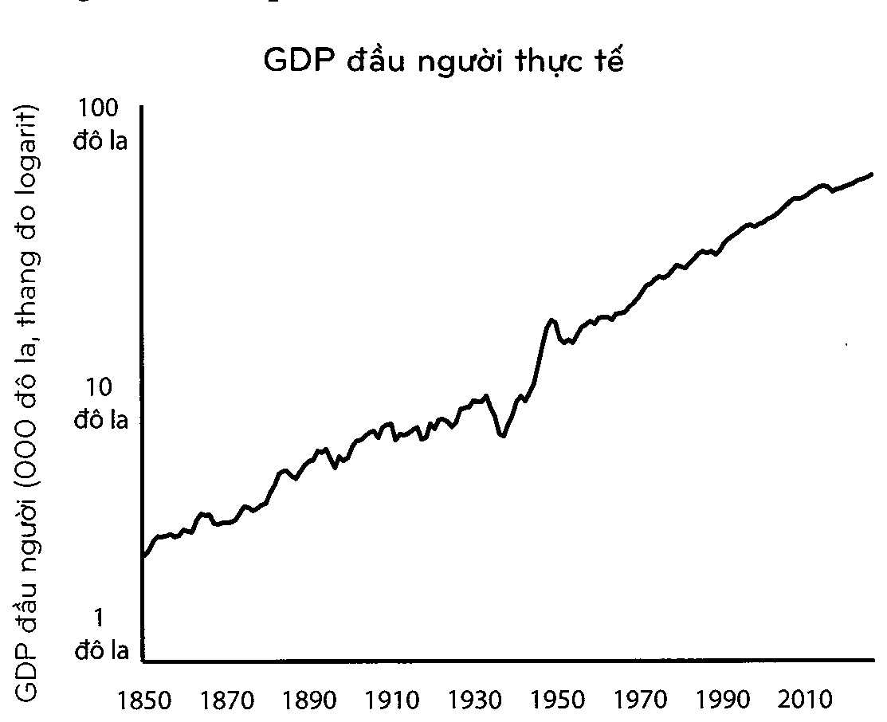

[<< Chương 04: Sự tích tụ gây chấn động](04_chuong_04.md) | [Mục lục](00_muc_luc.md) | [Chương 06: Sự kiện sau chót, bạn thắng rồi >>](06_chuong_06.md)

# Chương 05: LÀM GIÀU VÀ DUY TRÌ SỰ GIÀU CÓ

> *Đầu tư tốt không nhất thiết phải là đưa ra những quyết định đúng đắn. Mục tiêu ở đây là thường xuyên không phạm sai lầm.*

---

Có một triệu cách đế làm giàu, và rất nhiều sách về cách đạt được điều đó.

Nhưng chỉ có một cách duy nhất để duy trì sự giàu có: sự kết hợp giữa việc sống thanh đạm và chút hoang tưởng.

Và đó là chủ đề mà chúng ta chưa bàn bạc đủ.

Hãy bắt đầu với một câu chuyện ngắn về hai nhà đầu tư, không một ai trong số họ biết người còn lại, nhưng con đường của họ lại gặp nhau một cách thú vị vào gần một thế kỷ trước.

Jess Livermore là nhà giao dịch thị trường cổ phiếu vĩ đại nhất trong thời kỳ của ông. Sinh ra vào năm 1877, ông trở thành một nhà giao dịch chuyên nghiệp trước khi phần lớn mọi người biết rằng bạn có thể làm một việc như vậy. Đến tuổi 30, gia tài của Ông sau khi điều chỉnh với lạm phát có giá trị tương đương 100 triệu đô la.

Đến năm 1929, Jesse Livermore đã là một trong những nhà đầu tư nối tiếng nhất trên thế giới. Sự sụp đổ của thị trường chứng khoán vào năm đó dẫn tới cuộc Đại suy thoái đã đóng dấu di sản của ông trong lịch sử.

Hon một phần ba giá trị của thị trường chứng khoán bị xóa sạch vào một tuần tháng Mười năm 1929 mà sau đó những ngày này được đặt tên là Thứ Hai Đen Tối, Thứ Ba Đen Tối và Thứ Năm Đen Tối.

Vợ của Livermore là Dorothy lo sợ điều tôi tệ nhất khi chồng bà trở về nhà vào ngày 29 tháng Mười. Những báo cáo về các vụ tự tử của các nhà đầu cơ Phố Wall đang lan tràn khắp New York. Bà và các con đón Jesse ở cửa ra vào với nước mắt lưng tròng, trong khi mẹ bà thì lo sợ đến quẫn trí nên trốn trong một phòng khác, hét âm lên.

Jesse, theo người viết tiểu sử Tom Rubython, đã đứng trong tâm trạng bối rối một vài giây trước khi nhận thấy điều gì đang diễn ra.

Ông sau đó đã công bố tin tức với gia đình mình: Nhờ một sự may mắn pha lẫn đầu óc thiên tài, ông đã bán khống thị trường, đặt cược rằng chứng khoán sẽ tụt giá.

“Ý anh là chúng ta không bị khánh kiệt ư?” Dorothy hỏi.

“Không em yêu à, anh vừa có một ngày giao dịch tuyệt vời nhất - chúng ta đang vô cùng giàu có và có thể làm bất cứ gì ta muốn, Jesse nói.

Dorothy chạy đến chỗ mẹ bà và bảo bà hãy yên lặng.

Trong một ngày Jesse Livermore đã kiếm được một khoản tương đương với hơn 3 tỷ đô la.

Vào một trong những tháng tồi tệ nhất trong lịch sử của thị trường chứng khoán, ông đã trở thành một trong những người đàn ông giàu có nhất trên thế giới.

Trong khi gia đình Livermore ăn mừng thành công không lý giải nối của họ, thì một người đàn ông khác lại đi lang thang trên những con đường của New York trong sự tuyệt vọng.

Abraham Germansky là một triệu phú phát triển bất động sản, người đã kiếm được cả gia tài kếch xù trong thời kỳ bùng nổ những năm 1920. Khi nền kinh tế thịnh vượng, ông đã làm điều mà hầu như mọi người dân New York thành công khác đều làm trong những năm cuối 1920: đầu tư nặng tay vào thị trường chứng khoán đang lên.

Vào ngày 26 tháng Mười năm 1929, tờ Net York T#nes xuất bản một bài báo mà chỉ trong hai đoạn đã phác họa lại được một kết cục bi thảm:

Bernard H. Sandler, luật sư ở 225 Broadway, đã được bà Abraham Germansky hỏi vào sáng hôm qua về Mount Vernon để giúp tìm chồng bà, người đã mất tích kể từ sáng hôm thứ Năm. Germansky, hiện 50 tuổi và là một nhà tổ chức bất động sản phía Đông, theo lời Sandler nói là đã đầu tư mạnh tay vào chứng khoán.

Sandler nói ông được bà Germansky kể rằng một người bạn đã nhìn thấy chồng bà vào tối muộn hôm thứ Năm trên phố Wall gần sàn giao dịch chứng khoán. Theo nguồn thông tin của bà, chồng bà lúc đó đang xé rách những mẩu băng dán và ném chúng xuống vỉa hè trong khi đi bộ về phía Broadway.

Và đó, như những gì chúng ta được biết, là kết cục của Abraham Germansky.

Tại đây chúng ta thấy sự đối lập.

Sự sụp đổ vào tháng Mười năm 1929 biến Jesse Livermore trở thành một trong những người đàn Ông giàu có nhất thế giới. Nó đã hủy hoại Abraham Germansky, có lẽ là đã lấy đi cả mạng sống của ông.

Nhưng tua nhanh bốn năm sau đó và hai câu chuyện lại gặp nhau một lần nữa.

Sau chiến thắng năm 1929, Livermore, tràn trê sự tự tin, đã cá cược lớn hơn nữa. Những khoản nợ ngày càng tăng vượt quá khả năng của ông, và cuối cùng ông đánh mất mọi thứ cho thị trường chứng khoán.

Phá sản và xấu hổ, ông biến mất suốt hai ngày vào năm 1933. Vợ ông chạy đi tìm ông. “Jesse L. Livermor, người điều hành thị trường chứng khoán, sống ở số 1100 Park Avenue đã mất tích và chưa được nhìn thấy kể từ 3 giờ chiều ngày hôm qua”, tờ Netu York Times đã viết vào năm 1933.

Ông quay trở về, nhưng con đường của ông đã được định đoạt. Livermore cuối cùng cũng tự kết thúc cuộc đời mình.

Thời gian khác nhau, nhưng Germansky và Livermore đều có một tính cách chung: Họ đều rất giỏi trong việc làm giàu, nhưng lại vô cùng kém trong việc duy trì sự giàu có đó.

Ngay cả khi “giàu có” không phải là một từ mà bạn miêu tả bản thân mình, thì những bài học từ sự quan sát này cũng vẫn áp dụng được cho tất cả mọi người, ở mọi mức thu nhập. Kiếm tiền là một chuyện.

Giữ tiền lại là chuyện khác.

Nếu tôi phải tổng kết sự thành công về tiền bạc trong một từ nó sẽ là “sinh tồn”.

Như chúng ta sẽ thấy trong Chương 6, 40% các công ty đủ thành công để được giao dịch công khai đã đánh mất hầu như tất cả giá trị tài sản của họ qua thời gian. Danh sách 400 người Mỹ giàu có nhất của Forbes, theo trung bình, có khoảng 20% doanh thu trên một thập kỷ nhờ những lý do không liên quan đến cái chết hay chuyển tiền cho một thành viên khác trong gia đình.

Chủ nghĩa tư bản rất khó nhằn. Nhưng một phần của lý do cho sự việc này là bởi vì kiếm tiền và giữ tiền là hai kỹ năng khác biệt nhau.

Kiếm tiền yêu cầu phải chấp nhận rủi ro, lạc quan, và lao mình ra thị trường.

Nhưng giữ tiền yêu cầu điều ngược lại so với chấp nhận rủi ro. Nó yêu cầu sự khiêm nhường, và nối sợ rằng những gì bạn đã kiếm được có thể bị tước đi trong chớp mắt. Nó yêu cầu lối sống thanh đạm và biết chấp nhận rằng ít nhất một vài trong số những gì bạn đã kiếm được là nhờ sự may mắn, vì thế những thành công trong quá khứ không đáng tin cậy để có thể lặp lại vô hạn.

Michael Moritz, vị tỷ phú đứng đầu Sequoia Capital, đã được hỏi bởi Charlie Rose rằng tại sao Sequoia lại thành công đến vậy. Moritz nhắc đến tuổi thọ, nhấn mạnh rằng một vài công ty VC thành công được năm hoặc mười năm, nhưng Sequoia đã phát triển được bốn thập kỷ rồi. Rose đã hỏi lý do cho việc đó:

Moritz: Tôi nghĩ chúng tôi luôn sợ hãi việc đánh mất thị trường.

Rose: Thật ư? Vậu bí quyết là sự sợ hãi? Chỉ có những ai hoang tưởng mới tồn tại?

Moritz: Có rất nhiều sự thật đúng đắn trong đó... Chúng tôi for rằng ngày mai không giống như hôm qua. Chúng tôi không thể nghỉ ngơi trên ngai vàng được. Chúng tôi không thể tự mãn. Chúng tôi không thể cứ đinh ninh rằng sự thành công của ngày hôm qua sẽ được chuyển thành vận may tốt vào ngày mai.

Lại một lần nữa, sự sinh tồn được nhắc đến.

Không phải là “sự tăng trưởng” hay “trí não” hay “các bài học đúc rút”. Khả năng tồn tại trong một thời gian dài, mà không bị xóa sổ hay bị buộc phải từ bỏ, mới là điều tạo nên sự khác biệt lớn nhất. Điều này nên là cơ sở cho chiến lược của bạn, đù đó là trong đầu tư hay sự nghiệp hay một việc kinh doanh mà bạn sở hữu.

Có hai lý do tại sao một tâm lý sinh tồn lại quan trọng với tiền bạc đến vậy.

Lý do đầu tiên rất hiển nhiên: một vài lần thắng lớn mang lại cảm giác tuyệt vời đến mức chúng khiến bạn muốn làm tới hơn nữa.

Lý do thứ hai, như chúng ta đã thấy trong Chương 4, chính là bài toán đi ngược lại trực giác của sự tích lũy.

Sự tích lũy chỉ mang lại hiệu quả nếu bạn có thể trao cho một tài sản nhiều năm trời để phát triển. Nó giống như việc trồng những cây sồi: Một năm tăng trưởng sẽ không bao giờ thể hiện quá nhiều sự lớn mạnh, 10 năm có thể tạo ra một sự khác biệt nhất định, và 50 năm có thể tạo ra một thứ gì đó cực kỳ choáng ngợp.

Nhưng đạt được và giữ được sự tăng trưởng phi thường đó cần khả năng sinh tồn vượt qua mọi biến động lên và xuống khó lường trước được mà mọi người đều phải trải qua theo thời gian.

Chúng ta có thể dành hằng năm trời cố gắng tìm ra cách Buffettt đạt được những lợi nhuận trong đầu tư của ông: cách ông thành lập ra những công ty tuyệt nhất, những cổ phiếu giá rẻ nhất, những giám đốc tài giỏi nhất. Điều đó rất khó. Một việc bớt khó khăn hơn nhưng cũng không kém phần quan trọng là chỉ ra được những việc ông đã không làm.

Ông đã không bị cuốn đi bởi những khoản nợ.

Ông đã không hoảng sợ và bán ra trong suốt 14 cuộc khủng hoảng mà ông đã sinh tồn.

Ông đã không làm hỏng danh tiếng kinh doanh của mình.

Ông đã không quá gắn bó với một chiến lược, một cách nhìn nhận thế giới, hay một xu hướng thoáng qua nào đó.

Ông đã không dựa vào tiền của những người khác (quản lý các khoản đầu tư thông qua một công ty công có nghĩa là các nhà đầu tư không thể rút vốn của họ).

Ông đã không làm việc quá sức và từ bỏ hoặc nghỉ hưu.

Ông đã tồn tại. Sự sinh tồn trao cho ông tuổi thọ. Và tuổi thọ — đầu tư miệt mài từ lúc 10 tuổi cho đến tận lúc 89 tuổi - là điều khiến sự tích lũy mang lại những hiệu quả kỳ diệu. Một ý duy nhất đó lại là điều quan trọng nhất khi miêu tả về sự thành công của ông.

Để chỉ cho bạn thấy ý nghĩa tôi muốn truyền đạt, bạn phải nghe câu chuyện về Rick Guerin.

Warren, Charlie, và Rick đều đầu tư cùng nhau và phỏng vấn những giám đốc kinh doanh cùng nhau. Sau đó Rick gần như biến mất, ít nhất là đối với sự thành công của Buffettt và Munger. Nhà đầu tư Mohnish Pabrai từng hỏi Buffettt điều gì đã xảy ra với Rick. Mohnish nhớ lại:

[Warren nói] “Charlie và tôi luôn biết rằng chúng tôi muốn trở nên cực kỳ giàu có. Chúng tôi không vội vã để làm giàu; chúng tôi biết điều đó sẽ xảy ra.

Rick cũng thông minh như chúng tôi, nhưng ông ấy lại vội vã.”

Điều đã xảy ra đó là vào lúc thị trường đi xuống giai đoạn 1973-1974, Rick đang giao dịch tới những khoản cho vay ký quỹ. Và thị trường chứng khoán rớt xuống gần 70% trong hai năm đó, vì thế ông đã nhận được những thông báo từ nhà môi giới cho gọi ký quỹ. Ông đã bán cổ phiếu Berkshire cho Warren — Warren thực sự đã nói “Tôi mua cổ phiếu Berkshire của Rick” — ở mức giá dưới 40 đô la một cổ phiếu. Rick đã buộc phải bán ra bởi vì ông đã bị mất ưu thế Charlie, Warren, và Rick đều ngang tài trong việc làm giàu. Nhưng Warren và Charlie còn có thêm kỹ năng duy trì sự giàu có. Kỹ năng này, qua thời gian, mới chính là điều quan trọng nhất.

Nassim Taleb đã nói như sau: “Có được lợi thế và sinh tồn là hai điều hoàn toàn khác nhau: để có điều đầu tiên ta cần có điều thứ hai. Bạn cần phải tránh sự hủy hoại. Băng mọi giá.”

Áp dụng lối suy nghĩ sinh tồn vào thế giới thực có nghĩa là chúng ta cần phải trân trọng ba điều.

1. Tôi muốn trở nên bất khả chiến bại về mặt tài chính, hơn cả việc muốn hưởng những khoản lợi nhuận lớn. Và nếu tôi bất khả chiến bại thì tôi thực sự nghĩ mình sẽ có được những khoản lợi nhuận lớn nhất, bởi vì tôi sẽ có khả năng tồn tại đủ lâu đài để sự tích lũy mang lại hiệu quả diệu kỳ.

Không một ai muốn nắm giữ tiền trong thời kỳ thị trường bò tót. Họ muốn sở hữu những tài sản có thể tăng giá lên nhiều lần. Bạn trông và có cảm giác bảo thủ khi nắm giữ tiền trong thời kỳ thị trường bò tót, bởi vì bạn nhận thức rất rõ ràng về số lợi nhuận bạn đang từ bỏ khi không sở hữu những tài sản tốt. Giả sử tiền mặt mang lại 1% và cổ phiếu 10% một năm. Khoảng cách 9% đó sẽ gặm nhấm bạn môi ngày.

Nhưng nếu số tiền mặt đó ngăn cản bạn khỏi việc phải bán cổ phiếu đi trong thời kỳ thị trường gấu, thì lợi nhuận thực sự mà bạn nhận được từ số tiền mặt đó không phải là 1% một năm - nó có thể là rất nhiều Tần con số đó, bởi vì ngăn chặn một lần bán cổ phiếu trong lúc tuyệt vọng, không đúng thời điểm có thể mang lại nhiều lợi ích cho lợi nhuận cả đời của bạn hơn là việc lựa chọn hàng tá những tài sản có thể thắng lớn.

Tích lũy không phụ thuộc vào việc kiếm được lợi nhuận lớn. Những lợi nhuận đơn thuần được duy trì liên tục trong một thời gian dài - đặc biệt là trong những lúc hỗn loạn và nguy hiểm - sẽ luôn chiến thắng.

2. Lên kế hoạch là việc quan trọng, nhưng phần quan trọng nhất của mỗi kế hoạch đó là lên kế hoạch cho trường hợp kế hoạch không đi theo đúng kế hoạch.

Câu người ta thường hay nói là gì? Người tính không bằng trời tính. Việc lập kế hoạch tài chính và đầu tư là cần thiết, bởi vì chúng giúp bạn biết được liệu những hành động hiện tại của bạn có nằm trong vùng hợp lý hay không. Nhưng rất ít kế hoạch có thể tồn tại được sau lần tiếp xúc đầu tiên với thế giới thực. Nếu bạn đang dự đoán nguồn thu nhập, lãi suất tiết kiệm, và lợi nhuận thị trường của bạn trong vòng 20 năm tới, thì hãy nghĩ về tất cả những điều lớn lao đã xảy ra trong vòng 20 năm qua mà không một ai có thể tiên liệu trước: Ngày 11 tháng Chín, một tòa nhà lớn bị đâm và phá hủy khiến gần 10 triệu người dân Mỹ mất nhà, một cuộc khủng hoảng tài chính khiến gần 9 triệu người mất việc, một cuộc biểu tình phá vỡ kỷ lục của thị trường chứng khoán xảy ra sau đó, và một loài vi rút tên Corona làm lay chuyến cả thế giới trong lúc tôi đang viết điều này.

Một kế hoạch chỉ có hiệu quả khi nó có thể sinh tồn trong thực tại. Và một tương lai chứa đầy những điều chưa biết là thực tại của tất cả mọi người.

Một kế hoạch tốt không giả vờ rằng điều này là không có thật; nó chấp nhận sự thực và nhấn mạnh những kẽ hở đẫn đến sai lầm. Bạn càng cần những yếu tố cụ thể của một kế hoạch trở nên chính xác, thì cuộc sống tài chính của bạn càng trở nên mong manh. Nếu tỷ lệ tiết kiệm của bạn có đủ chỗ cho sai lầm đến mức bạn có thể nói rằng, “Sẽ thật tuyệt nếu lãi suất thị trường là 8% một năm trong vòng 30 năm tới, nhưng nếu nó chỉ là 4% một năm thì tôi vẫn ốn”, thì kế hoạch của bạn càng trở nên có giá trị.

Rất nhiều vụ cá cược thất bại không phải bởi chúng đã lầm, mà bởi vì chúng chỉ đúng phần lớn trong một tình huống yêu cầu mọi thứ phải chính xác. Chỗ cho sự sai lầm - thường được gọi là biên độ an toàn - là một trong những thế lực bị đánh giá thấp nhất trong tài chính. Nó xuất hiện dưới nhiều dạng thức: một ngân quỹ tiết kiệm, cách suy nghĩ linh hoạt, và một dòng thời gian mở - bất cứ điều gì cho phép bạn sống hạnh phúc với một tập hợp các kết quả khác nhau.

Điều này khác biệt với việc bảo thủ. Bảo thủ là tránh né một mức độ rủi ro nhất định. Biên độ an toàn là làm gia tăng cơ hội thành công ở bất cứ mức độ rủi ro nào bằng cách nâng cao các cơ hội sinh tôn của bạn. Phép màu của nó nằm ở chỗ biên độ an toàn của bạn càng cao, thì bạn càng cần ít lợi thế để có được một kết quả vừa ý.

3. Một tính cách linh hoạt - lạc quan về tương lai, nhưng lo sợ trước những điều sẽ ngăn cản bạn tiếp cận được tương lai - đó là mấu chốt.

Sự lạc quan thường được định nghĩa như một niềm tin rằng mọi thứ sẽ diễn ra tốt đẹp. Nhưng điều đó là chưa đủ. Sự lạc quan hợp lý là niềm tin rằng may mắn sẽ ủng hộ bạn, và qua thời gian mọi thứ sẽ tự cân bằng và cho ra một kết quả thuận lợi ngay cả khi những gì xảy ra trong giai đoạn đó khiến bạn khổ sở. Và trên thực tế bạn biết rằng nó sẽ đầy rẫy những điều khốn khổ. Bạn có thể lạc quan rằng quỹ đạo tăng trưởng về lâu dài có chiều hướng đi lên và về phía đúng đắn, nhưng cũng chắc chắn rằng con đường giữa hiện tại và tương lai đó trải đầy chông gai, và nó sẽ luôn như vậy. Hai điều đó không loại trừ lẫn nhau.

Ý tưởng rằng một điều gì đó có thể giành lợi thế qua thời gian dài nhưng lại thua lỗ trong thời gian ngắn không chỉ nằm ở trực giác, mà nó chính là cách vận hành của rất nhiều điều trong cuộc sống. Đến tuổi 20 một người trung bình có thể đánh mất gần một nửa những kết nối synap có trong não bộ của họ từ khi 2 tuổi, vì những lối thần kinh không còn hiệu quả và thừa thãi được dọn đi. Nhưng một người 20 tuổi thông thường lại thông mình hơn đứa trẻ 2 tuổi rất nhiều. Sự phá hủy để tạo ra tiến triển không chỉ có thể xảy ra, mà còn là cách thức hiệu quả để loại bỏ sự thừa thãi.

Hãy tưởng tượng nếu bạn là một vị phụ huynh và có thể nhìn vào bên trong não bộ của con bạn. Mỗi buổi sáng bạn nhận thấy ngày càng ít kết nối synap trong đầu đứa con của bạn, bạn sẽ hoảng hốt! Bạn sẽ nói, “Không thể thế này được, có sự phá hủy đang diễn ra ở đây. Chúng ta cần được can thiệp. Chúng ta phải đi gặp bác sĩ!“Nhưng bạn không cần làm vậy. Điều mà bạn đang chứng kiến là một con đường bình thường dẫn tới sự phát triển.

> 
>
> *Biểu đồ: GDP đầu người thực tế và các đợt sụt giảm của thị trường chứng khoán Mỹ*

Các nền kinh tế, thị trường, và sự nghiệp thường đi theo con đường tương tự vậy - tăng trưởng giữa mất mát.

Đây là cách mà nền kinh tế Mỹ đã thể hiện trong vòng 170 năm qua:

100 đô la

10 đô la

1 đô la

1850 1870 1890 1910 1930 1950 1970 1990 2010 Nhưng bạn có biết điều gì đã xảy ra trong quãng thời gian này không? Chúng ta bắt đầu từ đâu nhỉ... 1,3 triệu người Mỹ đã hy sinh khi chiến đấu trong chín cuộc chiến tranh lớn.

» Khoảng 99,9% tất cả các công ty được dựng nên đã phải đóng cửa.

» Bốn vị tổng thống Mỹ bị ám sát.

675.000 người dân Mỹ đã qua đời trong một năm vì trận đại dịch cúm.

30 thảm họa thiên nhiên khác nhau đã cướp đi ít nhất 400 người Mỹ mỗi lần.

33 cuộc suy thoái kéo dài trong tổng số 48 năm.

Số lượng người tiên đoán được bất cứ một cuộc suy thoái nào trong số đó đều là 0.

Thị trường chứng khoán rớt hơn 10% từ độ cao gần nhất ít nhất 102 lần.

Chứng khoán để mất một phần ba giá trị của chúng ít nhất 12 lần.

Lạm phát hằng năm vượt quá 7% trong 20 năm riêng biệt.

Cụm từ “sự bi quan về kinh tế” xuất hiện trong các tờ báo ít nhất 29.000 lần, theo thống kê của Google.

Tiêu chuẩn sống của chúng ta tăng gấp 20 lần trong vòng 170 năm này, nhưng hiếm có một ngày nào trôi qua mà thiếu vắng những lý do hữu hình dành cho sự bi quan.

Một lối suy nghĩ có thể vừa lo sợ vừa lạc quan cùng một lúc không đễ để duy trì, bởi vì nhìn nhận mọi điều là trắng hay đen yêu cầu ít nỗ lực hơn là chấp nhận những sắc thái ở giữa. Nhưng bạn cần sự hoang tưởng ngắn hạn để giúp bạn tồn tại đủ lâu nhằm khai thác được sự lạc quan về dài hạn.

Jesse Livermore đã hiểu được điều này thông qua trải nghiệm cay đắng.

Ông đánh đồng những khoảng thời gian tốt đẹp với sự kết thúc của thời gian tồi tệ. Làm giàu khiến Ông cảm thấy việc duy trì sự giàu có là điều hiến nhiên, và rằng ông là kẻ bất khả chiến bại. Sau khi đánh mất gần như mọi thứ ông đã suy nghĩ lại:

Tôi đôi khi nghĩ rng không có mức giá nào mà một nhà đầu cơ phải trả là quá cao để học được cách tránh tự phụ. Rất nhiều sự hủu hoạt được tạo ra bởi những người đàn ông tài giỏi đều là do sự tự phụ đó.

“Nó là một căn bệnh đắt giá”, ông nói, “ở mọi nơi dành cho mọi người”.

Tiếp theo, chúng ta sẽ nhìn vào một cách tăng trưởng khác trước sự biến hóa khôn lường không hề dễ hiểu.

---

[<< Chương 04: Sự tích tụ gây chấn động](04_chuong_04.md) | [Mục lục](00_muc_luc.md) | [Chương 06: Sự kiện sau chót, bạn thắng rồi >>](06_chuong_06.md)
