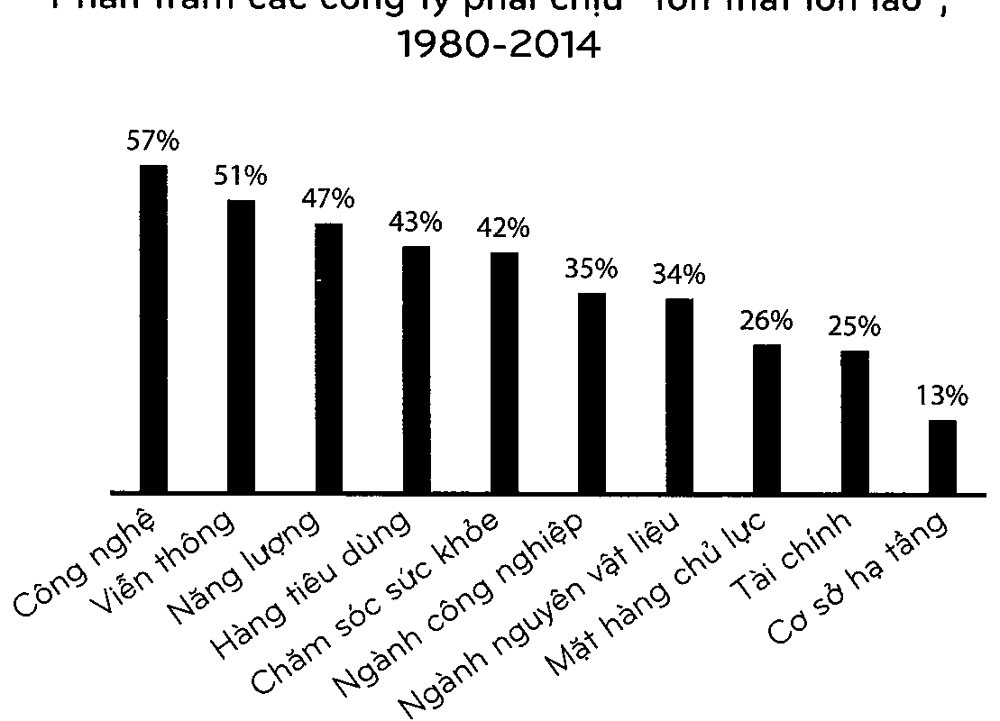

[<< Chương 05: Làm giàu và duy trì sự giàu có](05_chuong_05.md) | [Mục lục](00_muc_luc.md) | [Chương 07: Tự do >>](07_chuong_07.md)

# Chương 06: SỰ KIỆN SAU CHÓT, BẠN THẮNG RỒI

> *Bạn có thể sai lầm hết phân nửa thời gian nhưng vẫn làm nên một gia tài.*

---

“Tôi đã miệt mài với vấn để này suốt 30 năm. Tôi nghĩ bài toán đơn giản là, một vài dự án có hiệu quả và một vài thì không. Không có lý do gì phải lặp đi lặp lại bất cứ một cái nào hết. Cứ tiếp tục với dự án tiếp theo thôi”

Brad Pitt nhận Giải thưởng của Nghiệp đoàn. Diễn viên Heinz Berggruen chạy trốn khỏi Đức Quốc Xã vào năm 1936. Ông định cư ở Mỹ, nơi ông theo học ngành Văn học ở U.C. Berkeley.

Theo phần lớn thông tin có được thì ông không hề thể hiện bất cứ tiềm năng nào trong thời niên thiếu. Nhưng đến những năm 1990, Berggruen, đưới bất cứ góc độ đánh giá nào, là một trong những nhà kinh doanh các tác phẩm nghệ thuật thành công nhất mọi thời đại.

Năm 2000, Berggruen đã bán một phần trong bộ sưu tập khổng lồ của ông về Picassos, Braques, Kless, và Matisses cho chính phủ Đức với giá hơn 100 triệu euro. Đó là một giá hời đến mức phía Đức coi nó như một sự quyên góp. Giá trị của bộ sưu tập đó trên thị trường tư nhân là hơn 1 tỷ đô la.

Việc một người có thể sưu tầm được một lượng lớn những tác phẩm vĩ đại như thế thật đáng nể. Nghệ thuật trừu tượng như những gì nó thể hiện. Làm thế nào mà ai đó có thể tiên đoán trước, từ rất sớm, cái nào sẽ trở thành tác phẩm được săn lùng nhất của thế kỷ cơ chứ?

Bạn có thể nói đó là “kỹ năng”.

Bạn cũng có thể nói đó là “may mắm”.

Công ty Đầu tư Horizon Research lại có một lời giải thích thứ ba. Và nó có liên quan mật thiết tới những nhà đầu tư.

“Những nhà đầu tư vĩ đại mua rất nhiều các tác phẩm nghệ thuật”, công ty này viết. “Một phần nhỏ của bộ sưu tập sẽ biến thành khoản đầu tư lớn, và chúng được nắm giữ trong một thời gian đủ dài để lãi suất của danh mục đầu tư hội tụ trong lãi suất của những tác phẩm tuyệt vời nhất trong danh mục. Đó là tất cả những gì xảy ra.”

Những nhà kinh doanh nghệ thuật hoạt động như những quỹ đầu tư theo chỉ số. Họ mua mọi thứ có thể. Và họ mua chúng theo các danh mục, chứ không phải từng tác phẩm riêng lẻ mà họ yêu thích. Sau đó họ ngồi và chờ đợi cho một vài tác phẩm xuất chúng lộ diện.

Đó là tất cả những gì xảy ra.

Có lẽ 99% tác phẩm mà ai đó như Berggruen thu thập trong cuộc đời ông không có giá trị gì đáng kể. Nhưng điều đó không thực sự quan trọng nếu 1% còn lại là tác phẩm của một ai đó như Picasso. Berggruen có thể mắc sai lầm phần lớn thời gian nhưng vẫn hưởng kết quả đúng đắn đến ngạc nhiên.

Rất nhiều điều trong kinh doanh và đầu tư hoạt động theo cách này. Những sự kiện sau chót dài - điểm cuối xa nhất của một tập hợp các kết quả - có tác động rất lớn trong tài chính, nơi mà một lượng nhỏ các sự kiện có thể chịu trách nhiệm cho phần lớn kết quả.

Điều đó có thể không dễ đối phó, ngay cả khi bạn hiểu được thuật toán. Việc một nhà đầu tư có thể mắc sai lầm phân nửa thời gian mà vẫn kiếm được bộn tiền không thuộc về trực giác. Nó có nghĩa rằng chúng ta đã không thực sự hiểu được việc rất nhiều điều sẽ thất bại là chuyện hết sức bình thường. Điều này khiến chúng ta phản ứng thái quá khi nó xảy ra.

Tàu hơi nước Willie đã đưa tên tuổi Walt Disney lên bản đồ với tư cách là một nhà sản xuất hoạt hình. Thành công trong kinh đoanh lại là một câu chuyện khác. Xưởng phim đầu tiên của Disney bị phá sản. Những bộ phim của ông yêu cầu mức giá đắt đỏ để có thể sản xuất, cùng với những yêu cầu tài trợ hết sức lố bịch. Đến giữa thập kỷ 1930, Disney đã sản xuất hơn 400 bộ phim hoạt hình. Phần lớn trong số đó đều ngắn, phần lớn trong số đó đều được người xem yêu mến, và phần lớn trong số đó đều tiêu tốn một khoản tiền khống lồ.

Bạch Tuyết gà bảy Chú Lùn đã làm thay đổi mọi thứ.

Số tiền 8 triệu đô la nó kiếm được trong sáu tháng đầu của năm 1938 là một quy mô lớn hơn bất cứ con số nào mà công ty đã kiếm được trước đó. Nó đã làm biến đổi Xưởng phim Đisney. Toàn bộ số nợ của công ty được chỉ trả hết. Những nhân viên cốt cán được hưởng mức tiền thưởng giữ chân. Công ty mua một xưởng phim tân tiến nhất ở Burbank, nơi đến giờ vẫn còn tồn tại. Một giải thưởng Oscar biến Walt từ nối tiếng thành người của công chúng. Đến năm 1938, ông đã sản xuất vài trăm giờ phim. Nhưng theo thuật ngữ kinh doanh, 83 phút của Bạch TuỂ/ết mới là tất cả những gì quan trọng.

Bất cứ thứ gì lớn lao, mang lại lợi nhuận, nối tiếng, hoặc gây ảnh hưởng đều là kết quả của một sự kiện sau chót — một sự kiện xa xôi chỉ xuất hiện một trong hàng nghìn hoặc hàng triệu lần. Và phần lớn sự chú ý của chúng ta đều hướng đến những thứ lớn lao, mang lại lợi nhuận, nổi tiếng, hoặc gây ảnh hưởng. Khi phần lớn thứ thu hút sự chú ý của chúng ta là kết quả của một sự kiện sau chót, thật dễ để đánh giá thấp sự hiếm có và sức mạnh của chúng.

Một vài ngành công nghiệp hiển nhiên đưọc thúc đẩy bởi những sự kiện sau chót này. Lấy đầu tư mạo hiểm làm ví dụ. Nếu một công ty đầu tư mạo hiểm thực hiện 50 khoản đầu tư thì họ sẽ chuẩn bị trước tỉnh thần là một nửa trong số đó sẽ thất bại, 10 khoản sẽ mang lại kết quả khá tốt, và một hoặc hai khoản sẽ trở thành những vận may sản sinh 100% lại suất của cả quỹ. Công ty đầu tư Correlation Ventures từng tính toán nhanh những con số khổng lồ. Trong số hơn 21.000 khoản tài chính mạo hiểm từ năm 2004 đến năm 2014:

65% đánh mất toàn bộ số tiền. 2,5% các khoản đầu tư kiếm được 10x — 20x.

1% kiếm được hơn 20x lãi suất.

0,5% — khoảng 100 công ty trong số 21.000 - kiếm được 50x hoặc hơn. Đó là nơi mà phần lớn lãi suất của ngành công nghiệp sản sinh.

Điều này, bạn có thể nghĩ, là điều khiến đầu tư mạo hiểm lại rủi ro đến vậy. Và tất cả mọi người đầu tư mạo hiểm biết rằng nó rủi ro. Phần lớn các doanh nghiệp khởi nghiệp đều thất bại và thế giới chỉ đủ tốt bụng để cho phép một vài công ty đạt được những thành công lớn.

Nếu bạn muốn có những khoản lợi nhuận an toàn hơn, dễ đoán định, và ổn định hơn, bạn nên đầu tư vào các công ty công lớn. Hoặc đó là điều bạn nghĩ.

Hãy nhớ rằng, những sự kiện sau chót chỉ phối tết củ.

Sự phân bổ thành công giữ những cổ phiếu công lớn qua thời gian cũng không khác gì nhiều so với đầu tư mạo hiếm.

Phần lớn các công ty công đều không phát triển, một số ít vận hành tốt, và chỉ có một vài trở thành những nhà chiến thắng lẫy lừng chiếm phần lớn lợi nhuận của thị trường cổ phiếu.

J.P. Morgan Asset Management từng xuất bản bản phân bổ lợi nhuận dành cho Chỉ số Russell 3000 — một bộ sưu tập rộng lớn về các công ty công - kể từ năm 1980.

Bốn mươi phần trăm tất cả các thành phần chứng khoán của Russell 3000 đã đánh mất ít nhất 70% giá trị của họ và không bao giờ hồi phục được sau giai đoạn này.

Tất cả lợi nhuận tổng thể của chỉ số này đến từ 7% các công ty vượt chỉ tiêu bởi ít nhất hai độ lệch chuẩn.

Đó là điều mà đầu tư mạo hiểm sẽ mang lại. Nhưng đó lại là điều đã xảy ra bên trong một chỉ số nhàm chán, phức tạp.

Cú đánh vào phần lớn các công ty công này cũng không chừa một ngành nghề nào khác. Hơn một nửa các công ty công về công nghệ và viễn thông cũng đánh mất phần lớn giá trị của họ và không bao giờ hồi phục được. Ngay cả giữa những công ty quản lý cơ sở hạ tầng thì tỷ lệ thất bại cũng nhiều hơn 1 trong 10:

> 
>
> *Biểu đồ: Phần trăm các công ty phải chịu tổn thất lớn lao trong chỉ số Russell 3000*

1980-2014

Điều thú vị ở đây đó là bạn phải đạt được một mức độ thành công nhất định để trở thành một công ty công và một thành viên của Russell 3000. Đây là những tập đoàn được có tiếng tăm, không phải là những doanh nghiệp khởi nghiệp lươn lẹo. Ngay cả vậy, phần lớn các công ty chỉ có tuổi đời được đo đếm bằng năm, chứ không phải bằng thế hệ.

Lấy ví dụ một trong những công ty như vậy: Carolco, một cựu thành viên của chỉ số Russell 3000. Nó đã sản xuất một vài bộ phim bom tấn của những năm 1980 và 1990, bao gồm ba bộ phim Rambo đầu tiên, Terminator 2 (tạm dịch: Kẻ hủy diệt 2), Basic Instinct (tạm dịch: Bản năng gốc), và Total Recal (tạm dịch: Truy tìm Ký ức).

Carolco bắt đầu cổ phần hóa vào năm 1987. Nó là một thành công vang đội, cho ra đời hết siêu phẩm này đến siêu phẩm khác. Nó tạo ra một nửa tỷ đô la doanh thu trong năm 1991, mang lại con số vốn hóa thị trường 400 triệu đô la - một khoản tiền khống lồ vào hồi đó, đặc biệt là đối với một xưởng phim.

Và sau đó nó thất bại.

Những bộ phim bom tấn dừng lại, một vài dự án có ngân sách lớn thất bại, và đến giữa thập kỷ 1990, Carolco chỉ còn trong dĩ vãng. Nó tuyên bố phá sản vào năm 1996. Cổ phiếu trở về con số không. Một sự mất mát kinh hoàng. Và đó là một sự thất bại mà 4 trong 10 công ty công phải trải nghiệm qua thời gian. Câu chuyện của Carolco không đáng để kế không phải vì nó độc đáo, mà bởi nó quá phổ biến.

Đây là phần quan trọng nhất của câu chuyện này: Chỉ số Russell 3000 đã tăng lên hơn 73 lần kể từ năm 1980. Đó là một sự thay đối choáng ngợp. Đó là thành công.

Bốn mươi phần trăm các công ty trong chỉ số đều gặp thất bại. Nhưng 7% thành viên có hiệu suất cực kỳ ấn tượng là quá đủ để bù lại cho chỗ tổn thất. Cũng giống như Heinz Berggruen, nhưng với Microsoft và Walmart thay vì Picasso và Matisse.

Không chỉ số ít các công ty mang lại phần lớn lợi nhuận của thị trường, mà bên trong nội bộ những công ty còn xảy ra thêm nhiều sự kiện sau chót nữa.

Năm 2018, Amazon cân 6% lợi nhuận của chỉ số S&P 500. Và sự tăng trưởng của Amazon hầu như là nhờ Prime và AWS, bản thân chúng là những sự kiện sau chót trong một công ty đã thứ nghiệm với hàng trăm sản phẩm, từ điện thoại Fire Phone cho đến các đại lý du lịch.

Apple chịu trách nhiệm cho gần 7% lợi nhuận của chỉ số vào năm 2018. Và nó được thúc đẩy một cách choáng ngợp bởi iPhone, sản phẩm mang tính sự kiện sau chót nhất có thể trong thế giới công nghệ.

Và ai là người đang làm việc ở những công ty này? Tỷ lệ trúng tuyến của Google là 0,2%. Tỷ lệ của Facebook là 0,1%. Apple là khoảng 2%. Vì thế những người làm việc trong những dự án sau chót giúp sản sinh ra những lợi nhuận sau chót này sở hữu những sự nghiệp cũng mang tính sự kiện sau chót.

Ý tưởng rằng một vài điều lại chịu trách nhiệm cho phần lớn kết quả không chỉ đúng với các công ty trong danh mục đầu tư của bạn. Nó còn là một phần quan trọng trong hành vi của chính bạn với tư cách là một nhà đầu tư.

Định nghĩa của Napoleon về một nhà thiên tài quân sự là, “Người có thể làm điều bình thường khi tất cả những người xung quanh anh ta trở nên điên rồ”.

Đối với đầu tư cũng vậy.

Phần lớn các lời khuyên tài chính đều nói về ngày nay. Bạn nên làm gì ngay bây giờ, và cổ phiếu nào có vẻ là món hời ngày hôm nay?

Nhưng phần lớn thời gian ngày nay không quan trọng đến vậy. Trải qua thời gian trong cuộc đời của bạn với tư cách là một nhà đầu tư, những quyết định mà bạn đưa ra ngày hôm nay hoặc ngày mai hay tuần tiếp theo sẽ không quan trọng bằng việc bạn làm trong một số ngày nhỏ bé - khoảng 1% tống thời gian hay thậm chí ít hơn - khi tất cả những người khác xung quanh bạn trở nên điên rỒ.

Xem xét điều có thể xảy ra nếu bạn tiết kiệm 1 đô la mỗi tháng từ năm 1900 đến 2019.

Bạn có thể đầu tư 1 đô la đó vào thị trường cổ phiếu của Mỹ mỗi tháng, dù tình hình có thế nào đi chăng nữa. Dù các nhà kinh tế học đang loan tin về một cuộc suy thoái sắp tới hay một thị trường gấu mới thì cũng không quan trọng. Bạn cứ tiếp tục đầu tư. Giả sử ta gọi nhà đầu tư làm việc này là Sue.

Nhưng có thể việc đầu tư trong lúc suy thoái diễn ra là quá đáng sợ. Nên có lẽ bạn đầu tư 1 đô la của bạn vào thị trường cổ phiếu nơi mà nền kinh tế không phải chịu suy thoái, bán tất cả mọi thứ khi nó rơi vào suy thoái và giữ những đồng đô la hằng tháng ở dạng tiền mặt, và đầu tư mọi thứ trở lại vào thị trường cổ phiếu khi cuộc suy thoái kết thúc. Chúng ta sẽ gọi nhà đầu tư này là Jim.

Hoặc có lẽ cần phải mất vài tháng thì cuộc suy thoái mới khiến bạn hoảng sợ, và sau đó phải mất một thời gian nữa để bạn lấy lại sự tự tin trước khi quay trở lại thị trường. Bạn đầu tư 1 đô la vào cổ phiếu khi không có suy thoái, bán ra sáu tháng sau khi một cuộc suy thoái bắt đầu, và đầu tư lại vào sáu tháng sau đó sau khi một cuộc suy thoái kết thúc. Chúng ta sẽ gọi bạn là Tom.

Số tiền mà ba nhà đầu tư này cuối cùng có được sau một khoảng thời gian là gì?

Sue nắm trong tay 435.551 đô la.

Jim có 257.386 đô la.

Tom 234.476 đô la.

Sue đã thắng đậm.

Có 1.428 tháng giữa năm 1900 và 2019. Chỉ hơn 300 trong số đó nằm trong cuộc suy thoái. Vì thế bằng cách giữ bình tĩnh trong suốt chỉ 22% tổng thời gian nền kinh tế nằm trong hoặc gần như bị rơi vào suy thoái, Sue rốt cuộc có số tiền nhiều hơn gần ba phần tư so với Jim hoặc Tom.

Để đưa ra một ví dụ gần đây hơn: Cách bạn hành xử với tư cách là một nhà đầu tư trong vòng một vài tháng vào cuối năm 2008 và đầu 2009 sẽ mang lại nhiều tác động đến lợi nhuận trong cả quãng đời của bạn hơn mọi thứ bạn đã làm kể từ 2000 đến 2008.

Có một câu nhận xét của người phi công già về công việc của họ, đó là “hàng giờ đồng hồ nhàm chán được điểm xuyết bởi một vài giây phút sợ hãi tột độ.” Nó cũng giống với đầu tư. Sự thành công của bạn với tư cách là một nhà đầu tư sẽ được định đoạt bởi cách bạn phản ứng lại những giây phút điểm xuyết của nỗi kinh hoàng, chứ không phải là hằng năm dài kiếm soát cuộc hành trình.

Một định nghĩa hay về nhà thiên tài đầu tư đó là người có thể làm công việc bình thường khi tất cả những người khác xung quanh đều đang trở nên điên rồ.

Sự kiện sau chót thúc đẩy mọi thứ.

Khi bạn chấp nhận rằng sự kiện sau chót thúc đẩy mọi thứ trong kinh doanh, đầu tư, và tài chính thì bạn nhận ra rằng việc rất nhiều thứ có thể đi sai lệch, đổ vỡ, thất bại, và tụt đốc là chuyện bình thường.

Nếu bạn là một người lựa chọn cổ phiếu giỏi bạn sẽ có quyết định đúng đắn khoảng nửa thời gian.

Nếu bạn là một nhà lãnh đạo giỏi thì có thể phân nửa sản phẩm và ý tưởng chiến lược của bạn sẽ hiệu quả.

Nếu bạn là một nhà đầu tư giỏi thì phần lớn các năm sẽ ổn thỏa, và rất nhiều trong số đó sẽ tôi tệ.

Nếu bạn là một nhân viên giỏi thì bạn sẽ tìm được công ty phù hợp trong lĩnh vực phù hợp sau vài lần cố gắng và thử nghiệm.

Và đó là nếu bạn giỏi.

Peter Lynch là một trong những nhà đầu tư tuyệt vời nhất trong thời đại của chúng ta. “Nếu bạn xuất chúng trong ngành kinh doanh này, bạn sẽ đúng đắn sáu trên mười lân”, ông từng nói.

Có những lĩnh vực mà bạn phải hoàn hảo mọi lúc. Ví dụ như lái máy bay. Nhưng cũng có những lĩnh vực mà bạn muốn trở nên khá tốt gần như mọi lúc. Một đầu bếp nhà hàng chẳng hạn.

Đầu tư, kinh doanh, và tài chính không giống những lĩnh vực này.

Một điều mà tôi đã học được từ cả nhà đầu tư lẫn những doanh nhân đó là không ai đưa ra quyết định đúng đắn mọi lúc cả. Những người đáng nể nhất đều có đầy rẫy những ý tưởng khủng khiếp và thường thực hiện chúng.

Lấy ví dụ như Amazon. Việc nghĩ rằng sự thất bại khi ra mắt một sản phẩm ở một công ty lớn là bình thường và không vấn đề gì đi ngược lại với trực giác. Theo cảm quan, bạn sẽ nghĩ rằng vị CEO nên xin lỗi các cổ đông. Nhưng CEO Jeff Bezos chỉ nói như thế này sau sự ra mắt thảm họa của sản phẩm Fire Phone của công ty:

Nếu bạn nghĩ đó là một thất bại lớn, thì chúng tôi còn đang nghiên cứu những thất bại lớn hơn nữa ngay lúc này. Tôi không đùa đâu. Một cài dự án trong số chúng sẽ khiến Fire Phone trông chỉ như một gợn sóng lăn tăn mà thôi.

Việc Amazon đánh mất rất nhiều tiền vào Fire Phone là bình thường bởi vì nó sẽ được bù đắp lại bởi một sản phẩm nào đó như AWS đã mang lại hàng chục tỷ đô la. Sự kiện sau chót đã đến cứu nguy.

Reed Hastings, CEO Netflix, từng tuyên bố công ty của ông đang hủy bỏ một vài dự án sản xuất phim có ngân sách lớn. Ông đã nói:

Tỷ lệ thành công của chúng tôi hiện đang quá cao.

Tôi luôn thúc ã2y đội ngũ nội dung. Chúng tôi phải liều lĩnh nhiều hơn. Bạn phải thứ nhiều điều điên rồ hơn, bởi tì chúng tu nên có một tỷ lệ hủu bỏ tổng quan cao hơn.

Đây không phải là những lời hoang đường hay thất bại trong việc nhận trách nhiệm. Chúng là những sự thừa nhận thông mính về cách thúc đẩy thành công của những sự kiện sau chót. Với mỗi Amazon Prime hay Orange is the Netp Black bạn biết, chắc chắn là bạn cũng sẽ có một vài thất bại.

Một phần lý do tại sao đây không thuộc về trực giác là bởi vì phần lớn trong các lĩnh vực chúng ta chỉ nhìn thấy sản phẩm hoàn thiện, chứ không thấy những mất mát đã xảy ra để dẫn đến sản phẩm sau chót mang lại thành công.

Bộ phim Chris Rock I tôi xem trên tỉ vi rất hài hước, hoàn hảo. Nhân vật Chris Rock biểu diễn trong hàng tá những câu lạc bộ nhỏ mỗi năm thì chỉ ổn mà thôi. Đó là lẽ thường tình. Không có một thiên tài hài kịch nào đủ thông minh để biết trước được câu chuyện đùa nào sẽ khiến khán giả bật cười. Mọi diễn viên hài có tiếng đều thử nghiệm nội dung của họ ở những câu lạc bộ nhỏ trước khi sử dụng nó trong những sự kiện lớn. Rock từng được hỏi rằng liệu anh có nhớ những câu lạc bộ nhỏ hay không. Anh đã trả lời:

Khi tôi bắt đều chuyến lưu diễn, không phải là tôi bắt đâu ở những sân khấu lớn. Trước tour diễn cuối cùng nàu tôi đã biểu diễn ở một nơi tại Net Brunstoick được sọi là Stress Factoryu. lôi đã thực hiện khoảng 40 hay 50 buổi trình diễn để chuẩn bị sẵn sàng cho chuyến lưu diễn.

Một tờ báo từng miêu tả những phiên biểu diễn trong các câu lạc bộ nhỏ này.

Nó miêu tả Rock lật hết các trang giấy và ghi chú và lục tung đống tài liệu. “Tôi sẽ bỏ một vài câu nói đùa trong số này đi”, anh đã nói giữa những mẩu chuyện của mình. Những câu nói đùa hay ho mà tôi thấy trên Netflix chính là những câu nói sau chót nổi bật lên trong bầu trời vũ trụ của hàng trăm lần thử nghiệm.

Điều tương tự cũng xảy ra trong đầu tư. Thật dễ để tìm thấy giá trị ròng của Warren Buffett, hay lợi nhuận trung bình hằng năm của ông. Hay thậm chí là những khoán đầu tư tài tình, đáng chú ý nhất của ông. Chúng nằm ngay trước mắt, và chúng là những gì mọi người thường nhắc đến.

Việc kết nối mọi khoản đầu tư mà ông đã thực hiện trong suốt sự nghiệp là điều khó khăn hơn. Không ai nói về những lần chọn lựa sai lầm, những việc kinh doanh trở nên xấu xí, những vụ thâu tóm thất bại cả. Nhưng chúng là một phần lớn trong câu chuyện của Buffettt. Chúng là mặt còn lại của khoán lợi nhuận được thúc đẩy bởi những lựa chọn sau chót.

Ở cuộc họp cổ đông của Berkshire Hathaway vào năm 2013, Warren Buífet đã nói ông sở hữu 400 đến 500 cổ phiếu trong suốt cuộc đời và kiếm được phần lớn số tiền nhờ 10 loại trong số đó. Charlie Munger đã nói tiếp: “Nếu bạn loại bỏ chỉ một vài khoản đầu tư đứng đầu của Berkshire, thì hồ sơ theo dõi dài hạn của nó cũng khá là bình thường mà thôi.”

* * *

Khi chúng ta để ý đặc biệt đến sự thành công của một hình mẫu nào đó, chúng ta thường không thấy được rằng những lần thắng lớn của họ đến từ một phần trăm nhỏ của hành động họ thực hiện. Điều đó khiến những thất bại, thua lỗ, và bước thụt lùi của chúng ta có cảm giác chúng ta đang làm sai.

Nhưng rất có thể chúng ta sai, hoặc chỉ khá đúng, cũng thường xuyên như những bậc thầy này vậy. Có thể cái đúng của họ to tát hơn khi họ đúng, nhưng họ cũng có thể sai lầm thường xuyên như bạn vậy.

“Việc quan trọng không phải là bạn đúng hay sai“, George Soros từng nói, “mà quan trọng là bạn kiếm được bao nhiêu tiền khi đúng và để mất bao nhiêu khi sai.” Bạn có thể mắc sai lầm phân nửa thời gian mà vẫn kiếm được bộn tiền.

Có 100 tỷ hành tỉnh trong vũ trụ của chúng ta và chỉ có một, theo như những gì ta biết, chứa đựng sự sống thông minh.

Việc bạn đang đọc cuốn sách này là kết quả của sự kiện sau chót dài nhất mà bạn có thể tưởng tượng.

Bạn nên thấy vui với điều này. Tiếp theo, hãy xem số tiền lớn như nào mới có thể khiến bạn hạnh phúc hơn.

---

[<< Chương 05: Làm giàu và duy trì sự giàu có](05_chuong_05.md) | [Mục lục](00_muc_luc.md) | [Chương 07: Tự do >>](07_chuong_07.md)
