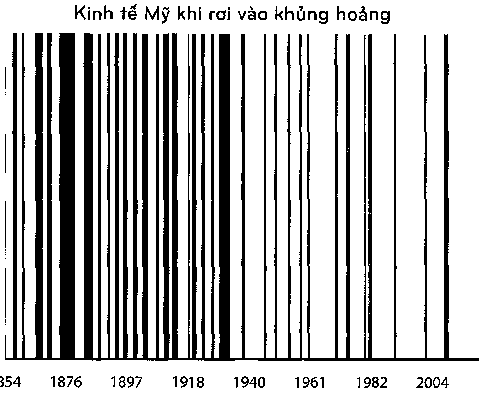

[<< Chương 11: Hợp lý >< Có lý](11_chuong_11.md) | [Mục lục](00_muc_luc.md) | [Chương 13: Chừa chỗ cho sai lầm >>](13_chuong_13.md)

# Chương 12: NGẠC NHIÊN CHƯA!

> *Lịch sử nghiên cứu sự thay đổi, éo le thay lại được dùng như tấm bản đồ định hướng tương lai.*

---

Giáo sư trường Stanford, Scott Sagan, từng nói một điều mà bất cứ ai theo dõi nền kinh tế hay các thị trường đầu tư đều nên treo trên tường của họ: “Những điều chưa từng xảy ra bao giờ vân xây ra thường xuyên.”

Lịch sử phần lớn là những nghiên cứu về các sự kiện bất ngờ. Nhưng nó thường được sử dụng bởi các nhà đầu tư và kinh tế học như một bản hướng dẫn không thể chính xác hơn cho tương lai.

Bạn có nhìn thấy sự trớ trêu ở đây không? Bạn có nhìn thấy vấn đề ở đây không?

Việc trân trọng lịch sử kinh tế và đầu tư là một điều thông minh. Lịch sử giúp chúng ta đo đếm được những trông đợi của bản thân, nghiên cứu xem mọi người thường hay mắc sai lầm ở đâu, và cung cấp một bản hướng dẫn sơ lược những hành động thường mang lại hiệu quả. Nhưng nó không phải, trong bất cứ tình huống nào, là một tấm bản đồ của tương lai.

Tôi gọi cái bẫy mà rất nhiều nhà đầu tư rơi vào là khái niệm sai lầm mang tên “nhà sử học làm tiên tri“: Sự phụ thuộc quá đà coi các dữ liệu quá khứ như một tín hiệu cho tình trạng tương lai trong một lĩnh vực mà sự cải tiến và thay đổi đóng vai trò huyết mạch cho quá trình tiến triển.

Bạn không thể đổ lỗi cho các nhà đầu tư vì làm điều này. Nếu bạn nhìn nhận việc đầu tư như một bộ môn khoa học khó nhằn, thì lịch sử xứng đáng là một bản hướng dẫn hoàn hảo cho tương lai. Những nhà địa chất học có thể nhìn vào hàng tỷ năm dữ liệu lịch sử và cấu thành những mô hình về cách hành xử của Trái đất. Các nhà khí tượng học cũng thế. Và các bác sĩ - tiến hành phẫu thuật thận vào năm 2020 với cách thức y hệt năm 1020.

Nhưng đầu tư không phải là một bộ môn khoa học khó nhằn. Nó là một nhóm lớn những người đưa ra các quyết định không hoàn hảo với lượng thông tin có hạn về những điều sẽ có tác động lớn lên sự phát triển toàn diện của họ, điều này khiến cả những người thông minh cũng phải lo lắng, tham lam và hoang tưởng.

Richard Feynman, nhà vật lý học đại tài, từng nói, “Hãy tưởng tượng vật lý học sẽ còn khó nhằn hơn đến thế nào nếu các hạt electron có cảm xúc”. Chà, các nhà đầu tư thì có cảm xúc. Một số lượng kha khá trong số họ. Đó là lý do tại sao thật khó để dự đoán được điều họ sẽ làm tiếp theo nếu chỉ dựa trên điều mà họ đã làm trong quá khứ.

Điều mấu chốt của kinh tế học đó là mọi thứ thay đối theo thời gian, bởi vì bàn tay vô hình ghét bất cứ điều gì quá tốt hoặc quá xấu kéo dài quá lâu. Nhà đầu tư Bill Bonner từng miêu tả cách mà Ngài Thị Trường hoạt động: “Anh ta mặc một chiếc áo phông in chữ “Chế độ tư bản đang hoạt động” và một chiếc búa tạ trong tay.” Rất ít thứ duy trì trạng thái quá lâu, điều này có nghĩa là chúng ta không thể coi những nhà sử học như nhà tiên tri được.

Yếu tố quan trọng nhất thúc đẩy bất cứ điều gì gắn liền với đồng tiền chính là những câu chuyện mà mọi người thường tự kể và những mối ưu tiên của họ dành cho các sản phẩm và dịch vụ. Những thứ đó thường không đứng yên. Chúng thay đối theo văn hóa và thế hệ. Chúng luôn luôn thay đối và sẽ luôn như vậy.

Cú lừa tâm lý mà chúng ta tự làm với chính bản thân mình ở đây đó là sự ngưỡng mộ quá mức những ai đã từng ở chỗ này chỗ kia, từng trải qua việc này việc kia khi liên quan đến tiền bạc. Trải nghiệm những sự kiện cụ thể không nhất thiết chứng tỏ bạn đủ trình độ để biết điều gì sẽ xảy ra tiếp theo. Trên thực tế nó hiếm khi nào xảy ra, bởi vì trải nghiệm dẫn tới sự tự tin thái quá hơn là khả năng tiên đoán.

Nhà đầu tư Michael Batnick từng giải thích điều này rất rõ ràng. Bị đối chất với luận điểm rằng rất ít nhà đầu tư đang chuẩn bị đối phó với tỷ lệ lãi suất tăng lên bởi vì họ chưa bao giờ trải nghiệm điều này - giai đoạn gia tăng tỷ lệ lãi suất lớn gần nhất xảy ra cách đây gần 40 năm - ông tranh luận rằng điều đó không quan trọng, bởi vì trải nghiệm hay thậm chí là nghiên cứu điều gì đã xảy ra trong quá khứ không thể đóng vai trò hướng dẫn gì được cho những điều sẽ xảy ra khi tỷ lệ gia tăng trong tương lai:

Vậy đã sao nào? Liệu sự tăng uọt của tỷ lệ hiện tại sẽ hoạt động giống lần trước đó, hau lầm trước đó nữa? Liệu các loại tài sản khác nhau sẽ hoạt động giỡng nhau, tương tự, hau hoàn toàn đối lập?

Một mặt, những người đã uà đang đầu tư qua các sự kiện năm 1987, 2000 cà 2008 đã trải nghiệm rất nhiều thị trường khác nhau. Mặt khác, không phải trải nghiệm này rất có thể dẫn tới sự tự tín thái quá hau sao? Không thừa nhận rằng bạn đũ sai? Có xu hướng lặp lại kết quả đã có trước đó?

Hai điều nguy hiếm xảy ra khi bạn coi lịch sử đầu tư như một bản hướng dẫn cho những gì sắp xảy Ta.

1. Bạn dễ dàng để lỡ những sự kiện bên lề nhưng lại có tác động dịch chuyển cán cân nhiều nhất.

Những sự kiện quan trọng nhất trong dữ liệu lịch sử là những trường hợp ngoại lệ lớn, những sự kiện phá vỡ kỷ lục. Chúng chính là những sự kiện làm thay đối cán cân trong nên kinh tế và thị trường cổ phiếu. Cuộc Đại suy thoái. Chiến tranh Thế giới thứ II. Bong bóng dot-com. Ngày 11 tháng Chín. Sự sụp đổ của ngành bất động sản vào giữa năm 2000. Một vài sự kiện ngoại lệ lại đóng vai trò rất lớn bởi vì chúng ảnh hưởng đến rất nhiều sự kiện không liên quan khác khi chúng xảy ra.

Mười lăm tỷ người được sinh ra vào thế kỷ 19 và 20. Nhưng hãy thứ tưởng tượng sự khác biệt của nền kinh tế thế giới - và toàn bộ thế giới - ngày nay nếu có bảy người trong số đó chưa bao giờ được tôn tại: » Adolf Hitler » TJosif Vissarionovich Stalin » Mao Trạch Đông » Gavrilo Primcgp » Thomas Edison » Bill Gates » Marun Luther King Tôi thậm chí còn không chắc chắn rằng đây đã là danh sách quan trọng nhất. Nhưng hầu như mọi thứ trên thế giới ngày nay - từ những đường biên giới cho đến công nghệ và những quy tắc trong xã hội - đều sẽ khác biệt nếu bảy con người này đã không để lại dấu ấn của họ. Một cách khác để miêu tả điều này đó là 0,00000000004% tổng số người chịu trách nhiệm cho đại đa số các hướng phát triển của thế giới trong thế kỷ qua.

Điều tương tự cũng xảy ra với những dự án, sự đổi mới, và sự kiện. Hãy tưởng tượng thế kỷ vừa qua trôi đi mà không có:

» Cuộc Đại suy thoái

» Chiến tranh Thế giới thứ II

» Dựán Manhattan

» Vắcxin

» Kháng sinh

» ARPANET

» Ngày 11 tháng Chín

» Sự sụp đổ của Cộng hòa Liên bang Xô viết Có bao nhiêu dự án và sự kiện xảy ra trong thế kỷ 20? Hàng tỷ, hàng nghìn tỷ - ai mà biết hết được. Nhưng chỉ riêng tám sự kiện trên thôi cũng đã tác động đến trật tự thế giới hơn những sự kiện khác hàng trăm lần.

Điều khiến những sự kiện sau chót thường bị thiếu trân trọng đó là sự dễ dàng trong việc đánh giá thấp cách tích lũy của mọi vật. Cách mà, ví dụ, ngày 11 tháng Chín đã khiến Cục Dự trữ Liên bang Hoa Kỳ cắt giảm tỷ lệ lãi suất, điều này ảnh hưởng đến bong bóng nhà đất, từ đó dẫn đến sự khủng hoảng tài chính, kéo theo là sự hiu hắt của thị trường việc làm, khiến hàng chục triệu người tìm kiếm tấm bằng đại học, dẫn tới 1,6 nghìn tỷ đô la trong khoản nợ sinh viên với một tỷ lệ lãi suất mặc định 10,8%. Việc kết nối 19 tên không tặc với sức nặng hiện tại của các khoản vay sinh viên là không phù hợp với trực giác, nhưng đó là điều xảy ra trong một thế giới bị thúc đấy bởi một vài sự kiện sau chót ngoại lệ.

Đại đa số những gì đang xảy ra ở bất cứ khoảnh khắc nào trong nền kinh tế toàn cầu đều có thể được kết nối với một vài sự kiện trong quá khứ mà chúng ta gần như không thể đự đoán được.

Cốt truyện phổ biến nhất của lịch sử kinh tế là vai trò của những sự bất ngờ. Lý do những bất ngờ xây ra không phải vì những mô hình của chúng ta đã sai hay trí tuệ của chúng ta còn thấp. Nó là vì tỷ lệ mà bố mẹ của Adolf Hitler tranh cãi vào một buổi chiều tối chín tháng trước khi ông ta ra đời cũng đồng nhất với việc họ thụ thai một đứa trẻ. Công nghệ thật khó để đoán định bởi vì Bil] Gates có thể đã chết vì bệnh bại liệt nếu Jonas Salk trở nên cáu bắn và từ bỏ công cuộc tìm kiếm vắc xin của ông. Lý do chúng ta không thể dự đoán được mức tăng trưởng của các khoản vay sinh viên đó là bởi một nhân viên bảo vệ sân bay đã có thể tịch thu một con dao của tên không tặc vào ngày 11 tháng Chín. Đó là tất cả những gì có thể.

Vấn đề ở đây là chúng ta thường sử dụng những sự kiện như cuộc Đại suy thoái và Chiến tranh Thế giới thứ II để định hướng cách nhìn nhận của chúng ta về mọi vật giống như những kịch bản tôi tệ nhất khi suy nghĩ về những khoản lợi nhuận đầu tư trong tương lai. Nhưng những sự kiện thiết lập kỷ lục đó không hề có tiền lệ khi chúng xảy ra. Vì thế những người tiên đoán cho rằng những sự kiện tồi tệ nhất (và tốt nhất) của quá khứ sẽ khớp với những sự kiện tồi tệ nhất (và tốt nhất) của tương lai là đang không theo đõi lịch sử; họ vô tình giả định rằng lịch sử của những sự kiện chưa từng có tiền lệ không áp dụng cho tương lai.

Nassim Taleb đã viết trong cuốn sách Fooled Bụ Randommess (tạm dịch: Trò đùa của sự ngẫu nhiên) như sau:

Trong thời Pharaon Ai Cập... những người có vai trò ghi chép đã theo dõi các mực nước cao của sông Nile và sử dụng nó như một cách ước lượng cho những trường hợp tồi tệ nhất của tương lai. Điều tương tự có thể được nhìn thấy ở lò phản ứng hạt nhân Fukushima, nơi đã trải qua một sự cố thảm họa vào năm 2011 khi trận sóng thần ập đến. Nó đã được xây dựng để chống chọi với những đợt động đất tồi tệ nhất trong quá khứ, và các nhà xây dựng không tưởng tượng gì tồi tệ hơn thế — cũng không nghĩ rằng sự kiện tồi tệ nhất trong quá khứ là một điều bất ngờ, vì nó chưa từng có tiền lệ.

Đây không phải là sự thất bại của việc phân tích. Nó là sự thất bại của trí tưởng tượng. Nhận ra rằng tương lai có lẽ không giống như bất cứ thứ gì trong quá khứ là một loại kỹ năng đặc biệt mà thường không được đánh giá cao bởi các cộng đồng dự đoán tài chính.

Vào một bữa tối năm 2017 mà tôi đã tham gia ở New York, Đaniel Kahneman được hỏi rằng các nhà đầu tư nên phản ứng như thế nào khi những dự đoán của chúng ta không chính xác. Ông đã nói:

Bất cứ khi nào chúng ta bị bất ngờ bởi điều gì đó, ngay củ khi chúng ta thừa nhận rằng chúng ta đã mắc phải sai lầm, chúng ta đều nói “Ôi, tôi sẽ không bao giờ mắc lại sai lầm đó nữa.” Nhưng, trên thực tế; điều bạn nên học được khi bạn mắc phải một sai âm bởi bạn đã không lường trước được điều gì đó đó là thể giới rất khó để đoán định. Đó là bài học đúng đắn cần được học hỏi từ những sự bất ngờ: rằng th giới đây rẫu sự ngục nhiên.

Bài học đúng đắn cần rút ra từ những sự kiện bất ngờ đó là thế giới đầy rẫy những sự ngạc nhiên. Không phải rằng chúng ta nên sử dụng những sự bất ngờ trong quá khứ như bản hướng dẫn cho những giới hạn tương lai; mà chúng ta nên sử dụng những sự bất ngờ trong quá khứ như một sự thừa nhận rằng chúng ta không hề biết điều gì sẽ xảy ra tiếp theo.

Những sự kiện kinh tế quan trọng nhất của tương lai - những điều làm dịch chuyển cán cân nhiều nhất - là những điều mà lịch sử không có hướng dẫn cho chúng ta. Chúng sẽ là những sự kiện chưa từng có tiền lệ. Bản chất không tiền lệ của chúng có nghĩa là chúng ta sẽ không thể chuẩn bị sẵn sàng cho chúng được, đó là một phần lý do khiến chúng lại có tác động lớn lao đến vậy. Điều này chính xác cho cả những sự kiện đáng sợ như những cuộc suy thoái và chiến tranh, lẫn những sự kiện tuyệt vời như công cuộc đối mới.

Tôi rất tự tin với tiên đoán này bởi vì những bất ngờ dịch chuyển cán cân nhiều nhất là sự tiên đoán chính xác ở hầu hết mọi thời điểm trong lịch sử.

2. Lịch sử có thể là bản hướng dẫn sai lệch cho tương lai của nền kinh tế và thị trường cổ phiếu bởi vì nó không xét đến những sự thay đối trong cấu trúc thường xảy ra ở thế giới ngày nay.

Hãy xem xét một vài ví dụ lớn.

Kế hoạch 401(k) hiện 42 tuổi. Tài khoản Roth IRA trẻ hơn, được tạo ra vào những năm 1990. Vì thế lời khuyên và những phân tích trong lĩnh vực tài chính cá nhân về cách người Mỹ tiết kiệm cho lúc nghỉ hưu ngày nay không hoàn toàn so sánh được với những gì từng đúng đắn vào một thế hệ trước. Chúng ta có những lựa chọn mới. Mọi thứ đã thay đổi.

Hay như đầu tư mạo hiểm chẳng hạn. Nó hầu như không tồn tại vào 25 năm trước. Có những quỹ đầu tư mạo hiểm ngày nay còn lớn hơn toàn bộ ngành công nghiệp của một thế hệ trước đó. Trong bản hồi ký của ông, nhà sáng lập Nike Phi] Knight đã viết về những ngày đầu kinh doanh của ông như sau:

Không có thứ gọi là liều tự mạo hiểm. Một doanh nhân trẻ đầy tham vọng có rất ít chỗ để tìm đến, và những chỗ đó đều được canh gác bởi những người gác cổng không thích mạo hiểm cùng trí tưởng tượng bằng không. Nói theo một cách khác, đó là những nhân viên ngân hàng.

Điều này có nghĩa là, tất cả những dữ liệu lịch sử của một vài thập kỷ trước phản ánh cách các doanh nghiệp khởi nghiệp được trợ tiền giờ đã lỗi thời rồi. Những gì mà chúng ta biết về các vòng tuần hoàn đầu tư và tỷ lệ thất bại khởi nghiệp không phải là một nền tảng lịch sử sâu rộng để có thể học hỏi, bởi vì cách mà các công ty được tài trợ ngày nay lại là một mô hình mang tính lịch sử mới.

Hoặc như các thị trường công. Chỉ số S&P 500 đã không bao gồm các cổ phiếu tài chính cho đến năm 1976; ngày nay, chúng chiếm 16% của bảng chỉ số này. Cổ phiếu công nghệ hầu như không hề tồn tại cách đây 50 năm. Ngày nay, chúng chiếm hơn một phần năm chỉ số. Quy tắc kế toán cũng đã thay đối qua thời gian. Nguyên tắc trọng yếu, kiểm toán, và số lượng thanh khoản thị trường cũng vậy. Mọi thứ đã thay đối.

Quãng thời gian giữa những cuộc khủng hoảng của Mỹ đã thay đối chóng mặt trong vòng 150 năm qua:

Quãng thời gian trung bình giữa các cuộc khủng hoảng đã tăng lên từ 2 năm trong những năm cuối thập kỷ 1800 đến 5 năm vào đầu thế kỷ 20 và 8 năm trong vòng nửa thế kỷ qua.

> 
>
> *Biểu đồ: Kinh tế Mỹ khi rơi vào khủng hoảng (1854 – 2004)*

Trong lúc tôi viết điều này thì đã được 12 năm kể từ cuộc khủng hoảng gần nhất bắt đầu vào tháng Mười Hai năm 2007. Đây là khoảng thời gian dài nhất chúng ta đã trải qua mà không thấy sự bắt đầu của một cuộc khủng hoảng mới kể từ trước Cuộc Nội Chiến.

Có rất nhiều giả thuyết cho lý do ít thường xuyên xuất hiện hơn của những cuộc khủng hoảng. Một lý do đó là Cục Dự trữ Liên bang Hoa Kỳ đã quản lý vòng tuần hoàn kinh doanh tốt hơn, hoặc ít nhất là biết cách kéo đài nó. Một lý do khác đó là ngành công nghiệp nặng dễ gặp tình trạng bùng nổ sản xuất dẫn tới phá sản hơn là các ngành dịch vụ đã thống trị trong 50 năm qua. Cái nhìn bi quan ở đây là chúng ta giờ gặp ít khủng hoảng hơn, nhưng khi chúng xảy ra thì chúng lại có sức mạnh to lớn hơn trước. Đối với bối cảnh tranh luận của chúng ta hiện giờ thì nguyên nhân gây ra sự thay đổi này là gì không thực sự quan trọng. Điều quan trọng là mọi việc rõ ràng có thay đổi.

Để chỉ ra được cách mà những sự thay đổi mang tính lịch sử này đã tác động lên những quyết định đầu tư ra sao, hãy xem xét tác phẩm của người đàn ông mà rất nhiều người coi là một trong những đầu óc đầu tư vĩ đại nhất của mọi thời đại: Benjamin Graham.

Cuốn sách kinh điển của Graham, The Intellisent Inroestor (tạm dịch: Nhà đầu tư thông minh), còn hơn là một giả thuyết. Nó đưa ra những hướng đi thiết thực như những công thức mà các nhà đầu tư có thể sử dụng để đưa ra những quyết định đầu tư thông minh.

Tôi đã đọc cuốn sách của Graham khi tôi còn trong độ tuổi thanh thiếu niên, tìm hiểu về đầu tư lần đầu tiên. Những công thức đưa ra trong cuốn sách rất hấp dẫn đối với tôi, bởi vì chúng là những hướng dẫn làm giàu từng bước một. Chỉ cần làm theo hướng dẫn. Nó có vẻ thật dễ dàng.

Nhưng một điều trở nên rõ ràng khi bạn cố gắng áp dụng một vài công thức trong số này: rất ít công thức thực sự hiệu quả.

Graham ủng hộ việc mua bán các cổ phiếu với mức giá thấp hơn giá trị ròng của các tài sản hiện có của họ - cơ bản là số tiền mặt trong ngân hàng trừ đi mọi khoản nợ. Điều này nghe có vẻ rất tuyệt, nhưng rất ít cổ phiếu thực sự giao dịch ở mức giá rẻ như thế - ngoại trừ, cổ phiếu của công ty nhỏ bị buộc tội gian lận trong khâu kế toán.

Một trong những tiêu chí của Graham hướng dẫn các nhà đầu tư bảo thủ nên tránh giao dịch cổ phiếu nhiều hơn 1,5 lần giá trị sổ sách. Nếu bạn làm theo quy tắc này trong vòng một thập kỷ qua thì bạn sẽ gần như không sở hữu được thứ gì cả ngoài bảo hiểm và các cổ phiếu ngân hàng. Không có nơi nào mà điều này lại là ổn cả.

Nhà đầu tư thông minh là một trong những cuốn sách đầu tư vĩ đại nhất mọi thời đại. Nhưng tôi không biết bất cứ một nhà đầu tư nào triển khai các công thức được xuất bản của Graham và nhận được kết quả tốt cả. Cuốn sách tràn trề sự uyên bác — có lẽ nhiều hơn bất cứ cuốn sách đầu tư nào từng được xuất bản. Nhưng với tư cách là một cuốn sách hướng dẫn, nó đầy điểm hoài nghĩ.

Điều gì đã xảy ra? Có phải Graham chỉ là một người trình diễn nghe thì có vẻ hay nhưng thực chất những lời khuyên của ông lại không hiệu quả hay không? Không hề. Bản thân ông thực sự là một nhà đầu tư cực kỳ thành công.

Nhưng ông cũng rất thực tế. Và ông là một người đi ngược lại với ý kiến số đông. Ông không quá tin vào những ý tưởng đầu tư đến mức gắn bó với chúng khi quá nhiều nhà đầu tư làm theo những giả thuyết đó, khiến cho chúng trở nên quá thịnh hành đến nỗi tiềm năng của chúng trở thành vô dụng. Jason Zweig — người đã chú thích phiên bản sau này của cuốn sách của Graham ~ từng viết:

Graham không ngừng thử nghiệm oà kiểm tra lại những giả định của ông đồng thời tìm kiếm điều gì thực sự có hiệu quả — không phải là điều đã hiệu quả gào ngày hôm qua mà là ngày hôm nau. Trong từng ấn bản sửa đổi của cuốn “Nhà đầu tư thông minh”, Graham đã loại bỏ những công thức mà ông giới thiệu trong những ấn bản trước đó uà thau thế chúng bằng những công thức tới, tuyên bố rằng “những công thức kia không còn hiệu quả nta, hoặc chúng không còn mang lại nhiều kết quả tốt như trước nữa; đây là những công thức có uê hoạt động tốt hơn ở hiện tại.”

Một trong những lời phê bình phổ biến với Graham đó là tất cả những công thức trong ấn bản năm 1972 đều đã lỗi thời. Lời đáp thích hợp duy nhất cho sự phê bình này đó là: “Tất nhiên rồi! Chúng là những công thức mà ông đã sử dụng để thay thế cho ấn bản năm 1965, và những công thức này lại thay thế cho ấn bản 1954, và ấn bản 1954 lại thay thế cho ấn bản 1949, mà những công thức năm 1949 đó lại được dùng để bổ sung cho những công thức nguyên gốc được Ông giới thiệu trong cuốn “Security Analysis” (tạm dịch: Phân tích bảo mật) năm 1934.”

Graham qua đời vào năm 1976. Nếu các công thức ông ủng hộ đã bị loại bỏ và cải tiến năm Tần từ năm 1934 đến 1972, thì bạn nghĩ chúng còn có hiệu lực đến đâu vào năm 2020? Hay sẽ như thế nào vào năm 2050?

Ngay trước khi mất Graham đã được hỏi liệu những phân tích chỉ tiết về các cổ phiếu cá nhân — một chiến thuật khiến ông trở nên nổi tiếng - có còn là chiến lược ông yêu thích hay không. Ông đã trả lời: Nhìn chung thì không. Tôi không còn ủng hộ cho những kỹ thuật phân tích bảo mật phức tạp chỉ để tìm kiếm những cơ hội mang giá trị lớn nữa. Đây là một hoạt động có hiệu quả, khoảng 40 năm trước, khi cuốn sách của chúng tôi mới được xuất bản lần đầu. Nhưng tình hình đã thay đối rất nhiều kể từ đó.

Điều đã thay đối đó là: Cạnh tranh tăng lên khi các cơ hội trở nên phổ biến; công nghệ khiến thông tin dễ dàng được tiếp cận hơn; và các ngành công nghiệp thay đổi khi nền kinh tế chuyến dịch từ công nghiệp sang các lĩnh vực công nghệ, với các vòng đời kinh doanh và việc sử dụng vốn khác biệt.

Mọi thứ thay đối.

Một đặc điểm thú vị của lịch sử đầu tư đó là bạn càng tìm hiểu sâu xa, càng có cơ hội bạn đang xem xét một thế giới không còn áp dụng được ngày hôm nay nữa. Rất nhiều nhà đầu tư và kinh tế học cảm thấy thoải mái khi biết rằng những tiên đoán của họ được hỗ trợ bởi dữ liệu của hàng thập kỷ, thậm chí là hàng thế kỷ. Nhưng vì nền kinh tế biến đổi, lịch sử gần đây thường là bản hướng dẫn tuyệt vời nhất cho tương lai, bởi vì nó đễ bao gồm những điều kiện quan trọng có liên quan đến tương lai hơn.

Có một câu nói phổ biến trong đầu tư, thường được sử dụng một cách chế giễu, đó là “Lần này thì khác.” Nếu bạn cần bác bỏ ai đó đang dự đoán rằng tương lai sẽ không lặp lại như trong quá khứ, hãy nói, “Ồ, vậy bạn nghĩ rằng lần này sẽ khác ư?” và ngừng ở đó. Nó xuất phát từ cái nhìn của nhà đầu tư John Templeton rằng “Bốn từ nguy hiểm nhất trong đầu tư là “lần này thì khác.”

Mặc dù vậy, Templeton thừa nhận rằng nó thực sự khác biệt ít nhất đến 20%. Thế giới thay đối. Tất nhiên rồi. Và những thay đổi đó mới là điều quan trọng nhất qua thời gian. Michael Bamick đã nói: “Mười hai từ nguy hiểm nhất trong đầu tư là, Bốn từ nguy hiểm nhất trong đầu tư là, Tân này thì khác”

Điều đó không có nghĩa là chúng ta nên coi thường lịch sử khi nghĩ về tiền bạc. Nhưng có một điều quan trọng: Bạn càng nhìn sâu xa vào lịch sử, bài học bạn rút ra càng nên tổng quát hơn. Những điều tổng quát như mối quan hệ của mọi người với sự tham lam và nỗi sợ hãi, cách mà họ hành xử khi chịu đựng áp lực, và cách họ phản ứng với những khoản tiền có xu hướng ổn định theo thời gian. Lịch sử tiền tệ chỉ hữu dụng cho những điều như thế.

Nhưng những xu hướng cụ thể, những giao dịch nhất định, những phân khúc, những mối quan hệ nhân quả về các thị trường cụ thế, và điều mọi người nên làm với tiền bạc của họ luôn là một ví dụ của quá trình phát triển. Những nhà sử học không phải là những nhà tiên tri.

Câu hỏi ở đây, đó là, chúng ta nên suy nghĩ ra sao và lên kế hoạch cho tương lai như thế nào? Hãy xem chương tiếp theo nhé.

---

[<< Chương 11: Hợp lý >< Có lý](11_chuong_11.md) | [Mục lục](00_muc_luc.md) | [Chương 13: Chừa chỗ cho sai lầm >>](13_chuong_13.md)
