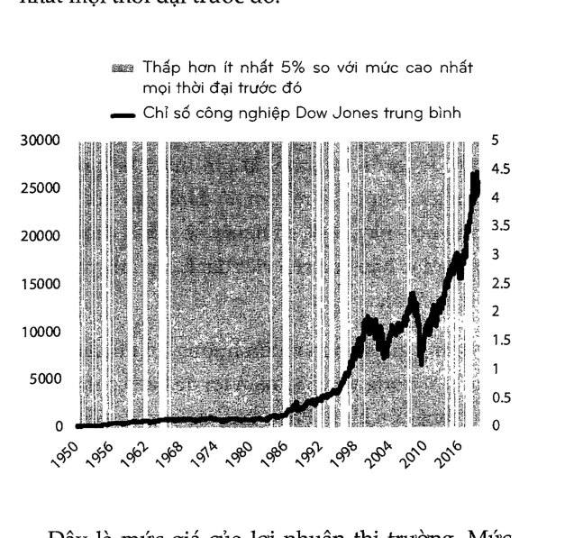

[<< Chương 14: Rồi bạn sẽ khác](14_chuong_14.md) | [Mục lục](00_muc_luc.md) | [Chương 16: Bạn & Tôi >>](16_chuong_16.md)

# Chương 15: KHÔNG CÓ GÌ LÀ MIỄN PHÍ

> *Mọi thứ đều có giá của nó, nhưng không phải cái giá nào cũng xuất hiện trên các nhãn mác.*

---

Mọi thứ đều có giá của nó, và chìa khóa tiếp cận rất nhiều thứ liên quan đến tiền là tìm cho ra mức giá của nó và sẵn sàng chi trả.

Vấn đề ở đây đó là giá cả của rất nhiều thứ không hề hiển hiện cho đến khi bạn đã trải nghiệm chúng trực tiếp, khi hóa đơn đã quá hạn.

General Electric là công ty lớn nhất trên thế giới vào năm 2004, có giá trị một phần ba nghìn tỷ đô la. Nó đã đứng vị trí hoặc thứ nhất hoặc thứ hai vào từng năm của thập kỷ trước, là ví dụ tỏa sáng của chủ nghĩa tư bản về quý tộc doanh nghiệp.

Sau đó mọi thứ tan vỡ thành từng mảnh.

Cuộc khủng hoảng tài chính năm 2008 khiến bộ phận tài chính của GE - nơi cung cấp hơn một nửa lợi nhuận của công ty - rơi vào hỗn loạn. Cuối cùng nó bị bán đi. Những vụ cá cược sau đó vào đầu mỏ và năng lượng cũng trở thành thảm họa, khiến cho hàng tỷ đô la không bao giờ lấy lại được. Giá cổ phiếu GE rơi từ 40 đô la năm 2007 xuống 7 đô la năm 2018.

Mọi tội lỗi bị đổ lên đầu CEO Jeff Inmelt — người điều hành công ty kể từ năm 2001 - đến ngay lập tức và rất khắc nghiệt. Ông bị chỉ trích về cách lãnh đạo, những vụ thu mua, cắt giảm cổ tức, sa thải nhân viên và - tất nhiên - sự tụt đốc của giá cổ phiếu. Điều này là dễ hiểu: những ai hưởng của cải của cả triều đại khi thịnh vượng thì cũng phải gánh những trọng tránh khi nước triều rút xuống. Ông đã từ chức vào năm 2017.

Nhưng Immelt đã nói một điều rất có ý nghĩa khi ra đi.

Trả lời trước những chỉ trích nói rằng những hành động của ông là sai trái và điêu mà ông nên làm là hiến nhiên, Immelt nói với người kế nhiệm của mình, “Mọi công việc đều trông dễ dàng khi bạn không phải là người thực hiện nó”.

Mọi công việc đều trông dễ dàng khi bạn không phải là người thực hiện nó bởi vì những thách thức mà người trong đấu trường phải đối mặt thường vô hình đối với những người đứng trong đám đông.

Đối phó với những yêu cầu trái ngược đến từ việc tuyển dụng thừa mứa, các nhà đầu tư ngắn hạn, các cơ quan quản lý, các hiệp hội, và sự quan liêu cố thủ không chỉ khiến công việc trở nên khó khăn, mà nó còn khó để nhận ra được sự nghiêm trọng của vấn đề cho đến khi bạn là người đối phó với chúng. Người kế nhiệm của Immelt, trụ lại được công ty trong 14 tháng, đã học được rất rõ bài học này.

Phần lớn mọi thứ đều khó khăn khi thực hành hơn là trên lý thuyết. Đôi khi điều này là bởi chúng ta quá tự tin. Thường thì là bởi chúng ta không giỏi trong việc xác định được mức giá của thành công, điều này ngăn cản khả năng chúng ta chỉ trả được cho nó.

Chỉ số S&P 500 tăng 119 lần trong vòng 50 năm kết thúc vào 2018. Tất cả những gì bạn cần làm là ngồi đó và để cho tiền của bạn tự nhân lên. Nhưng, tất nhiên, việc đầu tư thành công trông thật đễ dàng khi bạn không phải là người thực hiện nó.

“Giữ cổ phiếu trong thời gian dài,” bạn nghe nói. Đó là một lời khuyên tốt.

Nhưng bạn có biết việc duy trì một viễn cảnh lâu dài khi cổ phiếu sụp đổ khó đến mức nào không?

Giống như tất cả mọi thứ đáng giá khác, việc đầu tư thành công yêu cầu một mức giá. Nhưng đơn vị tiền tệ của nó lại không phải là đô la hay cent. Nó là sự biến động, nỗi sợ hãi, nghĩ ngờ, bất an, và cả hối hận - tất cả những điều này đều dễ bị ngó lơ cho đến khi bạn phải đối phó với chúng trong thực tế.

Việc bất lực không nhận ra được rằng đầu tư có cái giá của nó có thể dụ dỗ chúng ta thử giành được điều gì đó mà không phải đánh đối lại gì. Điều này, giống như việc ăn cắp vặt, hiếm khi có kết cục tốt đẹp.

Giả sử bạn muốn có một chiếc xe ô tô mới. Nó đáng giá 30.000 đô la. Bạn có ba lựa chọn: 1) Trả 30.000 đô la để mua nó, 2) tìm một chiếc đã qua sử dụng có mức giá rẻ hơn, 3) đánh cắp nó. Trong trường hợp này, 99% số người sẽ tránh chọn cách số ba, bởi vì hậu quả của việc đánh cắp một chiếc xe hơi là quá lớn.

Nhưng giả sử bạn muốn hưởng lợi nhuận hằng năm 11% trong vòng 30 năm tới để bạn có thể nghỉ hưu trong yên bình. Phần thưởng này có đến miễn phí không? Tất nhiên là không rồi. Thế giới chả bao giờ tốt bụng như vậy cả. Luôn có một nhãn giá, một hóa đơn phải trả. Trong trường hợp này nó là một sự trêu đùa không ngơi nghỉ đến từ phía thị trường, nó mang lại những khoản lợi nhuận lớn nhưng cũng mang chúng đi nhanh không kém.

Tính cả cổ tức thì Chỉ số Công nghiệp Dow Jones trung bình mang lại lợi nhuận khoảng 11% hằng năm từ 1950 đến 2019, điều này thật tuyệt. Nhưng cái giá của việc thành công trong giai đoạn này lại cực kỳ cắt cổ. Những đường tô xám trong biểu đồ cho thấy khi nó thấp hơn ít nhất 5% mức giá cao nhất mọi thời đại trước đó.

> 
>
> *Biểu đồ: Chỉ số Công nghiệp Dow Jones trung bình và các đợt sụt giảm từ 1950 đến 2019*

mọi thời đại trước đó

Đây là mức giá của lợi nhuận thị trường. Mức phí phải nộp. Là chỉ phí nhập môn. Và nó không đễ chịu gì.

Giống hầu hết các sản phẩm, lãi suất càng lớn, mức giá càng cao. Cổ phiếu Netflix mang lại hơn 35.000% từ 2002 đến 2018, nhưng bị giao dịch dưới mức giá cao nhất mọi thời đại trước đó của nó trong 94% tổng số ngày. Monster Beverage mang lại 319.000% từ 1995 đến 2018 — một trong những mức lợi nhuận cao nhất trong lịch sử - nhưng lại phải giao dịch dưới mức giá cao nhất trước đó trong 95% tổng số thời gian trong giai đoạn này.

Giờ mới là phần quan trọng. Giống như chiếc xe, bạn có một vài lựa chọn: Bạn có thể trả mức giá này, chấp nhận sự biến động và thay đối đột ngột. Hoặc bạn có thể tìm một loại tài sản khác ít bấp bênh hơn và với mức lợi nhuận thấp hơn, tương tự như một chiếc xe đã qua sử dụng. Hoặc bạn có thể thử cách tương đương với việc đánh cắp chiếc xe: Cố gắng đạt được lãi suất trong khi tránh né những biến động đi kèm với nó.

Rất nhiều người trong đầu tư lựa chọn cách thứ ba. Giống như một tên trộm xe — mặc dù ở đây họ mang mục đích tốt và vẫn chấp hành pháp luật - họ thành lập những mánh khóe và chiến lược để có được mức lợi nhuận mà không phải trả giá. Họ mua vào và bán ra. Họ nỗ lực bán trước cuộc suy thoái tiếp theo và mua vào trước cuộc bùng nổ sắp tới.

Hầu hết các nhà đầu tư chỉ với một chút kinh nghiệm cũng biết rằng sự biến động là có thật và phổ biến. Rất nhiều người trong số họ thực hiện bước trông có vẻ logic tiếp theo: cố gắng tránh né nó.

Nhưng Vị Thần Tiên Bạc không đánh giá cao những kẻ tìm kiếm phần thưởng mà không săn sàng trả giá. Một vài tên trộm xe sẽ trốn thoát. Những rất nhiều tên sẽ bị bắt và trừng phạt.

Tương tự với đầu tư.

Công ty Dịch vụ tài chính toàn cầu Morningstar từng xem xét hiệu suất của những quỹ tương hỗ có chiến thuật, với chiến lược là chuyển đối giữa cổ phiếu và trái phiếu ở những thời điểm sinh lời, nắm bắt lợi nhuận thị trường với rủi ro thấp hơn. Họ muốn có được mức lợi nhuận mà không phải trả giá. Bài nghiên cứu tập trung vào giai đoạn giữa năm 2010 đến cuối năm 2011, khi thị trường cổ phiếu Mỹ trở nên hoảng loạn vì sợ một cuộc suy thoái mới xảy ra và chỉ số S&P 500 giảm xuống hơn 20%. Đây chính là kiểu môi trường mà những quỹ chiến thuật được sinh ra để hoạt động hiệu quả. Đó là môi trường để nó tỏa sáng.

Đã có, theo số liệu của Morningstar, 112 quỹ tương hỗ chiến thuật trong giai đoạn này. Chỉ có chín quỹ có mức lợi nhuận đã điều chỉnh rủi ro tốt hơn so với quỹ cổ phiếu - trái phiếu 60/40. Ít hơn một phần tư các quỹ chiến thuật có mức giải ngân tối đa nhỏ hơn so với chỉ số không bị đụng chạm tới. Morningstar đã viết: “Ngoại trừ một vài trường hợp ngoại lệ, [các quỹ chiến thuật] thu về ít hơn, biến động nhiều hơn, hoặc là chủ thể phải chịu rủi ro nhiều không kém” so với các quỹ không chỉnh sửa.

Những nhà đầu tư cá nhân cũng thường rơi vào bẫy này khi đưa ra những quyết định đầu tư của riêng họ. Nhà đầu tư vào các quỹ đầu tư trung bình làm giảm hiệu suất của những quỹ mà họ đầu tư vào xuống khoảng một nửa phần trăm một năm, theo Morningstar - hệ quả của việc mua vào và bán ra khi họ chỉ nên mua vào và giữ lấy.

Sự trớ trêu ở đây là bằng cách cố gắng tránh né chi phí, các nhà đầu tư lại có kết cục phải trả gấp đôi.

Quay trở lại với GE. Một trong rất nhiều sai 3m của nó xuất phát từ một thời đại dưới sự nắm quyền của cựu CEO Jack Welch. Welch trở nên nối tiếng vì đảm bảo được rằng tỷ suất lợi nhuận trên cổ phiếu hằng quý đánh bại được dự đoán của Phố Wall. Ông là trùm cuộc chơi. Nếu các nhà phân tích Phố Wall dự đoán 0,25 đô la trên một cổ phiếu, Jack sẽ mang lại 0,26 đô la bất chấp tình hình kinh doanh hay nền kinh tế lúc đó. Ông ta làm được điều đó bằng cách mát-xa các con số - cách miêu tả này là còn nhẹ nhàng so với thực tế - thường kéo những lợi nhuận của các quý trong tương lai về quý hiện tại để khiến các con số biết nghe lời cúi chào trước vị chủ nhân của chúng.

Forbes đã báo cáo lại một trong hàng tá các ví dụ điển hình: “[General Electric] trong suốt hai năm liên đã “bán” các đầu máy xe lửa cho những đối tác tài chính không tên thay vì bán cho những người dùng cuối trong các giao dịch và để lại phần lớn các rủi ro về quyền sở hữu cho GE.”

Welch chưa bao giờ bác bỏ cách chơi này. Ông đã viết trong cuốn sách Từ tận tôm can của mình:

Cách phản ứng của các nhà lãnh đạo doanh nghiệp của chúng tôi trước những khủng hoảng là điển hình của nền văn hóa GE. Mặc dù sổ sách trong quý đã đóng lại, rất nhiều người ngay lập tức đề nghị đóng góp để lấp đầy khoảng trống [lợi nhuận]. Một vài người nói rằng họ có thể tìm được thêm 10 triệu đô la, 20 triệu đô la, và thậm chí là 30 triệu đô la từ việc kinh doanh của họ để giảm thiểu sự bất ngờ.

Kết quả là dưới sự lãnh đạo của Welch, các cổ đông không phải trả giá cho chi phí. Họ có được sự nhất quán và khả năng tiên đoán - một cổ phiếu tăng giá hết năm này qua năm khác mà không đi kèm với những bất ngờ của sự bấp bênh. Sau đó hóa đơn đến hạn, như nó luôn thế. Các cổ đông của GE đã phải chịu đựng một thập kỷ thua lỗ nặng nề mà trước đó được che chắn bởi sự thao túng trong công cuộc kế toán. Những đồng xu giành được trong thời đại Welch trở thành những sự thua lỗ gấp 10 lần ngày nay.

Ví dụ kỳ lạ nhất của việc này đến từ sự thất bại của hai gã khổng lồ trong lĩnh vực thế chấp Freddie Mac và Fannie Mae, hai tố chức này đã bị bắt vào đầu thập niên 2000 vì tội báo cáo lợi nhuận hiện tại thấp hơn đến hàng tỷ đô la so với thực tế với mục đích muốn chia con số đó cho các giai đoạn trong tương lai để trao cho các nhà đầu tư một ảo ảnh về sự trôi chảy và khả năng dự đoán cao. Ảo ảnh của việc không phải trả giá cho chi phí.

Câu hỏi ở đây là: Tại sao rất nhiều người sẵn sàng trả giá cho ô tô, nhà cửa, thực phẩm, và các kỳ nghỉ lại làm mọi cách để tránh né các chỉ phí của lợi nhuận đầu tư?

Câu trả lời rất đơn giản: Cái giá của việc đầu tư thành công không đến ngay lập tức. Nó không phải là một nhãn giá mà bạn có thể nhìn thấy, vì thế khi hóa đơn đến hạn nó không có cảm giác giống như một mức phí để có được thứ gì đó tốt đẹp. Nó giống như một mức phạt vì đã làm gì đó sai trái. Và mặc dù mọi người nhìn chung đều chấp nhận trả phí, các mức phạt lại thường bị tránh né. Bạn lẽ ra phải đưa ra các quyết định nhằm ngăn chặn và tránh được các mức phạt. Tiền phạt do vi phạm luật giao thông và sở thuế IRS đồng nghĩa với việc bạn đã làm sai điều gì đó và xứng đáng bị trừng trị. Cách phản ứng tự nhiên với bất cứ ai phải chứng kiến của cải của họ đần sụt giảm và coi đó là một mức án phạt chính là tránh né các mức phạt trong tương lai.

Nó nghe có vẻ nhỏ nhặt, nhưng coi sự biến động của thị trường như một mức phí thay vì mức phạt là một phần quan trọng trong việc phát triển lối suy nghĩ cho phép bạn tồn tại được đủ lâu để những lợi nhuận đầu tư mang lại hiệu quả cho chính bạn.

Rất ít nhà đầu tư có thể nói được rằng, “Thực ra tôi thấy ổn khi phải đánh mất 20% số tiền của mình”. Điều này còn đúng hơn với những nhà đầu tư mới chưa bao giờ trải nghiệm một sự sụt giảm 20%.

Nhưng nếu bạn coi sự biến động là một mức phí, thì mọi thứ lại mang dáng vẻ khác.

Giá vé vào cửa Disneyland là 100 đô la. Nhưng bạn sẽ có được một ngày tuyệt vời với những đứa con của mình mà bạn sẽ không bao giờ quên. Năm ngoái, hơn 18 triệu người nghĩ rằng mức phí đó đáng để chi trả. Rất ít người cảm thấy 100 đô la là một sự trừng phạt hay một mức phạt. Sự xứng đáng của một giao dịch là hiển nhiên khi rõ ràng là bạn đang chỉ trả cho mức phí của nó.

Tương tự với đầu tư, khi mà sự biến động hầu như luôn là một mức chi phí, chứ không phải là một khoản tiền phạt.

Lợi nhuận thị trường không bao giờ là miễn phí và cũng sẽ không bao giờ như vậy. Chúng yêu cầu bạn phải trả một mức giá, giống như biết bao các sản phẩm khác. Bạn không buộc phải trả mức chi phí này, cũng như bạn không buộc phải đi Disneyland. Bạn có thể đến hội chợ địa phương nơi giá vé có thể chỉ khoảng 10 đô la, hoặc ở nhà miễn phí. Bạn có thể vẫn có được khoảng thời gian vui vẻ. Nhưng bạn thường có được thứ xứng với mức giá mà bạn trả. Với thị trường cũng vậy. Chi phí biến động/ bấp bênh - cái giá của lợi nhuận — chính là mức phí nhập môn để có được mức lợi nhuận cao hơn so với những công viên có chi phí thấp như tiền mặt và trái phiếu.

Mánh khóe ở đây là thuyết phục bản thân rằng chi phí của thị trường là xứng đáng. Đó là cách duy nhất để đối phó với biến động và sự bấp bênh - không chỉ là chịu đựng nó, mà nhận ra rằng nó là chi phí nhập môn đáng chỉ trả.

Không có gì đảm bảo rằng nó sẽ luôn xứng đáng. Đôi khi trời đổ mưa ở Disneyland.

Nhưng nếu bạn nhìn nhận chi phí nhập môn này là một mức phạt, bạn sẽ không bao giờ tận hưởng được phép màu.

Tìm ra mức giá, rồi chỉ trả cho nó.

---

[<< Chương 14: Rồi bạn sẽ khác](14_chuong_14.md) | [Mục lục](00_muc_luc.md) | [Chương 16: Bạn & Tôi >>](16_chuong_16.md)
