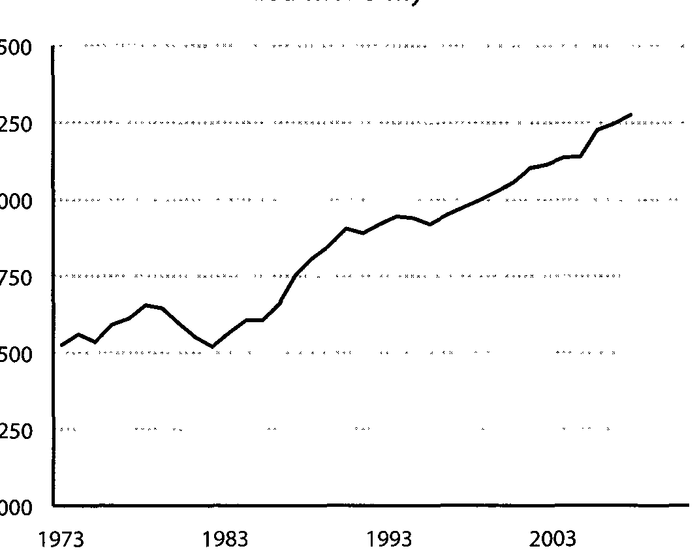

[<< Chương 20: Lời thú nhận](20_chuong_20.md) | [Mục lục](00_muc_luc.md) | [Lời cảm ơn >>](22_loi_cam_on.md)

# TÁI BÚT: LƯỢC SỬ LÝ DO CHO LỐI SUY NGHĨ CỦA NGƯỜI TIÊU DÙNG MỸ

Để hiểu được tâm lý học của người tiêu dùng thời hiện đại và để nắm bắt được nơi họ sẽ có thể hướng tới tiếp theo, bạn phải biết cách mà họ đến được đây.

Cách mà tất cả chúng ta đều đến được đây.

Nếu bạn chìm vào giấc ngủ năm 1945 và tỉnh dậy vào năm 2020, bạn sẽ không thể nhận ra thế giới xung quanh bạn.

Khối lượng tăng trưởng kinh tế đã diễn ra trong thời kỳ đó là hầu như chưa từng có tiền lệ. Nếu bạn nhìn vào mức độ của cải ở New York và San Francisco, bạn sẽ bị sốc. Nếu bạn so sánh nó với sự nghèo đói của Detroit, bạn sẽ bị sốc. Nếu bạn thấy giá cả của nhà đất, phí học đại học, và chăm sóc sức khỏe, bạn sẽ bị sốc. Nếu bạn nhìn thấy cách mà những người dân Mỹ trung bình nghĩ về các khoản tiết kiệm và chỉ tiêu nói chung, bạn sẽ bị sốc. Và nếu bạn cố gắng nghĩ ra một câu chuyện hợp lý về cách mà tất cả những điều này xảy ra, tôi đoán là bạn sẽ hoàn toàn sai lầm. Bởi vì nó không thuộc về trực giác, và nó không được lường trước.

Những gì đã xảy ra ở Mỹ kể từ cuối Thế chiến Thứ II là câu chuyện của người tiêu dùng Mỹ. Đó là một câu chuyện giúp giải thích tại sao mọi người suy nghĩ về tiền bạc theo cách họ làm ngày nay.

Phiên bản ngắn gọn đó là: Mọi thứ lúc đó rất bấp bênh, sau đó chúng trở nên rất tốt đẹp, sau đó lại rất tồi tệ, rồi lại rất tốt, rồi lại tồi tệ, và giờ chúng ta ở đây. Theo tôi nghĩ, có một câu chuyện kết nối tất cả những sự kiện đó lại với nhau. Không phải là một tài khoản chỉ tiết. Mà là một câu chuyện về cách kết hợp hoàn hảo của mọi thứ.

Vì đây là nỗ lực để kết nối những sự kiện lớn lại với nhau, nên nó sẽ chừa ra rất nhiều chỉ tiết về những gì đã xảy ra trong giai đoạn này. Tôi rất có thể sẽ đồng tình với bất cứ ai chỉ ra những gì tôi đã bỏ sót. Mục tiêu ở đây không phải là miêu tả mọi vở kịch; mà là nhìn vào cách một trò chơi tác động lên trò chơi tiếp theo.

Đây là cách mà những người tiêu dùng hiện đại đã tới được hiện tại.

1 Thóng Tóm, 1945. Thế chiến thứ II kết thúc.

Nhật Bản đầu hàng là “Ngày hạnh phúc nhất trong Lịch sử nước Mỹ”, thời báo Netop York Times đã viết.

Nhưng có một câu nói, “Lịch sử chỉ là điều chết tiệt này sau điều chết tiệt khác.”

Niềm vui khi chiến tranh kết thúc nhanh chóng gặp phải một câu hỏi, “Giờ thì sao?”

16 triệu người Mỹ - 11% trong tổng dân số - đã phục vụ trong chiến tranh. Khoảng 8 triệu đóng quân ở nước ngoài vào lúc cuối. Độ tuổi trung bình của họ là 23. Trong vòng 18 tháng, tất cả 1,5 triệu người họ sẽ quay trở về nhà và không còn ở trong quân ngũ.

Và sau đó thì sao?

Họ sẽ làm gì tiếp theo?

Họ sẽ làm việc ở đâu? Họ sẽ sống ở đâu?

Đó là những câu hỏi quan trọng nhất của ngày, vì hai lý do. Một, không ai biết câu trả lời. Hai, nếu chúng không được trả lời nhanh chóng, thì tình thế dễ xảy ra nhất - trong con mắt của rất nhiều nhà kinh tế học - đó là nền kinh tế sẽ lại rơi vào đáy vực của một cuộc Đại suy thoái.

Ba thế lực đã được xây dựng nên trong thời chiến:

1. Các công trình xây dựng nhà cửa đã bị đình lại, vì hầu hết tất cả khả năng sản xuất được chuyển dịch sang xây dựng trang thiết bị phục vụ chiến tranh. Những quân lính trở về sẽ phải đối mặt với sự thiếu hụt nhà cửa nặng nề.

2. Những công việc cụ thể được tạo ra trong thời chiến - đóng tàu, xe tăng, và máy bay - bỗng dưng lại không cần thiết sau đó, dừng lại với một tốc độ và quy mô hiếm khi nào thấy trong ngành kinh doanh tư nhân. Thật không rõ ràng để thấy được các quân lính có thể làm việc ở đâu.

3. Tỷ lệ kết hôn tăng vọt trong và ngay lập tức sau chiến tranh. Các quân nhân không muốn quay trở lại tầng hầm của nhà mẹ họ. Họ muốn bắt đầu một gia đình, trong chính ngôi nhà của họ, với một công việc tốt, ngay lập tức.

Điều này làm các nhà hoạch định chính sách 1o lắng, đặc biệt là kể từ khi cuộc Đại suy thoái vẫn còn là một ký ức mới gần đây, chỉ vừa mới kết thúc 5 năm trước.

Vào năm 1946, Hội đồng Tư vấn Kinh tế đã trình một bản báo cáo lên Tổng thống Truman với cảnh báo rằng “một cuộc suy thoái ở quy mô rộng khắp sẽ xảy ra vào một lúc nào đó trong vòng từ một đến bốn năm tới.”

Họ viết trong một bản ghi nhớ riêng vào năm 1947, tống kết cuộc gặp với Truman:

Chúng ta có thể rơi vào một giai đoạn khủng hoảng nào đó nơi mà chúng ta phải rất chắc chắn với vị trí của mình xem liệu các thế lực khủng hoảng có dấu hiệu vượt khỏi tầm kiểm soát hay không... Có một viễn cảnh đáng kể không nên bị coi thường đó là một sự sụt giảm sâu hơn nữa có thể làm gia tăng mối nguy hiểm của một vòng xoáy trôn ốc dẫn tới những điều kiện suy thoái.

Nỗi sợ hãi này đã bị phóng đại lên bởi sự thật rằng chúng ta không thể ngay lập tức dựa vào xuất khẩu để tăng trưởng được, vì hai trong số nền kinh tế lớn nhất - châu Âu và Nhật Bản - đang phải đối phó với những cuộc khủng hoảng nhân đạo. Và bản thân Mỹ thì bị chìm đắm trong khối lượng nợ nhiều hơn bao giờ hết, hạn chế sự kích thích kinh tế trực tiếp đến từ chính phủ.

Vì thế chúng ta đã làm một điều gì đó khác.

## 9. Tỷ lệ lãi suất thấp vò sự ra đời có chủ đích của người tiêu dùng Mỹ.

Điều đầu tiên chúng tôi làm để giữ cho nền kinh tế nổi sau chiến tranh đó là giữ cho tỷ lệ lãi suất ở mức thấp. Đây không phải là một quyết định dễ dàng, bởi vì khi các quân nhân trở về nhà với sự thiếu hụt mọi thứ từ quần áo đến xe hơi thì nó tạm thời khiến sự lạm phát tăng lên thành hai con số.

Cục Dự trữ không độc lập về mặt chính trị trước năm 1951. Tổng thống và Cục Dự trữ có thể điều phối chính sách. Vào năm 1942, Cục Dự trữ đã tuyên bố rằng nó sẽ giữ cho tỷ lệ ngắn hạn ở mức 0,38% để giúp đóng góp tài chính cho chiến tranh. Tỷ lệ này đã không nhúc nhích một điểm cơ bản duy nhất nào trong vòng bảy năm tiếp theo. Lãi suất kho bạc ba tháng duy trì dưới mức 2% cho tới giữa những năm 1950.

Lý do cụ thể cho việc giữ tỷ lệ ở mức thấp là để giữ cho chi phí của việc hỗ trợ một khoản tương đương 6 nghìn tỷ đô la mà chúng ta đã chi tiêu vào chiến tranh ở mức thấp.

Nhưng tỷ lệ thấp cũng đã làm được thêm một điều khác cho tất cả những quân nhân quay trở về nhà. Nó khiến cho việc vay mượn để mua nhà, xe, dụng cụ, và đồ chơi trở nên thật rẻ.

Điều đó, từ góc nhìn của nhà hoạch định chính sách đang hoảng sợ thì, thật sự tuyệt vời. Sự tiêu dùng trở thành một chiến thuật kinh tế đặc biệt trong những năm sau Thế chiến thứ II.

Một kỷ nguyên của việc khuyến khích tiêu xài cẩn thận và tiết kiệm để gây quỹ cho chiến tranh nhanh chóng được biến thành một kỷ nguyên của việc khuyến khích tiêu dùng một cách chủ động. Nhà sử học Princeton Sheldon Garon viết:

Sau 1945, Mỹ một lần nữa tách biệt khỏi những quy luật khuyến khích tiết kiệm ở châu Âu nà Đông Á... Các chính trị gia, doanh nhân uà các nhà lãnh đạo lao động đều khuyến khích người dân Mỹ tiêu dùng để làm tăng trưởng nền kinh tế:

Hai điều đã tiếp nhiên liệu cho sự thúc đẩy này.

Đầu tiên, đó là Đạo luật điều chỉnh của Quân nhân, cung cấp những cơ hội thế chấp chưa từng có trước đó. Mười sáu triệu cựu chiến binh có thể mua một căn nhà và thường không phải đặt cọc trước, không có lãi suất trong năm đầu tiên, và tỷ lệ được điều chỉnh thấp đến mức mà khoản thế chấp phải trả hằng tháng có thể thấp hơn cả tiền thuê nhà.

Điều thứ hai, đó là sự bùng nổ của tín dụng tiêu dùng, được cấp phép bởi sự nới lỏng của các quy định thời Suy thoái. Chiếc thẻ tín dụng đầu tiên được giới thiệu vào năm 1950. Tín dụng cửa hàng, tín dụng trả góp, cho vay cá nhân, cho vay theo ngày - mọi thứ được chắp cánh. Và lãi suất mọi khoản nợ, bao gồm cả các thẻ tín dụng, được khấu trừ thuế vào thời điểm đó.

Nó có vị thật thơm ngon. Vì thế chúng ta đã ăn rất nhiều. Một câu chuyện đơn giản bên bàn ăn giản đơn:

| Năm | Tổng nợ hộ gia đình tại Mỹ | |:--- |:--- | | 1945 | 29,4 tỷ đô la | | 1955 | 125,7 tỷ đô la | | 1965 | 331,2 tỷ đô la |

Khoản nợ hộ gia đình vào những năm 1950 tăng nhanh 1,5 lần so với giai đoạn khủng hoảng nợ những năm 2000.

3. Nhu cầu bị dồn nén được thỏa mãn bởi một sự bùng nổ tín dụng và một sự bùng nổ năng suốt ẩn giấu vào những năm 1950 dẫn đến một sự bùng nổ kinh tế.

Những năm 1930 là thập kỷ kinh tế khó khăn nhất trong lịch sử nước Mỹ. Nhưng có một tỉa hy vọng mà cần tới hai thập kỷ mới nhận ra được: Đù không thể thay đối được, nhưng cuộc Đại suy thoái đã tiếp thêm siêu năng lượng cho sự tháo vát, năng suất, và đối mới.

Chúng tôi đã không chú ý quá nhiều đến sự bùng nổ năng suất vào những năm 30, bởi vì ai cũng tập trung vào sự tồi tệ của tình hình kinh tế lúc đó. Chúng tôi đã không chú ý đến nó vào những năm 40 bởi vì ai cũng tập trung vào chiến tranh.

Rồi những năm 1950 đến và chúng tôi chợt nhận ra rằng, “Chà, chúng ta có một vài sáng kiến tuyệt vời mới. Và chúng ta thực sự giỏi trong việc tạo ra chúng.”

Dụng cụ gia đình, xe hơi, điện thoại, điều hòa, điện.

Gần như không thể mua nhiều dụng cụ gia đình trong thời chiến, bởi vì các nhà máy được chuyến đối để chế tạo súng và tàu thuyền. Diều đó tạo ra một nhu cầu dồn nén đến từ những cựu quân nhân sau khi chiến tranh kết thúc. Đã kết hôn, háo hức muốn xây dựng cuộc sống, và được tiếp thêm sức mạnh với chiếc thẻ tín dụng tiêu dùng lãi suất thấp mới, họ bắt đầu một chiến dịch mua sắm thả phanh mà đất nước chưa từng được chứng kiến.

Erederick Lewis Allan viết trong cuốn sách The Bic Change (tạm dịch: Sự thay đối lớn) của ông:

Trong những năm sau chiến tranh, người nông dân mua một chiếc máy kéo mới, một chiếc máy thu hoạch ngô, một chiếc máy vắt sữa bằng điện; trên thực tế anh và hàng xóm, giữa họ hình thành nên một đội máy móc nông nghiệp hùng hậu để sử dụng chung. Vợ người nông dân mua được một chiếc tủ lạnh chạy bằng điện màu trắng sáng bóng mà bà vẫn luôn ao ước và chưa bao giờ trong suốt cuộc Đại suy thoái có thể chi trả được, cùng với một chiếc máy giặt đời mới, và một tủ đông. Gia đình ở vùng ngoại ô đã lắp đặt một chiếc máy rửa bát và đầu tư vào một chiếc máy cắt cỏ. Gia đình ở thành phố trở thành khách hàng của một cửa tiệm giặt là và tậu một dàn ti vi cho phòng khách. Văn phòng của người chồng được lắp máy điều hòa. Và còn nhiều thứ nữa.

Không thể nào nói quá sự to lớn của đợt bùng nổ này.

Việc sản xuất xe tải và xe hơi thương mại hầu như đã bị tạm dừng từ 1942 đến 1945. Sau đó, 21 triệu chiếc xe đã được bán từ 1945 đến 1949. Thêm 37 triệu chiếc nữa được bán vào 1955.

Chỉ dưới hai triệu căn nhà được xây dựng từ năm 1940 đến năm 1945. Sau đó, bảy triệu căn đã được xây từ năm 1945 đến năm 1950. Thêm tám triệu căn nữa được xây vào năm 1955.

Nhu cầu cho các vật dụng bị dồn nén, và khả năng mới được khai phá của chúng ta trong việc sản xuất, đã tạo ra những nghề nghiệp giúp những cựu quân nhân quay trở lại làm việc. Và chúng còn là những công việc tốt nữa. Hòa trộn điều đó với tín dụng tiêu dùng, và khả năng chỉ tiêu của Mỹ bùng nổ.

Cục Dự trữ Liên bang đã viết cho Tổng thống Truman vào năm 1951: “Đến năm 1950, tổng chi tiêu tiêu dùng, cùng với các công trình nhà ở, đã tăng lên khoảng 203 tỷ đô la, hoặc trong khu vực 40% trên mức của năm 1944.”

Câu trả lời cho câu hỏi, “Những cựu quân nhân này sẽ làm gì sau chiến tranh?” giờ đã rõ. Họ sẽ mua sắm, với số tiền kiếm được từ những công việc chế tạo ra nhiều đồ đạc mới, được trợ giúp bởi số tiền vay lãi suất thấp để mua thêm càng nhiều đồ đạc hơn.

## 4. Những khoón tiền gia tăng được chia đều hơn bất cứ lúc nào khác.

Đặc điểm nổi trội của kinh tế học vào những năm 1950 đó là quốc gia làm giàu bằng cách giúp những người dân nghèo bớt nghèo hơn.

Mức lương trung bình tăng gấp đôi từ năm 1940 đến 1948, sau đó lại tăng gấp đôi một lần nữa vào năm 1963.

Và những khoản tiền gia tăng đó được tập trung vào những người đã bị bỏ lại phía sau trong nhiều thập kỷ trước đó. Khoảng cách giữa giàu và nghèo được thu hẹp lại bởi một lượng đáng kể.

Lewis Allan đã viết vào năm 1955:

Sự dẫn đầu khổng lồ của những tầng lớp giàu có trong cuộc đua kinh tế đã được thu hẹp lại một cách đáng kể:

Chính những công nhân công nghiệp tới tư cách là một nhóm đã đạt được những điều tuyệt vời nhất — những người như ở trong gia đình công nhân thép từng sống với mức 2.500 đô la và giờ đang kiếm được 4.500 đô la, hoặc gia đình của công nhân điều hành máy móc — công cụ tay nghề cao từng kiếm được 3.000 đô la và giờ có thể tiêu một mức 5.500 đô la hằng năm hoặc hơn thế nữa.

Đối với một phần trăm những người ở tầng lớp cao nhất, những người thực sự khá giả và giàu có, những người mà chúng ta có thể phân loại một cách áng chừng là thuộc nhóm 16.000 đô la trở lên, phần trăm của họ trong tổng thu nhập quốc gia, sau thuế: đã giảm xuống vào năm 1945 từ 13% còn 7%.

Đây không phải là xu hướng ngắn hạn. Thu nhập thực sự cho những người thuộc nhóm thấp nhất 20% đã tăng một lượng gần tương đương với nhóm ở trên đỉnh 5% từ 1950 đến 1980.

Sự bình đẳng còn vượt ra cả mức lương.

Phụ nữ có nghề nghiệp bên ngoài gia đình đạt mức kỷ lục. Tỷ lệ tham gia vào lực lượng lao động của họ tăng từ 31% sau chiến tranh lên đến 37% vào năm 1955, và đến 40% vào năm 1965.

Những người thiểu số cũng nhận được những lợi ích. Sau lễ nhậm chức vào năm 1945, Eleanor Roosevelt đã viết về một phóng viên người Mỹ gốc Phi, người đã nói với bà rằng:

Bà có nhận ra rằng 12 năm đã thay đối những gì không? Nếu ở buổi lỗ năm 1933, một số người da màu đã di chuyển nào dòng người uà hòa lẫn với mọi người khác theo cách họ làm ngày hôm nay, thì mọi tờ báo trong nước đã phải đưa tín gề điều đó rồi. Chúng ta giờ còn không nghĩ rằng nó là tín tức gì mới uà không một ai trong số chúng tu sẽ nhắc đến nó.

Quyền của phụ nữ và những người thiểu số hồi đó vẫn chỉ là một phần nhỏ so với ngày nay. Nhưng tiến trình hướng đến sự bình đẳng vào cuối những năm 40 và 50 thật là phi thường.

Việc cân bằng hóa các tầng lớp cũng đồng nghĩa với sự cân bằng hóa các lối sống. Những người bình thường lái những chiếc Chevy. Người giàu lái Cadillac. Ti vi và đài đã làm trung hòa sự giải trí và văn hóa mà mọi người yêu thích không kể đến tầng lớp. Những ấn phẩm quảng cáo qua đường bưu điện giúp cân bằng hóa quần áo mà mọi người mặc và những món đồ mà họ mua không kể đến nơi họ sinh sống. Tạp chí Harper's đã ghi lại vào năm 1957:

Người giàu hút cùng một loại thuốc với người nghèo, cạo râu với cùng một loại lưỡi dao, sử dụng cùng một loại điện thoại, máy hút bụi, đời, và dàn ti vi, có cùng những thiết bị điện và sưởi ấm trong căn nhà, và còn nhiều nữa. Sự khác biệt giữa chiếc xe hơi của anh ta và của người nghèo là rất nhỏ. Cụ thể thì chúng có động cơ tương tự nhau, nội thất tương tự nhau. Vào những năm đầu của thế kỷ từng tồn tại một sự phân cấp các loại xe hơi.

Paul Graham đã viết vào năm 2016 về điều mà một thứ giản đơn như từng chỉ có ba đài tỉ vi đã làm để cân bằng hóa văn hóa:

Thật khó để tưởng tượng ở hiện tại, nhưng mỗi tối hàng chục triệu gia đình sẽ ngồi xuống cùng nhau trước dàn ti vi để xem cùng một chương trình, vào cùng một thời điểm, giống như những hàng xóm cạnh nhà họ vậy. Điều xảy ra bây giờ với chương trình Super Bowl từng xảy ra mỗi đêm. Chúng tôi đã hòa chung nhịp điệu đúng nghĩa.

Điều này rất quan trọng. Mọi người đo đếm sự phát triển toàn diện của họ bằng cách so với những người đồng trang lứa. Và trong hầu hết giai đoạn 1945 - 1980, mọi người có rất nhiều thứ giống nhau để so sánh. Rất nhiều người - đại đa số - sống những cuộc đời hoặc bằng hoặc ít nhất là hiểu được so với những người xung quanh họ. Ý tưởng rằng cuộc sống của mọi người được cân bằng hóa cũng như nguồn thu nhập của họ là một điểm mấu chốt trong câu chuyện này mà chúng ta sẽ còn quay trở lại tiếp.

5. Khoón nợ tăng chóng mặt. Nhưng thu nhập cũng vậy, vì thế tác động của nó không phải là điều gì to lớn.

Các khoản nợ của hộ gia đình tăng gấp năm lần từ 1947 đến 1957 do sự kết hợp của nền văn hóa tiêu dùng mới, những sản phẩm cho vay nợ mới, và tỷ lệ lãi suất được trợ cấp bởi các chương trình của chính phủ, và được giữ ở mức thấp bởi Cục Dự trữ Liên bang.

Nhưng sự tăng trưởng thu nhập trong giai đoạn này mạnh đến mức mà tác động của nó lên các hộ gia đình là không nặng nề. Và các khoản nợ hộ gia đình vào lúc ban đầu sau chiến tranh là rất thấp. Cuộc Đại suy thoái đã xóa sạch rất nhiều trong số đó, và việc chi tiêu hộ gia đình bị hạn chế trong thời chiến đến mức sự tích tụ của các khoản nợ cũng bị hạn chế. Vì thế sự tăng trưởng của tỷ lệ nợ trên thu nhập của các hộ gia đình từ 1947-1957 là nằm trong tâm kiểm soát.

Tỷ lệ nợ trên thu nhập của các hộ gia đình ngày nay chỉ hơn 100%. Ngay cả sau khi gia tăng vào những năm 1950, 1960, và 1970 thì nó vẫn giữ vững dưới mức 60%.

Yếu tố thúc đẩy lớn cho sự bùng nổ nợ này là một làn sóng về quyền sở hữu nhà ở.

Tỷ lệ sở hữu nhà vào năm 1900 là 47%. Nó giữ nguyên ở đó trong bốn thập kỷ tiếp theo. Sau đó nó cất cánh, chạm mức 53% vào năm 1945 và 62% vào năm 1970. Một phần trăm đáng kể của tổng dân số giờ đang sử dụng các khoản nợ mà những thế hệ trước đã không tiếp cận - hoặc không thể tiếp cận được. Và phần lớn họ đều thấy OK với nó.

David Halberstam viết trong cuốn sách The Fifties (tạm dịch: Những năm 50) của ông:

Họ tự tin vào chính bản thân và tương lai của họ theo một cách mà [những người] lớn lên trong những giai đoạn khó khăn hơn cảm thấy thật choáng ngợp. Họ không sợ hãi khoản nợ như cha mẹ họ đã từng... Họ khác biệt với cha mẹ họ không chỉ trong số tiền họ kiếm được và những gì họ sở hữu mà còn cả trong niềm tin rằng tương lai đã đến. Là những người đầu tiên sở hữu căn nhà trong gia đình của họ, họ mang đến một sự hào hứng và niềm tự hào mới cùng họ đến những cửa hàng để mua nội thất hoặc vật dụng trong nhà — ở những giai đoạn khác những cặp đôi trẻ có thể có được cảm giác tương tự khi họ mua quần áo cho đứa con đầu đời của họ. Cứ như thể bản thân thành tựu của việc sở hữu một căn nhà đã thể hiện một sự đột phá vô cùng to lớn đến mức không gì là quá tầm tay để mua cho nó cả.

Giờ là thời điểm tốt để kết nối một vài điều, vì chúng sẽ trở nên ngày càng quan trọng:

» Mỹ đang bùng nổ.

» Sự bùng nổ cùng nhau chưa từng có tiền lệ.

» Sự bùng nổ các khoản nợ không phải là một vấn đề lớn vào lúc đó bởi vì nó vẫn khá thấp so với thu nhập và có một sự chấp nhận về văn hóa rằng nợ không phải là một điều đáng sợ.

6. Mọi thứ bắt đầu nhen nhóm. 1973 là năm đầu tiên mà mọi thứ trở nên rõ ràng rằng nền kinh tế đang bước trên một con đường mới. Cuộc khủng hoảng bắt đầu vào năm đó đưa tỷ lệ thất nghiệp lên mức cao nhất kế từ những năm 1930 đến lúc này.

Lạm phát tăng vọt. Nhưng không giống với những lần bùng phát hậu chiến tranh, nó duy trì ở mức cao đó.

Tỷ lệ lãi suất ngắn hạn đạt 8% vào năm 1973, tăng từ 2,5% so với một thập kỷ trước đó.

Và bạn phải đặt toàn bộ những điều này vào trong bối cảnh của nỗi lo sợ giữa Việt Nam, các cuộc biểu tình, và những vụ ám sát Martin Luther King, John và Bobby Kennedy.

Nó trở nên ảm đạm.

Mỹ thống trị nền kinh tế thế giới trong hai thập kỷ sau chiến tranh. Khả năng sản xuất của rất nhiều trong số những quốc gia lớn nhất bị đánh bom thành tro bụi. Nhưng khi thập kỷ 1970 xuất hiện, điều đó đã thay đối. Nhật Bản trong giai đoạn bùng nổ. Nền kinh tế Trung Quốc mở rộng. Khu vực Trung Đông thể hiện thế mạnh đầu mỏ.

Một sự kết hợp giữa các lợi thế kinh tế may mắn và một nền văn hóa được chia sẻ bởi Thế hệ Vĩ đại nhất - được rèn giữa bởi cuộc Đại suy thoái và có nền tảng dựa trên sự phối hợp mang tính hệ thống từ thời chiến - đã chuyển đối khi những đứa trẻ của thời kỳ bùng nổ trẻ sơ sinh bắt đầu trưởng thành. Một thế hệ mới với một cái nhìn khác biệt về điều gì là bình thường ập đến cùng lúc với rất nhiều luồng gió kinh tế của hai thập kỷ trước kết thúc.

Mọi thứ trong tài chính là dữ liệu niềm trong bối cảnh trông đợi. Một trong những sự chuyển dịch lớn nhất của thế kỷ trước xảy ra khi những luồng gió kinh tế bắt đầu thối theo một hướng khác biệt, không đồng đều, nhưng những trông đợi của mọi người vẫn cắm rễ ở nền văn hóa bình đẳng sau chiến tranh. Không nhất thiết phải là sự bình đẳng về thu nhập, mặc dù đã từng có điều đó, mà là sự bình đẳng về lối sống và những trông đợi trong tiêu dùng; ý tưởng rằng ai đó kiếm được một mức thu nhập phân vị thứ 50 cũng không nên sống một cuộc sống quá khác biệt hơn so với một ai đó ở phân vị thứ 80 hay 90. Và rằng ai đó ở phân vị thứ 99 sống một cuộc sống tốt đẹp hơn, nhưng vẫn là một cuộc sống mà ai đó ở phân vị thứ 50 có thể hiểu được. Đó là cách mà Mỹ đã hoạt động trong phần lớn giai đoạn 1945-1980. Không quan trọng bạn nghĩ đó là đúng hay sai về mặt đạo đức. Chỉ đơn giản là điều đó đã xảy ra.

Những trông đợi luôn di chuyển chậm hơn sự thật. Và những sự thật kinh tế của những năm từ đầu thập kỷ 1970 đến tận những năm đầu của thập kỷ 2000 đó là sự tăng trưởng vẫn tiếp tục, nhưng trở nên bất đồng đều hơn, thế nhưng những trông đợi của mọi người về cách mà lối sống của họ nên được so sánh với những người đồng trang lứa vẫn không thay đổi.

## 7. Sự bùng nổ lại tiếp tục, nhưng khác với lúc trước.

Quảng cáo “Chào buổi sáng nước Mỹ” năm 1984 của Ronald Reagan đã tuyên bố:

Lại là một buổi sáng nữa trên đất Mỹ. Hôm nay sẽ có thêm nhiều đàn ông và phụ nữ đi làm hơn bất kể thời điểm nào trước đó trong lịch sử của đất nước ta. Với tỷ lệ lãi suất chỉ bằng khoảng một nửa con số cao kỷ lục của năm 1980, gần 2.000 gia đình ngày nay sẽ mua được những căn nhà mới, nhiều hơn bất cứ thời điểm nào trong vòng bốn năm qua. Đầu giờ chiều nay 6.500 người đàn ông và phụ nữ trẻ tuổi sẽ kết hôn, và với lạm phát chỉ ở mức dưới một nửa so với nó bốn năm trước, họ có thể trông đợi một cách đầy tự tin vào tương lai.

Đó không phải là một lời nói phóng đại. Sự tăng trưởng GDP đạt mức cao nhất kể từ những năm 1950. Đến năm 1989, số lượng người dân Mỹ thất nghiệp giảm đi sáu triệu so với bảy năm trước đó. Chỉ số S&P 500 tăng lên gần gấp bốn lần từ năm 1982 đến năm 1990. Tổng tăng trưởng GDP thực sự vào những năm 1990 là gần như bằng với con số của những năm 1950 — 40% so với 42%.

Tống thống Clinton đã khoe khoang trong bài diễn thuyết Thông điệp Liên bang năm 2000 của ông:

Chúng ta bắt đầu một thế kỷ mới với hơn 20 triệu nghề nghiệp mới; sự tăng trưởng kinh tế nhanh nhất trong hơn 30 năm; tỷ lệ thất nghiệp thấp nhất trong 30 năm; tỷ lệ đói nghèo thấp nhất trong 20 năm; tỷ lệ thất nghiệp của những người Mỹ gốc Phi và gốc Tây Ban Nha thấp nhất từng ghi nhận được; nhìn thặng dư liên hiệp đầu tiên trong 42 năm; và vào tháng tới, Mỹ sẽ đạt được giai đoạn tăng trưởng kinh tế dài nhất trong toàn bộ lịch sử của quốc gia. Chúng ta đã xây dựng được một nền kinh tế mới.

Câu cuối cùng của ông là câu rất quan trọng. Đó là một nền kinh tế rới. Sự khác biệt lớn nhất giữa nền kinh tế của giai đoạn 1945-1973 và giai đoạn 19822000 đó là cùng một lượng tăng trưởng nhưng lại tìm đường vào những cái túi hoàn toàn khác nhau.

Bạn có lẽ đã nghe nói đến những con số này nhưng chúng xứng đáng được nhắc lại. Tờ

Atlantic viết:

Từ năm 1993 đến năm 2012, những người thuộc nhóm 1% trên đỉnh chứng kiến thu nhập của họ tăng 86,1%, trong khi những người ở dưới đáy 99% lại chỉ chứng kiến một sự tăng trưởng 6,6%.

Joseph Stiglitz năm 2011:

Trong khi những người thuộc nhóm 1% trên đỉnh đã thấy thu nhập của họ tăng 18% trong vòng một thập kỷ qua, thì những người thuộc tầng lớp trung lưu lại thực sự thấy thu nhập của họ giảm. Đối với những người đàn ông với bằng cấp ba, đây là một sự tụt dốc — 12% chỉ riêng trong vòng một phần tư thế kỷ vừa qua.

Xu hướng này gần như trái ngược với sự cân bằng đã xảy ra sau chiến tranh.

Tại sao điều này lại xảy ra là một trong những tranh luận căng thẳng nhất trong kinh tế học, chỉ đứng sau mỗi cuộc tranh luận về điều chúng ta nên làm với nó. Thật may là với mục đích của cuộc bàn luận này, hai điều trên đều không quan trọng.

Tất cả những gì quan trọng đó là sự bất bình đẳng hiển hiện trở thành một thế lực trong vòng 35 năm qua, và nó xảy ra trong giai đoạn mà, về mặt văn hóa, người dân Mỹ vẫn bấu víu lấy hai khái niệm được xuất phát từ nền kinh tế sau Thế chiến thứ II: Đó là bạn nên sống một lối sống tương tự với phần lớn những người dân Mỹ khác, và đó là chấp nhận những khoản nợ để chu cấp cho lối sống đó là điều được chấp nhận.

## 8. Cú giãn lớn.

Thu nhập tăng lên đối với một nhóm nhỏ những người dân Mỹ dẫn tới việc nhóm đó tách ra khỏi lối sống thường thấy.

Họ mua những căn nhà lớn hơn, những chiếc xe hơi đẹp hơn, đi học ở những ngôi trường đắt tiền hơn, và có những kỳ nghỉ xa hoa.

Và tất cả mọi người đều đang dõi theo — được tiếp sức bởi Đại lộ Madison vào những năm 80 và 90, và kết nối internet sau đó.

Lối sống của một bộ phận nhỏ những người dân Mỹ giàu chính đáng đã thối bùng lên khát khao của đại đa số những người dân Mỹ, những người với thu nhập không gia tăng.

Một nền văn hóa của sự bình đẳng và cùng nhau bước ra từ giai đoạn 1950-1970 giờ bị biến đối thành hiệu ứng Bắt kịp với Nhà Joneses.

Giờ bạn có thể thấy được vấn đề.

Joe, một nhân viên đầu tư ngân hàng kiếm được 900.000 đô la một năm, mua một căn hộ rộng 4.000 foot vuông với hai chiếc Mercedes và gửi ba đứa con của anh ta đến học ở Pepperdine. Anh ta có thể chỉ trả được.

Peter, một giám đốc chỉ nhánh ngân hàng kiếm được 80.000 đô la một năm, nhìn thấy Joe và cảm thấy một cách vô thức rằng anh ta có quyền được sống một lối sống tương tự, bởi vì bố mẹ của Peter tin rằng — cũng như gieo vào lòng anh ta - rằng lối sống của người Mỹ không khác biệt mấy kể cả khi họ có những công việc khác nhau. Bố mẹ anh ta đã đúng trong kỷ nguyên của họ, bởi vì thu nhập hồi đó được phân chia chặt chẽ. Nhưng đó là hồi trước. Peter sống trong một thế giới khác. Nhưng những mong đợi của anh ta thì vẫn không có gì thay đối nhiều so với bố mẹ anh, ngay cả khi sự thật đã thay đối.

Vậy thì Peter làm gì?

Anh ta nhận một khoản thế chấp lớn. Anh ta có một khoản nợ 45.000 đô la trong thẻ tín dụng. Anh ta thuê hai chiếc xe ô tô. Những đứa con của anh ta sẽ tốt nghiệp với những khoản nợ sinh viên nặng nề. Anh ta không thể chỉ trả được những thứ như Joe, nhưng anh ta đã cố kéo giãn để có được lối sống tương tự. Đó là một cú giãn lớn.

> 
>
> *Biểu đồ: Diện tích trung bình căn nhà kiểu mới ở Mỹ (1973 – 2013)*

Điều này có vẻ vô lý đối với một ai đó sống trong những năm 1930. Nhưng chúng ta đã dành 75 năm kể từ khi chiến tranh kết thúc để nuôi dưỡng một sự chấp nhận về mặt văn hóa cho những khoản nợ gia đình.

Trong khoảng thời gian khi mà mức lương trung bình được cân bằng, căn nhà trung bình kiểu mới của người dân Mỹ rộng thêm 50%. kiểu mới ở Mỹ Căn nhà kiểu mới trung bình của người dân Mỹ giờ có nhiều phòng tắm hơn là số thành viên trong gia đình. Gần một nửa trong số đó có bốn phòng ngủ trở lên, tăng từ 18% vào năm 1983.

Khoản nợ mua xe trung bình sau điều chỉnh với lạm phát đã tăng hơn gấp đôi từ 1975 đến 2003, từ 12.300 đô la lên 27.900 đô la.

Và bạn biết điều gì đã xảy ra với chỉ phí học đại học và các khoản nợ sinh viên.

Tỷ lệ nợ trên thu nhập hộ gia đình duy trì khá cân bằng từ 1963 đến 1973. Sau đó nó tăng lên, và tăng lên, và tăng lên, từ khoảng 60% vào năm 1973 đến hơn 130% vào năm 2007.

Ngay cả khi tỷ lệ lãi suất sụt giảm từ những năm đầu thập kỷ 1980 đến 2020, thì phần trăm thu nhập được chi trả cho các dịch vụ cho vay vẫn tăng. Và nó hướng về phía những nhóm có thu nhập thấp hơn. Phần trăm thu nhập đổ vào nợ và các khoản thuê mướn là chỉ hơn 8% đối với nhóm có thu nhập cao nhất - những người được hưởng những khoản lợi lớn nhất trong thu nhập - nhưng là hơn 21% đối với những người dưới phân vị 50.

Sự khác biệt giữa khoản nợ ngày càng cao này và khoản nợ tăng diễn ra trong những năm 1950 và 60 đó là sự tăng vọt gần đây bắt đầu từ một nền tảng cao.

Nhà kinh tế học Hyman Minsky đã miêu tả sự bắt đầu của những khủng hoảng nợ: Giây phút mà mọi người chấp nhận thêm nhiều khoản nợ hơn mức mà họ có thể chỉ trả. Đó là một giây phút xấu xí, đau đớn. Nó giống như khi Wile E. Coyote nhìn xuống, nhận ra là đời cậu ta đã bị hủy hoại, và rơi thẳng xuống. Đó, tất nhiên, là điều đã xảy ra vào năm 2008.

Một khi quy luật đã được hình thành, thật khó để xoay chuyển nó.

Rất nhiều khoản nợ đã được trả sau năm 2008. Và sau đó tỷ lệ lãi suất tụt dốc. Các khoản nợ gia đình chiếm một phần trăm của thu nhập giờ đang ở mức thấp nhất trong 35 năm.

Nhưng câu trả lời cho năm 2008, dù có cần thiết, đã kéo dài một vài xu hướng khiến chúng ta đến được đây.

Nói lỏng định lượng vừa ngăn chặn được sự sụp đổ của nền kinh tế vừa thúc đẩy mức giá của cải, một món hời cho những ai đang sở hữu chúng - đa số là người giàu.

Cục Đự trữ đã chuẩn bị trước cho khoản nợ doanh nghiệp năm 2008. Điều đó giúp cho những ai sở hữu khoản nợ đó - hầu hết là người giàu.

Cắt giảm thuế trong vòng 20 năm vừa qua đã chủ yếu thuộc về những ai có thu nhập cao hơn.

Những người có thu nhập cao hơn gửi con cái của họ đến những trường đại học tốt nhất. Những đứa trẻ đó có thể tiếp tục kiếm được khoản thu nhập cao hơn và đầu tư vào nợ doanh nghiệp được Cục Dự trữ hỗ trợ, sở hữu những cổ phiếu được hỗ trợ bởi VÔ số chính sách nhà nước, và hơn thế nữa.

Không có bản thân điều nào trong số này là vấn đề cả, đó là lý do tại sao chúng được duy trì.

Nhưng chúng lại là dấu hiệu của điều lớn hơn đã xảy ra từ những năm đầu thập kỷ 1980: Nền kinh tế hoạt động tốt hơn đối với một vài người so với những người khác. Thành công không còn phụ thuộc vào tài năng như trước và, khi đạt được thành công, phần thưởng là những khoản lãi cao hơn so với những kỷ nguyên trước đó.

Bạn không cần phải nghĩ đó là đúng hay sai về mặt đạo đức.

Và, một lần nữa, trong câu chuyện này lý do tại sao nó xảy ra không quan trọng.

Việc quan trọng chỉ là nó đã xảy rũ, và nó khiến cho nền kinh tế chuyển dịch khỏi những mong đợi được đặt ra sau chiến tranh: Rằng có một tầng lớp trung lưu rộng lớn không phải trải nghiệm sự bất bình đẳng hệ thống, nơi mà những người hàng xóm cạnh nhà hay cách bạn một vài dặm vẫn sống một cuộc sống tương tự so với bạn.

Một phần lý do những mong đợi này đã tồn tại được 35 năm sau khi chúng bị chuyển dịch khỏi thực tế là bởi vì nó mang lại cảm giác rất tuyệt vời cho rất nhiều người khi nó còn là hiện thực. Một thứ gì đó tốt đến vậy - hoặc ít nhất là ấn tượng về nó là tốt - thật không dễ gì có thể buông bỏ.

Vì thế mọi người vân chưa buông bỏ nó. Họ muốn nó quay trở lại.

9. Phong trào Tiệc Trờ, Chiếm đóng Phố Wall, Brexit, và Donald Trump, mỗi bên đều đại diện cho một nhóm với khẩu hiệu: “Ngưng cuộc chơi đi, tôi muốn xuống.”

Chi tiết khẩu hiệu của họ không giống nhau, nhưng họ đều hô vang khẩu hiệu đó - ít nhất là theo từng phần - bởi vì mọi thứ đang không hoạt động có hiệu quả cho họ trong bối cảnh những mong đợi hậu chiến tranh rằng mọi thứ nên mang lại hiệu quả khá tương đồng cho hầu hết mọi người.

Bạn có thể tỏ thái độ với việc kết nối sự trỗi dậy của Trump với sự bất bình đẳng của thu nhập. Và bạn nên như thế. Những điều này luôn gồm nhiều tầng lớp phức tạp sâu sắc. Nhưng đó là một phần quan trọng thúc đẩy mọi người đến suy nghĩ rằng, “Tôi không sống trong một thế giới mà tôi mong đợi. Điều đó làm tôi tức giận. Vì thế tôi mặc kệ điều này. Và tôi mặc kệ bạn! Tôi sẽ chiến đấu vì một điều gì đó hoàn toàn khác biệt, bởi vì điều này - dù nó có là gì đi nữa - cũng không hiệu quả.”

Hãy xem xét lối suy nghĩ đó và đưa nó lên tầm của Facebook, Instagram, và tin tức truyền hình cáp —nơi mà mọi người nhận thức rõ ràng hơn bất cứ lúc nào về cách sống của những người khác. Nó như đổ đầu vào lửa vậy. Benedict Evans nói, “Internet càng khiến mọi người tiếp cận với nhiều quan điểm mới, thì mọi người càng bực tức khi thấy rất nhiều quan điểm khác nhau tồn tại.” Đó là một sự chuyển đối to lớn kể từ nền kinh tế hậu chiến tranh nơi mà sự dao động về quan điểm kinh tế hạn hẹp hơn, do tập hợp đầu ra thật sự là thấp hơn và không dễ gì để nhìn thấy cũng như học hỏi suy nghĩ của người khác và cách mà họ sống.

Tôi không hề bi quan. Kinh tế học là câu chuyện của những vòng tuần hoàn. Mọi thứ đến rồi đi.

Tỷ lệ thất nghiệp giờ đang ở mức thấp nhất trong hàng thập kỷ. Mức lương giờ cũng đang thực sự tăng nhanh hơn đối với những nhân công có thu nhập thấp so với những người giàu có. Chi phí học đại học nhìn chung đã dừng việc tăng giá một khi các khoản tài trợ được đưa vào. Nếu mọi người đều nghiên cứu về những tiến bộ trong chăm sóc sức khỏe, giao tiếp, giao thông, và quyền công dân kế từ Những năm tháng hào hùng của thập kỷ 1950, thì tôi đoán giờ phần lớn sẽ không muốn quay trở lại.

Nhưng chủ đề trung tâm của câu chuyện này đó là những mong đợi di chuyển chậm chạp hơn thực tế. Điều đó đã xảy ra khi mọi người bấu víu lấy những mong đợi của thập kỷ 1950 trong khi nền kinh tế thay đổi trong vòng 35 năm tới. Và ngay cả khi sự bùng nổ tầng lớp trung lưu xảy ra ngày nay, thì những mong đợi rằng cơ hội đều chống lại tất cả mọi người ngoại trừ những người thuộc tầng lớp cao nhất vẫn có thể còn tôn tại.

Vì thế kỷ nguyên của “Cái này không hiệu quả” có thể vẫn tồn tại.

Và kỷ nguyên của “Chúng ta cần thứ gì đó hoàn toàn mới, ngay bây giờ, dù nó là gì đi chăng nữa.” có thể vẫn tồn tại.

Điều này, ở một khía cạnh nào đó, là một phần thúc đẩy những sự kiện dẫn đến những điều như Thế chiến thứ II, nơi mà câu chuyện này bắt đầu.

Lịch sử chỉ là hết thứ chết tiệt này đến thứ chết tiệt khác.

---

[<< Chương 20: Lời thú nhận](20_chuong_20.md) | [Mục lục](00_muc_luc.md) | [Lời cảm ơn >>](22_loi_cam_on.md)
