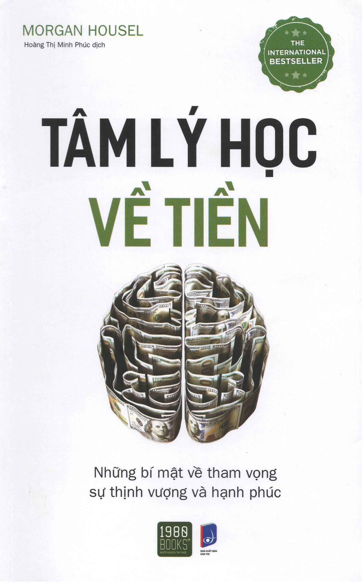

# TÂM LÝ HỌC VỀ TIỀN (THE PSYCHOLOGY OF MONEY)
### Những bài học không bao giờ cũ về sự giàu có, lòng tham và hạnh phúc

- **Tác giả:** Morgan Housel
- **Dịch giả:** Hoàng Thị Minh Phúc
- **Nhà xuất bản:** NXB Dân Trí & 1980 Books
- **Tên nguyên tác:** *The Psychology of Money: Timeless lessons on wealth, greed, and happiness*
- **Thể loại:** Tài chính cá nhân & Tâm lý học hành vi

> 

---

## Mục lục các chương

- [Thông tin xuất bản & Giới thiệu sách](00_trang_bia_va_thong_tin_xuat_ban.md)
- [Mục lục & Dành tặng](00_muc_luc.md)
- [Lời giới thiệu: Buổi trình diễn lớn nhất hành tinh](00_gioi_thieu.md)
1. [Chương 01: Không ai điên rồ](01_chuong_01.md)
2. [Chương 02: May mắn & Rủi ro](02_chuong_02.md)
3. [Chương 03: Không bao giờ là đủ](03_chuong_03.md)
4. [Chương 04: Sự tích tụ gây chấn động](04_chuong_04.md)
5. [Chương 05: Làm giàu và duy trì sự giàu có](05_chuong_05.md)
6. [Chương 06: Sự kiện sau chót, bạn thắng rồi](06_chuong_06.md)
7. [Chương 07: Tự do](07_chuong_07.md)
8. [Chương 08: Nghịch lý người đàn ông ở trong xe ô tô](08_chuong_08.md)
9. [Chương 09: Của cải là thứ mà bạn không nhìn thấy](09_chuong_09.md)
10. [Chương 10: Tiết kiệm tiền](10_chuong_10.md)
11. [Chương 11: Hợp lý >< Có lý](11_chuong_11.md)
12. [Chương 12: Ngạc nhiên chưa!](12_chuong_12.md)
13. [Chương 13: Chừa chỗ cho sai lầm](13_chuong_13.md)
14. [Chương 14: Rồi bạn sẽ khác](14_chuong_14.md)
15. [Chương 15: Không có gì là miễn phí](15_chuong_15.md)
16. [Chương 16: Bạn & Tôi](16_chuong_16.md)
17. [Chương 17: Nét quyến rũ của chủ nghĩa bi quan](17_chuong_17.md)
18. [Chương 18: Khi bạn tin vào bất cứ điều gì](18_chuong_18.md)
19. [Chương 19: Tổng hợp lại](19_chuong_19.md)
20. [Chương 20: Lời thú nhận](20_chuong_20.md)
- [Tái bút: Lược sử lý do cho lối suy nghĩ của người tiêu dùng Mỹ](21_tai_but.md)
- [Lời cảm ơn](22_loi_cam_on.md)

---

*Toàn bộ nội dung sách được chuyển đổi từ bản gốc `raw/TamLyHocVeTien.pdf`, trích xuất đầy đủ các hình ảnh biểu đồ minh họa sang thư mục `images/` và tham chiếu chính xác trong các file Markdown tương ứng.*