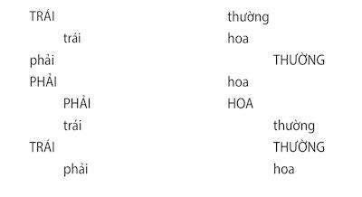
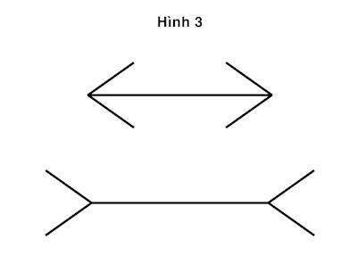

# PHẦN I. HAI HỆ THỐNG

# Chương 1. Những nét tính cách

Để có thể khám phá trí óc của bạn khi nó vận hành ở chế độ tự động ra sao, xin mời liếc mắt nhìn xuống bức hình dưới đây.

Kinh nghiệm của bạn khi nhìn vào khuôn mặt của người phụ nữ này dựa trên sự kết hợp nhuần nhuyễn giữa quan sát và tư duy trực giác. Rất nhanh và rất rõ ràng, vừa thoạt nhìn bạn đã nhận ra người phụ nữ này có mái tóc tối màu và cô ta đang rất giận dữ. Hơn thế nữa, những gì quan sát còn được bạn liên tưởng đến tương lai. Bạn cảm nhận rằng người phụ nữ này sắp sửa “phun ra” những lời độc địa với rất nhiều khả năng là bằng một chất giọng lảnh lót đến xuyên thấu màng nhĩ người nghe. Linh cảm về hành động tiếp theo của người phụ nữ này xuất hiện trong trí óc của bạn một cách tự động mà chẳng cần tiêu tốn một chút nỗ lực nào để cảm nhận được nó. Bạn tuyệt nhiên không có chủ ý thấu hiểu tâm trạng của cô ta, cũng như không hề cố gắng dự đoán những gì mà cô ta sẽ làm; phản ứng của bạn đối với hình ảnh này hoàn toàn không mang lại cảm giác như bạn vừa thực hiện một hành động nào đó. Chỉ đơn giản là nó đã diễn ra một cách vô thức như thế trong trí óc của bạn. Đó chính là một ví dụ điển hình để có thể hiểu được về cơ chế tư duy nhanh.

Giờ thì bạn hãy xem xét vấn đề tiếp theo:

**17 x 24**

Ngay lập tức, bạn biết đây là một phép tính nhân của toán học, có thể bạn có bút chì và giấy, hoặc không có gì đi chăng nữa thì bạn cũng thừa khả năng để giải được phép tính này. Trong trí óc của bạn cũng xuất hiện một vài phán đoán lờ mờ của trực giác về một dải những đáp án gần đúng cho phép tính nhân này. Có thể rất nhanh bạn nhận thấy cả hai đáp án 12.609 hay 123 đều không đúng. Tuy vậy, nếu không dành thời gian ngồi tính toán, có thể bạn cũng không dám chắc 568 cũng không phải là một đáp án đúng. Một đáp án đúng đã không xuất hiện trong đầu óc bạn và bạn cảm thấy tốt hơn hết là mình nên lựa chọn chiếc máy tính để làm phép tính nhân này. Nếu bạn vẫn không muốn nhờ đến chiếc máy tính ấy, thì giờ bạn thử cố ngồi tính phép tính nhân này xem nào.

Bạn đã trải nghiệm tiến trình tư duy chậm khi các công đoạn như trên tuần tự diễn ra trong đầu. Đầu tiên, bạn cố gắng khôi phục trí nhớ của mình và lập trình lại chương trình nhận thức liên quan đến phép nhân mà bạn đã được học khi ngồi trên ghế nhà trường, sau đó bạn thử áp dụng nó vào phép nhân này. Hành động lôi máy tính ra là một khuynh hướng của quá trình khôi phục trí nhớ. Bạn cảm thấy khó khăn khi phải huy động quá nhiều dữ liệu trong bộ nhớ, trong khi đó bạn vẫn cần giữ cân bằng để nhận thức xem mình đang ở đâu và sẽ đi đâu, trong khi vẫn phải chú tâm tới việc tìm ngay ra đáp án. Đây chính là tiến trình hoạt động của trí não, đó là: Cân nhắc, nỗ lực, tuần tự và là một bản mẫu của tư duy chậm. Cái máy tính không phải là sự kiện duy nhất nhảy ra trong đầu óc của bạn, thậm chí ngay cả cơ thể bạn cũng tham gia vào tiến trình tư duy này. Các cơ của bạn gồng lên; huyết áp tăng cao và nhịp tim đập nhanh hơn. Nếu có ai đó nhìn sâu vào mắt bạn trong khi bạn đang xử lý vấn đề này, họ sẽ thấy đồng tử của bạn giãn ra. Đôi đồng tử đó sẽ trở lại trạng thái bình thường ngay sau khi bạn tìm ra đáp án (nhân tiện, cho bạn biết đáp án đúng là 408) hoặc ngay khi bạn từ bỏ phép toán này.

### Hai hệ thống

Vài thập kỷ trở lại đây, các nhà tâm lý học đã dành rất nhiều công sức để nghiên cứu về hai hình thức thức tư duy của con người, thông qua ví dụ về bức hình một người phụ nữ giận dữ và ví dụ về một phép tính nhân mà họ đã gán cho chúng rất nhiều dấu hiệu. Tôi tiếp thu những thuật ngữ vốn được hai nhà tâm lý học Keith Stanovich và Richard West đề xuất và sẽ đưa chúng vào hai hệ thống tư duy là Hệ thống 1 và Hệ thống 2.

- Hệ thống 1 hoạt động theo cơ chế tự động và mau lẹ, với rất ít hoặc hầu như không cần cố gắng và không tự động kiểm soát.

- Hệ thống 2 huy động sự chú ý đến những hoạt động tư duy đòi hỏi sự nỗ lực, bao gồm những phép tính phức tạp. Cơ chế hoạt động của Hệ thống 2 thường gắn với những kinh nghiệm chủ quan, sự lựa chọn và tập trung của chủ thể.

Thuật ngữ Hệ thống 1 và Hệ thống 2 đã được sử dụng rộng rãi trong ngành Tâm lý học nhưng trong cuốn sách này, tôi sẽ tiếp tục đào sâu vấn đề này, bạn đọc có thể đọc sách như xem một vở kịch tâm lý với hai nhân vật chính là hai hệ thống này.

Khi nghĩ về bản thân, chúng ta thường nhận ra mình gần với Hệ thống 2, là một con người ý thức và duy lý, có đức tin, luôn suy nghĩ chín chắn trong từng hành động khi phải đưa ra những quyết định và lựa chọn. Hệ thống 2 luôn nghĩ rằng nó chính là nguồn gốc của hành động, tuy nhiên, Hệ thống tự động 1 mới là “người hùng” của vở kịch tâm lý này. Tôi mô tả Hệ thống 1 như là những ấn tượng và cảm xúc thụ động ban đầu là nguồn gốc chính hình thành những niềm tin và lựa chọn cẩn trọng của Hệ thống 2. Cơ chế tự động của Hệ thống 1 hình thành lên những ý tưởng với những khía cạnh phức tạp đáng kinh ngạc nhưng Hệ thống 2 chậm chạp mới có khả năng cấu trúc lại những suy nghĩ đó tuần tự theo từng bước. Tôi cũng mô tả những tình huống mà Hệ thống 2 giành quyền kiểm soát, thắng thế và tự do thúc đẩy, liên kết với Hệ thống 1. Bạn đọc cũng sẽ thử suy nghĩ về hai hệ thống như những nhân vật với những khả năng, hạn chế và những chức năng riêng biệt.

Chính bởi sự phức tạp đó, xin giới thiệu một số ví dụ về những hoạt động tự động làm nên Hệ thống 1:

- Phát hiện ra một đồ vật nằm xa hơn so với các đồ vật khác.

- Định hướng nơi phát ra một âm thanh lạ.

- Hoàn thành câu “bánh mì và…”

- Nhăn mặt khi xem một bức ảnh gớm ghiếc.

- Nhận ra sự thù nghịch trong một giọng nói.

- Trả lời câu hỏi 2 + 2 = ?

- Đọc chữ trên những tấm biển hiệu lớn.

- Lái xe trên một con đường vắng.

- Đi một nước cờ đỉnh cao (nếu bạn là một kỳ thủ lão luyện).

- Hiểu nghĩa những câu đơn giản.

- Nhận ra cụm từ “một người nhu mì và gọn ghẽ," ám chỉ người thuộc loại nghề nghiệp nào.

Tất cả những hiện tượng trí não này đi kèm với hình ảnh người phụ nữ giận dữ, đều diễn ra một cách tự động và không đòi hỏi phải nỗ lực. Khả năng Hệ thống 1 còn bao gồm cả những kỹ năng bẩm sinh của loài người cũng như của các loài động vật khác. Chúng ta sinh ra đều được chuẩn bị để nhận thức về thế giới xung quanh, nhận biết các đồ vật, định hướng sự chú ý, lảng tránh sự mất mát và khiếp sợ những con nhện chân đầy lông. Những hoạt động trí não khác trở nên nhanh và tự động nhờ việc chúng thường xuyên được luyện tập. Hệ thống 1 còn học cách liên kết các ý tưởng (ví dụ: "Thủ đô của nước Pháp là gì?"), nó cũng học được những kỹ năng như đọc và hiểu những sắc thái khác nhau trong những tình huống xã hội khác nhau. Một vài kỹ năng như tìm ra những nước cờ “độc” chỉ có thể có ở những kỳ thủ cao cường. Những kỹ năng chơi cờ cơ bản còn lại thì ai cũng có thể có cả. Khả năng phát hiện một sự tương đồng với một khuôn mẫu nghề nghiệp đòi hỏi sự hiểu biết rộng rãi về ngôn ngữ, văn hóa và may mắn là hầu hết chúng ta cũng đều có những khả năng này. Tri thức được lưu trữ trong bộ nhớ và chúng ta truy cập vào nó mà không cần huy động sự cố gắng cũng như phải có sự tập trung cao độ.

Một vài hoạt động trí não trong danh sách trên diễn ra một cách hoàn toàn tự động không cần bất cứ sự tập trung nào. Bạn không thể ngăn việc mình có thể hiểu những câu nói đơn giản bằng ngôn ngữ mẹ đẻ của mình hay nhận ra âm thanh lạ bất chợt xuất hiện phát ra từ nơi nào, cũng như bạn không thể ngăn cản bản thân biết được phép cộng 2 + 2 = 4 hay nghĩ đến Paris khi có ai đó nhắc đến thủ đô của nước Pháp. Những hoạt động khác, ví dụ như nhai kẹo cao su dễ bị quy là hành động có chủ ý của chúng ta nhưng thông thường đây lại là hành động theo hướng tự động. Việc kiểm soát sự tập trung, chủ động bị chi phối bởi hai hệ thống. Định hướng nơi phát ra âm thanh thông thường là thao tác không chủ ý của Hệ thống 1, nhưng ngay sau đó lập tức dịch chuyển thành sự tập trung có chủ đích của Hệ thống 2. Có thể bạn sẽ chủ ý ngăn cản mình hướng sự tập trung về phía âm thanh ầm ĩ phát ra hoặc một lời nhận xét ác ý trong một bữa tiệc đông người, nhưng dù cho bạn không quay đầu lại, thì sự chú ý của bạn ngay từ đầu đã bị hướng về phía đó, ít nhất là trong chốc lát. Tuy nhiên, bạn có thể chuyển hướng sự chú ý khỏi một mục tiêu không mong muốn, trước hết là bằng việc bạn sẽ hướng sự tập trung của mình sang một mục tiêu khác.

Các hoạt động của Hệ thống 2 rất đa dạng nhưng chúng có một điểm chung: Chúng đều đòi hỏi sự chú ý và sẽ kết thúc khi bạn không còn tập trung nữa. Dưới đây là vài hoạt động thuộc cơ chế hoạt động của Hệ thống 2:

- Dỏng tai lên đợi tiếng súng ra hiệu bắt đầu một cuộc đua.

- Tập trung chú ý vào những chú hề trên sân khấu xiếc.

- Tập trung để lắng nghe tiếng nói của một người nhất định trong một căn phòng đông đúc và ồn ào.

- Tìm kiếm một phụ nữ tóc bạc.

- Lục trong trí nhớ tên của một ca khúc được truyền tải bởi một giọng hát hay rất cuốn hút.

- Duy trì tốc độ đi bộ nhanh hơn tốc độ đi bộ bình thường của bạn.

- Điều chỉnh hành vi ứng xử sao cho phù hợp với tình huống xã hội cụ thể.

- Đếm số lần xuất hiện của chữ cái a trong một trang dày đặc chữ.

- Cho ai đó biết số điện thoại của bạn.

- Đậu xe trong một ô hẹp (dành cho hầu hết mọi người trừ nhân viên gara).

- So sánh hai chiếc máy giặt dựa trên giá trị sử dụng của chúng.

- Điền bảng kê khai thuế.

- Kiểm tra tính hợp lý của một lập luận logic phức tạp.

Trong tất cả những tình huống trên, bạn buộc phải tập trung chú ý và hiệu quả thường kém, thậm chí là tệ hại nếu bạn không sẵn sàng hoặc sự chú ý của bạn bị chuyển hướng sang các chủ đề không thích hợp. Hệ thống 2 có khả năng thay đổi cách thức hoạt động của Hệ thống 1, bằng cách lập trình tự động những chức năng chú ý và ghi nhớ thông thường. Ví dụ, trong khi đang chờ đợi một người họ hàng ở một nhà ga đông đúc, bạn có xu hướng chỉ nhìn vào những người phụ nữ tóc bạc hoặc những người đàn ông rậm râu, đó là cách nâng cao khả năng phát hiện được người bạn đang chờ đón từ khoảng cách xa. Bạn cũng có thể hướng bộ nhớ của mình tìm kiếm tên của những thủ đô bắt đầu bằng chữ cái N hoặc tên của những cuốn tiểu thuyết hiện thực của Pháp. Và khi bạn thuê một chiếc xe hơi của sân bay Heathrow ở London, người lái xe có thể nhắc bạn nhớ rằng: “Ở̉ đây chúng tôi lái xe bên phía trái đường.” Trong tất cả những tình huống ấy, bạn được yêu cầu làm một điều gì đó khác so với cách thông thường mà bạn vẫn hay làm và bạn sẽ nhận thấy rằng sự cố gắng duy trì hàng loạt những yêu cầu như vậy đòi hỏi bạn phải nỗ lực hơn bình thường.

Cụm từ hay được sử dụng “tập trung chú ý” là để chỉ một năng lượng: Bạn phải sử dụng sự chú ý tạm thời của bản thân, đổi lại bạn có thể phán đoán được các hoạt động và nếu bạn cố gắng sử dụng vượt quá khả năng chú ý của mình, bạn sẽ thất bại. Đó chính là dấu hiệu của những hoạt động đòi hỏi sự chú ý mà chúng có sự tương tác qua lại lẫn nhau, đó là lý do vì sao bạn rất khó hoặc không thể xử lý vài vấn đề phức tạp diễn ra cùng một lúc. Bạn không thể vừa tính nhẩm phép nhân 17 x 24 trong lúc cố rẽ trái khi đang lái xe trên một con đường đông người qua lại, thực tế là bạn cũng không nên thử. Bạn có thể làm vài việc cùng một lúc nhưng chỉ là những việc đơn giản và không bị thúc ép. Có thể sẽ vẫn an toàn khi bạn góp chuyện vài câu với hành khách khi đang lái xe trên một đoạn cao tốc vắng và rất nhiều bậc phụ huynh thú nhận với đôi chút hối lỗi rằng họ có thể vừa đọc truyện cho con nghe vừa nghĩ đến một vấn đề khác.

Tất cả mọi người đều được cảnh báo về khả năng tập trung sự chú ý tạm thời, xét về hành vi xã hội, khả năng của chúng ta tương thích với những giới hạn này. Ví dụ, khi một người tài xế đang lái xe vượt một chiếc xe tải trên một đoạn đường hẹp, những hành khách nhạy cảm nhận ra và lập tức ngừng trò chuyện. Họ hiểu rằng làm phân tán sự chú ý của tài xế vào lúc này không phải là việc làm đúng đắn và đồng thời mong rằng bác tài xế tạm thời không nghe thấy những gì họ nói.

Tập trung cao độ vào một nhiệm vụ có thể khiến người ta tạm thời thực sự đui mù, ngay cả với những tác nhân mà bình thường vẫn thu hút được sự chú ý của họ. Bằng chứng gây kinh ngạc nhất đã được Christopher và Daniel Simons chỉ ra trong cuốn sách The Invisible Gorilla (Tạm dịch: Chú khỉ đột vô hình) của mình. Họ tiến hành sản xuất một đoạn phim ngắn về trận đấu của hai đội bóng chày, một đội mặc áo trắng và một đội mặc áo đen. Sau đó, yêu cầu người xem đếm số vận động viên mặc áo trắng mà không cần để ý đến những vận động viên mặc áo đen đang đi lại trên sân thi đấu. Nhiệm vụ này rất khó khăn và cực kỳ cuốn hút. Đến giữa đoạn phim, một người phụ nữ mang trên mình bộ đồ của một con khỉ đột xuất hiện, chạy ngang qua sân vận động, vừa đi vừa đấm thùm thụp vào ngực. Người phụ nữ mặc bộ đồ khỉ đột xuất hiện trong vòng 9 giây. Hàng ngàn người xem đoạn phim và khoảng một nửa trong số đó không hề phát hiện ra điều gì bất thường. Nhiệm vụ đếm và đặc biệt là yêu cầu đếm các cầu thủ của một đội và phớt lờ các cầu thủ đội còn lại đã tạo ra sự mù quáng tạm thời. Không một ai không bị gắn vào nhiệm vụ kia khi xem đoạn phim mà không phát hiện ra người phụ nữ mặc bộ đồ con khỉ đột. Nhìn và định hướng là những chức năng tự động của Hệ thống 1 nhưng chúng bị phụ thuộc vào sự định vị của một số sự chú ý đối với các kích thích có liên quan. Các tác giả nhấn mạnh rằng quan sát có giá trị nhất trong nghiên cứu của mình đó là ai cũng nhận thấy kết quả này thực sự đáng kinh ngạc. Thực tế thì tất cả những người không nhìn thấy người phụ nữ mặc bộ đồ khỉ đột lúc đầu đều chắc chắn là không hề có người phụ nữ mặc bộ đồ khỉ đột nào hết, họ không thể tưởng tượng nổi rằng, mình đã bỏ qua một sự kiện độc đáo đến vậy. Nghiên cứu “Chú khỉ đột vô hình” đã minh họa cho hai thực tế quan trọng về đầu óc của chúng ta: Chúng ta có thể mù trước sự thật hiển nhiên và chúng ta cũng mù trước sự mù quáng của chính bản thân mình.

### Tóm tắt dàn ý:

Sự tương tác của hai hệ thống là chủ đề lặp đi lặp lại trong cuốn sách này và thực hiện một bản tóm tắt về nó là một yêu cầu cần thiết. Trong câu chuyện mà tôi sẽ kể tới đây, Hệ thống 1 và Hệ thống 2 đều được kích hoạt mỗi khi chúng ta thức dậy. Hệ thống 1 hoạt động tự động và Hệ thống 2 thì thường hoạt động ở chế độ thoải mái không đòi hỏi nhiều nỗ lực. Hệ thống 1 liên tục phát đi những tín hiệu gợi ý cho Hệ thống 2 như là: Ấn tượng, trực giác, sự chú ý và cảm xúc. Nếu chúng được Hệ thống 2 xác nhận, ấn tượng và trực giác sẽ chuyển thành niềm tin và thúc đẩy chúng trở thành những hành động tự động. Khi mọi thứ hoạt động nhuần nhuyễn, vốn thường ăn ý trong hầu hết thời gian, Hệ thống 2 sẽ tiếp nhận sự gợi ý của Hệ thống 1 mà rất ít thay đổi hoặc không thay đổi gì. Thông thường bạn tin tưởng vào những ấn tượng của mình và hành động theo ý thích, điều đó thường là tốt. Khi Hệ thống 1 gặp một tình huống khó khăn, nó sẽ gọi Hệ thống 2 ra hỗ trợ thực hiện những tiến trình chi tiết và đặc thù hơn để có thể xử lý các vấn đề tại thời điểm đó. Hệ thống 2 sẽ được huy động khi nảy sinh một vấn đề mà Hệ thống 1 không thể đưa ra được lời giải đáp, đó có thể là tình huống khó khăn khi bạn phải trả lời 17 x 24 bằng bao nhiêu ngay lập tức. Hoặc khi ngạc nhiên trước điều gì đó, bạn cũng sẽ nhận ra sự xuất hiện một cảm giác của chú ý tiềm thức. Hệ thống 2 được kích hoạt khi một sự kiện bị phát hiện và đe dọa đến hình mẫu thế giới mà Hệ thống 1 đã duy trì. Trong thế giới mà Hệ thống 1 đã quy ước đó, đèn bàn không nhảy nhót và chó không sủa, cũng như khỉ đột không chạy qua chạy lại ở sân bóng chày. Thí nghiệm “Chú khỉ đột vô hình” chứng minh rằng một vài sự chú ý là điều cần thiết để phát hiện ra những tương tác gây kinh ngạc. Sau đó, sự kinh ngạc kích hoạt và định hướng đến sự chú ý của bạn; bạn sẽ tập trung, rồi bạn sẽ lục tìm trong ký ức một câu chuyện sao cho thích hợp để lý giải cho sự kiện gây kinh ngạc ấy. Hệ thống 2 cũng đồng thời ghi nhận sự định hướng tiếp diễn trong hành vi của chính bạn, như là sự kiểm soát giúp bạn giữ lịch sự khi đang giận dữ và cảnh báo khi bạn đang lái xe trong đêm tối.

Hệ thống 2 được huy động để tăng cường sự cố gắng khi nó phát hiện ra một lỗi sai có thể xảy ra. Hãy nhớ lúc bạn bất ngờ buột miệng thốt ra một lời nhận xét ác ý và nhớ xem bạn đã phải cố gắng nhường nào để khôi phục lại sự kiểm soát của bản thân. Tóm lại là, hầu hết những gì bạn (tức Hệ thống 2 của bạn), nghĩ và làm đều có nguồn gốc từ Hệ thống 1 nhưng Hệ thống 2 nhận trách nhiệm xử lý khi mọi việc trở nên khó khăn và nó thường chịu trách nhiệm ra quyết định cuối cùng.

Sự phân công lao động giữa Hệ thống 1 và Hệ thống 2 cực kỳ hiệu quả: Nó giảm thiểu tối đa sự nỗ lực của chúng ta và điều chỉnh kết quả theo cách mà chúng ta muốn. Sự sắp xếp hoạt động hiệu quả trong hầu hết thời gian bởi vì Hệ thống 1 thực hiện tốt vai trò của mình: Các mô hình về các tình huống quen thuộc của nó rất chính xác, những dự báo ngắn hạn và những phản ứng ban đầu rất mau lẹ của nó trước các thách thức cũng thường chuẩn xác và thường thích đáng. Tuy vậy, Hệ thống 1 có sự sai lệch với những lỗi sai hệ thống có thiên hướng nảy sinh trong những tình huống đặc thù. Chúng ta có thể thấy, đôi khi có những câu trả lời lại dễ hiểu hơn là câu hỏi và bởi vì câu hỏi thể hiện sự không logic và thống kê. Một hạn chế nữa của Hệ thống 1 là nó không thể bị gián đoạn. Nếu trước mắt bạn xuất hiện một bảng hiệu được viết thứ tiếng mà bạn biết, bạn sẽ dễ dàng đọc nó, trừ khi sự chú ý của bạn khi ấy hoàn toàn tập trung vào chỗ khác.

### MÂU THUẪN

Mô tả một hình biến thể của một thí nghiệm cổ điển trình bày sự mâu thuẫn giữa hai hệ thống. Bạn nên làm bài tập này trước khi đọc tiếp.

Trong cả hai nhiệm vụ, hầu hết mọi người đều đọc đúng các từ, và hẳn là các bạn cũng nhận thấy trong mỗi nhiệm vụ thì có một số chỗ dễ đọc hơn rất nhiều so với chỗ khác. Xác định các chữ viết in hoa và in thường ở cột bên trái dễ hơn, còn cột bên phải khiến bạn phải đọc chậm lại và có khi bạn còn nói lắp hoặc nói vấp. Khi bạn xác định vị trí của các từ, cột bên trái lại khó hơn và cột bên phải lại dễ hơn nhiều.

*Nhiệm vụ đầu tiên của bạn là hãy đọc từ trên xuống dưới cả hai cột, đọc to lên xem từ nào được viết in thường, từ nào được viết in hoa. Khi kết thúc nhiệm vụ đầu tiên, tiếp tục đọc từ trên xuống dưới các cột lại một lần nữa, lần này đọc xem từ nào được căn lề trái và từ nào được căn lề phải, bằng cách đọc lên (hoặc nói thầm với bản thân) “TRÁI” hay “PHẢI”.*

*Hình minh họa mâu thuẫn nhận thức (Hiệu ứng Stroop)*

Những nhiệm vụ này thuộc về Hệ thống 2, bởi hành động nói to lên từ viết “hoa/thường” hoặc từ nằm “phải/trái” không phải là hoạt động thông thường khi nhìn một cột từ trên xuống dưới. Một trong số những điều mà phải cố gắng làm khi thực hiện nhiệm vụ này, đó là lập trình trí nhớ của mình sao cho việc phát ra những từ có liên quan (in hoa và in thường đối với nhiệm vụ 1) trở thành phản xạ của miệng. Khi đọc cột đầu tiên, việc ưu tiên đối với một số từ được chọn khá hiệu quả và việc cưỡng lại không đọc những từ còn lại là một nhiệm vụ tương đối dễ dàng nhưng đến cột thứ hai bao gồm những từ mà bạn lựa chọn được theo quy luật và bạn có thể lờ đi ý nghĩa của chúng. Hầu hết mọi người đều có thể thực hiện chính xác nhiệm vụ này nhưng để lặp đi lặp lại các câu trả lời đúng là rất khó và làm bạn căng thẳng, nó khiến tốc độ trả lời của bạn chậm lại. Vậy là bạn đã phải đối mặt với mâu thuẫn giữa việc bạn phải cố gắng thực hiện một yêu cầu, trong khi có một câu trả lời khác cứ tự động xen vào.

Sự mâu thuẫn giữa một phản ứng tự động và một nỗ lực kiểm soát diễn ra rất phổ biến trong cuộc sống của chúng ta. Chúng ta đều biết cảm giác cố gắng không nhìn chằm chằm vào một cặp đôi ăn vận kỳ cục ở bàn kế bên trong một nhà hàng. Chúng ta cũng biết cảm giác cố gắng tập trung để đọc một cuốn sách tẻ nhạt, đôi khi bạn phải đọc lại cả một đoạn văn vì bạn chẳng hiểu nó viết về cái gì. Ở những vùng có mùa đông khắc nghiệt, rất nhiều tài xế nhớ cảm giác khi xe của họ mất phanh trên đường băng tuyết và phải cố gắng giữ lái để làm theo chỉ dẫn vốn đi ngược lại với những gì mà thông thường họ vẫn làm: “Đánh lái theo hướng ngược lại, dù có làm gì đi nữa, chớ có động vào má phanh!” Hay tất cả mọi người sống trên đời này nhận thức rằng đừng nên nguyền rủa ai đó cút xuống địa ngục. Một trong những nhiệm vụ của Hệ thống 2 là vượt qua những thôi thúc của Hệ thống 1. Nói cách khác, Hệ thống 2 đảm nhiệm phần tự chủ trong mỗi chúng ta.

### ẢO GIÁC

Để hiểu rõ giá trị độc lập của Hệ thống 1, cũng như phân biệt sự khác nhau giữa ấn tượng và niềm tin, mời bạn hãy nhìn kỹ hình số 3.

Hình ảnh này không có gì đặc biệt: Hai đoạn thẳng với độ dài khác nhau, có gắn thêm “vây”, chỉ về hai phía khác nhau. Đoạn thẳng bên dưới rõ ràng là dài hơn đoạn thẳng bên trên. Đó là những gì tất cả chúng ta đều nhìn ra rất tự nhiên, chúng ta tin tưởng những gì mình vừa trông thấy. Tuy nhiên, nếu bạn đã từng biết hình ảnh này trước đó, bạn sẽ dễ dàng nhận ra đây chính là minh họa nổi tiếng về ảo giác của Muller-Lyer. Và bằng cách dùng thước đo, bạn có thể dễ dàng đo và biết được độ dài của chúng là bằng nhau.

*Ảo giác Müller-Lyer*

Giờ thì bạn đã đo đạc hẳn hoi, bạn - tức Hệ thống 2 của bạn, cái con người lý trí mà bạn gọi là “tôi” ấy - giờ đã có một niềm tin mới: Bạn hay Hệ thống 2 biết rằng hai đoạn thẳng trên có chiều dài bằng nhau. Nếu có hỏi bạn về độ dài của chúng, bạn sẽ nói điều mà bạn vừa mới biết. Nhưng nếu chỉ nhìn thì bạn vẫn thấy đoạn thẳng phía dưới dài hơn đoạn thẳng phía trên. Bạn buộc phải tin vào sự đo đạc, nhưng bạn không thể ngăn cản Hệ thống 1 làm nhiệm vụ của nó, bạn không thể bắt mắt mình – Hệ thống 1 nhìn thấy hai đường thẳng đó dài bằng nhau, mặc dù bạn – Hệ thống 2 biết chắc chắn điều đó. Để chống lại ảo giác, chỉ có một cách duy nhất: Bạn phải học cách hoài nghi chính cảm giác của mình về chiều dài của các đoạn thẳng khi chúng được gắn thêm “vây”. Để áp dụng được nguyên tắc đó, bạn có thể nhận ra những ảo giác và nhớ lại những gì bạn đã được biết là chính xác. Nếu bạn có thể làm được điều này, bạn sẽ không bao giờ bị “lừa” bởi những minh họa của Muller-Lyer. Nhưng dù thế nào đi nữa, bạn – Hệ thống 1 sẽ vẫn thấy một đoạn thẳng dài hơn đoạn thẳng còn lại.

Không phải mọi ảo giác đều có thể nhìn thấy bằng mắt thường. Có cả những ảo giác trong suy nghĩ, mà người ta gọi nó là ảo giác nhận thức. Khi vừa tốt nghiệp đại học, tôi đã tham gia vài khóa học về nghệ thuật và tâm lý. Trong một bài giảng, thầy giáo của chúng tôi đã giảng cho chúng tôi một mẩu truyện ngụ ngôn. Đây là những gì thầy đã kể: “Rồi sẽ có lúc các bạn gặp phải một bệnh nhân, anh ta chia sẻ với bạn vô số những sai lầm mà anh ta phải chịu đựng trong những lần điều trị trước. Bệnh nhân này miêu tả một cách rành rọt chuyện các nhà trị liệu đã hiểu sai về anh ta như thế nào, anh ta nhận ra rằng bạn khác những bác sĩ trước. Bạn đồng cảm với anh ta, bạn bị thuyết phục rằng bạn hiểu anh ta và bạn chính là người có khả năng giúp đỡ anh ta.” Đến đoạn này, thầy giáo cất cao giọng: “Đừng bao giờ nghĩ đến chuyện chữa trị cho bệnh nhân này! Hãy tống anh ta ra khỏi phòng khám! Đây là loại bệnh nhân tâm thần nhất và không bao giờ các bạn có thể giúp được anh ta.”

Rất nhiều năm sau này tôi mới học được rằng những gì thầy giáo đã cảnh báo chúng tôi chính là sự chống lại sức hấp dẫn của tâm lý và khi đã trở thành chuyên gia đầu ngành nghiên cứu về Tâm lý trị liệu tôi mới thấy những lời khuyên của ông thầy kia là đúng đắn. Hiện tượng này tương thích với ảo giác mà Muller Lyer đã trình bày là những gì chúng tôi được dạy không phải là cảm thấy thế nào về bệnh nhân đó. Hiển nhiên là thầy giáo cho rằng cảm giác cảm thông của chúng tôi sẽ bị mất kiểm soát; nó trỗi dậy từ Hệ thống 1. Hơn nữa, thông thường không ai dạy chúng tôi phải nghi ngờ cảm xúc của mình đối với bệnh nhân. Việc bị hấp dẫn bởi một bệnh nhân - người cứ lặp đi lặp lại tiền sử điều trị bị thất bại của mình là một dấu hiệu nguy hiểm - giống như những chiếc “vây” gắn vào hai đoạn thẳng song song, chúng đánh lạc hướng sự chú ý của chúng ta. Đó chính là một ảo giác – được gọi tên là một ảo giác nhận thức - và tôi (hay Hệ thống 2 của tôi) được dạy cách làm thế nào để nhận ra nó và được khuyên là đừng có tin tưởng vào nó cũng như hành động dựa trên nó.

Câu hỏi đặt ra là: Có khi nào chúng ta có thể chống lại được sức hấp dẫn của nó không. Thông điệp trong những ví dụ này không phải điển hình. Trong khi Hệ thống 1 hoạt động một cách tự động và không thể chủ động “ngắt mạch” thì thường rất khó phát hiện để ngăn chặn các lỗi sai của suy nghĩ tiềm thức. Không phải lúc nào cũng có thể tránh được các sai lệch trong hoạt động tư duy này, bởi vì Hệ thống 2 không có bất cứ một đầu mối nào liên hệ với các lỗi sai. Ngay cả khi các đầu mối liên kết với lỗi sai dường như rất rõ ràng, các lỗi sai chỉ có thể được ngăn ngừa khi có sự hỗ trợ giám sát và những hoạt động rất nỗ lực của Hệ thống 2. Tuy nhiên, “không ai có thể nắm tay suốt từ tối đến sáng”, tuy nhiên, việc liên tục đề cao cảnh giác không hẳn đã tốt và thực tế là cách đó chắc chắn không khả thi. Bởi vì liên tục đặt câu hỏi với chính những suy nghĩ của mình sẽ khiến bạn trở nên rất mệt mỏi và cơ chế vận hành của Hệ thống 2 thì quá chậm, không hiệu quả khi nó phải đảm nhận vai trò của Hệ thống 1 trong việc phải ra quyết định liên tục. Điều tốt nhất bạn có thể làm là thỏa hiệp: Hãy học cách nhận biết các tình huống dễ nảy sinh sai lầm và cố gắng tránh các sai lầm hiển nhiên hết mức có thể trong các tình huống đã được báo động khẩn cấp. Cuốn sách này được viết với tiền đề là bao giờ người ta cũng dễ nhận ra lỗi lầm của người khác hơn là nhận ra lỗi lầm của bản thân mình.

### HƯ CẤU HỮU ÍCH

Vậy là bạn đã được giới thiệu về hai hệ thống như hai nhân tố trong một trí não với những phẩm chất, khả năng và giới hạn rất riêng. Tôi thường sử dụng các câu văn, trong đó các hệ thống được coi như những chủ ngữ, như “Hệ thống 2 suy tính hệ quả.”

Việc sử dụng ngôn ngữ này bị coi là một lỗi sai và thường không được giới khoa học chấp nhận, bởi vì nó dường như lý giải rằng các suy nghĩ và hành động của một con người lại bị chi phối bởi suy nghĩ và hành động của những “nhân vật tí hon” sống bên trong đầu óc của anh ta. Về mặt ngữ pháp, thì câu này có cấu trúc giống như “Người quản gia hay ăn cắp vặt.” Các đồng nghiệp của tôi sẽ chỉ ra rằng hành động của người quản gia, trên thực tế, đã giải thích cho sự biến mất của món tiền và họ có quyền đặt câu hỏi về việc liệu Hệ thống 2 giải thích thế nào về hệ quả tính toán. Câu trả lời của tôi là ý nghĩa của câu chủ động ngắn gọn đó là thuộc tính tính toán của Hệ thống 2 có giá trị như một sự mô tả, chứ không phải một lời giải thích. Nó là câu nói giản lược của câu này: “Tính nhẩm là một hành động tự nhiên đòi hỏi sự nỗ lực, mà ta không nên thực hiện khi đang cố rẽ trái và có liên hệ với sự giãn nở đồng tử và tăng nhịp tim.”

Tương tự như vậy, câu tuyên bố kiểu “lái xe bon bon trên đường vắng thuộc về Hệ thống 1 nghĩa là điều khiển một chiếc xe vào ngã rẽ là một hành động mang tính tự động và hầu như không cần đến sự nỗ lực nào. Nó cũng ngụ ý rằng một tài xế kinh nghiệm có thể lái xe trên một đoạn đường cao tốc vắng vẻ mà vẫn có thể tham gia đồng thời vào một cuộc trò chuyện. Cuối cùng, “Hệ thống 2 cảnh báo James khỏi phản ứng ngu ngốc để tránh bị ăn chửi” nghĩa là James có thể hành xử điên dại hơn nếu như nỗ lực kiểm soát của anh ta bị thất bại (như khi anh ta đã say bí tỉ).

Hệ thống 1 và Hệ thống 2 là nhân vật chính trong câu chuyện mà tôi sẽ kể trong cuốn sách này, tôi chắc hẳn phải làm rõ một điều, rằng chúng là những nhân vật hư cấu trong một câu chuyện tưởng tượng mà tôi muốn lý giải về cách vận hành trí não của con người. Hệ thống 1 và Hệ thống 2 không phải là những thực thể điển hình có các bộ phận của một cơ thể với lục phủ ngũ tạng. Và cũng không có phần nào trong não bộ hay bất cứ hệ thống nào được gọi là đầu não chỉ huy. Rất có thể bạn sẽ hỏi: Vậy thì giới thiệu các nhân vật hư cấu với những cái tên xấu xí làm gì trong cuốn sách nghiên cứu này? Câu trả lời là cuốn sách này cần có các nhân vật này, bởi vì nó đại diện cho một số thói quen trong đầu óc của chúng ta, cả của bạn và của tôi. Người ta có thể dễ dàng hiểu về một câu văn nếu nó được miêu tả dưới dạng một nhân tố (Hệ thống 2) hơn là một cái gì đó, một phẩm chất nào đó. Nói cách khác “Hệ thống 2” sẽ là chủ ngữ cho một câu tốt hơn là một “phép tính nhẩm.” Trí óc - đặc biệt là Hệ thống 1 - dường như có một khuynh hướng đặc biệt để xây dựng và diễn giải những câu chuyện về các nhân tố tích cực, với cá tính, thói quen và khả năng hẳn hoi. Bạn sẽ nhanh chóng định hình những quan điểm xấu về một lão quản gia ăn cắp vặt, bạn sẽ nghĩ lão có nhiều hành vi xấu và bạn sẽ nhớ về lão, dù chỉ là trong một khoảnh khắc. Đó cũng là hy vọng của tôi khi sử dụng ngôn ngữ của hệ thống bằng lối hành văn này để giúp các bạn sẽ hiểu hơn về hai hệ thống.

Tại sao lại gọi chúng là Hệ thống 1 và Hệ thống 2 chứ không phải là miêu tả kỹ như “Hệ thống tự động” và “Hệ thống nỗ lực”? Lý do rất đơn giản: Nói “Hệ thống tự động” dài hơn so với “Hệ thống 1” và chiếm nhiều diện tích trong bộ nhớ của bạn hơn. Điều này có ảnh hưởng đấy, bởi vì bất cứ thứ gì chiếm nhiều diện tích bộ nhớ của bạn đều làm giảm thiểu khả năng suy nghĩ của bạn. Bạn nên coi “Hệ thống 1” và “Hệ thống 2” như những cái tên thân mật, kiểu như Bob và Joe, việc đặt tên cho các nhân vật sẽ giúp bạn hiểu rõ hơn về chúng khi đọc cuốn sách này. Khi phải đưa ra các phán đoán và lựa chọn, các hệ thống hư cấu này giúp tôi dễ dàng suy nghĩ hơn và giúp các bạn dễ hiểu hơn đối với những gì tôi viết.

### PHÁT NGÔN CỦA HAI NHÂN VẬT: HỆ THỐNG 1 VÀ HỆ THỐNG 2

> *“Anh ta là người 'rất dễ gây ấn tượng', một vài ấn tượng của anh ta chỉ là ảo giác.”*

> *“Đó chỉ đơn thuần là phản ứng của Hệ thống 1. Cô ta đã phản ứng với mối đe dọa trước khi kịp nhận ra nó.”*

> *“Hệ thống 1 của bạn lên tiếng đấy. Chậm lại và để Hệ thống 2 của bạn chỉ huy đi.”*