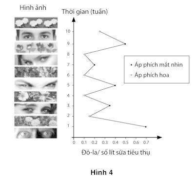

# Chương 4. Bộ máy liên tưởng

Để bắt đầu hành trình khám phá hoạt động kỳ diệu của Hệ thống 1, mời bạn nhìn vào các từ sau đây:

Chuối nôn mửa.

Chỉ cần một đến hai giây, có biết bao thứ lóe lên trong đầu bạn khi nhìn vào từ “chuối nôn mửa”. Một số hình ảnh và kỷ niệm không mấy dễ chịu hiện ra trong đầu bạn. Khuôn mặt bạn có lẽ sẽ nhăn lại đôi chút, thể hiện sự ghê ghê và rất có thể, một cách vô thức bạn sẽ đẩy cuốn sách này ra xa mình hơn một chút. Nhịp tim tăng lên, lông tơ trên cánh tay dựng lên đôi chút và tuyến mồ hôi của bạn được kích hoạt. Tóm lại, bạn đã phản ứng với một từ mang nghĩa kinh tởm mà không hề kiểm soát được hình ảnh của mình khi phản ứng trước hiện thực ấy. Tất cả quá trình phản ứng này đều diễn ra hoàn toàn rất tự nhiên, nằm ngoài tầm kiểm soát của bạn.

Không có lý do đặc biệt nào để bạn phải phản ứng như vậy nhưng đầu óc bạn tự động hình thành một liên tưởng tạm thời và một liên hệ mang tính hệ quả, Chuối là nguyên nhân gây buồn nôn (nhưng chớ lo, mọi việc sẽ mau chóng qua thôi.) Trạng thái bộ nhớ của bạn đã thay đổi theo nhiều cách khác: Giờ thì bạn sẵn sàng nhận ra và phản ứng với những thứ và khái niệm có mối liên hệ với “nôn mửa”, ví dụ buồn nôn, khó chịu, hoặc lờm lợm và các từ ngữ có liên hệ với “chuối” như màu vàng, hoa quả, thậm chí là táo và dâu.

Thông thường, sự nôn mửa xuất hiện trong một số hoàn cảnh cụ thể, ví dụ như bữa tiệc thâu đêm và quá chén. Bạn cũng thường không dễ nhận ra những từ ngữ có liên hệ với những nguyên nhân khác nữa, chúng cho cùng một kết quả mà bạn không mong đợi. Hơn nữa, Hệ thống 1 của bạn ghi nhận thực tế rằng việc đặt hai từ cạnh nhau như thế là trái với lẽ thường: Có thể trước đó chưa bao giờ bạn có liên tưởng hai sự việc này với nhau. Bạn đã trải qua một kinh nghiệm tương đối khác biệt so với trải nghiệm trước đây của mình.

Một loạt phản ứng phức tạp xuất hiện một cách mau lẹ, tự nhiên và không đòi hỏi bất cứ sự cố gắng nào từ phía bạn. Bạn không cố tình nhưng bạn cũng chẳng thể ngăn được chúng xuất hiện. Đó chính là cách vận hành của Hệ thống 1. Những hiện tượng xuất hiện kể trên là kết quả của việc nhìn thấy các từ ngữ diễn ra nhờ một quá trình gọi là kích hoạt liên tưởng: Các ý tưởng này được khởi phát từ rất nhiều ý tưởng khác, chúng xuất hiện ào ạt như thác đổ trong trí não của bạn. Điểm cốt lõi trong hệ thống phức hợp các hiện tượng trí não chính là sự gắn kết giữa chúng. Mỗi một nhân tố đều được kết nối với một nhân tố khác, hỗ trợ và được hỗ trợ, củng cố cho nhân tố khác. Một từ khơi gợi những ký ức, từ đó tạo ra cảm xúc và cảm xúc đến lượt nó lại trở thành tác nhân tạo ra những biểu hiện khuôn mặt và những phản ứng khác, ví dụ như trạng thái căng thẳng hoặc thái độ ghê tởm. Biểu hiện khuôn mặt với biểu cảm ghê tởm củng cố những cảm giác mà chúng có liên kết trong trí óc bạn. Tất cả diễn ra nhanh và đồng thời, tùy biến theo nhận thức, cảm xúc và phản ứng cơ học của từng người và tất cả đều tác động qua lại lẫn nhau, nó được gọi là tính liên kết.

Chỉ trong một vài giây, bạn đã hoàn thành một phản ứng kỳ diệu, một cách tự động và vô thức. Bắt đầu từ một sự kiện bất ngờ, Hệ thống 1 lập tức đặt ra vô số giả thuyết đều có vẻ có lý, ví dụ như đặt hai từ không có vẻ gì liên quan cạnh nhau, bằng cách tạo ra các liên hệ nhân quả từ các từ ngữ đó; dự đoán những đe doạ tiềm ẩn và tạo ra khung cảnh cho những tiến triển sắp tới bằng việc chuẩn bị cho bạn những sự kiện có khả năng xảy ra; nó cũng tạo ra khung cảnh cho sự kiện được nhắc đến bằng cách đánh giá xem sự kiện đó đặc biệt ở mức nào. Bạn kết thúc quá trình này bằng việc cung cấp thông tin của quá khứ và chuẩn bị cho tương lai có thể diễn ra.

Quá trình vừa diễn ra lạ thường ở một điểm, đó là Hệ thống 1 chỉ làm một việc duy nhất là liên kết hai từ với hai ý nghĩa đơn thuần lại với nhau. Cơ thể bạn hồi đáp lại bằng một loạt những phản ứng đối với một thứ có thực, phản ứng cảm xúc và cơ thể phản ánh một phần sự diễn giải của các hiện tượng. Những năm gần đây, các nhà khoa học nhận thức luận đã cổ vũ cho ý tưởng nhận thức là sự thể hiện; bạn tư duy bằng cả cơ thể, chứ không chỉ với bộ não.

Từ rất lâu, người ta đã biết đến cơ chế tạo ra một loạt những hiện tượng trí não như trên: Nó chính là sự kết hợp của các ý tưởng. Tất cả chúng ta đều biết rằng, chính nhờ kinh nghiệm trong quá khứ của bạn mà các ý tưởng nối đuôi nhau tuần tự xuất hiện trong trí não của mình. Các triết gia Anh thế kỷ XVII và XVIII đã nghiên cứu các quy luật để giải thích cho sự tiếp nối này. Trong cuốn sách Nhu cầu hiểu biết về loài người xuất bản năm 1748, nhà triết học người Scotland David Hume đã đúc rút ra ba nguyên tắc của sự liên tưởng: Sự tương đồng, sự liên tưởng về mặt thời gian, địa điểm và tính hệ quả. Khái niệm về sự liên tưởng đã thay đổi triệt để từ thời Hume, nhưng ba nguyên tắc trên vẫn đóng vai trò là nền tảng cho những xuất phát điểm.

Tôi sẽ phát triển cái nhìn khái quát về thế nào là một ý tưởng. Có thể cụ thể hoặc trừu tượng và nó có thể được biểu hiện theo nhiều cách khác nhau, dưới dạng: Một động từ, một danh từ, một tính từ hay một biểu tượng. Các nhà tâm lý học cho rằng ý tưởng là một điểm mấu chốt trong một mạng lưới, được gọi là liên kết ký ức, trong đó mỗi ý tưởng lại được liên kết với rất nhiều ý tưởng khác nhau. Có rất nhiều loại liên kết: Nguyên nhân liên kết với hệ quả (virus => cảm lạnh); sự vật với thuộc tính (chanh => màu xanh); sự vật với phạm trù khái quát (chuối => hoa quả). Chúng ta đã tiến thêm một bước so với thời của Hume, đó là ta không còn nghĩ rằng bộ óc phải trải qua một loạt những ý tưởng liên tiếp và lần lượt. Nếu nhìn theo cách hoạt động của hệ thống bộ nhớ liên kết, thì tất cả được diễn ra cùng một lúc. Nó kích hoạt rất nhiều ý tưởng, cũng như bản thân ý tưởng đó lại được kích hoạt là khởi nguồn cho những ý tưởng khác. Hơn thế nữa, chỉ có vài ý tưởng kích hoạt được suy nghĩ một cách có nhận thức, còn lại hầu hết các suy nghĩ liên kết đều diễn ra trong im lặng, ẩn mình trong tiềm thức của mỗi người.

Rất khó chấp nhận khái niệm cho rằng chúng ta phải giới hạn truy cập vào các hoạt động trí óc của con người, bởi vì, tự nhiên mà nói, nó xa lạ so với sự hiểu biết trước đây của chúng ta nhưng đó lại là sự thật: Bạn hiểu về bản thân mình hơn rất nhiều so với những gì bạn nghĩ.

### Sự kỳ diệu của hiệu ứng mồi

Ai cũng biết rằng bước đột phá lớn đầu tiên trong giới hạn hiểu biết của chúng ta về cơ chế hoạt động của liên tưởng chính là sự tiến bộ trong phương pháp đo lường. Vài thập kỷ trở lại đây, cách duy nhất để nghiên cứu các liên tưởng đó là đi hỏi rất nhiều người một số câu hỏi như: “Khi ai đó nói từ BAN NGÀY thì những từ đầu tiên bạn nghĩ đến sẽ là từ gì?”. Các nhà khoa học đã ghi lại tần suất của những câu trả lời thường xuyên nhất, ví dụ như “ban đêm”, “nắng”, hoặc “dài lê thê”. Vào những năm 1980, các nhà khoa học phát hiện ra rằng, đưa sẵn một từ nào đó ra có thể lập tức tạo ra những sự thay đổi có thể đo lường được trong trường hợp có rất nhiều từ liên quan nằm trong trường liên tưởng. Nếu bạn vừa nhìn thấy hoặc nghe thấy từ ĂN (EAT), thì trong khoảnh khắc, bạn có xu hướng điền chữ còn thiếu vào chỗ trống của SO_P để tạo thành từ SOUP (cháo/súp) hơn là SOAP (xà phòng). Chiều ngược lại cũng đúng, tất nhiên, nếu bạn vừa nhìn thấy từ TẮM (SOAP). Chúng ta gọi đó là hiệu ứng mồi, nghĩa là từ ĂN đã mồi cho ý tưởng SÚP và từ TẮM đã mồi ý tưởng cho từ XÀ PHÒNG.

“Hiệu ứng mồi” được thể hiện dưới rất nhiều dạng thức. Nếu từ ĂN đang chiếm lĩnh đầu óc bạn (dù bạn có nhận thức được điều đó hay không), thì thường bạn sẽ nhận biết được từ SOUP nhanh hơn bình thường, dù nó chỉ được nói bằng một cái mấp máy môi hay được viết bằng một bộ phông chữ mờ ảo. Và tất nhiên bạn sẽ không chỉ được mồi để bật ra ý tưởng liên quan đến súp, mà còn là hàng loạt các ý tưởng liên quan đến chuyện ăn uống, bao gồm dĩa, đói, béo, ăn kiêng, bánh. Và nếu bạn vừa ngồi ăn ở một cái bàn bị cập kênh trong một nhà hàng, thì bạn cũng sẽ được dẫn dắt để nghĩ đến sự bập bênh. Hơn thế nữa, những ý tưởng được mồi cũng có khả năng khơi gợi ra những ý tưởng khác, dẫu có yếu ớt hơn. Như những con sóng lăn tăn trên mặt hồ, một ý tưởng bé nhỏ như một hòn sỏi có thể tạo sóng lan tỏa cho những ý tưởng tiếp nối nhau. Giờ đây, bản đồ hóa những làn sóng ấy trở thành một trong những chủ đề hấp dẫn, đáng được theo đuổi nhất trong ngành khoa học nghiên cứu về tâm lý học.

Một bước tiến bộ lớn nữa trong nhận thức của chúng ta về bộ nhớ đó là hiệu ứng mồi không chỉ giới hạn trong các khái niệm hay từ ngữ. Bạn không thể biết nó tồn tại như một trải nghiệm mà bạn ý thức được nhưng bạn buộc phải chấp nhận ý tưởng kỳ quặc rằng các hành động của bạn, những tâm trạng của bạn, có thể bị dẫn dắt bởi những sự kiện mà bạn thậm chí còn không nghĩ tới. Trong một thí nghiệm mà ngay sau khi được thực hiện đã trở thành một thí nghiệm kinh điển, nhà tâm lý học John Bargh và các đồng sự đã yêu cầu các sinh viên ở Đại học New York, hầu hết trong độ tuổi từ 18 tới 22 – thu thập bốn từ có nghĩa từ một tập hợp năm từ (ví dụ: “thấy ông tóc bạc phơ”). Hơn một nửa số người được hỏi trong một nhóm sinh viên đã nhặt ra những từ có nghĩa liên quan đến người cao tuổi, ví dụ như Florida, đãng trí, hói, hoa râm hoặc nhăn nheo. Khi hoàn thành nhiệm vụ, các sinh viên tham gia thí nghiệm tiếp tục thực hiện một thí nghiệm khác trong một văn phòng ở tầng dưới. Quãng đường đi bộ ngắn từ hai điểm thí nghiệm chính là điều mà thí nghiệm nhắm tới. Các nhà nghiên cứu kín đáo đo thời gian di chuyển giữa hai địa điểm của các sinh viên này. Như Bargh đã dự đoán trước, những người trẻ tuổi vừa tìm ra những từ có nghĩa liên quan đến người già đi chậm hơn rõ rệt so với những người bình thường.

“Hiện tượng Florida” ở đây liên quan đến hai trạng thái của hiệu ứng mồi. Đầu tiên, một tập hợp các từ ngữ dẫn dắt tư tưởng liên hệ với người cao tuổi, mặc dù từ già nua không hề được nhắc tới; thứ hai, những suy nghĩ này đến lượt nó, lại dẫn dắt một hành vi, đi chậm vốn là từ có sự liên hệ với người cao tuổi. Tất cả những điều này diễn ra một cách hoàn toàn không có kiểm soát. Khi được hỏi họ có lường trước điều này không, không sinh viên nào trong số những ghi nhận rằng các từ ngữ mà họ thu thập lại có chung một chủ đề và tất cả bọn họ đều khẳng định mọi thứ họ làm sau thí nghiệm đầu tiên không hề bị ảnh hưởng bởi những từ ngữ mà họ đã gặp trước đó. Họ không hề ý thức được những gì liên quan đến người cao tuổi, ấy vậy mà hành vi của họ đã bị thay đổi. Hiện tượng dẫn dắt mồi đáng kinh ngạc này - một ý tưởng chi phối thế nào đến một hành vi - được biết đến với tên gọi hiệu ứng ý vận. Mặc dù chắc chắc là bạn không ý thức được điều này, nhưng việc đọc những dòng này cũng đang dẫn dắt bạn. Nếu bây giờ có ai đó yêu cầu bạn đứng lên đi lấy một cốc nước, chắc chắn bạn sẽ thực hiện hành động đó chậm rãi hơn bình thường, trừ khi bạn rất ghét những người già, trong trường hợp này, các nhà nghiên cứu cho rằng có thể bạn sẽ thực hiện hành động nhanh hơn một chút so với bình thường.

Liên tưởng ý vận cũng đúng trong chiều ngược lại. Một nghiên cứu diễn ra ở một Đại học tại Đức là hình ảnh phản chiếu so với thí nghiệm người cao tuổi mà Bargh và các sinh viên thực hiện ở Đại học New York. Người ta yêu cầu các sinh viên đi lại trong một căn phòng trong 5 phút, với tốc độ 30 bước/phút, nghĩa là chậm hơn khoảng 1/3 so với tốc độ thông thường. Sau thí nghiệm ngắn đó, những người tham gia thí nghiệm nhận ra các từ ngữ liên quan đến người cao tuổi như đãng trí, già, cô đơn nhanh hơn hẳn so với bình thường. Các hiện tượng mồi nghịch và đảo (reciprocal priming effects) có xu hướng sinh ra một phản ứng rất logic và mạch lạc: Nếu bạn được mồi để nghĩ đến người già, bạn sẽ có xu hướng hành động như người già và hành động như người già sẽ củng cố thêm suy nghĩ của bạn về người già.

Những mối liên kết đảo chiều như vậy rất phổ biến trong mạng lưới liên tưởng. Ví dụ, vui vẻ có xu hướng khiến bạn mỉm cười, và mỉm cười lại có xu hướng khiến bạn cảm thấy vui vẻ. Giờ hãy thử đứng lên và lấy một chiếc bút chì, đặt nó ngang với miệng, dùng hai hàm răng kẹp chiếc bút chì lại, đầu có miếng tẩy nằm phía tay phải, đầu chì nằm phía tay trái. Giờ thì giữ chặt chiếc bút sao cho đầu chì nhắm thẳng về phía đối diện, môi bạn sẽ chu lại quanh chiếc tẩy ở phía cuối. Có thể bạn sẽ không nhận thức được rằng một trong những hành động trên khiến khuôn mặt bạn biến đổi từ nhăn nhó sang trạng thái ngược lại là mỉm cười. Các sinh viên Đại học được yêu cầu đánh giá xếp hạng cho loạt tranh biếm họa The Far Side của Gary Larson trong khi giữ chiếc bút chì ở trên miệng. Những người đang “mỉm cười” (mà không biết là mình đang ở trạng thái ấy) cho rằng loạt tranh biếm họa đó hài hước hơn so với những người đang ở trạng thái “nhăn nhó”. Trong một thí nghiệm khác, những người có khuôn mặt nhăn nhó (cộng thêm cả việc nhíu mày) cho thấy một phản ứng có tính liên hệ cảm xúc đối với những bức tranh gây cảm giác khó chịu, như là những đứa trẻ đói khát, hay những người cãi nhau, hoặc những nạn nhân trong các vụ tai nạn giao thông.

Thật đơn giản, những điệu bộ thông thường có thể ảnh hưởng một cách vô thức đến suy nghĩ và cảm xúc của chúng ta. Trong một thí nghiệm, người ta yêu cầu những người tham gia nghe thông điệp bằng một đôi tai nghe mới. Người ta cho biết mục đích của thí nghiệm này là thử chất lượng của thiết bị âm thanh và những người tham gia được yêu cầu ra hiệu bằng cách sử dụng đầu mỗi khi nghe thấy bất cứ âm thanh méo nào. Một nửa số người tham gia được yêu cầu gật đầu lên xuống, số còn lại được yêu cầu lắc qua lắc lại. Thông điệp mà họ nghe thấy là một bản tin trên đài phát thanh. Những người gật đầu (một cử chỉ đồng nghĩa với sự đồng tình) có xu hướng chấp nhận thông điệp mà họ nghe thấy, nhưng những người lắc đầu có xu hướng bác bỏ thông tin. Một lần nữa, dù không chủ định, có mối liên hệ thường xuyên giữa một điệu bộ từ chối hoặc chấp nhận và hình thức thể hiện thông thường của nó. Bạn có thể thấy tại sao những lời nhắc nhở thông thường như “cố gắng cư xử bình tĩnh và hòa nhã bất kể bạn cảm thấy thế nào” là một lời khuyên rất tốt: Dường như bạn được đền đáp bởi cảm giác bình tĩnh và hòa nhã vậy.

### Hiệu ứng mồi dẫn dắt

Những nghiên cứu về hiệu ứng mồi đã phát hiện rằng, quan niệm cho rằng con người luôn ý thức và độc lập khi đưa ra những nhận định và lựa chọn đã không còn phù hợp. Ví dụ, hầu hết chúng ta đều nghĩ bầu cử là một hành động được cân nhắc kỹ lưỡng mà không bị bất cứ điều gì tác động đến và phiếu bầu của chúng ta không thể nào bị ảnh hưởng bởi địa điểm diễn ra cuộc bầu cử, nhưng thực tế lại bị ảnh hưởng. Một nghiên cứu về các yếu tố liên quan đến bầu cử ở Arizona năm 2000 đã chứng minh: Tỷ lệ ủng hộ gây quỹ cho các trường học đã tăng một cách đáng kể khi địa điểm bỏ phiếu được diễn ra ở trường học so với khi tổ chức bầu cử ở một địa điểm gần đó. Một thí nghiệm khác cũng cho thấy trưng bày những hình ảnh về các lớp học và trường học cũng giúp tăng xu hướng ủng hộ các sáng kiến của nhà trường của những người tham gia hơn. Hiệu ứng hình ảnh đối với phụ huynh và những thành phần cử tri khác cũng không giống nhau. Từ những bằng chứng đầu tiên của nghiên cứu về hiệu ứng mồi, người ta đã thừa nhận họ đi chậm hơn khi được gợi nhắc về những người già. Giờ thì chúng ta đã biết hiệu ứng mồi có thể chạm đến mọi ngóc ngách trong đời sống của chúng ta.

Gợi nhắc về tiền bạc cũng sinh ra vài hiệu ứng phức tạp. Những người tham gia thí nghiệm của chúng tôi được xem một danh sách gồm năm từ, sau đó họ sẽ đặt ra một câu có nghĩa gồm bốn từ theo chủ đề tiền bạc (“cao/một/lương/bàn/chi trả” sẽ thành “một (mức) lương (được) chi trả cao”). Những hiệu ứng mồi khác thì tinh vi hơn nhiều, bao gồm sự hiện diện của những đồ vật liên quan đến tiền bạc được sắp đặt một cách “vô lý” trong khung cảnh, ví dụ như một bàn cờ tỷ phú được đặt trên bàn hoặc một chiếc máy tính với màn hình chờ là những đồng đô-la trôi bồng bềnh trên mặt nước.

Những người bị “mồi” tiền bạc trở nên độc lập hơn so với khi không được dẫn dắt bởi những thứ liên quan. Họ kiên nhẫn hơn gần gấp đôi để cố gắng xử lý một vấn đề rất hóc búa trước khi nhờ những người tổ chức thí nghiệm giúp đỡ, họ quyết liệt chứng minh sự độc lập tự chủ của mình. Những người bị “mồi” liên quan đến tiền bạc cũng trở nên ích kỷ hơn: Họ không sẵn lòng bỏ thời gian giúp đỡ những sinh viên khác. Khi một thí nghiệm viên vụng về đánh rơi một đống bút chì xuống sàn, những người tham gia thí nghiệm bị mồi tiền bạc (một cách vô thức) sẽ nhặt hộ số bút chì ít hơn so với những người không bị hiệu ứng mồi tiền bạc ảnh hưởng. Trong một thí nghiệm khác, những người tham gia thí nghiệm được yêu cầu tham gia một cuộc trò chuyện ngắn để làm quen với một người khác và sau đó, người ta yêu cầu họ sắp xếp hai chiếc ghế trong khi người tổ chức thí nghiệm bỏ đi để lấy thông tin từ người kia. Những người tham gia thí nghiệm được mồi tiền bạc thích ngồi xa hơn so với những người không bị mồi tiền bạc (118 cm so với 80 cm). Những người tham gia thí nghiệm được mồi tiền bạc cũng cho thấy họ có khả năng chịu đựng việc phải ngồi một mình tốt hơn nhiều so với những người khác.

Chủ đề chung của những phát hiện này chính là ý tưởng về chủ nghĩa cá nhân trong hiện tượng được mồi tiền bạc: Sự miễn cưỡng khi phải dính dáng đến người khác, phụ thuộc vào người khác hoặc phải chấp nhận yêu cầu từ những người khác. Nhà tâm lý học đã thực hiện nghiên cứu xuất sắc này là Kathleen Vohs đã kiềm chế sự tự chủ của mình khi bàn đến những ứng dụng của những phát hiện này, mà dành lại nhiệm vụ này cho những bạn đọc của mình. Các thí nghiệm của bà rất sâu sắc, các phát hiện của bà gợi ra một ý tưởng rằng, con người sống trong một môi trường sống được bao bọc bởi một nền văn hoá gợi nhắc đến tiền bạc và nó có tác động tới quá trình hình thành nhân cách của chính chúng ta, mà có thể ảnh hưởng tới thái độ và hành vi của chúng ta mà chính chúng ta cũng không nhận ra. Một vài nền văn hoá thường xuyên nhắc nhở con người ta về sự tôn trọng, một số lại gợi nhắc đến Chúa và một vài xã hội dẫn dắt sự thuần phục bằng hình ảnh choáng ngợp của vị lãnh tụ kính yêu. Chẳng phải việc trưng bày nhan nhản khắp nơi các hình ảnh chân dung của vị lãnh đạo quốc gia ở các xã hội độc tài không chỉ hàm ý “Lãnh tụ đang nhìn bạn” mà còn làm suy giảm những ý nghĩ tự phát cũng như những hành động tự do đó sao?

Rõ ràng là các thí nghiệm “hiệu ứng mồi” nhắc cho con người ta nhớ rằng chính cái chết là nguyên nhân khiến các ý tưởng độc tài trở nên hấp dẫn hơn và đó có thể trở thành phương cách hữu hiệu để làm yên lòng những kẻ sợ chết. Những thí nghiệm khác đã khẳng định bản chất của học thuyết Freud về vai trò của các biểu tượng và ẩn dụ trong các mối quan hệ vô thức. Ví dụ, hãy xem từ sau W_ _ H và S_ _ P. Nếu trước khi điền những chữ cái còn thiếu vào các từ trên, những người tham gia thí nghiệm được yêu cầu hãy nghĩ đến một hành động mà họ cảm thấy hổ thẹn, thì những người này có xu hướng điền vào chỗ trống để tạo thành các từ như WASH (gột rửa) hoặc SOAP (xà bông) và ít có khả năng tạo ra các từ như WISH (ước muốn) hoặc SOUP (món súp). Hơn thế nữa, chỉ nghĩ đến việc “đâm lén sau lưng” đồng nghiệp đã có thể khiến những người tham gia thí nghiệm có khuynh hướng đi mua xà bông, nước tẩy rửa hoặc thuốc tẩy thay vì đi mua pin, nước quả, hoặc kẹo. Cảm giác tâm hồn của ai đó bị nhuốm bẩn đã có thể “khởi động” ham muốn tắm rửa cơ thể sạch sẽ, một sự thôi thúc đã được gán cho tên gọi “hiệu ứng Phu nhân Macbeth.”

Đặc biệt hơn nữa, sự tắm rửa còn có thể cụ thể đến từng bộ phận trên cơ thể khi một ai đó có liên quan đến một tội lỗi nào đó. Những người tham gia trong một thí nghiệm được đặt vào tình huống phải “nói dối” một người bằng tưởng tượng, hoặc qua điện thoại hoặc qua thư điện tử. Kết quả là sau bài thử nghiệm, người ta đo được sự ham muốn của những người tham gia thí nghiệm với một vài loại sản phẩm, những người đã nói dối trên điện thoại có vẻ thích kem đánh răng hơn là xà phòng, còn những người đã dối trá trên thư điện tử thì ngược lại, thích xà phòng hơn kem đánh răng.

Khi tôi miêu tả hiệu ứng mồi cho khán giả, phản ứng của họ thường là hoài nghi. Điều đó không có gì là lạ: Hệ thống 2 tin rằng nó mới là người chịu trách nhiệm ở đây và nó biết lý do vì sao lại đưa ra các chọn lựa ấy. Có thể trong đầu bạn cũng đang đặt ra các câu hỏi tương tự: Làm sao mà những thứ tầm thường trong một khung cảnh bình thường lại có thể gây ra những hiệu ứng lớn đến vậy? Liệu các thí nghiệm có chứng minh rằng chúng ta hoàn toàn vui vẻ với bất cứ thứ gì làm “mồi” trong một không gian cho trước, vào bất cứ thời điểm nào? Tất nhiên là không rồi. Hiệu ứng mồi rất tinh vi nhưng không nhất thiết có tầm ảnh hưởng lớn. Trong hàng trăm cử tri, chỉ có vài người không chắc chắn khi bỏ phiếu liên quan đến các vấn đề trường học, họ có thể thay đổi quyết định nếu địa điểm bỏ phiếu diễn ra gần trường học chứ không phải trong nhà thờ - nhưng chỉ vài phần trăm như thế thôi cũng có thể thay đổi cả kết quả của một cuộc chạy đua bầu cử.

Tuy vậy, ý tưởng mà bạn nên tập trung vào, đó là sự hoài nghi kia không phải là một lựa chọn. Các kết quả không hề được dựng lên, cũng như các thống kê không hề ăn may. Bạn không có lựa chọn nào khác ngoài việc chấp nhận rằng hầu hết các kết luận trong các nghiên cứu là chuẩn xác. Quan trọng hơn, bạn phải chấp nhận rằng chúng cũng đúng với cả bạn nữa. Nếu bạn đã từng cài màn hình chờ là những đồng đô-la trôi nổi trên mặt nước, bạn sẽ ít có xu hướng nhặt bút chì giúp một kẻ vụng về xa lạ số bút chì hơn. Bạn không tin rằng những kết quả này cũng ứng vào bạn bởi vì chúng không liên quan gì đến những kinh nghiệm trong quá khứ của bạn. Nhưng những kinh nghiệm chủ quan trong quá khứ của bạn lại hàm chứa phần lớn những câu chuyện mà Hệ thống 2 sẽ tự động lấy dữ liệu để phân tích xem chuyện gì đang diễn ra. Hiện tượng mồi nổi lên ở Hệ thống 1 và bạn không có cách tự ý xâm nhập vào chúng.

Tôi đưa ra kết luận của phần này với một thí nghiệm hoàn hảo về “hiệu ứng mồi”, thí nghiệm được diễn ra trong khu bếp ăn của trường Đại học Anh quốc. Trước đó, trong nhiều năm, những người làm việc trong văn phòng này tự phục vụ trà hoặc cà phê, họ cũng trả một khoản tiền tự nguyện vào “hộp tự nguyện”. Gần đó dán một danh sách gợi ý các mức giá khác nhau. Một ngày nọ, một tấm áp phích được dán ngay trên bảng giá, mà không hề có bất cứ một lời giải thích hay cảnh báo nào. Trong vòng 10 tuần liên tiếp, cứ một tuần lại có một hình ảnh mới được thay thế, một bức tranh hình hoa hoặc một bức tranh hình đôi mắt nhìn trực diện người nhìn. Không ai bình luận gì về sự trang trí mới này nhưng số tiền thu được trong hộp tự nguyện thì thay đổi một cách đáng kể. Hình 4 dưới đây là biểu đồ minh họa cho số tuần treo poster và số tiền thu được từ những người sử dụng dịch vụ trà và cà phê ở đây (liên quan đến cả số lượng tiêu thụ của họ nữa). Nhìn thật kỹ, bạn sẽ thấy rất thú vị.

Vào tuần đầu tiên của thí nghiệm (mà bạn có thể nhìn thấy dòng cuối cùng của biểu đồ), một đôi mắt mở trừng trừng nhìn vào người uống cà phê hay trà, khiến mức đóng góp vào khoảng 70 xu mỗi lít. Ở tuần 2, tấm áp phích hiện hình hoa và mức đóng góp giảm đi 15 xu. Xu hướng đó tiếp tục lặp lại. Trung bình, người sử dụng nhà bếp tập thể đóng góp nhiều gấp 3 vào những tuần có tấm áp phích “mắt nhìn” so với những tuần có tấm áp phích “hoa”. Rõ ràng một biểu tượng có thể nhắc nhở về sự theo dõi, kích thích người dùng cải thiện hành vi. Đúng như những gì chúng tôi kỳ vọng ở điểm này, các hiệu ứng diễn ra mà không hề có bất cứ sự cảnh báo nào. Giờ thì bạn tin rằng mình cũng có thể rơi vào những tình huống tương tự và hành động tương tự rồi chứ?

*Hình 4: Hiệu ứng mồi*

Vài năm trước, nhà tâm lý học có tên là Timothy Wilson đã viết một cuốn sách có một tiêu đề gợi mở Strangers to Ourselves (Tạm dịch: Người lạ trong ta). Giờ thì bạn đã được giới thiệu với người lạ trong bản thân rồi đấy, đó là người có thể kiểm soát khá nhiều hành động của bạn, mặc dù hiếm khi bạn để ý tới điều đó. Hệ thống 1 cung cấp những ấn tượng để làm chất liệu cho niềm tin của bạn, nó cũng chính là nguồn cơn thúc đẩy sự lựa chọn cũng như hành động của bạn. Nó ngầm “phiên giải” những gì diễn ra với bạn, xung quanh bạn, liên hệ hiện tại với quá khứ và với kỳ vọng trong tương lai gần. Nó bao gồm những thế giới kiểu mẫu có thể biến thành những sự kiện bình thường hoặc đáng kinh ngạc. Nó là nguồn cơn của những nhận định nhanh và trực giác của bạn. Và hầu hết chúng diễn ra nằm ngoài ý thức của bạn về sự tồn tại của chúng. Như chúng ta sẽ thấy trong các chương tiếp theo, Hệ thống 1 là nguồn gốc của rất nhiều lỗi sai mang tính hệ thống trong trực giác của bạn.

### HIỆU ỨNG MỒI LÊN TIẾNG

> “Tất cả những người mặc đồng phục không thể tạo ra sự sáng tạo.”

> “Thế giới này ít ý nghĩa hơn so với bạn nghĩ. Sự kết nối hầu hết xuất phát từ cách vận hành đầu óc của bạn.”

> “Họ được dẫn dắt để tìm ra dòng chảy và đó chính xác là những gì họ tìm thấy.”

> “Hệ thống 1 của anh ta dựng lên một câu chuyện và Hệ thống 2 tin tưởng vào điều đó. Đó là điều diễn ra với tất cả chúng ta.”

> “Tôi tự nhủ hãy mỉm cười lên và thực tế là tôi cảm thấy dễ chịu hơn rất nhiều.”