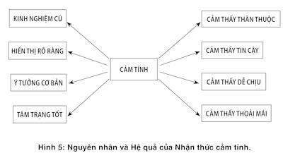

# Chương 5. Nhận thức cảm tính

Bất cứ khi nào bạn đang ý thức và thậm chí là khi bạn đang tỉnh táo, có rất nhiều phép tính phức tạp vẫn đang diễn ra trong bộ não, chúng duy trì và cập nhật tình trạng hiện thời cho các câu hỏi như là: Có gì mới vừa xảy ra? Có mối đe doạ nào không? Mọi thứ vẫn ổn cả chứ? Liệu tôi có phải hướng sự chú ý của mình sang một mục tiêu khác? Tôi có cần nỗ lực hơn nữa cho nhiệm vụ này không? Bạn có thể hình dung ra một chiếc cabin, bên trong chứa rất nhiều đồng hồ đo đạc, biểu thị những giá trị hiện tại của một số nỗ lực chủ yếu và liên tục biến thiên. Những chỉ số này do Hệ thống 1 tự động đo và một trong những tính năng để xác định xem có cần bổ sung thêm sự nỗ lực hay không thuộc về Hệ thống 2.

Một trong những mặt số đồng hồ kia sẽ đo mức độ nhận thức cảm tính (cognitive ease) và kim đồng hồ chạy giữa hai đầu cực “cảm tính” và “lý tính”. Cảm tính là dấu hiệu cho thấy mọi thứ đang diễn ra bình thường, không hiểm họa, không có vấn đề gì căng thẳng khiến Hệ thống 2 phải hành động cả. Ngược lại là cực “nhận thức lý tính”. Nhận thức lý tính bị ảnh hưởng bởi hai yếu tố, bao gồm tình trạng hiện thời của sự nỗ lực và sự tồn tại của những yêu cầu không được thỏa mãn. Điều ngạc nhiên là chỉ một mặt số của nhận thức cảm tính thôi cũng được nối với một mạng lưới rộng lớn của các chỉ số đầu vào và đầu ra. Hình 5 sẽ chứng minh điều đó.

Hình minh họa này chỉ ra rằng một câu văn nếu được viết hoặc in bằng một phông chữ rõ ràng, hay đã được sử dụng nhiều lần, hoặc là một phông chữ cơ bản, thì sẽ dễ dàng được xếp vào trạng thái nhận thức cảm tính. Khi bạn nghe một diễn giả trình bày trong tâm trạng vui vẻ, hoặc thậm chí là khi bạn đang ngậm một chiếc bút chì ngang miệng khiến bạn trông như đang “mỉm cười”, cũng có thể được xếp vào trạng thái nhận thức cảm tính. Ngược lại, bạn sẽ cảm thấy nhận thức lý tính khi bạn đọc một đoạn hướng dẫn trên một phông chữ khó nhìn, màu nhợt nhạt hoặc các từ được viết bằng thứ ngôn ngữ phức tạp, khi ấy bạn sẽ cảm thấy khó chịu, thậm chí bạn sẽ hơi cau mày.

*Hình 5: Các yếu tố tạo nên nhận thức cảm tính và hệ quả*

Các nguyên nhân khác nhau giữa “cảm tính” và “lý tính” có thể có những hiệu ứng hoán đổi. Khi bạn đang ở trạng thái nhận thức cảm tính, bạn có thể đang trong tâm trạng tốt và như bạn đã biết, bạn sẽ tin vào những gì mình nghe thấy, giao phó chúng cho các trực giác, bạn sẽ cảm thấy tình huống hiện tại thật là thân thuộc, thoải mái. Bạn cũng có thể rất dễ dàng tùy tiện và nông nổi trong suy nghĩ. Khi bạn cảm thấy nhận thức “lý tính”, bạn có xu hướng thận trọng và dò xét, bạn sẽ cố gắng nhiều hơn cho những gì mình đang làm và cảm thấy không thoải mái, mắc ít lỗi sai hơn nhưng khả năng trực giác của bạn cũng kém đi và giảm thiểu khả năng sáng tạo hơn mức bình thường.

### ẢO GIÁC VỀ TRÍ NHỚ

Từ ảo giác khiến bạn chỉ nghĩ đến những ảo ảnh nhìn thấy bằng mắt thường, bởi tất cả chúng ta đã quá quen thuộc với những bức tranh nhòe nhoẹt. Nhưng ảo giác không chỉ là phạm trù duy nhất của ảo tưởng; cũng như tư duy, trí nhớ cũng rất dễ bị rơi vào tình trạng ảo giác.

David Stenbill, Monica Bigoutski, Shana Tirana là những cái tên mà tôi vừa mới bịa ra. Nếu vô tình bạn nghe thấy một trong những cái tên này trong vài phút nữa, khả năng cao là bạn sẽ rất nhớ nơi đã gặp gỡ họ. Trong một lúc bạn biết rằng đó không phải tên của những người nổi tiếng. Nhưng giả sử như vài ngày sau, bạn phải xem một danh sách dài những cái tên, bao gồm một vài ngôi sao và một vài cái tên “mới” mà bạn chưa từng nghe thấy, nhiệm vụ của bạn là phải kiểm tra xem tên nào trong danh sách là tên của một người nổi tiếng. Khả năng gần như chắc chắn bạn sẽ nhận định David Stenbill là một người nổi tiếng, mặc dù bạn sẽ không biết (tất nhiên rồi) mình đã gặp cái tên này ở đâu, trong phim ảnh, thể thao hay chính trị. Nhà tâm lý học Larry Jacoby là người đầu tiên chứng minh ảo giác trí nhớ này trong phòng thí nghiệm, tiêu đề của bài báo là “Trở thành người nổi tiếng chỉ sau một đêm.” Làm sao lại thế được? Đầu tiên, bạn hãy tự hỏi bản thân làm sao mà bạn có thể quen ai đó nổi tiếng được. Trong nhiều trường hợp, với một số người nổi tiếng thực sự (hoặc những người có danh tiếng trong lĩnh vực mà bạn theo dõi), bạn nắm được cả một tập tư liệu với rất nhiều thông tin về người đó, ví dụ như Albert Einstein, Bono, Hillary Clinton. Nhưng bạn chẳng có chút thông tin nào về David Stenbill nếu bạn mới chỉ nghe nhắc đến tên anh ta vài ngày trước đấy. Tất cả những gì bạn có chỉ là một cảm giác thân quen, bạn đã nhìn thấy cái tên ấy ở đâu đó rồi.

Nhà tâm lý học Jacoby đã mào đầu vấn đề một cách nhẹ nhàng như: “Cảm giác thân quen đơn giản nhưng lại rất quyền năng, dường như nó dẫn dắt suy nghĩ trở lại với những kinh nghiệm của con người trong quá khứ. Tính “quá khứ” chính là một ảo giác. Như Jacoby và rất nhiều người sau này đã chứng minh, sự thật là cái tên David Stenbill trông có vẻ thân thuộc hơn là vì khi bạn nhìn thấy cái tên ấy, thì bạn đã nhìn nó một cách rõ ràng hơn. Từ nào mà bạn đã từng nhìn thấy trong quá khứ sẽ trở nên dễ nhận biết hơn khi bạn gặp lại chúng, bạn có thể xác định chúng nhanh hơn so với các từ khác, nhất là khi chúng chỉ xuất hiện thoáng qua dưới dạng hình ảnh hay âm thanh, bạn sẽ nhận ra chúng nhanh hơn so với những từ khác. Nói ngắn gọn là kinh nghiệm của bạn giúp bạn nhận thức dễ dàng và nhanh hơn khi bắt gặp một từ mà bạn đã nhìn thấy trước đó và đó chính là yếu tố khiến bạn có cảm giác thân quen.

Hình 5 đưa ra để kiểm nghiệm nhận định này. Bạn hãy chọn một từ mới, viết sao cho nó thật dễ nhìn và bạn sẽ thấy nó ẩn chứa trong mình một quá khứ. Thực vậy, một cách vô thức, bạn cũng sẽ dễ dàng nhận ra từ mới đó, nhanh hơn vài mili giây so với các từ khác dù bạn chỉ mới nhìn thấy từ đó ngay trước khi diễn ra thử nghiệm, tốc độ sẽ càng nhanh hơn nếu từ đó được hiển thị tương phản, nổi bật so với các từ khác trong danh sách. Một vài từ cố tình bị làm mờ, một vài từ khác thì bị mờ ít hơn và nhiệm vụ của bạn là xác định xem bạn thấy từ nào rõ ràng hơn. Một từ bạn vừa nhìn thấy chắc chắn sẽ xuất hiện rõ ràng hơn so với những từ không quen thuộc khác. Như chỉ dẫn trong hình minh họa 5, có rất nhiều cách khác nhau để tạo ra một nhận thức cảm tính và nhận lý tính và các cách này có thể đổi vai cho nhau; có thể bạn không biết chính xác cái gì khiến bạn có nhận thức cảm tính hay nhận thức lý tính. Đây chính là lúc ảo tưởng về sự thân thuộc xuất hiện.

### ẢO TƯỞNG VỀ SỰ THẬT

Mệnh đề “New York là một thành phố lớn của Hoa Kỳ” hay “Mặt trăng quay xung quanh Trái đất” hoặc “Một con gà có bốn chân.” Rất nhanh chóng, bạn thu thập được kha khá thông tin liên quan đến tất cả các mệnh đề trên, ít nhất là theo nghĩa này hoặc nghĩa khác. Bạn nhanh chóng nhận ra hai mệnh đề đầu là đúng, còn mệnh đề cuối là sai. Tuy vậy, phải lưu ý rằng bạn sẽ nhận ra nhận định “Một con gà có ba chân” là sai nhanh hơn so với câu “Một con gà có bốn chân”. Đánh giá nhận định thứ hai đúng hay sai bị chậm so với nhận định một là do bộ máy liên tưởng của bạn đã kết nối với hiện thực, là có rất nhiều loài vật có bốn chân, hoặc bởi vì ở nhiều siêu thị, người ta thường bán một gói chân gà gồm bốn chiếc. Hệ thống 2 đã tham gia vào quá trình sàng lọc thông tin, có thể đặt lại vấn đề xem thông tin về thành phố New York có quá dễ kiểm chứng không, hay phải kiểm tra lại nghĩa của từ quay quanh.

Hãy nhớ lại lần gần nhất khi bạn thi lấy bằng lái xe. Có phải bạn cần một loại giấy phép lái xe đặc biệt dành riêng cho loại xe trên ba tấn? Có thể bạn đã học hành rất nghiêm túc và có khả năng nhớ chi tiết đáp án nằm ở mặt trái hay mặt phải, cũng như logic phía sau đáp án đó. Chắc chắn đó không phải là cách tôi thi đỗ kỳ thi lấy bằng lái xe, khi tôi chuyển đến một bang mới. Cách thực hành của tôi là đọc cuốn cẩm nang về các quy tắc lái xe một lần và kỳ vọng những điều tôi biết sẽ xuất hiện ở bài thi. Tôi đã biết một vài câu trả lời nhờ kinh nghiệm lái xe lâu năm. Nhưng sẽ có những câu hỏi làm khó tôi, khiến tôi chẳng nghĩ ra nổi một đáp án khả dĩ nào, thế là tôi đành phó mặc cho nhận thức cảm tính của mình để đưa ra đáp án. Nếu đáp án có vẻ quen quen, tôi sẽ mặc định là nó đúng. Nếu trông nó có vẻ lạ lẫm (hoặc quá cực đoan), khả năng cao là tôi sẽ loại nó. Ấn tượng về sự thân thuộc do Hệ thống 1 sản sinh, còn Hệ thống 2 phụ thuộc vào cảm giác đúng hay sai trong nhận định.

Từ hình 5, có thể rút ra một bài học, đó là chắc chắn xuất hiện những ảo ảnh có thể dự đoán được nếu một nhận định được đưa ra dựa trên ấn tượng của nhận thức cảm tính hoặc nhận thức lý tính. Nếu có một yếu tố nào đó khiến cho bộ máy liên tưởng này hoạt động trơn tru hơn thì đó chính là do những sai lệch quyết định. Cách chắc chắn nhất khiến người ta tin vào một suy nghĩ sai lầm chính là sự lặp lại một cách thường xuyên, bởi vì ranh giới giữa sự gần gũi và sự thật rất mong manh. Các tổ chức cầm quyền và các nhà tiếp thị luôn hiểu được nguyên tắc này để áp dụng vào công việc của mình. Nhưng chính các nhà tâm lý học mới là người phát hiện ra rằng bạn không cần phải nhắc lại toàn bộ tuyên bố về một vấn đề hay một ý tưởng mới khiến chúng có vẻ trở nên đúng đắn. Những người nhắc đi nhắc lại câu “Thân nhiệt của một con gà” có khả năng đồng ý với nhận định “Thân nhiệt của một con gà là 144 độ” (hoặc bất cứ con số trừu tượng nào). Sự gần gũi của một cụm từ trong một nhận định cũng đủ khiến toàn bộ nhận định đó có cảm giác thân quen và vì thế, nó trở nên đúng đắn. Nếu bạn không thể nhớ được nguồn gốc của một nhận định và cũng không thấy mối liên hệ giữa nhận định đó với bất cứ thứ gì mà bạn biết, thì bạn chẳng có phương án nào khác ngoài việc tuân theo cảm giác của nhận thức cảm tính.

### THÔNG ĐIỆP THUYẾT PHỤC

Giả sử bạn phải viết một thông điệp với mong muốn làm người nhận được thông điệp đó tin tưởng mình. Tất nhiên, thông điệp của bạn phải đúng, nhưng như thế vẫn chưa đủ sức thuyết phục khiến người khác tin nó là đúng. Sẽ là hoàn toàn “hợp pháp” nếu bạn quyết định dùng nhận thức cảm tính để tranh thủ lòng tin của người khác và các nghiên cứu liên quan đến ảo tưởng về sự thật cung cấp cho bạn những gợi ý cụ thể giúp bạn có thể hoàn thành mục tiêu này.

Nguyên tắc chung đơn giản là hãy làm bất cứ điều gì nhằm hạn chế trạng thái nhận thức bị căng thẳng, vì vậy trước tiên, bạn càng làm cho thông điệp rõ ràng bao nhiêu càng tốt bấy nhiêu.

Hãy so sánh hai câu văn dưới đây:

Aldolf Hitler sinh năm 1892.

Aldolf Hitler sinh năm 1887.

Cả hai câu đều sai (Hitler sinh năm 1889) nhưng các thí nghiệm cho thấy câu đầu tiên có xu hướng được mọi người tin là đúng hơn. Thêm một lời khuyên nữa là: Nếu thông điệp của bạn được in trên giấy, hãy sử dụng loại giấy cao cấp để làm tăng tính tương phản giữa nội dung và nền giấy. Nếu in màu, hãy sử dụng màu mực xanh da trời sáng hoặc màu đỏ thì hiệu quả hơn so với khi bạn in thông điệp bằng một thứ màu mờ nhạt giữa xanh, vàng hay màu xanh nhạt.

Nếu muốn người nhận cảm thấy thông điệp của bạn đáng tin cậy và thông minh, đừng dùng thứ ngôn ngữ phức tạp, thay vào đó hãy diễn đạt bằng ngôn ngữ đơn giản mà vẫn biểu đạt được ý cần nói. Một đồng nghiệp của tôi ở Đại học Princeton tên là Danny Oppenheimer đã thẳng thừng bác bỏ tin đồn hoang đường trong giới sinh viên về một kho từ vựng gây ấn tượng nhất đối với các giáo sư. Trong một bài báo có tên “Hậu quả của việc sử dụng thổ ngữ cầu kỳ không cần thiết: Các vấn đề từ việc sử dụng các từ dài vô ích”, ông đã chứng minh rằng việc diễn đạt các ý tưởng thân thuộc bằng thứ ngôn ngữ cầu kỳ là biểu hiện sự kém thông minh và thông tin đó không đáng tin cậy.

Thêm nữa, để thông điệp của bạn đơn giản, hãy cố gắng làm cho nó trở nên dễ nhớ. Nếu có thể, hãy đưa các ý tưởng của bạn dưới dạng các vần thơ nếu có thể; chúng sẽ dễ dàng chiếm được lòng tin của người đọc hơn. Những người tham gia thí nghiệm dưới đây được đọc khoảng một tá những câu thành ngữ không lấy gì làm quen thuộc, ví dụ như:

Sự đau khổ liên kết kẻ thù.

Chấn động nhỏ kéo đổ cây sồi lớn.

Thừa nhận sai lầm đã coi như sửa sai được một nửa.

Một số sinh viên khác được đọc một số câu thành ngữ có nội dung tương tự nhưng không được viết dưới dạng vần điệu:

Kẻ thù của kẻ thù là bạn.

Nước chảy đá mòn.

Thú nhận khuyết điểm là biết sửa mình.

Các câu thành ngữ có vần điệu được nhận xét là đúng đắn hơn so với những câu thành ngữ còn lại.

Cuối cùng, nếu bạn đưa một câu trích dẫn, hãy chọn trích dẫn của người có cái tên dễ phát âm. Những người tham gia một thí nghiệm được yêu cầu đánh giá triển vọng phát triển của một công ty của Thổ Nhĩ Kỳ dựa trên các bản báo cáo cơ bản từ hai công ty môi giới cổ phiếu khác nhau. Với mỗi loại cổ phiếu, một công ty môi giới lại đưa ra một bản đánh giá khác nhau, bản đánh giá của một công ty có tên rất dễ phát âm (ví dụ Artan), bản báo cáo còn lại là của công ty có tên rất khó phát âm (ví dụ Taahhut). Những kết luận trong bản báo cáo này đôi khi mâu thuẫn với nhau. Những người quan sát sẽ phải đánh giá xem bản báo cáo nào tốt hơn, dựa trên thông tin chung của hai bản báo cáo, tuy nhiên mọi chuyện không diễn ra như thế. Các nhà phân tích cho rằng bản báo cáo đến từ công ty Artan có sức nặng hơn so với bản báo cáo của công ty Taahhut. Phải luôn nhớ rằng Hệ thống 2 rất lười biếng và không hề tự nguyện đối với các nỗ lực phải tính toán. Nếu được, lúc nào người đọc cũng cố tránh xa khỏi tất cả những gì khiến họ phải cố gắng, kể cả là cố gắng đọc một cái tên phức tạp.

Tất cả đều là những lời khuyên hữu ích nhưng chúng ta cũng không cần phải quá rối trí với nó. Chất lượng giấy cao cấp, màu sắc tươi sáng, câu văn có vần điệu hay không cũng chẳng giúp được gì nhiều nếu thông điệp của bạn không mang ý nghĩa, hoặc nó đối lập hoàn toàn với những gì mà khán giả của bạn biết chắc là đúng đắn. Các nhà tâm lý học khi thực hiện những thí nghiệm này tin rằng con người không phải là giống ngu ngốc hoặc khờ khạo nhất. Những gì họ tin, đó là tất cả chúng ta, sống trên đời này, đều được dẫn dắt bởi những ấn tượng mà Hệ thống 1 cung cấp và chúng ta thường không hiểu vì đâu ta lại có những ấn tượng ấy. Làm sao bạn biết được một câu tuyên bố là đúng đắn? Nếu nó được liên kết chặt chẽ bằng logic hoặc kết hợp bền chặt với những niềm tin và những trải nghiệm mà bạn đã kiểm chứng, hoặc nó xuất phát từ những nguồn tin mà bạn tin tưởng hoặc yêu thích, bạn sẽ lập tức có ý thức về nhận thức cảm tính. Rắc rối ở đây là có những yếu tố khác nữa cũng tạo ra ý thức nhận thức cảm tính, bao gồm chất lượng của phông chữ, nhịp điệu của câu văn và thật khó khăn để khiến bạn có thể nhận ra nguồn gốc cảm xúc của mình. Đây chính là thông điệp mà hình 5: Ý thức về nhận thức cảm tính hay nhận thức lý tính xuất phát từ rất nhiều nguyên nhân và rất khó để tách bạch chúng ra. Rất khó, nhưng không có nghĩa là không thể. Con người có thể vượt qua một số yếu tố bề mặt sản sinh ra những ảo giác về sự thật khi họ có động lực mạnh mẽ để làm điều đó. Trong hầu hết các trường hợp, hệ thống lười biếng số 2 sẽ chấp thuận những gợi ý của Hệ thống 1 và vận hành trên hệ thống ấy.

### LÝ TRÍ VÀ NỖ LỰC

Sự tương xứng của rất nhiều liên kết liên tưởng là một chủ đề được quan tâm đặc biệt trong các cuộc tranh luận về sự liên kết chặt chẽ. Như chúng ta đã biết ở phần trước, những ai bị làm cho “mỉm cười” hoặc “nhăn nhó” bằng cách ngậm một chiếc bút chì trên miệng hoặc dùng những nếp nhăn giữa hai lông mày để giữ một sợi chỉ sẽ có xu hướng trải nghiệm chính những cảm xúc này như thể họ đang mỉm cười hoặc đang nhăn nhó vậy. Mặt khác, hai mặt của sự tự củng cố cũng được tìm thấy trong các nghiên cứu về nhận thức cảm tính. Một mặt, khi bộ máy nỗ lực của Hệ thống 2 tham gia vào quá trình nhận thức, thì người ta nhận thấy sự xuất hiện của nhận thức lý tính. Mặt khác, khi quá trình nhận thức của con người ở chế độ căng thẳng, bất chấp nguồn gốc của sự căng thẳng ấy từ đâu, thì nó có xu hướng khởi động Hệ thống 2, biến đổi cách tiếp cận của cá thể với các vấn đề từ chế độ bản năng thông thường sang chế độ chú tâm và phân tích cẩn thận hơn.

Câu chuyện “gậy và bóng” được nhắc đến ở phần trước chính là sự kiểm chứng cho thấy con người có xu hướng trả lời các câu hỏi với đáp án là những ý tưởng đầu tiên xuất hiện trong đầu mà không cần kiểm chứng. Thí nghiệm “Phản chiếu nhận thức” của Shane Frederick đã đưa ra câu chuyện về “bóng và gậy” và hai vấn đề khác, tất cả đều cho thấy chúng tạo ra những câu trả lời bản năng tức thì nhưng lại đều không phải là câu trả lời chuẩn xác. Hai câu hỏi còn lại trong thí nghiệm “Phản chiếu nhận thức” của Shane như sau:

Nếu 5 chiếc máy, trong 5 phút, sản xuất được 5 đồ vật, vậy thì phải mất bao lâu để 100 chiếc máy tạo ra 100 đồ vật?

100 phút hay 5 phút?

Có một cái hồ phủ đầy hoa huệ tây. Mỗi ngày, thảm hoa huệ tây ấy phủ được diện tích gấp đôi. Nếu mất 48 ngày để thảm hoa huệ tây ấy phủ kín cả mặt hồ, thì phải mất bao nhiêu thời gian thì thảm huệ tây phủ được một nửa mặt hồ?

24 ngày hay 47 ngày?

Đáp án cho hai bài toán này nằm ở phần ghi chú cuối trang này1. Thí nghiệm viên tuyển 40 sinh viên Đại học Princeton tham gia thí nghiệm này. Một nửa trong số họ được nhìn thấy bài toán được viết bằng cỡ chữ nhỏ, trên giấy in mờ nhạt. Bài toán không khó nhưng cỡ chữ nhỏ đã kích hoạt nhận thức lý tính của những sinh viên này. Kết quả rất rõ ràng: 90% sinh viên làm thí nghiệm với cỡ chữ bình thường trả lời sai ít nhất một bài toán, nhưng tỷ lệ ấy giảm xuống còn 35% đối với những sinh viên làm thí nghiệm với cỡ chữ nhỏ, khó đọc. Bạn không nhầm đâu: Kết quả tốt hơn khi cỡ chữ bé hơn. Nhận thức lý tính, bất kể nguồn gốc từ đâu, đều kích hoạt Hệ thống 2, hệ thống có xu hướng không bị “mắc lừa” các đáp án mang tính bản năng được Hệ thống 1 gợi ý.

### SỰ THÍCH THÚ CỦA NHẬN THỨC CẢM TÍNH

Một bài báo có tựa đề “Đầu óc thư giãn, nụ cười trên môi” mô tả một thí nghiệm trong đó những người tham gia được xem nhanh một bức tranh về các đồ vật. Một vài bức tranh rất dễ nhận biết được trình chiếu bằng cách cho người xem thấy được hình dáng của đồ vật trước khi hình ảnh hoàn chỉnh hiện ra, nhanh đến nỗi người xem không hề nhận thức được đường nét của đồ vật. Phản ứng cảm xúc của người xem được đo bằng xung lực điện trên bề mặt cơ bắp, ghi nhận những thay đổi biểu cảm cực ít và cực nhanh, hầu như những người quan sát không thể nào nhận ra được. Đúng như dự đoán, mọi người thể hiện một nụ cười nhẹ và đôi lông mày thư giãn khi nhìn vào bức tranh dễ nhìn. Dường như Hệ thống 1 đảm nhận những nhận thức cảm tính được liên kết chặt chẽ với những xúc cảm tích cực.

Đúng như dự đoán, những từ dễ phát âm cũng tạo ra thái độ tích cực hơn. Các công ty có tên gọi dễ đọc làm ăn tốt hơn các công ty khác trong tuần đầu tiên sau khi cổ phiếu lên sàn, mặc dù hiệu ứng này sẽ biến mất theo thời gian. Cổ phiếu với những mã giao dịch dễ phát âm (như KAR hoặc LUNMOO) hoạt động tốt hơn những cổ phiếu có mã giao dịch khiến người ta phải xoắn vặn lưỡi khi phát âm như PXG hoặc RDO và chúng dường như chiếm được một chút ưu thế khi mới xuất hiện. Một nghiên cứu được thực hiện ở Thụy Sĩ cho thấy các nhà đầu tư tin tưởng những mã cổ phiếu có tên gọi dễ đọc như Emmi, Swissfirst và Comet sẽ thu lợi nhuận cao hơn so với những thương hiệu có tên khó nhớ như Geberit hay Ypsomed.

Như chúng ta đã thấy trong Hình 5, sự lặp lại cũng tạo ra nhận thức cảm tính và cảm giác dễ chịu cũng như sự thân thuộc. Nhà Tâm lý học nổi tiếng Robert Zajonc đặc biệt dành rất nhiều thời gian trong sự nghiệp của mình để nghiên cứu mối liên hệ giữa sự lặp lại của các khích lệ tiềm ẩn với tình cảm nhẹ nhàng mà con người thường dành cho nó. Zajonc gọi đó là “hiệu ứng tiếp xúc đơn thuần”. Thí nghiệm được thực hiện tại các tờ báo sinh viên của Đại học Michigan để chứng minh cho điều này là một trong những thí nghiệm ưa thích của tôi. Trong khoảng thời gian vài tuần, một hộp thoại trông như ô quảng cáo xuất hiện trên trang nhất của báo, trong đó chứa một trong những từ Thổ Nhĩ Kỳ (hoặc mang âm sắc Thổ Nhĩ Kỳ) như kadirga, saricik, biwonjni, nansoma và iktitaf. Tần suất xuất hiện của những từ này được lặp đi lặp lại: Chỉ có mỗi một từ được xuất hiện một lần, những từ còn lại được xuất hiện 2, 5, 10 hoặc 25 lần khác nhau. (Các từ xuất hiện thường xuyên nhất trong một trong số những tờ báo này sẽ ít xuất hiện trên những tờ báo khác). Không hề có bất cứ lời giải thích nào và những thắc mắc của bạn đọc chỉ được giải thích chung chung là “có một nhân vật giấu tên trả tiền quảng cáo cho việc này.”

Khi hàng loạt quảng cáo kỳ lạ này kết thúc, những điều tra viên đã gửi bảng câu hỏi đến cho cộng động sinh viên, hỏi các sinh viên này xem ấn tượng của họ về các từ đã từng xuất hiện “mang hàm ý “tốt” hay hàm ý “xấu”. Kết quả thật đáng kinh ngạc: Các từ xuất hiện thường xuyên nhất được xếp hạng cao hơn so với những từ chỉ xuất hiện một lần hoặc hai lần. Kết quả này được khẳng định qua rất nhiều thí nghiệm, trong đó các ký tự được thay đổi bằng từ tượng hình Trung Quốc, các khuôn mặt và cả những đa giác có hình thù bất kỳ.

“Hiệu ứng tiếp xúc đơn thuần” không phụ thuộc vào kinh nghiệm ý thức hay tính thân quen. Trên thực tế, hiệu ứng này không hề phụ thuộc vào ý thức: Nó chỉ xuất hiện khi các ký tự được lặp đi lặp lại hoặc khi các bức tranh được trình chiếu quá nhanh, khiến cho những người tham gia thí nghiệm không hề ý thức được là đã nhìn thấy chúng. Chỉ biết rằng cuối cùng thì họ chọn những ký tự hoặc các bức tranh xuất hiện thường xuyên hơn. Giờ thì mọi chuyện đã rõ, Hệ thống 1 phản ứng với những ấn tượng về các sự kiện mà Hệ thống 2 không hề ý thức. Thực vậy, “hiệu ứng tiếp xúc đơn thuần” trên thực tế có tác động mạnh hơn rất nhiều, còn các cá nhân thì không bao giờ ý thức là mình đã nhìn thấy.

Zajonc lập luận rằng hiệu ứng thích cái gì hơn cái gì được sản sinh bởi sự lặp đi lặp lại thực ra chính là một hiện thực sinh học rất quan trọng và nó còn mở rộng ra với tất cả các loài động vật nói chung. Để tồn tại trong một thế giới đầy nguy hiểm, một sinh vật sống cần phản ứng thận trọng với những tác động mới lạ, bằng cách lẩn trốn và sợ hãi. Khả năng sống sót sẽ rất nhỏ đối với những loài động vật nào không nhận thức được các tác nhân lạ. Tuy nhiên, sau một thời gian thích ứng, phản ứng với những tác nhân lạ cũng sẽ giảm dần nếu đó là những tác nhân an toàn. Zajnonc khẳng định: “Hiệu ứng tiếp xúc đơn thuần” chỉ xuất hiện nhờ sự lặp đi lặp lại của một tác nhân, mà sau đó tác động này không có ảnh hưởng xấu. Những tác nhân như thế dần dần sẽ biến thành một tín hiệu an toàn và an toàn là tốt. Rõ ràng đây không phải là một lập luận chặt chẽ đối với con người. Để chứng minh luận điểm này, một phụ tá của Zajonc đã cho hai nhóm trứng gà đang được ấp “nghe” những tần số âm thanh khác nhau. Sau khi được ấp, các chú gà con tỏ ra ít bị hoảng loạn hơn khi được “cho nghe lại” những âm thanh mà chúng từng được nghe khi còn đang ấp.

Zajonc đưa ra một kết luận hùng hồn cho chương trình nghiên cứu của mình như sau:

Tầm quan trọng của sự lặp đi lặp lại chính là ích lợi đối với các cá thể trong mối quan hệ của nó với những tác nhân đột ngột ồn ào hay tĩnh lặng của môi trường xung quanh. Chúng cho phép các cá thể có thể phân biện được những đối tượng và môi trường nào là an toàn so với những tác nhân không an toàn. Chúng hình thành những ứng xử cơ bản trong hệ thống xã hội và sự gắn bó là nguồn gốc cơ bản của sự ổn định tâm lý và xã hội.

Mối liên hệ giữa những xúc cảm tích cực và nhận thức cảm tính trong Hệ thống 1 đã có một lịch sử phát triển lâudài.

### CẢM TÍNH, TÂM TRẠNG VÀ BẢN NĂNG

Vào khoảng năm 1960, một nhà Tâm lý học trẻ tuổi có tên Sarnoff Mednick cho rằng mình đã nhận diện được bản chất của sự sáng tạo. Ý tưởng của ông rất đơn giản và không kém phần hùng hồn: Sự sáng tạo được kết nối với bộ nhớ và hoạt động hiệu quả một cách đặc biệt. Ông đã dựng lên một thí nghiệm, được gọi là Thí nghiệm Liên kết Từ xa (Remote Association Test – RAT), mà đến nay vẫn thường xuyên được sử dụng trong các nghiên cứu về tính sáng tạo.

Lấy một ví dụ đơn giản, hãy xem xét ba từ sau:

Nhà gỗ Thụy Sĩ bánh Bạn nghĩ xem từ nào có thể có mối liên hệ với cả ba từ trên? Từ pho mát có thể là một từ mà bạn nghĩ đến. Giờ thử tiếp với ba từ sau:

Lộn nhào ánh nắng tên lửa Vấn đề trở nên khó khăn hơn rất nhiều nhưng nó chỉ có một đáp án duy nhất, mà bất cứ người nào nói tiếng Anh đều có thể nhận ra, mặc dù chỉ có ít hơn 20% số sinh viên được hỏi tìm được từ chính xác trong vòng 15 giây. Câu trả lời đúng là bầu trời. Tất nhiên, không phải bộ ba từ nào cũng có đáp án. Ví dụ các từ mơ, bóng, sách chẳng có bất cứ mối liên hệ nào đến một đáp án chung khiến người ta thấy là thuyết phục để có một đáp án chung hết.

Vài nhà tâm lý học người Đức cũng đã nghiên cứu RAT trong những năm gần đây và đã đưa ra những khám phá đáng kể về nhận thức cảm tính. Một trong số các nhóm này đã đặt ra hai câu hỏi: Liệu người ta có thể cảm nhận được đáp án liên kết giữa ba từ ngữ trước khi họ biết đáp án ấy hay không? Để tìm hiểu, đầu tiên họ làm sao cho các đối tượng nghiên cứu rơi vào trạng thái vui vẻ hoặc buồn rầu, sau đó yêu cầu họ nghĩ trong vài phút về những khoảng thời gian hạnh phúc và buồn đau trong cuộc sống của họ. Rồi họ trình chiếu cho những đối tượng này một loạt những bộ ba từ vựng, một nửa trong số đó có mối liên hệ với nhau (ví như lộn nhào, ánh nắng và tên lửa) và một nửa không có liên kết gì (ví như mơ, bóng, sách) và hướng dẫn họ nhấn vào một trong số hai nút rất nhanh để ra hiệu cho thí nghiệm biết đáp án mà họ đoán, xem bộ ba từ đó có sự liên hệ với nhau hay không. Thời gian để các đối tượng này đưa ra phán đoán là hai giây, quá ngắn, không đủ để mọi người thực sự cân nhắc để chọn ra một đáp án nào đó.

Điều đầu tiên gây kinh ngạc chính là phán đoán của mọi người hóa ra rất chính xác, không hề do đoán mò. Tôi cho rằng điều này cực kỳ lạ lùng. Cảm nhận của nhận thức cảm tính dường như được xác định bởi những tín hiệu rất yếu ớt trong bộ máy liên kết nhưng chúng “biết” rằng ba từ ấy có liên kết hay không (có mối dây liên hệ) rất lâu trước khi mối liên kết ấy thực sự được lật mở. Vai trò của nhận thức cảm tính trong phán đoán được khẳng định một cách khoa học thông qua thí nghiệm bởi một nhóm những nhà khoa học người Đức khác: Những yếu tố tác động làm gia tăng nhận thức cảm tính (hiệu ứng mồi, phông chữ rõ ràng, trình chiếu trước các từ ngữ) đã làm gia tăng khả năng nhìn nhận các từ ngữ có mối liên hệ với nhau.

Một khám phá đáng chú ý khác nữa đó là hiệu ứng của tâm trạng diễn ra rất mạnh mẽ trong những “màn trình diễn” bản năng. Các nhân viên thí nghiệm lập ra một “danh mục trực giác” để đo đạc mức độ chuẩn xác. Họ nhận thấy rằng nếu các đối tượng tham gia thí nghiệm có tâm trạng tốt trước khi tham gia kiểm tra sẽ có mức độ chính xác cao gấp hai lần. Kết quả còn lạ lùng hơn nữa, đó là những đối tượng không vui vẻ còn không có khả năng hoàn thành những thí nghiệm trực giác một cách trọn vẹn và chính xác, sự phán đoán của họ chỉ dựa trên sự may rủi. Tâm trạng rõ ràng có ảnh hưởng đến hoạt động của Hệ thống 1: Khi chúng ta cảm thấy không thoải mái và không vui, chúng ta đánh mất sự nhạy cảm của trực giác.

Những phát hiện này đã cung cấp thêm bằng chứng rõ ràng cho thấy tâm trạng, trực giác, sự sáng tạo, sự khờ khạo và sự tin cậy trong Hệ thống 1 đi thành một nhóm với nhau. Ở phía khác, sự buồn bã, thận trọng, hoài nghi, cách tiếp cận phân tích và nỗ lực, cố gắng cũng đi thành một nhóm với nhau. Tâm trạng vui vẻ khiến Hệ thống 2 giảm bớt sự co cứng, tạo ra hiệu quả cao hơn: Khi ở vào tâm trạng tốt, con người trở nên trực giác hơn và sáng tạo hơn, đồng thời cũng bớt thận trọng hơn và có xu hướng mắc những lỗi logic nhiều hơn. Một lần nữa, như “hiệu ứng tiếp xúc đơn thuần” sự kết nối tạo ra cảm giác sinh học. Tâm trạng tốt là dấu hiệu cho thấy mọi thứ nhìn chung đang đi theo chiều hướng tốt, môi trường xung quanh an toàn và không có lý do gì phải cảnh giác hết. Tâm trạng xấu cho thấy mọi thứ đang không ổn, có thể có sự đe dọa và cẩn trọng là điều cần thiết. Nhận thức cảm tính vừa là nguyên nhân vừa là hệ quả của một cảm giác thư thái.

Thí nghiệm “Liên kết từ xa” còn cho chúng ta biết nhiều hơn về mối liên hệ giữa nhận thức cảm tính và hiệu ứng của mặt tích cực. Hãy xem hai bộ ba từ sau:

Ngủ thư công tắc Muối sâu bọt biển Tất nhiên, bạn có thể không nhận ra máy đo xung điện hoạt động trên cơ mặt của bạn có thể cho biết bạn đã thoáng mỉm cười khi đọc bộ ba từ thứ hai, trong đó chúng có liên quan đến nhau (biển có thể là một đáp án). Phản ứng mỉm cười đối với sự liên tưởng xuất hiện trong chủ thể mà người đó có thể không hề nói gì về những mối liên kết giữa ba từ, chúng chỉ xuất hiện thoáng qua trước một bộ tam từ được xếp hàng ngang và truyền đi xung lực để nhấn vào phím dấu cách sau khi họ đọc xong. Nhận thức cảm tính xuất hiện một cách nhẹ nhàng thư thái để dễ dàng đưa ra một liên kết bộ tam.

Sự thật hiển nhiên là khi chúng ta cảm thấy thoải mái và thư giãn, thì trực giác về sự gắn kết theo cách nói của các nhà khoa học là có sự liên hệ nhưng không nhất thiết là mối liên hệ nhân quả. Nhận thức cảm tính và mỉm cười diễn ra cùng với nhau nhưng có phải cảm giác thoải mái dẫn đến trực giác liên tưởng? Đúng, chính vậy. Các bằng chứng xuất phát từ cách tiếp cận thực nghiệm sáng tạo đã ngày càng trở nên phổ biến. Một vài người tham gia được đưa vào khung cảnh gợi nhắc cho họ cảm giác tốt đẹp: Họ được nghe những bản nhạc qua các cặp tai nghe mà “các nghiên cứu trước đó cho thấy dòng nhạc đó ảnh hưởng đến phản ứng xúc cảm của các cá nhân.” Câu chuyện này hoàn toàn loại bỏ sự gắn kết của trực giác. Khám phá cho thấy phản ứng cảm xúc ngắn, sau đó là sự trình chiếu của bộ tam từ ngữ (cảm xúc dễ chịu nếu bộ tam từ có sự gắn kết, hoặc ngược lại, khó chịu nếu bộ ba từ không có tính kết dính), thực tế là nền tảng cho các phán đoán về tính gắn kết. Ở đây Hệ thống 1 không có tác động gì cả. Những sự thay đổi cảm xúc giờ đây đã được tôn trọng, bởi không có gì ngạc nhiên khi chúng không có liên kết mang tính hệ quả.

Điều này quả thực là tin tốt lành đối với các nhà nghiên cứu Tâm lý học, trong đó có sự kết hợp giữa kỹ thuật thực nghiệm và trong nó bao hàm cả kết quả, cả hai đều rất thiết thực và cực kỳ đáng kinh ngạc. Từ vài thập kỷ trở lại đây, chúng ta đã biết về hệ thống hoạt động tự động của Hệ thống 1. Những gì mà giờ đây chúng ta mới biết nghe giống như khoa học viễn tưởng vào thời kỳ cách đây 30 năm hay 40 năm. Tất cả đều vượt quá trí tưởng tượng của chúng ta, như việc phông chữ kém cũng ảnh hưởng tới nhận định về sự thật, hay làm cho hoạt động nhận thức hiệu quả hơn, hay chuyện một phản ứng xúc cảm xuất hiện khi hệ thống nhận thức của chúng ta thư giãn trước một bộ ba từ ngữ cũng có thể tạo ra cảm giác về sự cố kết. Ngành Tâm lý học lại đứng trước một thách thức lớn.

### NHẬN THỨC CẢM TÍNH LÊN TIẾNG

> “Đừng có bác bỏ kế hoạch kinh doanh của bọn họ chỉ vì phông chữ của nó trông hơi khó đọc.”

> “Chúng ta có xu hướng tin tưởng một cái gì đấy, chỉ vì nó được lặp đi lặp lại thường xuyên, giờ hãy thử nghĩ thêm về điều này xem sao.”

> “Sự thân thiết tạo ra niềm thích thú. Đây chính là ‘hiệu ứng tiếp xúc đơn thuần.’”

> “Hôm nay tôi đang vui và Hệ thống 2 của tôi yếu hơn ngày thường. Tôi phải cẩn thận hơn mới được.”