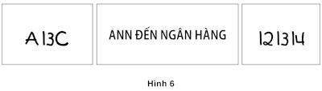

# Chương 7. Bộ máy đi tắt đón đầu

Nhà hài kịch vĩ đại Danny Kaye đã phát biểu một câu mà tôi vẫn nhớ như in từ khi tôi còn là một thanh niên. Khi nhắc đến một người phụ nữ mà ông không ưa, ông nói: “Nơi chốn yêu thích của cô ta là được ở một mình, còn môn thể thao ưa thích của cô ta là nhảy cóc tới kết quả.” Khi đọc được dòng này, tôi nhớ lại cuộc trò chuyện trước đó với Amos Tversky về ý thức của trực quan thống kê và giờ tôi tin rằng nó gợi ý cho ta cách mô tả hợp lý về chức năng của Hệ thống 1. Các kết luận hồ đồ có thể hữu ích. Nếu như các kết luận ấy có vẻ chính xác thì cái giá phải trả cho những sai lầm cũng chấp nhận được và nếu sự “đi tắt đón đầu” đó giúp bạn tiết kiệm thời gian và công sức. Nhưng kết luận hồ đồ ẩn chứa nhiều rủi ro trong những tình huống không quen thuộc, thiệt hại lớn và không có thời gian để thu thập thêm thông tin. Có những tình huống trong đó những lỗi sai trực giác có thể xảy ra nhưng nó cũng có thể được cảnh báo trước nếu có sự can thiệp kịp thời của Hệ thống 2.

### PHỚT LỜ SỰ MƠ HỒ VÀ LOẠI TRỪ SỰ HOÀI NGHI

Ba tấm bảng trong Hình 6 dưới đây có điểm chung là gì? Câu trả lời là tất cả đều không rõ nghĩa. Gần như chắc chắn là bạn sẽ đọc 3 ký tự trong tấm bảng bên tay trái là A B C, còn 3 ký tự trong tấm bảng bên tay phải là 12 13 14, mặc dù hai ký tự giữa của hai bảng giống hệt nhau. Bạn hoàn toàn có thể diễn giải chúng thành A 13 C hoặc 12 B 14 nhưng bạn đã không làm như vậy. Tại sao lại không? Cùng một hình ảnh nhưng trong những ngữ cảnh khác nhau lại được hiểu theo những cách khác nhau, lúc thì được hiểu là một chữ cái, lúc lại được hiểu là một con số. Toàn bộ ngữ cảnh đã giúp bạn xác nhận cách diễn giải mỗi thành tố. Các ký tự rất mơ hồ, nhưng bạn đã đưa ra được ngay kết luận trong từng trường hợp và không nhận ra rằng sự mơ hồ đã được giải quyết.

*Hình 6: Phớt lờ sự mơ hồ và loại trừ sự hoài nghi*

Trong trường hợp tấm bảng ở giữa, bạn có thể hình dung ra một người phụ nữ đang nghĩ đến tiền bạc, đi bộ tiến về phía một tòa nhà có những nhân viên thu ngân cùng các loại két sắt. Nhưng cách diễn giải hợp lý đó không phải là cách diễn giải duy nhất; vì thế câu văn đó rất mơ hồ. Nếu trước câu đó là câu “Họ nhẹ nhàng chèo thuyền xuôi theo dòng sông,” bạn sẽ hình dung ra một cảnh tượng hoàn toàn khác. Khi bạn vừa nghĩ đến một con sông, từ "ngân hàng" sẽ không còn liên hệ với tiền bạc nữa. Khi thiếu ngữ cảnh, Hệ thống 1 thường diễn giải theo cách gần gũi với nó nhất. Tất cả chúng ta đều biết rằng đó là Hệ thống 1 bởi vì bạn không hề nhận ra mình đã đưa ra lựa chọn hoặc còn có một cách diễn giải hợp lý khác. Trừ khi bạn vừa mới chèo thuyền cách đây không lâu và dành thời gian đi bộ dọc bờ sông, thì có thể bạn sẽ diễn giải câu văn trên theo cách thứ hai. Nhưng khi chưa chắc chắn, Hệ thống 1 sẽ “đoán đại” ra một câu trả lời và câu trả lời hú họa đó hoàn toàn dựa trên kinh nghiệm cá nhân. Quy luật may rủi rất nhanh nhạy: Những sự kiện gần nhất và những ngữ cảnh gần nhất sẽ có sức nặng nhất trong việc đưa ra cách diễn giải. Khi không có bất cứ sự kiện nào lóe lên trong đầu, thì lúc đó những ký ức gần nhất sẽ được trí óc huy động. Nếu những kinh nghiệm gần nhất và đáng nhớ nhất “reo” lên rằng đó là các chữ cái ABC thì bạn không thể nào diễn giải thành A13C được.

Khía cạnh quan trọng nhất trong cả hai ví dụ trên là: Một quyết định rõ ràng đã được đưa ra nhưng bạn không hề biết. Chỉ có một cách diễn giải xuất hiện trong đầu bạn và bạn không bao giờ để ý đến sự mơ hồ của nó. Hệ thống 1 không có sẵn những phương án để thay thế, hoặc thậm chí nó còn không hề nhận thức được thực tế là còn có những phương án khác để thay thế. Ý thức về sự hoài nghi vốn không có trong danh mục của Hệ thống 1; nó đòi hỏi duy trì cùng một lúc những sự diễn giải không tương thích trong đầu óc và điều đó đòi hỏi nỗ lực của trí óc. Sự thiếu chắc chắn và nghi ngờ nằm trong lĩnh vực của Hệ thống 2.

### SAI LỆCH VỀ NIỀM TIN VÀ KHẲNG ĐỊNH

Nhà Tâm lý học Daniel Gilbert, được nhiều người biết đến với tư cách là tác giả cuốn sách Stumbling to Happiness (Tạm dịch: Va phải hạnh phúc), có lần đã từng viết một tiểu luận có tựa đề “Hệ thống trí não tin tưởng”, trong đó ông phát triển một giả thuyết về niềm tin và hoài nghi mà ông theo đuổi của nhà Triết học Baruch Spinoza thế kỷ 17. Gilbert cho rằng để hiểu một thông điệp, trước tiên phải có nỗ lực tin tưởng thông điệp đó: Nếu như nó đúng thì thông điệp của nó là gì. Chỉ khi đó bạn mới có thể quyết định xem có nên tin hay không tin vào nó. Sự cố gắng tin tưởng là hoạt động tự động thuộc về Hệ thống 1, trong đó có việc xây dựng những diễn giải hợp lý nhất của tình huống đó. Ngay cả đối với một tuyên bố vớ vẩn, Gilbert lập luận rằng, cũng có thể tạo ra một niềm tin ban đầu nào đó. Hãy xem ví dụ của ông: “Cá hồi ăn kẹo.” Có thể ngay lập tức bạn sẽ thấy được một loạt những ấn tượng về cá và kẹo xuất hiện trong đầu như một tiến trình tự động của bộ máy liên tưởng, tìm kiếm những liên kết giữa hai phạm trù, khiến cho một câu nói vô nghĩa cũng trở nên có nghĩa.

Gilbert cho rằng sự hoài nghi thuộc quá trình tư duy của Hệ thống 2 và ông đưa ra một thí nghiệm hết sức tinh tế để chứng minh cho luận điểm của mình. Những người tham gia thí nghiệm nhìn thấy những câu vô nghĩa kiểu như “Linh tinh là một ngọn lửa” một vài giây sau khi xuất hiện những từ đơn như “Đúng” hoặc “Sai”. Một lúc sau, họ được kiểm tra xem trong trí nhớ câu nào được dán nhãn là “Đúng”. Điều kiện của thí nghiệm là những người tham gia sẽ phải nhớ một dãy số trong suốt tiến trình thực hiện thí nghiệm. Sự “xen ngang” Hệ thống 2 như thế đã tạo ra hiệu ứng có lựa chọn: Nó khiến cho người ta khó mà “hoài nghi” những câu sai. Trong thí nghiệm trí nhớ sau đó, cuối cùng thì những người tham gia thí nghiệm vốn đã rất mệt mỏi cũng tích đại kết quả rất nhiều câu sai thành đúng. Kết quả đã quá rõ ràng: Khi Hệ thống 2 đang bận rộn, chúng ta sẽ tin hầu hết mọi thứ. Hệ thống 1 có xu hướng cả tin và những sai lệch dẫn đến niềm tin, Hệ thống 2 thì đảm nhận phần hoài nghi và ngờ vực, nhưng đôi khi bận rộn sẽ khiến chúng trở nên lười biếng. Thực vậy, có một sự thật hiển nhiên là con người ta có xu hướng bị ảnh hưởng bởi những thông điệp thuyết phục vô nghĩa, như các quảng cáo thương mại chẳng hạn, nhất là khi người ta đang cảm thấy mệt mỏi và kiệt sức.

Các tổ chức của hệ thống bộ nhớ liên kết đóng góp đáng kể vào những sai lệch kiểm định. Khi được hỏi là “Sam có thân thiện không?” sẽ tạo ra ấn tượng tức thì về cách hành xử của Sam hơn là khi được hỏi “Có phải Sam kém thân thiện không?” Trí óc sẽ tìm kiếm những bằng chứng xác nhận, được biết tới với tên gọi chiến lược thử nghiệm khả năng cũng chính là cách mà Hệ thống 2 kiểm tra một giả thuyết. Đối lập với những nguyên tắc triết học, trong đó người ta kiểm tra các giả thuyết bằng cách phủ định lại các giả thuyết đó, thì con người (và cả những nhà khoa học, thường xuyên) tìm kiếm những dữ liệu có xu hướng tương thích và bổ trợ cho những điều mà người ta đang tin tưởng. Các sai lệch được kiểm chứng thuộc Hệ thống 1 ưu tiên những gợi ý và phóng đại việc chấp nhận tính thiếu suy xét trong những sự kiện có vẻ đúng hoặc cực đoan. Nếu bạn được hỏi về khả năng một cơn bão tấn công California trong vòng 30 năm tới, hình ảnh xuất hiện trong đầu bạn đúng thực là một trận bão to, đúng như cách mà Gilbert đưa ra những câu nhận định vô nghĩa như “Cá hồi ăn kẹo” vậy. Bạn sẽ thiên về hướng đưa ra một nhận định thái quá về khả năng xảy ra một thảm họa.

### SỰ GẮN KẾT TÌNH CẢM THÁI QUÁ (HIỆU ỨNG HÀO QUANG)

Nếu bạn yêu thích chủ trương chính trị của Tổng thống đương nhiệm, nhiều khả năng bạn sẽ thích giọng nói và sự hiện diện của ông ta. Xu hướng yêu thích (hoặc ghét bỏ) mọi thứ của một người, bao gồm cả những thứ bạn không quan sát thấy được biết tới với tên gọi “Hiệu ứng hào quang”. Thuật ngữ này được sử dụng trong ngành Tâm lý học hàng thế kỷ nay nhưng nó không được sử dụng phổ biến trong ngôn ngữ đời thường. Thật là một sự đáng tiếc, bởi “Hiệu ứng hào quang” là một cái tên hay cho một thiên lệch phổ biến, đóng vai trò lớn trong việc chúng ta nhận định về con người và hoàn cảnh. Đó là một trong những cách tái hiện một thế giới mà Hệ thống 1 vận hành một cách đơn giản hơn và nhiều liên kết hơn so với đời thực.

Bạn gặp một phụ nữ có tên là Joan trong một bữa tiệc, bạn thấy cô ta rất duyên dáng và dễ bắt chuyện. Giờ thì tên của cô ấy lại xuất hiện với tư cách một người được kêu gọi đóng góp cho một quỹ từ thiện. Bạn biết gì về sự hào phóng của Joan? Câu trả lời chính xác là bạn hầu như không biết gì cả, bởi vì có rất ít lý do để tin rằng một người dễ chịu trong đời sống xã hội cũng là một nhà từ thiện hào phóng. Tuy nhiên, bạn thích Joan và bạn sẽ nhớ lại cảm giác yêu mến cô ấy khi nghĩ về cô ta. Bạn cũng thích sự hào phóng và những người hào hiệp. Bằng sự liên tưởng, dẫn đến việc giờ bạn tin rằng Joan cũng rất hào phóng. Và giờ khi bạn đã tin rằng cô ta hào phóng, có thể bạn còn thấy thích cô ta hơn cả trước kia, bởi vì bạn đã tự động gán thêm tính cách hào phóng bên cạnh những ấn tượng tốt đẹp mà cô ta đã tạo ra cho bạn.

Sự thực rõ ràng rằng: Sự hào phóng không hề xuất hiện trong câu chuyện của Joan và khoảng trống ấy được lấp đầy bởi một sự võ đoán, phù hợp với tâm trạng mà bạn đã có với cô ấy. Trong những tình huống khác, hiện thực dần dần được phiên giải và sự diễn giải sẽ bị tâm trạng đi kèm với những ấn tượng ban đầu phủ bóng. Trong ngành Tâm lý học cổ điển, Solomon Asch đã đưa ra những tính từ mô tả về hai người khác nhau và hỏi xem mọi người nhận xét như thế nào về tính cách riêng của mỗi người. Bạn nghĩ thế nào về Alan và Ben?

Alan: thông minh – chăm chỉ - bốc đồng – khó tính – cứng đầu – đố kỵ Ben: đố kỵ - cứng đầu – khó tính – bốc đồng – chăm chỉ - thông minh.

Nếu bạn cũng giống hầu hết mọi người, bạn sẽ thấy Alan đáng mến hơn Ben rất nhiều. Những nét tính cách đầu tiên trong danh sách đã thay đổi hầu hết ý nghĩa của những tính cách xuất hiện phía sau. Sự cứng đầu của một người thông minh thường dễ được chấp nhận và thậm chí còn khiến người ta phải tôn trọng hơn nhưng sự thông minh trong một kẻ đố kỵ và cứng đầu khiến anh ta trở nên nguy hiểm hơn rất nhiều. “Hiệu ứng hào quang” là một ví dụ điển hình của sự tối nghĩa: Cũng giống như từ "ngân hàng" trong phần trước, tính từ cứng đầu là một từ tối nghĩa và có thể được diễn giải bằng nhiều cách khác nhau sao cho phù hợp với ngữ cảnh.

Có rất nhiều phiên bản khác của chủ đề nghiên cứu này. Những người tham gia thí nghiệm trong một nghiên cứu được xem trước ba tính từ miêu tả Alan; sau đó họ được cho xem tiếp ba tính từ tiếp theo, được mô tả là tính cách của một người khác. Khi họ đã hình dung ra hai con người khác nhau, những người tham gia thí nghiệm được hỏi liệu có khả năng nào cả sáu tính từ này đều mô tả cùng một người không và hầu hết những người được hỏi đều trả lời điều đó là không thể!

Trong đoạn sau, chúng ta sẽ quan sát những nét cá tính của một con người thường được xác định dựa trên may mắn. Tuy vậy, thứ tự xuất hiện là cả vấn đề, bởi vì “Hiệu ứng hào quang” sẽ làm tăng sức nặng của những ấn tượng đầu tiên, đôi khi khiến những thông tin phía sau đó hầu như vô nghĩa. Hồi đầu khi mới làm giảng viên, tôi đã đánh giá các bài tiểu luận của sinh viên theo lối truyền thống. Đó là tôi sẽ lấy một bảng điểm và đọc tất cả các bài tiểu luận của một sinh viên đến đâu thì chấm điểm đến đó. Sau đó tôi sẽ cộng tổng số điểm của sinh viên đó lại và tiếp tục chấm điểm tiểu luận của sinh viên tiếp theo. Dần dần tôi nhận thấy cách đánh giá của mình về các bài tiểu luận của mỗi sinh viên hóa ra rất đồng nhất. Tôi bắt đầu hoài nghi liệu cách đánh giá của tôi có phải cũng là một dạng “Hiệu ứng hào quang” không, rằng câu hỏi đầu tiên mà tôi chấm điểm đã tạo ra hiệu ứng bất cân xứng đối với toàn thể các câu hỏi phía sau. Cơ chế ấy rất đơn giản: Nếu bài tiểu luận đầu tiên của một sinh viên nào đó được chấm điểm cao, thì sinh viên đó sẽ được hưởng lợi từ việc tôi sẽ loại bỏ những hoài nghi khi vấp phải bất cứ câu văn hoặc dòng nào tối nghĩa trong bài kế tiếp. Điều này nghe vẻ có lý. Chắc chắn một sinh viên đã làm tốt trong bài tiểu luận đầu tiên sẽ không mắc phải những lỗi ngớ ngẩn trong bài tiểu luận thứ hai! Và đó chính là vấn đề nghiêm trọng mà tôi đã gặp phải trong cách làm việc của mình. Nếu một sinh viên viết hai bài tiểu luận, một bài tốt, một bài dở, thì cuối cùng tôi lại đánh giá cả hai bài phụ thuộc vào kết quả đánh giá bài đầu tiên mà tôi đọc được. Tôi đã nói với các sinh viên rằng hai bài tiểu luận đó có giá trị ngang nhau nhưng điều đó không đúng: Bài tiểu luận đầu tiên đã có ảnh hưởng lớn hơn nhiều trong việc đánh giá chung khả năng của sinh viên đó so với bài tiểu luận thứ hai. Điều này không thể chấp nhận được.

Tôi đã tiến hành một tiến trình chấm điểm khác. Thay vì đọc các tập tiểu luận của sinh viên theo thứ tự, tôi đã đọc và chấm điểm tất cả các bài tiểu luận số một của tất cả các sinh viên trước, sau đó mới tiến hành chấm điểm bài tiểu luận số hai. Tôi chắc chắn là mình đã ghi lại tất cả điểm vào một bảng điểm riêng để đảm bảo mình không bị thiên vị (dù chỉ là vô thức) khi chấm đến bài tiểu luận thứ hai. Sau khi thay đổi phương pháp, tôi rút ra một kết luận khiến tôi lâm vào tình thế lúng túng: Sự tự tin trong việc chấm điểm của tôi tụt xuống mức thê thảm. Lý do là tôi thường xuyên phải trải nghiệm một cảm giác khó chịu và lần nào cũng như là mới với tôi. Khi tôi thất vọng với bài tiểu luận thứ hai của một sinh viên nào đó, tôi chấm cho cậu ta điểm kém và thi thoảng tôi phát hiện ra mình đã từng cho chính sinh viên này điểm số thuộc hàng cao nhất cho bài tiểu luận số một. Tôi cũng nhận thấy mình đã cố gắng giảm thiểu sự không nhất quán bằng cách thay đổi số điểm mà tôi chưa kịp ghi vào bảng điểm và nhận thấy thật khó mà làm theo nguyên tắc đơn giản, là không bao giờ được nhân nhượng như thế. Điểm số của tôi dành cho mỗi sinh viên đã thay đổi một cách đáng kể. Sự thiếu hụt liên kết khiến tôi cảm thấy mình bất ổn và chán nản với việc chấm điểm này.

Giờ tôi cảm thấy không vui và tin cậy hơn vào điểm số mình đã chấm cho sinh viên trước đó nhưng tôi nhận thấy đó là một tín hiệu tốt, một chỉ báo cho thấy cách chấm điểm mới của tôi tối ưu hơn. Sự chắc chắn mà tôi tận hưởng trong lần chấm điểm trước đó không đảm bảo, nó sản sinh ra cảm giác của tư duy “cảm tính” và Hệ thống 2 của tôi vui vẻ và dễ dãi chấp nhận kết quả đánh giá cuối cùng. Bằng việc để mình bị bài tiểu luận đầu tiên tác động mạnh tới kết quả đánh giá của bài tiểu luận thứ hai, tôi đã để bản thân nhận thấy sự thiếu hợp lý khi thấy một sinh viên có thể làm rất tốt ở bài tiểu luận này, lại có thể làm rất tệ ở bài tiểu luận khác. Tính không nhất quán xuất hiện một cách rõ ràng khi tôi chuyển qua cách đánh giá mới: Nó cho thấy không thể dùng một đề bài đơn lẻ để đánh giá về hiểu biết của một sinh viên cũng như nó phản ánh sự bất hợp lý trong cách đánh giá của riêng tôi.

Phương pháp mà tôi sử dụng để giảm thiểu “Hiệu ứng hào quang” phù hợp với nguyên tắc phổ biến là: Lỗi sai bất tương đồng! Để hiểu được hoạt động của nguyên tắc này, hãy hình dung có rất nhiều người cùng trông thấy những chiếc bình thủy tinh đựng đồng xu và họ phải đoán xem trong mỗi bình thủy tinh có bao nhiêu đồng xu. Jame Surowiecki giải thích trong cuốn sách “Trí tuệ đám đông” nổi tiếng của mình, rằng đây là một loại nhiệm vụ mà đối với mỗi người đơn lẻ thì hiệu quả đạt được sẽ rất thấp nhưng nếu có cả một đám đông cùng thực hiện nhiệm vụ này thì kết quả cuối cùng lại chính xác đến kinh ngạc. Sẽ có một số người đưa ra con số quá lớn, một số khác lại đưa ra con số quá nhỏ so với thực tế nhưng khi có rất nhiều người dự đoán, thì con số trung bình cuối cùng thường có xu hướng chuẩn xác. Cơ chế rất rõ ràng: Mỗi người đều được nhìn thấy cùng một chiếc bình và tất cả những đánh giá của họ đều có một điểm chung cơ bản. Mặt khác, các lỗi sai mà các cá thể đưa ra lại độc lập so với những lỗi sai của người khác và (trong trường hợp không có lỗi sai hệ thống), họ có xu hướng đưa con số trung bình về mức 0. Tuy vậy, “nguyên tắc lỗi sai phổ biến” chỉ có tác dụng trong trường hợp tất cả mọi người đều độc lập khi quan sát và các lỗi sai của họ không có điểm tương đồng. Nếu những người quan sát có cùng một sai lệch, thì tập hợp kết quả các đánh giá sẽ không thể hạn chế được sai lệch ấy. Nếu những người quan sát được quyền gây ảnh hưởng lẫn nhau thì sẽ giảm thiểu tính hiệu quả của mẫu thí nghiệm, cũng như tính chính xác trong kết quả của nhóm thí nghiệm.

Để có thể rút ra thông tin hữu ích nhất trong vô số những nguồn tin, bạn phải luôn cố gắng tìm cách làm sao cho những nguồn tin đó độc lập với nhau. Nguyên tắc này chính là một phần trong nghiệp vụ điều tra của cảnh sát. Trong trường hợp có nhiều nhân chứng trong cùng một sự việc, các nhân chứng không được quyền thảo luận với nhau trước khi được lấy lời khai. Việc này ngăn chặn các nhân chứng đối lập cấu kết với nhau, nó còn ngăn chặn các nhân chứng không bị ảnh hưởng bởi những nhân chứng khác. Các nhân chứng trao đổi với nhau sẽ có xu hướng mắc những lỗi sai tương tự trong lời khai, khiến tổng số thông tin có giá trị thu được bị giảm xuống. Loại trừ những yếu tố thừa trong các nguồn thông tin luôn là một việc cần thiết phải thực hiện.

Nguyên tắc của các “phản biện độc lập” (và các lỗi sai bất tương đồng) có những ứng dụng ngay tức thì khi bạn tổ chức các cuộc họp, một hoạt động thường xuyên của các lãnh đạo trong các tổ chức, hay công ty. Một nguyên tắc đơn giản nên được áp dụng: Trước khi đưa ra một vấn đề nào đó để thảo luận, tất cả mọi thành viên trong hội đồng được yêu cầu phải viết ra một đoạn rất ngắn những giải pháp của mình. Tiến trình này giúp ích cho việc thu thập những kiến thức và thu được nhiều ý kiến phong phú của cả nhóm. Những cuộc thảo luận mở kiểu truyền thống khiến ý kiến của những người phát biểu đầu tiên bỗng nhiên có quá nhiều trọng lượng và chắc chắn là có ảnh hưởng đến ý kiến của những người phát biểu sau đó.

### CÁI GÌ TA THẤY LÀ CÁI TA BIẾT

Một trong những ký ức đáng nhớ nhất của tôi với Amos thời mới bắt đầu cộng tác với nhau, đó là ông luôn xuất hiện với vẻ hài hước thường trực. Với vai trò là một trong những vị giáo sư uy tín dạy môn Triết học ở trường đại học, Amos có thể “gằn gừ” tiếng Do Thái bằng chất giọng Đức đậm đặc: “Các cậu không bao giờ được quên rằng Primat of the Is (Tạm dịch: Tính tối thượng của Hiện tại). Tôi không rõ ông thầy giáo (Amos và tác giả bắt chước giọng của thầy giáo người Đức) đó muốn nói gì qua câu nói đó (mà tôi nghĩ cả Amos cũng không hiểu nốt) nhưng những câu đùa của Amos luôn ghi điểm với sinh viên. Ông luôn trích dẫn được những thành ngữ cổ (và thực ra tôi cũng làm được thế) mỗi khi chúng tôi đụng phải những vấn đề khác biệt đáng kể trong cách xử lý những thông tin mà chúng tôi không nắm được.

Một tính năng chủ yếu trong thiết kế của “bộ máy liên tưởng” đó là nó chỉ đại diện cho những ý tưởng được kích hoạt. Các thông tin không được gọi ra (kể cả vô thức) trong bộ nhớ có thể không tồn tại. Hệ thống 1 nổi trội hơn khi xây dựng những câu chuyện giả định, kết hợp nhiều ý kiến đã được khởi động nhưng nó không (và không thể) dựng nên những thông tin mà nó không có.

Giới hạn thành công của Hệ thống 1 chính là sự kết nối câu chuyện mà nó phải tạo ra. Số lượng và chất lượng của các dữ liệu cấu thành nên câu chuyện phần lớn là không thích hợp. Khi dữ liệu hạn chế, thường được coi là một sự cố, Hệ thống 1 hoạt động như một “bộ máy đi tắt đón đầu”. Hãy xem ví dụ sau: “Liệu Mindik có phải là một lãnh đạo tốt? Cô ta thông minh và mạnh mẽ...” Câu trả lời là có, xuất hiện rất nhanh trong đầu của bạn. Bạn đã chọn ra được đáp án tốt nhất dựa trên những dữ liệu ít ỏi có được nhưng bạn đã “cướp cò”. Câu trả lời sẽ thay đổi thế nào nếu hai tính từ tiếp theo là tham nhũng và độc ác?

Hãy ghi lại những gì bạn không làm nếu bạn thoáng nghĩ về Mindik trong vai trò là một nhà lãnh đạo. Bạn không bắt đầu bằng câu hỏi, “Tôi cần biết gì trước khi tôi đưa ra một ý kiến về chất lượng quản lý của một nhà lãnh đạo?” Hệ thống 1 phải làm việc độc lập dựa trên những tính từ đầu tiên nó tiếp nhận: Thông minh là tốt, thông minh và mạnh mẽ là rất tốt. Đây là câu chuyện tốt nhất có thể xây dựng được dựa trên hai tính từ và Hệ thống 1 đã truyền tải nó với một nhận thức cảm tính tuyệt diệu. Câu chuyện sẽ bị đánh giá lại khi có những dữ liệu mới xuất hiện (ví dụ như Mindik tham nhũng) nhưng ấn tượng đầu tiên xuất hiện ngay lập tức và không gây cản trở đối với chủ thể. Đồng thời, dù thế nào đi nữa thì ấn tượng tốt đẹp đầu tiên vẫn tồn tại như một sai lệch.

Sự kết hợp giữa Hệ thống 1 tìm kiếm sự liên kết với Hệ thống 2 lười biếng khiến cho Hệ thống 2 sẽ xác lập rất nhiều niềm tin bản năng, phản ánh khá sát với những ấn tượng thông thường do Hệ thống 1 xác lập. Tất nhiên, Hệ thống 2 có khả năng hệ thống hóa và cẩn trọng hơn khi tiếp cận với các chứng cứ và sẽ có một loạt những ô tích được đánh dấu trước khi đưa ra quyết định, ví dụ như mua một căn nhà, bạn sẽ phải tìm kiếm cho được những thông tin mà bạn không có. Tuy nhiên, Hệ thống 1 được cho là có ảnh hưởng nhiều hơn đến các quyết định cần sự suy tính cẩn trọng và đầu vào của nó không bao giờ ngừng thu nhận thông tin.

Hiểu được cơ chế “đi tắt đón đầu” (hay vội vàng đưa ra kết luận) dựa trên dữ liệu giới hạn cơ bản rất quan trọng để lý giải tư duy trực giác và trong cuốn sách này, tôi sẽ thường xuyên sử dụng một cụm từ viết tắt cho khái niệm này là: WYSIATI, có nghĩa là bạn chỉ thấy cái mà bạn biết. Hệ thống 1 về cơ bản là không nhạy cảm với cả chất lượng lẫn số lượng thông tin tạo ra các ấn tượng và trực giác.

Amos cùng với hai sinh viên đã tốt nghiệp của mình ở Đại học Stanford đã báo cáo một nghiên cứu liên quan trực tiếp đến WYSIATI, thông qua quan sát phản ứng của mọi người được thông báo trước khi xem những dữ liệu một chiều. Những người tham gia thí nghiệm được đọc một biên bản pháp lý như sau:

Vào ngày 3 tháng Chín, nguyên đơn David Thorton, một đại diện công đoàn khu vực 43 tuổi đã có mặt ở hãng thuốc lá Thrifty số 168, đi thăm hỏi người lao động theo lệ thường. 10 phút sau, người quản lý ngăn ông lại và nói ông không được phép nói chuyện với công nhân đang làm việc trong hãng. Thay vào đó, ông có thể gặp họ ở phòng trong vào giờ nghỉ. Yêu cầu này đã được quy định trong hợp đồng công đoàn của hãng thuốc lá Thrifty nhưng chưa bao giờ được công bố. Khi ông Thornton từ chối, người ta bảo rằng ông có quyền lựa chọn hoặc làm theo yêu cầu hoặc rời khỏi đây hoặc sẽ bị báo cảnh sát. Lúc này, ông Thorton lý luận với vị quản lý rằng từ trước đến nay ông luôn được nói chuyện với các nhân viên khi họ đang làm việc trong khoảng 10 phút, miễn là không làm ảnh hưởng tới công việc kinh doanh và ông đã chấp nhận thà bị bắt còn hơn là phải thay đổi nguyên tắc làm việc của mình. Vị quản lý sau đó đã gọi điện báo cho cảnh sát và ông Thornton bị còng tay đưa ra khỏi cửa hàng vì vi phạm quy định của công ty. Sau đó ông bị tạm giam và bị tạm đình chỉ mọi chức vụ hiện tại. Ông Thornton đã kiện hãng thuốc lá Thrifty vì bắt giữ người trái phép.

Để thêm dữ liệu cho câu chuyện, bên cạnh những gì mà tất cả những người tham gia thí nghiệm đã được đọc, các nhóm khác nhau cũng được xem những bài trình bày của các luật sư bào chữa cho hai bên. Một cách tự nhiên, luật sư của người đại diện Công đoàn mô tả cuộc bắt giữ như một nỗ lực của sự đe dọa, trong khi luật sư của bên hãng thuốc lá lập luận rằng trò chuyện với nhân viên trong khi họ đang làm việc là gây rối và người quản lý đã hành động hoàn toàn hợp lý trong tình huống này khi thông báo cho cảnh sát. Một vài người tham gia thí nghiệm, ví dụ Bồi thẩm viên, thì được nghe cả hai phía. Các luật sư thêm vào những thông tin bất lợi mà bạn không thể phỏng đoán từ ngữ cảnh của câu chuyện.

Tất cả những người tham dự đều đã lường trước được sự sắp đặt trước và những người chỉ nghe từ một phía dễ dàng đưa ra những lập luận chống lại phía còn lại. Tuy nhiên, bài trình bày của các luật sư từ những bằng chứng một chiều có ảnh hưởng rõ ràng lên những phán đoán. Hơn thế nữa, những người tham gia thí nghiệm chỉ được biết thông tin một chiều tỏ ra tự tin với lập luận của mình hơn những người được biết thông tin từ cả hai phía. Đây chỉ là những gì bạn có thể đoán ra nếu bạn tin rằng kinh nghiệm của con người được xác định bởi sự liên kết trong câu chuyện mà họ xây dựng nên từ những thông tin có sẵn. Sự nhất quán của dữ liệu mang đến một câu chuyện hay, chứ nó không xây dựng thành một câu chuyện hoàn chỉnh. Thực sự thì bạn sẽ luôn tìm thấy những nút thắt dù nhỏ nhất để diễn giải phù hợp với tất cả những gì bạn biết và đặt chúng vào những hoàn cảnh thích hợp.

WYSIATI tạo điều kiện lưu trữ những sự liên kết và nhận thức cảm tính cho phép chúng ta chấp nhận một nhận định là đúng. Nó giải thích tại sao chúng ta có thể suy nghĩ rất nhanh và làm sao chỉ từ một ít thông tin trong thế giới phức tạp này, chúng ta cũng xây dựng thành một câu chuyện có ý nghĩa. Hầu hết thời gian, những câu chuyện gắn kết với nhau, được chúng ta đặt cạnh nhau có đủ sự tương thích nhằm cổ vũ cho những hành động có vẻ có lý. Tuy nhiên, tôi cũng dùng WYSIATI để giải thích cho rất nhiều những loại sai lệch khi phải đưa ra nhận định và lựa chọn, sau đây là một số cách lý giải:

- Quá tự tin: Khi áp đặt nguyên tắc WYSIATI thì cả chất lượng và số lượng bằng chứng xuất hiện không có mấy giá trị đối với chủ thể tự tin. Sự tự tin mà các cá nhân có được trong niềm tin của mình phụ thuộc hầu hết vào chất lượng câu chuyện mà họ có thể kể liên quan đến những gì họ nhìn thấy, dù cho họ không thấy nhiều thứ của câu chuyện hoàn chỉnh thực sự. Chúng ta thường xuyên thất bại vì không đưa ra các bằng chứng rất cần thiết trong lập luận của chúng ta. Bởi vì chúng ta chỉ biết có thế mà thôi. Hơn thế nữa, hệ thống liên kết của chúng ta có xu hướng dừng lại ở một khía cạnh liên kết, khi thấy có sự xuất hiện và ngăn chặn nghi ngờ và sự tối nghĩa.

- Hiệu ứng khung: Nhiều cách hiểu khác nhau từ cùng một dữ liệu thường tạo ra nhiều tâm trạng khác nhau. Câu khẳng định “tỷ lệ sống sót sau phẫu thuật một tháng là 90%” nghe đúng (hợp lý) hơn câu khẳng định có giá trị tương đương “tỷ lệ tử vong sau phẫu thuật một tháng là 10%”. Tương tự, thịt nguội được miêu tả là “giảm 90% chất béo” sẽ hấp dẫn hơn khi được miêu tả là “chỉ 10% chất béo”. Rõ ràng là có các công thức tương đương nhau về nghĩa nhưng thông thường một cá nhân chỉ nhìn thấy một công thức và tất cả những gì anh ta thấy là những gì anh ta biết (hay hiểu).

- Bỏ qua đánh giá cơ bản: Hãy nhớ lại Steve, anh chàng chỉn chu và cẩn thận, được mọi người cho là sẽ trở thành một người thủ thư mẫn cán.

- Dù người ta chỉ mô tả anh ta bằng hai nét tính cách nổi bật và sống động nhất, mặc dù bạn biết chắc rằng số người có tính cách như thế làm nông dân có thể nhiều hơn những người làm thủ thư, nhưng con số thống kê thực tế chắc chắn không xuất hiện trong hiểu biết của bạn, khi bạn phải đưa ra câu trả lời cho câu hỏi anh ta làm nghề gì. Tất cả những gì bạn từng biết đến chỉ có vậy mà thôi.

### BỘ MÁY ĐI TẮT ĐÓN ĐẦU LÊN TIẾNG

> “Cô ta chẳng biết tí gì về kỹ năng quản lý của người này. Tất cả những gì cô ta nghĩ chỉ là “Hiệu ứng hào quang” từ một bài thuyết trình tốt mà thôi.”

> “Hãy tách bạch các lỗi sai bằng cách thu thập riêng rẽ các nhận định về cùng một vấn đề trước khi đưa nó ra thảo luận. Chúng ta sẽ thu nhận được nhiều thông tin hơn từ những nguồn tin độc lập.”

> “Họ đưa ra quyết định lớn dựa vào một bản báo cáo của một nhà tư vấn. WYSIATI tức tất cả những gì bạn thấy là những gì bạn biết. Dường như họ không nhận thấy lượng thông tin thu về là rất ít ỏi.”

> “Họ không muốn biết thêm thông tin có thể làm lộ câu chuyện của mình. WYSIATI.”