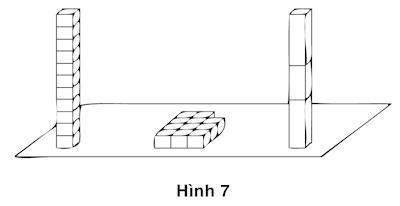
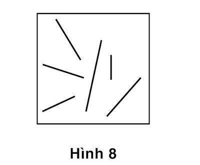

# Chương 8. Dự đoán diễn ra thế nào?

Không có giới hạn đối với số lượng những câu hỏi bạn có thể trả lời, bất kể chúng là câu hỏi của người khác hay là câu hỏi do chính bạn đặt ra. Cũng như không có giới hạn cho những đóng góp mà bạn có thể ước lượng. Bạn có khả năng đếm số những chữ cái in hoa trong trang này, so sánh chiều cao của các khung cửa sổ ngôi nhà của mình với một ngôi nhà bất kỳ trên phố và đánh giá triển vọng chính trị của vị thượng nghị sĩ đang trên đỉnh cao danh vọng hay vực sâu thảm họa. Các câu hỏi được chuyển tới Hệ thống 2 để xác định phương hướng và dò tìm bộ nhớ để tìm ra các câu trả lời. Hệ thống 2 tiếp nhận các câu hỏi hoặc sinh ra các câu hỏi: Trong trường hợp nào nó cũng điều khiển sự chú ý và tìm kiếm trong bộ nhớ để tìm ra câu trả lời, khác hẳn với hoạt động của Hệ thống 1. Nó tiếp tục giám sát những gì đang diễn ra bên ngoài cũng như bên trong đầu óc, tiếp tục sản sinh ra những đánh giá với vô số những khía cạnh khác nhau của tình huống mà không hề có sự chú ý đặc biệt nào cũng như với rất ít hoặc không có nỗ lực. Những đánh giá cơ bản chiếm một vị trí quan trọng trong các suy nghiệm trực giác, vì chúng rất dễ bị thay thế bởi những câu hỏi khó hơn – đó chính là ý tưởng cơ bản của phương pháp suy nghiệm định kiến. Hai tính năng khác của Hệ thống 1 cũng hỗ trợ cho sự thay thế một nhận định này bằng một nhận định khác. Một là khả năng diễn giải những giá trị theo kích cỡ, trong đó bạn sẽ trả lời một câu hỏi mà hầu hết mọi người đều cho là đơn giản: “Nếu Sam cũng có chiều cao như trí thông minh của mình, thì anh ấy có thể cao bao nhiêu?” Cuối cùng, đó chính là một “shotgun” tinh thần. Một chức năng của Hệ thống 2 là trả lời một câu hỏi đặc biệt hoặc đánh giá một đóng góp cụ thể trong một tình huống tự động kích hoạt các phép tính, bao gồm cả những đánh giá cơ bản.

### NHỮNG ĐÁNH GIÁ CƠ BẢN

Hệ thống 1 được hình thành dựa trên tiến trình liên tục cung cấp những đánh giá cơ bản về những vấn đề chính mà cơ thể cần giải quyết để tồn tại: Mọi việc đang diễn ra thế nào? Có xuất hiện mối đe dọa hay cơ hội nào không? Mọi việc vẫn bình thường cả chứ? Liệu tôi nên tiếp cận hay tránh xa? Những câu hỏi này có thể ít cấp bách hơn, nhưng bộ máy thần kinh mà con người được kế thừa vẫn tham gia cung cấp những đánh giá cơ bản về các mức độ đe dọa và bộ máy này không bao giờ bị tắt nguồn. Các tình huống liên tục được đánh giá tốt hay xấu, có cần phải bỏ trốn hay được phép tiếp cận. Tâm trạng tốt và nhận thức cảm tính chính là đối trọng của loài người về phía an toàn và thân thuộc.

Để hiểu hơn về một ví dụ của đánh giá cơ bản, hãy xem khả năng phân biệt bạn và thù trong một tích tắc. Điều này cho phép con người có cơ hội sống sót trong một thế giới đầy hiểm nguy và một khả năng đặc biệt như thế đúng là có tồn tại. Alex Todorov, đồng nghiệp của tôi ở Đại học Princeton, đã khám phá ra nguồn gốc sinh học của những đánh giá nhanh về khả năng an toàn trong tình huống tiếp xúc với một người lạ mặt. Ông chứng minh cho ta thấy chúng ta được ban tặng một khả năng đánh giá, chỉ trong một tích tắc, khi nhìn vào khuôn mặt của một người lạ, có hai sự thật cơ bản tiềm tàng về người này như sau: Anh ta có vẻ áp chế không (ẩn chứa khả năng đe dọa) và anh ta có vẻ đáng tin không, bất kể người lạ mặt đó tỏ ra thân thiện và hiếu khách như thế nào. Đặc điểm của khuôn mặt cũng cung cấp những đầu mối để đánh giá về con người như một cái cằm vuông “khoẻ khoắn” là một đầu mối về khả năng đe dọa. Biểu hiện khuôn mặt (tươi cười hay ủ dột) cho ta tín hiệu về ý định cơ bản của người lạ mặt. Sự kết hợp của một chiếc cằm vuông với khuôn mặt buồn rầu có thể mang đến rắc rối. Nhưng tính chính xác của khả năng “nhìn mặt (mà) bắt hình dong” không phải lúc nào cũng hoàn hảo: Cằm tròn không phải là chỉ báo cho một kẻ nhu mì và nụ cười (đôi khi) có thể giả trá. Tuy nhiên, khả năng đánh giá một người lạ mặt dù không chính xác 100% cũng có thể mang lại những lợi thế sống còn trong cuộc sống.

Cơ chế cổ xưa này được đặt vào sử dụng một tính năng lạ thường trong thế giới hiện đại: Nó có thể ảnh hưởng tới kết quả bầu cử. Todorov cho các sinh viên của mình xem ảnh của những người đàn ông, có khi chỉ trong vòng 1/10 giây, và yêu cầu họ đánh giá các khuôn mặt theo mức độ khác nhau, từ thân thiện đến cạnh tranh. Kết quả xếp hạng của những người quan sát khá thống nhất. Todorov cho họ xem những khuôn mặt không theo thứ tự nhất định: Họ là những chính khách đang vận động tranh cử cho một vị trí trong nhà nước. Sau đó Todorov so sánh các kết quả của các vòng bầu cử với kết quả đánh giá mà các sinh viên Princeton thực hiện thông qua việc cho xem ảnh của các ứng cử viên trong chốc lát và không hề được cung cấp thêm bất cứ thông tin về bối cảnh chính trị nào. Khoảng 70% số vòng bầu cử thượng nghị sĩ, nghị sĩ và chính khách, những người thắng cuộc chính là những ứng cử viên nhận được xếp hạng đánh giá cao. Kết quả bất ngờ này càng được khẳng định, củng cố thêm sau đó trong những cuộc bầu cử cấp quốc gia ở Phần Lan, bầu cử hội đồng khu vực ở nước Anh và trong rất nhiều cuộc tuyển chọn ở Australia, Đức và Mexico. Đáng ngạc nhiên hơn (ít nhất là đối với tôi) là trong nghiên cứu của Todorov, người ta dễ đoán được xếp hạng của các ứng viên tiềm năng hơn là những ứng viên thân thiện.

Todorov nhận thấy rằng con người đánh giá năng lực cạnh tranh dựa trên sự kết hợp hai yếu tố mạnh mẽ và đáng tin cậy. Khuôn mặt thể hiện cạnh tranh là sự kết hợp của một cái cằm mạnh mẽ, với một nụ cười thoáng vẻ tự tin trên khuôn mặt. Không có bằng chứng nào cho thấy những biểu hiện trên khuôn mặt dự đoán khả năng hoạt động của các chính trị gia trên cương vị công tác của mình. Nhưng các nghiên cứu về phản ứng não bộ đối với những ứng cử viên thắng và thua trong bầu cử cho thấy xu hướng tự nhiên của con người là loại bỏ những ứng viên thiếu những yếu tố mà họ đánh giá cao – trong nghiên cứu này, những ứng viên thất bại có những biểu hiện cảm xúc tiêu cực mạnh mẽ. Đó chính là một ví dụ của cái mà tôi sẽ gọi là phán đoán suy nghiệm trong những chương tiếp theo. Cử tri thường cố gắng hình thành một ấn tượng về một ứng viên tốt sẽ thế nào khi đảm đương một vị trí công việc và họ dựa vào những đánh giá đơn giản hơn, được thực hiện nhanh chóng và tự động và có hiệu lực khi Hệ thống 2 cần thông tin để ra quyết định.

Các nhà khoa học chính trị đã theo dõi những nghiên cứu đầu tiên của Todorov bằng cách xác định một loại cử tri ưu tiên Hệ thống 1, nghĩa là Hệ thống 1 chiếm giữ vai trò rất quan trọng. Họ đã nhận ra điều mà họ tìm kiếm trong số những cử tri chính trị ít được trang bị thông tin và xem truyền hình quá nhiều. Đúng như dự đoán, những ảnh hưởng của các yếu tố khuôn mặt cạnh tranh trong bầu cử ảnh hưởng nhiều gấp 3 lần đối với những cử tri ít thông tin và nghiền TV so với những người được trang bị nhiều thông tin hơn và ít xem truyền hình hơn. Thực tế là mối liên hệ quan trọng của Hệ thống 1 là nó xác định lựa chọn bầu cử không giống tất cả mọi người. Chúng ta sẽ gặp những ví dụ khác về những cá nhân khác biệt này.

Hệ thống 1 hiểu ngôn ngữ, và tất nhiên, sự hiểu biết phụ thuộc vào những đánh giá cơ bản, thường được tính đến như một phần cảm nhận về các sự kiện và sự lĩnh hội thông điệp. Những đánh giá này bao gồm tính toán về những đặc điểm tương tự, tính đại diện, đóng góp của các nguyên nhân và đánh giá về tính khả dụng của các liên kết và bản mẫu. Chúng được hình thành ngay cả khi thiếu đi những nhiệm vụ cụ thể, mặc dù các kết quả được sử dụng để hoàn thành nhiệm vụ đòi hỏi chúng phải xuất hiện.

Danh sách những đánh giá cơ bản rất dài, nhưng không phải tất cả mọi yếu tố đều được xem xét. Ví dụ, hãy nhìn nhanh vào Hình 7 ở trang 135.

Chỉ liếc mắt một cái cũng có thể cho bạn một ấn tượng tức thời xem có bao nhiêu yếu tố xuất hiện trong minh họa. Bạn biết ngay là hai tòa tháp trong hình cao bằng nhau và có vẻ chúng giống nhau hơn so với tòa tháp có các lô nằm ngang ở giữa. Tuy nhiên, bạn không thể lập tức nhận thấy số lô ở toà tháp bên trái bằng y hệt số lô ở toà tháp nằm ngang, và bạn cũng không hề có ấn tượng về chiều cao của tòa tháp nếu bạn phải sắp xếp lại các lô trong tòa tháp này. Để chắc chắn là số lô của chúng bằng nhau, bạn cần đếm số lô trong cả hai tòa nhà và so sánh kết quả, hoạt động này chỉ có thể thực hiện nhờ Hệ thống 2.

*Hình 7: Chiều dài trung bình của các đoạn thẳng*

### SẮP ĐẶT VÀ NGUYÊN MẪU

Thêm một ví dụ nữa, hãy xem câu hỏi sau: Chiều dài trung bình của các đoạn thẳng trong hình 8 là bao nhiêu?

*Hình 8: So sánh các đoạn thẳng*

Câu hỏi này đơn giản và Hệ thống 1 có thể trả lời không chút do dự. Các thí nghiệm cho thấy chỉ cần một phần mấy giây là đủ để người ta có thể đưa ra được chiều dài trung bình của các đoạn thẳng trong hình, một cách khá chắc chắn. Hơn thế nữa, tính chính xác của những quyết định này không hề suy giảm khi tư duy của người quan sát đang bận rộn với một nhiệm vụ ghi nhớ. Có thể họ không ước lượng được chiều dài trung bình là bao nhiêu inch hay centimet nhưng họ khá chuẩn xác khi ước lượng chiều dài của những đoạn thẳng khác so với đoạn thẳng có chiều dài trung bình. Không cần đến sự can dự của Hệ thống 2 để hình thành ấn tượng về chiều dài trung bình của một đoạn thẳng. Hệ thống 1 đã làm điều đó, tự động và dễ dàng, như thể mỗi đoạn thẳng có một màu sắc và sự thật là chúng không hề được đặt song song.

Giờ thì đến một câu hỏi khác: Vậy thì tổng chiều dài của các đoạn thẳng trong hình 8 là bao nhiêu? Đây lại là một vấn đề khác bởi vì Hệ thống 1 chẳng đưa ra được gợi ý nào. Cách duy nhất để bạn có thể trả lời được câu hỏi này là kích hoạt Hệ thống 2, để ước lượng chiều dài của đoạn thẳng trung bình, đoán hoặc đếm số đường thẳng, nhân chiều dài trung bình với số đoạn thẳng lên.

Sự thất bại của Hệ thống 1 khi tính tổng chiều dài của một bộ đoạn thẳng trong một thời gian ngắn có thể khá đúng với bạn, không bao giờ bạn nghĩ bạn sẽ làm phép tính này. Trên thực tế, nó chính là một trường hợp đặc biệt trong giới hạn quan trọng của hệ thống. Bởi vì Hệ thống 1 sử dụng những nguyên mẫu hoặc một bộ ví dụ điển hình làm đại diện cho một phạm trù, nó xử lý tốt những con số trung bình, nhưng yếu với con số tổng. Kích cỡ của phạm trù, số lượng những trường hợp cá biệt, có xu hướng bị bỏ qua trong các đánh giá mà tôi sẽ gọi là một tổng biến thiên.

Những người tham gia vào một trong số rất nhiều thí nghiệm được thúc đẩy bởi vụ kiện sau thảm họa tràn dầu Exxon Valdez được hỏi xem họ sẵn sàng trả bao nhiêu để mua lưới bao quanh các ao dầu để ngăn các chú chim di cư bị chết đuối. Nhiều nhóm tham gia thí nghiệm đã khẳng định họ sẵn sàng cứu 2.000 hay 20.000 hoặc 200.000 con chim. Nếu cứu chim là một việc tốt cho nền kinh tế, thì nó chính là một kiểu tổng biến thiên: Cứu được 200.000 con chim sẽ có lợi hơn nhiều so với việc chỉ cứu có 2.000 con chim. Trên thực tế, đóng góp trung bình của 3 nhóm đó chỉ vào khoảng 78 đô-la, 80 đô-la và 88 đô-la. Số tiền đóng góp chênh nhau rất ít dù số chim được cứu khác nhau. Phản ứng của những người tham gia thí nghiệm, trong cả 3 nhóm, chính là một mẫu thử - hình ảnh của một chú chim tuyệt vọng bị chết đuối, lông cánh dính đầy dầu là một hình ảnh xấu. Số lượng hầu như bị bỏ qua trong hoàn cảnh vô cùng xúc động này đã được khẳng định rất nhiều lần.

### CƯỜNG ĐỘ PHÙ HỢP

Những câu hỏi về hạnh phúc, về sự nổi tiếng của tổng thống, về những biện pháp trừng phạt tài chính đối với những kẻ vô lại, và triển vọng tương lai của một chính trị gia đều có chung một đặc điểm: Tất cả chúng đều được gán vào một diện mạo mang tính cường độ hoặc tổng số, cho phép người ta sử dụng từ thêm: Thêm hạnh phúc, thêm nổi tiếng, thêm nghiêm khắc hoặc thêm quyền lực (đối với chính trị gia). Ví dụ, một ứng viên chính trị tương lai có thể xếp hạng từ thấp “Cô ta thất bại ở vòng bỏ phiếu phổ thông” đến cao như “Một ngày nào đó cô ta sẽ trở thành tổng thống Hoa Kỳ.”

Đến đây, chúng ta sẽ bắt gặp một khả năng mới của Hệ thống 1. Một quy mô cơ bản về cường độ phù hợp với những chiều kích đa dạng. Ví dụ nếu tội ác có màu sắc, thì tên sát nhân sẽ phải có màu đỏ đậm hơn so với tên ăn trộm. Nếu tội ác được đo bằng âm nhạc, thì kẻ giết người hàng loạt sẽ là đoạn chơi cực mạnh, còn kẻ trốn vé đỗ xe sẽ chỉ là đoạn nhạc rất nhẹ. Và tất nhiên, bạn cũng sẽ có cảm giác tương tự về cường độ đối với sự trừng phạt. Trong thí nghiệm cổ điển, người ta điều chỉnh âm thanh dựa trên mức độ tàn ác của tội phạm; người khác lại điều chỉnh âm thanh theo mức độ nghiêm khắc của hình phạt. Nếu bạn nghe thấy hai đoạn ghi chú, một đối với tội ác, một đối với hình phạt, bạn sẽ cảm nhận được sự bất công nếu một tông nhạc mạnh hơn tông nhạc còn lại.

Hãy xem ví dụ sau, thí dụ này sẽ trở lại trong đoạn sau:

Julie đọc trôi chảy khi lên 4 tuổi.

Giờ thì hãy ghép khả năng đọc thông viết thạo của Julie khi còn là một đứa trẻ sao cho phù hợp với hệ quy chiếu cường độ sau:

Một người đàn ông sẽ cao bao nhiêu nếu chiều cao của ông ta cao tương đương với khả năng thiên bẩm của Julie?

Bạn có nghĩ là 1,83 m không? Rõ ràng là quá thấp. Thế còn 2,13 m? Có thể là quá cao. Bạn đang tìm kiếm một chiều cao ấn tượng phù hợp với khả năng đọc trôi chảy của một đứa trẻ lên bốn. Phải vừa ấn tượng, nhưng không quá cường điệu. Biết đọc ở độ tuổi 15 tháng là kỳ diệu, có thể sánh với người đàn ông cao 2,13 m hay 2,41 m.

Mức thu nhập của bạn là bao nhiêu thì phù hợp với trình độ đọc hiểu của Julie?

Tội ác nào đủ gay gắt nếu sánh với tài năng của Julie?

Điểm tốt nghiệp trung bình (GPA) của một sinh viên thuộc trường đại học hàng đầu là bao nhiêu thì phù hợp với trình độ đọc hiểu của Julie?

Không khó lắm, phải không? Hơn thế nữa, bạn có thể chắc rằng đáp án của bạn khá gần với những người khác cùng thuộc môi trường văn hóa như bạn. Chúng ta sẽ xem khi mọi người được hỏi hãy dự đoán điểm trung bình GPA của Julie là bao nhiêu từ những thông tin về độ tuổi cô bé biết đọc, họ sẽ trả lời bằng cách dịch chuyển từ một hệ quy chiếu này sang hệ quy chiếu khác và tìm ra một điểm GPA phù hợp. Và chúng ta cũng sẽ thấy tại sao phương thức đoán biết bằng cách ghép cặp dựa trên thống kê là sai - mặc dù nó hoàn toàn tự nhiên đối với Hệ thống 1, và hầu hết mọi người, trừ những nhà Thống kê học, điều đó cũng chấp nhận được với Hệ thống 2.

### Súng săn trí não

Hệ thống 1 thực hiện rất nhiều tính toán cùng một lúc. Một số trong số các phép tính là liên tục đưa ra những nhận định. Kể cả khi mắt bạn đang mở to, bộ não của bạn đang tính toán một bản trình bày trong không gian 3 chiều về những gì mắt bạn nhìn thấy, hoàn thiện với hình dáng của các vật thể, vị trí của chúng trong không gian và đặc tính của chúng. Không cần có ý định để kích hoạt hoạt động này hoặc giám sát liên tục đối với những triển vọng vi phạm. Đối lập với những đánh giá thường nhật, những tính toán khác chỉ được thực hiện khi có nhu cầu: Bạn không cần duy trì tình trạng đánh giá liên tục xem mình đang hạnh phúc hay khỏe mạnh như thế nào, và ngay cả khi bạn là một người nghiện chính trị, bạn cũng không tự động đánh giá tương lai của ngài tổng thống. Các phán xét không thường xuyên đều là tự nguyện. Chúng chỉ được thực hiện khi bạn có ý định đánh giá thực sự mà thôi.

Bạn không tự động đếm số âm tiết trong tất cả những từ bạn đọc lên, nhưng bạn có thể làm được điều đó nếu bạn muốn. Tuy nhiên, việc kiểm soát chủ động những tính toán thường cách xa so với nhu cầu chính xác: Chúng ta thường tính toán nhiều hơn rất nhiều so với nhu cầu hoặc mong muốn. Tôi gọi sự tính toán vượt mức này là “súng săn trí não.” Nghĩa là không thể thực hiện một cú nhắm trúng duy nhất một đích với một khẩu súng săn bởi vì đặc tính của loại súng này là bắn liên tục ra các viên đạn nhỏ. Có vẻ đây là một nhiệm vụ khó đối với Hệ thống 1, do đó Hệ thống 2 đảm nhiệm chức năng này. Hai thí nghiệm mà tôi đã đọc được từ rất lâu dưới đây có thể minh họa cho điều này.

Những người tham gia một thí nghiệm được cho nghe một cặp từ, và được hướng dẫn là ấn vào một nút càng nhanh càng tốt ngay khi họ xác định được vần điệu của các từ. Các cặp từ đều có vần như sau:

Vote – note (bầu cử - ghi chú) Vote – goat (bầu cử - con dê) Sự khác biệt là rất rõ ràng với bạn, bởi vì bạn được nhìn thấy cả hai cặp từ. VOTE và GOAT cùng vần nhưng chúng phát âm khác hẳn nhau. Những người tham gia chỉ nghe thấy các từ, nhưng họ cũng có thể bị ảnh hưởng bởi cách phát âm đó. Rõ ràng là họ sẽ nhận biết các từ chậm hơn nếu phát âm của họ không nhất quán. Mặc dù hướng dẫn chỉ yêu cầu so sánh các âm, nhưng những người tham gia cũng sẽ so sánh cả cách phát âm và chính sự so sánh này khiến tốc độ nhấn nút của họ bị chậm lại. Ý định trả lời một câu hỏi lại dẫn dắt sang một câu hỏi khác, thành ra quá trình diễn biến không chỉ vô nghĩa mà thực tế còn gây ảnh hưởng tới nhiệm vụ chính.

Trong một nghiên cứu khác, mọi người được nghe một loạt những câu văn được hướng dẫn nhấn một nút càng nhanh càng tốt nếu thấy câu văn đó là đúng và nhấn một nút khác nếu thấy câu văn đó sai. Đâu là câu trả lời đúng cho những câu văn dưới đây?

Một vài con đường ngoằn ngoèo.

Một vài công việc ngoằn ngoèo.

Một vài công việc như nhà tù.

Cả ba câu văn trên đều sai. Tuy nhiên, bạn có thể thấy câu thứ hai rõ ràng là sai hơn hai câu còn lại – thời gian phản ứng thu nhận được trong thí nghiệm đã khẳng định sự khác biệt thực tế. Lý do của sự khác biệt đó là về mặt ẩn dụ, hai câu văn nghe có khó hiểu hơn thì lại có thể đúng. Một lần nữa, chủ định chỉ đưa ra một phép tính lại dẫn đến một phép tính khác. Và thêm một lần nữa, câu trả lời đúng lại thắng thế trong mâu thuẫn, nhưng sự mâu thuẫn với câu trả lời không liên quan lại làm ảnh hưởng phong độ. Trong chương tiếp theo, ta sẽ xem xét sự kết hợp giữa khẩu súng săn trí não với sự phù hợp chặt chẽ để giải thích vì sao chúng ta lại đưa ra những nhận định trực giác về rất nhiều thứ mà ta chỉ biết có chút ít.

### DỰ ĐOÁN LÊN TIẾNG

> “Đánh giá con người có hấp dẫn hay không là sự đánh giá cơ bản. Nó diễn ra một cách tự động dù bạn có muốn hay không, và nó tác động đến bạn.”

> “Có những vòng tròn trong não bộ chịu trách nhiệm đánh giá những đặc điểm cơ bản trên khuôn mặt. Anh ta trông ra dáng một nhà lãnh đạo.”

> “Sự trừng phạt sẽ khiến người ta cảm thấy thiếu công bằng trừ khi nó phù hợp, liên hệ chặt chẽ với tội ác. Giống như khi bạn ghép sự ầm ĩ của âm thanh với sự tươi sáng của màu sắc.”

> “Khoảnh khắc đó rõ ràng là một khẩu súng săn trí não. Người ta chỉ hỏi anh nghĩ thế nào về khả năng tài chính của một công ty, nhưng anh ta không thể dừng được ý nghĩ anh cũng thích sản phẩm của công ty đó.”