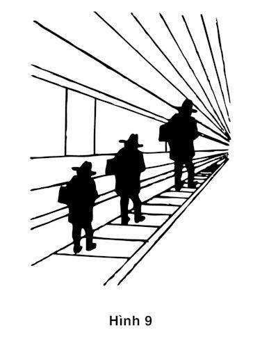

# Chương 9. Trả lời một câu hỏi dễ

Một khía cạnh đáng chú ý của đời sống trí não đó là bạn rất hiếm khi tỏ ra bối rối. Sự thật là thế, rất hiếm khi bạn phải đối mặt với những câu hỏi kiểu như 17 x 24 = ? mà câu trả lời rõ ràng là không thể lập tức xuất hiện trong đầu, nhưng những khoảnh khắc trí óc bạn “chết cứng” (không tìm ra được luôn đáp án) như thế cực hiếm. Còn trạng thái thông thường của đầu óc là bạn luôn có cảm giác trực giác và có quan điểm về hầu như tất cả mọi thứ xảy đến với mình. Bạn thích hoặc không thích một người rất lâu trước khi bạn biết nhiều hơn về họ, bạn tin hoặc không tin một số người lạ mà không biết tại sao; bạn cảm thấy một doanh nghiệp đang trên đà phát triển mà không hề dựa trên phân tích gì về doanh nghiệp đó. Dù bạn có nói ra thành lời hay không, bạn vẫn luôn có câu trả lời cho những câu hỏi mà bạn không hoàn toàn thấu hiểu, dựa trên bằng chứng mà bạn không thể giải thích vì sao cũng như phản đối nó như thế nào.

### CÁC CÂU HỎI THAY THẾ

Tôi đưa ra một lý giải đơn giản hơn về cách chúng ta đưa ra quan điểm về một vấn đề phức tạp. Nếu không thể có ngay một câu trả lời đủ thỏa mãn trước một câu hỏi phức tạp, Hệ thống 1 sẽ tìm kiếm một câu hỏi liên quan nhưng dễ hơn để trả lời. Tôi gọi đó là hệ thống trả lời một câu hỏi thay thế khác khi không tìm ra được câu trả lời cho câu hỏi gốc. Tôi cũng thừa nhận các thuật ngữ sau:

Câu hỏi mục tiêu là sự đánh giá mà bạn có ý định thực hiện.

Câu hỏi cảm tính là câu hỏi dễ hơn mà thay vì trả lời câu hỏi mục tiêu, bạn sẽ trả lời câu hỏi này.

Theo định nghĩa chuyên môn, cảm tính là một tiến trình đơn giản hơn cho phép bạn tìm câu trả lời hợp lý, dù không được hoàn hảo, cho những vấn đề phức tạp. Từ này xuất phát cùng một nguồn gốc với từ eureka.

Ý tưởng của câu hỏi thay thế xuất hiện từ rất sớm trong nghiên cứu của tôi và Amoss và nó trở thành cốt lõi cho lập luận sau này trở thành phương pháp tiếp cận cảm tính và sai lệch. Chúng tôi tự hỏi bản thân xem con người xoay xở thế nào để đưa ra những nhận định về các khả năng khi không hề biết chính xác đó là những khả năng nào. Chúng tôi đi đến kết luận là con người có thể bằng cách nào đó để đơn giản hóa những nhiệm vụ bất khả thi và làm thế nào họ thực hiện được điều đó. Câu trả lời thu được khi nhắc đến một nhận định về điều có thể xảy ra, con người thường đánh giá một thứ khác và họ tin rằng mình đã đánh giá đúng đối tượng cần đánh giá. Hệ thống 1 thường thực hiện hành động này khi phải đối mặt với những vấn đề mục tiêu phức tạp, trong trường hợp câu trả lời cho câu hỏi có liên quan và câu hỏi cảm tính dễ hơn đã sẵn có trong đầu.

Thay thế một câu hỏi bằng một câu hỏi khác có thể là một chiến lược hợp lý để giải quyết những vấn đề phức tạp đã được Goerge Pólya đưa vào cuốn sách kinh điển của mình *Làm sao để xử lý vấn đề này*: “Nếu bạn không thể xử lý một vấn đề, vậy thì sẽ có một vấn đề dễ hơn mà bạn có thể xử lý: Hãy tìm nó”. “Lý thuyết suy nghiệm” của Pólya chính là tiến trình mang tính chiến lược đã được tích hợp trong Hệ thống 2. Nhưng những suy nghiệm mà tôi bàn đến trong chương này không phải được lựa chọn, chúng là hệ quả của “khẩu súng săn trí óc”, sự kiểm soát mà chúng ta thực hiện bao trùm lên những câu trả lời đối với một câu hỏi mục tiêu.

Hãy xem Bảng 1 những câu hỏi mà tôi liệt kê trong cột bên trái ở bảng 1. Đó là những câu hỏi khó. Trước khi nghĩ câu trả lời hợp lý cho từng câu hỏi trong cột trái, bạn đều phải thử sức với những câu hỏi khó khác: Đâu là ý nghĩa của hạnh phúc? Hệ thống chính trị trong sáu tháng tới sẽ phát triển theo hướng nào? Đâu là những tiêu chuẩn cơ bản cho những tội ác tài chính? Đối thủ cạnh tranh của các ứng viên có những điểm mạnh nào? Những vấn đề môi trường hoặc các nguyên nhân nào khác cần phải tính tới? Những câu trả lời toàn diện hoàn toàn không khả thi. Nhưng bạn có thể bớt cầu toàn mà trả lời các câu hỏi dễ hơn đối với từng trường hợp. Đó là những phương án thay thế cảm tính một cách có lý, đôi khi mang lại những câu trả lời hợp lý, nhưng đôi khi dẫn đến những lỗi sai nghiêm trọng.

| Câu hỏi mục tiêu | Câu hỏi cảm tính |
| :--- | :--- |
| Bạn sẵn sàng đóng góp bao nhiêu tiền để cứu những loài động vật đang gặp nguy hiểm? | Tôi cảm thấy thế nào khi nghĩ đến những chú cá heo bị giết hại? |
| Những ngày gần đây bạn cảm thấy hạnh phúc thế nào? | Tâm trạng hiện thời của tôi thế nào? |
| Tổng thống sẽ được ngưỡng mộ hơn ra sao sau sáu tháng nữa? | Ngài Tổng thống được hâm mộ ra sao? |
| Những nhà tư vấn tài chính bóc lột những người già cần phải bị trừng phạt như thế nào? | Tôi tức giận thế nào khi nghĩ đến những kẻ lợi dụng tài chính của người khác? |
| Người phụ nữ này đang tranh cử trong vòng bỏ phiếu phổ thông. Liệu bà ta có thể tiến tới đâu trên vũ đài chính trị? | Người phụ nữ này có khả năng thắng cử chính trị không? |

*Bảng 1*

“Súng săn trí óc” tạo nên những câu trả lời nhanh đối với những vấn đề khó mà không bắt Hệ thống 2 lười biếng của bạn phải làm việc quá căng thẳng. Những câu hỏi bên phải là bản sao gợi ra từ các câu hỏi bên trái nhưng dễ trả lời hơn. Cảm xúc của bạn về cá heo hay những kẻ lừa gạt tài chính, tâm trạng hiện thời của bạn, ấn tượng của bạn về kỹ năng chính trị của một ứng cử viên, hoặc vị thế hiện tại của Tổng thống sẽ sẵn sàng trong đầu óc của bạn hơn. Mỗi khi vấp phải những câu hỏi phức tạp, những câu hỏi suy nghiệm cung cấp những câu trả lời “ăn sẵn” cho bạn.

Vẫn thiếu một cái gì đó trong câu chuyện này: Các câu trả lời cần phải ăn khớp với câu hỏi gốc. Ví dụ, cảm xúc của tôi về những chú cá heo đang chết dần cần phải được thể hiện bằng tiền bạc. Một khả năng khác của Hệ thống 1, sự phù hợp chặt chẽ, cũng sẵn sàng để giải quyết vấn đề này. Hãy nhớ lại tất cả cảm xúc và mức độ sẵn sàng đóng góp tiền trong thang bậc cường độ. Tôi có thể có ít hay nhiều cảm xúc về cá heo và sẽ phải có một sự đóng góp nào đấy phù hợp với mức độ cảm xúc của tôi. Số tiền cụ thể xuất hiện trong đầu tôi chính là số tiền phù hợp. Có thể chỉ ra những sự phù hợp về cường độ tương tự trong tất cả các câu hỏi. Ví dụ, kỹ năng chính trị của một ứng cử viên có thể được xếp hạng từ thảm hại đến ấn tượng, và thang bậc dành cho sự thành công chính trị có thể xếp hạng từ thấp như: “Bà ta sẽ thất bại ở vòng bỏ phiếu phổ thông” đến cao như: “Một ngày kia, bà ta sẽ trở thành tổng thống Hoa Kỳ.”

Tiến trình tự động của “súng săn trí óc” và sự phù hợp cường độ thường khiến cho một hoặc nhiều câu trả lời của những câu hỏi dễ có thể phản ánh được cho câu hỏi mục tiêu. Trong một vài trường hợp, câu hỏi thay thế lóe lên và một câu trả lời suy nghiệm có thể được Hệ thống 2 xác nhận. Tất nhiên, Hệ thống 2 cũng có cơ hội để từ chối câu trả lời trực giác này, hoặc điều chỉnh nó bằng cách đưa thêm những thông tin liên quan vào. Tuy nhiên, hệ thống 2 lười biếng thường chọn con đường ít tốn năng lượng nhất và chấp nhận một câu trả lời suy nghiệm mà không cần cân nhắc quá kỹ lưỡng xem thông tin ấy có đáng tin cậy hay là không. Bạn sẽ không phải cứng nhắc, cũng không phải làm việc vất vả và thậm chí bạn còn không nhận ra là mình không trả lời cho câu hỏi mình được hỏi. Hơn thế nữa, bạn có thể không nhận ra câu hỏi mục tiêu là khó, bởi một câu trả lời trực giác đã trực chờ trong trí óc của bạn rồi.

### MÔ HÌNH SUY NGHIỆM 3D

Hãy xem bức tranh về ba người đàn ông và trả lời câu hỏi dưới đây:

*Hình 9: Ảo giác kích thước theo luật xa gần*

Bức tranh được in trên giấy, liệu hình ảnh phía bên phải có lớn hơn hình ảnh phía bên trái không?

Câu trả lời hiển nhiên xuất hiện ngay trong đầu bạn: Hình ảnh bên phải lớn hơn. Tuy nhiên, nếu bạn lấy một cái thước để đo, bạn sẽ phát hiện ra thực tế là các hình ảnh có kích cỡ y hệt nhau. Ấn tượng của bạn về hình ảnh này so với hình ảnh khác đã bị chi phối mạnh mẽ bởi một ảo ảnh, gần như minh họa cho tiến trình thay thế này.

Đường ray xe lửa trong hình được vẽ theo luật xa gần và chúng có chiều sâu. Hệ thống giác quan của bạn tự động giải mã bức tranh thành một hình ảnh ba chiều, không phải là hình ảnh in bẹt trên bề mặt của một tờ giấy phẳng. Trong hình ảnh ba chiều đó, người đàn ông bên phải rõ ràng là ở xa hơn và lớn hơn người đàn ông bên phía trái. Đối với hầu hết chúng ta, ấn tượng về hình ảnh 3D là quá rõ ràng. Chỉ trừ những nghệ sĩ hình ảnh và những nhiếp ảnh gia kinh nghiệm mới có thể phát triển kỹ năng nhìn những vật thể trên giấy chính xác như nó vốn vậy. Hầu hết những người còn lại, thì sự thay thế đã xuất hiện: Ấn tượng về hình ảnh 3D đã lấn át và làm nhoè đi sự đánh giá về hình ảnh hai chiều. Ảo ảnh tạo ra bởi hình ảnh suy nghiệm 3D.

Ở đây tồn tại một ảo ảnh thực sự, không phải là sự hiểu lầm câu hỏi. Bạn hiểu câu hỏi là muốn hỏi về kích cỡ của hình ảnh trong bức tranh khi được in trên giấy. Nếu bạn được hỏi hãy ước lượng kích cỡ của hình ảnh trong tranh thông qua thí nghiệm, câu trả lời của bạn sẽ được quy ra inch, không quy ra feet. Bạn không băn khoăn về câu hỏi nhưng bạn bị ảnh hưởng bởi câu trả lời cho câu hỏi mà bạn không được hỏi: “Ba người này cao bao nhiêu?”

Bước cơ bản trong suy nghiệm là sự thay thế của hình ảnh ba chiều thay vì hình ảnh hai chiều đã xuất hiện một cách tự động. Bức tranh chứa những dấu hiệu tạo nên một không gian ba chiều. Những dấu hiệu này không liên quan đến nhiệm vụ chính, ước lượng kích cỡ cho ba hình ảnh trên giấy và bạn nên phớt lờ chúng nhưng bạn đã không làm được. Sai lệch liên quan đến suy nghiệm ở trường hợp này là trong tranh các vật thể xuất hiện ở xa hơn trông có vẻ lớn hơn. Như thí nghiệm này đã minh họa, một sự phán đoán dựa trên sự thay thế có thể bị hiểu sai dựa trên những sai lệch, theo những cách có thể đoán được. Trong trường hợp này, nó diễn ra dưới tầng sâu của hệ thống tri giác mà đơn giản là bạn không thể làm gì khác được.

### TÂM TRẠNG SUY NGHIỆM VỚI HẠNH PHÚC

Một bản khảo sát của những sinh viên người Đức là một trong những ví dụ tuyệt vời nhất về sự thay thế này. Bản khảo sát cho phép những người tham gia trẻ tuổi trả lời hai câu hỏi sau:

Gần đây bạn cảm thấy hạnh phúc không?

Tháng trước bạn hẹn hò bao nhiêu lần?

Nghiên cứu này quan tâm tới sự tương quan giữa hai câu trả lời. Liệu những sinh viên hẹn hò nhiều có hạnh phúc hơn những sinh viện hẹn hò ít? Thật ngạc nhiên khi câu trả lời về sự tương quan giữa các câu trả lời này là không. Rõ ràng là việc hẹn hò không phải là yếu tố đầu tiên xuất hiện trong đầu óc của các sinh viên, khi họ được hỏi về hạnh phúc. Một nhóm sinh viên khác cũng được hỏi hai câu hỏi y như vậy nhưng theo thứ tự ngược lại:

Tháng trước bạn hẹn hò bao nhiêu lần?

Gần đây bạn cảm thấy hạnh phúc không?

Lần này kết quả thu được lại hoàn toàn khác. Kết quả là mối tương quan giữa số lần hẹn hò và cảm giác hạnh phúc cao hơn so với mối tương quan giữa những thước đo tâm lý. Chuyện gì đã xảy ra ở đây vậy?

Câu trả lời rất dễ hiểu và nó là một ví dụ điển hình cho sự thay thế. Hẹn hò rõ ràng không phải là tâm điểm trong cuộc sống của những sinh viên này (trong khảo sát đầu tiên, hạnh phúc và hẹn hò không có liên quan đến nhau) nhưng khi họ được yêu cầu nghĩ về đời sống tình cảm, họ chắc chắn đã có phản ứng tâm lý. Những sinh viên hẹn hò nhiều hơn được nhắc nhở về khía cạnh hạnh phúc trong cuộc sống của mình, trong khi những sinh viên hẹn hò ít bị nhắc nhớ về cảm giác cô đơn và bị chối bỏ của mình. Cảm xúc ấy vẫn tồn tại trong đầu óc của họ cho đến khi câu hỏi tiếp theo về hạnh phúc trong cuộc sống chung chung xuất hiện.

Khía cạnh tâm lý được đề cập trong những khảo sát trên cũng tương tự như trong ảo giác về kích cỡ mà ta vừa gặp trong Hình 9. “Hạnh phúc những ngày gần đây” không phải điều tự nhiên và không dễ dàng để đánh giá. Cần phải có thời gian suy nghĩ mới có thể trả lời tốt câu hỏi này. Tuy nhiên, những sinh viên vừa được hỏi về đời sống tình cảm không cần phải nghĩ nhiều bởi vì họ đã có sẵn trong đầu câu trả lời liên quan đến câu hỏi: Họ cảm thấy hạnh phúc thế nào với đời sống tình cảm của mình. Họ đã thay thế câu hỏi bằng câu hỏi mà họ đã có sẵn câu trả lời trước đó.

Một lần nữa, chúng ta lại làm theo ảo giác, chúng ta có thể hỏi: Liệu những sinh viên này có bị bối rối không? Liệu họ có thật sự nghĩ rằng hai câu hỏi, bao gồm câu hỏi mà họ được hỏi và câu hỏi mà họ đã trả lời có cùng nghĩa? Tất nhiên là không. Những sinh viên này không hề bị mất khả năng phân biệt dù tạm thời hai khái niệm về cuộc sống tình cảm và cuộc sống nói chung. Nếu được hỏi riêng rẽ về hai khái niệm, họ chắc chắn trả lời chúng là khác nhau. Nhưng câu hỏi mà họ nhận được không phải để hỏi hai khái niệm đó có khác nhau hay không. Họ chỉ được hỏi xem gần đây có cảm thấy hạnh phúc hay không mà thôi và Hệ thống 1 đã có sẵn câu trả lời.

Hẹn hò không phải là vấn đề duy nhất. Hiện tượng tương tự cũng xảy ra nếu một câu hỏi về mối quan hệ của sinh viên với cha mẹ của họ hoặc về tình hình tài chính của họ, chúng đều liên quan trực tiếp đến câu hỏi về hạnh phúc nói chung. Trong cả hai trường hợp, sự hài lòng trong một lĩnh vực riêng biệt chi phối đến cảm giác hạnh phúc chung. Bất cứ câu hỏi liên quan đến cảm xúc nào cũng gây ra hiệu ứng tâm trạng tương tự đối với một người. WYSIATI. Tâm trí mỗi người đều bị che phủ bởi tâm trạng của họ khi được yêu cầu đánh giá về mức độ hạnh phúc của bản thân.

### HIỆU ỨNG SUY NGHIỆM

Sự thống trị của các kết luận bao trùm lên các lập luận là điều dễ thấy nhất khi có các yếu tố cảm xúc chen vào. Nhà tâm lý học Paul Slovic đã đề xuất một tên gọi là hiệu ứng suy nghiệm, trong đó mọi người được sử dụng những thứ họ thích và những thứ họ không thích để xác định niềm tin của họ về thế giới xung quanh. Sở thích chính trị của bạn xác định những lập luận mà bạn cảm thấy hấp dẫn. Nếu bạn cảm thấy thích chính sách chăm sóc cho sức khỏe hiện thời, bạn sẽ tin rằng phúc lợi mà nó mang đến là hợp lý và bạn đầu tư chi phí chăm sóc sức khoẻ hợp lý hơn là đầu tư cho các chi phí cho các thứ khác. Nếu bạn có thái độ hiếu chiến đối với những quốc gia khác, bạn có thể nghĩ họ thật yếu đuối và có xu hướng đề cao những mong muốn của đất nước mình. Nếu bạn là người chuộng hòa bình, bạn có thể nghĩ các nước khác cũng mạnh và sẽ không dễ dàng gì để áp chế các nước này. Thái độ và xúc cảm của bạn với những thứ như vậy giống như thức ăn được chiếu xạ, thức ăn sống, năng lượng hạt nhân, hình xăm, xe gắn máy đều ảnh hưởng tới niềm tin của bạn, về tính khả thi cũng như nguy cơ tiềm tàng ẩn giấu trong nó. Nếu bạn không thích bất cứ thứ gì trong số những thứ này, khả năng là bạn tin rằng hiểm họa chúng mang lại là cao so với lợi ích mà chúng mang lại là không đáng kể.

Dù các kết luận này xuất hiện tức thời trong đầu óc bạn, thì điều đó không có nghĩa là đầu óc bạn đã hoàn toàn đóng lại, không tiếp nhận thêm thông tin nữa và không có lý do nào nữa để đưa vào ý kiến của mình. Niềm tin của bạn, thậm chí cả thái độ cảm xúc của bạn đều có thể thay đổi (dù ít dù nhiều) khi bạn nhận ra nguy cơ trong một hành động mà bạn không thích hóa ra nhỏ hơn so với suy nghĩ của bạn. Tuy nhiên, thông tin về nguy cơ thấp có thể cũng sẽ làm thay đổi góc nhìn của bạn về lợi ích (tốt đẹp hơn) ngay cả khi không có gì nhắc đến lợi ích của những thông tin mà bạn thu nhận được.

Chúng ta thấy ở đây một khía cạnh mới trong “nhân vật” Hệ thống 2. Cho đến giờ gần như tôi đã mô tả Hệ thống 2 hoàn toàn như một bộ máy ít hay nhiều phục tùng, cho phép trôi dạt về phía Hệ thống 1. Tôi cũng đã miêu tả Hệ thống 2 như một bộ máy tìm kiếm trong bộ nhớ, chứa những tính toán phức tạp, sự so sánh, sự hoạch định và lựa chọn. Trong vấn đề “gậy và bóng” và trong rất nhiều ví dụ khác về mối quan hệ tương tác qua lại giữa hai hệ thống, có vẻ hầu như Hệ thống 2 chịu trách nhiệm, với khả năng phản kháng lại những đề xuất từ Hệ thống 1, chậm rãi xử lý mọi thứ và áp đặt những phân tích logic. Suy nghiệm là một trong những chức năng của Hệ thống 2. Trong những hoàn cảnh nhất định, Hệ thống 2 giống nhà biện hộ cho xúc cảm của Hệ thống 1 hơn là một nhà chỉ trích những cảm xúc ấy và nó giống một nhà bảo lãnh hơn là một người thúc ép. Hệ thống tìm kiếm thông tin và lập luận của nó gần như chặt chẽ với thông tin mà nó kiên định với những niềm tin hiện tại, chứ không phải với ý định kiểm tra chúng. Hệ thống 1 năng động và luôn tìm kiếm sự tương đồng gợi ý những giải pháp cho Hệ thống 2 ít đòi hỏi.

### SỰ THAY THẾ VÀ SUY NGHIỆM LÊN TIẾNG

> “Chúng ta còn nhớ câu hỏi mà chúng ta đang cố gắng tìm câu trả lời không? Hay chúng ta đã thay thế câu hỏi ấy bằng một câu hỏi dễ hơn rồi?”

> “Câu hỏi mà ta phải trả lời đó là liệu ứng cử viên này có giành thắng lợi hay không. Câu hỏi mà chúng ta định trả lời đó là bà ta trả lời phỏng vấn có tốt không. Đừng có mà thay thế nữa.”

> “Anh ta thích dự án này, vì thế anh ta nghĩ chi phí như vậy là thấp và lợi ích từ dự án này mang lại là rất cao. Thật là một ví dụ điển hình của hiệu ứng suy nghiệm .”

> “Chúng ta đã lấy năng suất lao động của năm ngoái làm cơ sở để dự đoán giá trị của doanh nghiệp trong vài năm tới. Đó có phải là một suy nghiệm tốt? Thế chúng ta cần những thông tin nào nữa?”

### Tính cách của Hệ thống 1

- Tạo ra ấn tượng, cảm giác và thiên hướng; khi được chứng thực bởi Hệ thống 2, chúng sẽ biến thành niềm tin, thái độ và mục đích.

- Hoạt động tự động và nhanh, với rất ít hoặc không cần nỗ lực, và không cảm giác về sự kiểm soát tự nguyện.

- Có thể được lập trình bởi Hệ thống 2 để điều chỉnh sự chú ý khi một yếu tố đặc biệt được phát hiện (tìm kiếm).

- Thực hành các phản ứng khéo léo và tạo thành những trực giác tinh tế, sau khi được đào tạo đầy đủ.

- Phản ứng mạnh mẽ với sự mất mát hơn là sự được (đảo chiều mất mát).

- Điều chỉnh quyết định các vấn đề một cách tỉ mỉ, từng vấn đề riêng lẻ một.

- Những vấn đề này sẽ được trình bày kỹ hơn trong phần IV.

- Tạo ra những hoạt động tương thích với các ý tưởng được kích hoạt trong bộ nhớ.

- Liên kết cảm giác nhận thức cảm tính với ảo ảnh về giá trị, cảm giác dễ chịu và giảm thiểu sự thận trọng.

- Phân biệt sự kinh ngạc so với sự bình thường.

- Phỏng đoán và sáng tạo ra nguyên nhân và mục đích.

- Phớt lờ sự khó hiểu và nén chặt sự nghi ngờ.

- Bị thành kiến trong niềm tin và khẳng định.

- Phóng đại cảm xúc kiên định (hiệu ứng hào quang).

- Tập trung vào hiện thực tồn tại và phớt lờ những hiện thực vắng mặt (WYSIATI).

- Tạo ra một bộ phận những nhận định cơ bản có giới hạn.

- Đại diện một bộ quy chuẩn và nguyên mẫu, không hợp nhất.

- Ghép cặp cường độ trên các chiều kích (ví dụ kích cỡ với âm thanh).

- Tính toán nhiều hơn chủ định (súng săn trí não).

- Đôi khi thay thế một câu hỏi dễ thay vì câu hỏi khó (suy nghiệm).

- Nhạy cảm hơn với sự thay đổi so với sự lo lắng (lý thuyết triển vọng).

- Đánh giá quá thấp các khả năng.