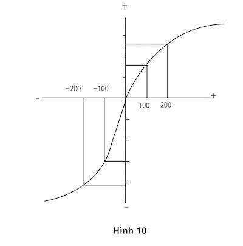

# Chương 26. Lý thuyết viễn cảnh

Amos và tôi đã rơi vào thiếu sót chính yếu trong học thuyết của Bernoulli bởi một sự kết hợp may mắn của kỹ năng và sự mù mờ. Theo đề nghị của Amos, tôi đã đọc một chương trong cuốn sách của ông miêu tả những thí nghiệm nhấn mạnh tới các học giả đã đo lường độ thỏa dụng về tiền bạc bằng việc đề nghị mọi người đưa ra những sự chọn lựa các trò may rủi mà người tham gia có thể thắng hoặc thua một vài đồng penny. Những người thử nghiệm đo lường giá trị thỏa dụng của tài sản, bằng việc làm giảm bớt tài sản trong khoảng một hạn mức ít hơn một đô-la. Điều này đã đưa ra những câu hỏi. Có hợp lý không khi thừa nhận rằng mọi người đánh giá những trò may rủi bởi những khác biệt rất nhỏ về tài sản? Làm thế nào để một người có thể hy vọng lĩnh hội được Vật lý tâm thần học về tài sản bằng việc nghiên cứu những phản ứng khi được và mất những đồng penny? Những bước tiến gần đây trong học thuyết Vật lý - Tâm lý học đã gợi ra rằng nếu bạn muốn nghiên cứu giá trị chủ quan của tài sản, bạn nên đặt những câu hỏi trực tiếp về tài sản, chứ không phải về những thay đổi của tài sản. Tôi đã không hiểu một cách đầy đủ về học thuyết thỏa dụng để rồi thành ra mù mờ bởi triển vọng dành cho nó, và tôi đã lúng túng.

Khi Amos và tôi gặp nhau vào ngày hôm sau, tôi đã thông báo về những khó khăn mà rôi gặp phải là những suy nghĩ mơ hồ, chứ không phải về việc nghiên cứu. Tôi đã hoàn toàn trông đợi ông ấy hiểu tôi một cách chính xác và giải thích tại sao thí nghiệm đó đã làm tôi lúng túng trong việc đưa ra phán đoán sau cùng, nhưng ông ấy đã không làm theo cách ấy – mối liên quan về Vật lý tâm thần học hiện đại đã ngay lập tức trở nên rõ ràng đối với ông ấy. Ông ấy nhớ ra nhà kinh tế học Harry Markowitz, sau này sẽ đoạt giải Nobel trên lĩnh vực tài chính, người đưa ra một học thuyết theo đó các thỏa dụng được gắn liền với những thay đổi về tài sản hơn là trạng thái tài sản. Ý tưởng của Markowitz đã được đưa ra trong khoảng ¼ thế kỷ và đã không thu hút được nhiều sự chú ý, nhưng chúng tôi kết luận nhanh chóng rằng đó chính là con đường để đi tiếp, và đó là học thuyết mà chúng tôi đang dự kiến phát triển. Nó sẽ đưa ra các kết quả là những lợi ích và tổn thất, chứ không giống như các trạng thái tài sản. Hiểu biết về sự nhận thức và điểm mù về lý thuyết quyết định, cả hai đã góp phần cho một bước tiến lớn trong việc nghiên cứu của chúng tôi.

Chúng tôi nhanh chóng biết được rằng chúng tôi đã vượt qua một trường hợp phức tạp về học thuyết gây ra sự mù mờ, bởi ý tưởng chúng tôi đã loại trừ giờ đây có vẻ không chỉ sai mà còn vô lý. Chúng tôi đã vui mừng nhận ra rằng chúng tôi không có khả năng định giá tài sản hiện tại của mình trong khoảng 10 ngàn đô-la. Ý tưởng về việc nhận được những quan điểm đối với những thay đổi nhỏ từ thỏa dụng tài sản giờ đây dường như không thể biện minh được nữa. Bạn biết mình vừa tạo ra một bước tiến về mặt lý thuyết khi bạn không còn có thể tái dựng lại việc tại sao bạn đã mắc sai lầm trong thời gian quá lâu để thấy được một cách rõ ràng. Tuy nhiên, chúng tôi phải mất hàng năm trời để phát triển những hệ quả của việc suy nghĩ về những kết quả như là lợi ích và tổn thất.

Trong học thuyết thỏa dụng, lợi ích của sự tăng thêm được định giá bằng việc so sánh những thỏa dụng của hai trạng thái tài sản. Ví dụ, thỏa dụng của việc có thêm một khoản 500 đô-la khi tài sản của bạn là 1 triệu đô-la là sự khác biệt giữa thỏa dụng của 1.500.000 đô-la và thỏa dụng của 1 triệu đô-la. Và nếu bạn sở hữu một lượng lớn hơn, thì việc mất đi 500 đô-la một lần nữa là sự khác biệt giữa những thỏa dụng của hai trạng thái tài sản. Trong học thuyết này, những lợi ích của những cái được và mất chỉ được phép phân biệt với nhau theo ký hiệu của chúng (+ hoặc -). Không có cách nào để trình bày sự thực rằng phản hiệu dụng của việc mất đi 500 đô-la có thể lớn hơn tính thỏa dụng của việc giành được cùng một lượng như vậy – mặc dù hiển nhiên là như vậy. Như có thể được dự tính trong trường hợp học thuyết gây ra sự mơ hồ, những sai biệt có thể giữa những cái được và mất không thể dự tính được cũng không thể nghiên cứu được. Sự khác biệt giữa những lợi ích và tổn thất được giả định là không quan trọng, bởi vậy không hề có đơn vị đo lường trong việc kiểm tra chúng.

Amos và tôi đã không thấy được ngay rằng sự tập trung của chúng tôi vào những thay đổi về tài sản đã mở ra con đường dẫn tới một cuộc khảo sát về một đề tài mới. Chúng tôi chủ yếu quan tâm tới những khác biệt giữa những trò may rủi với khả năng chiến thắng cao hay thấp. Một ngày nọ, tình cờ Amos đã đưa ra gợi ý: “Những tổn thất thì như thế nào?” và chúng tôi nhanh chóng phát hiện ra rằng nỗi sợ rủi ro quen thuộc của chúng ta đã được thay thế bằng việc tìm ra những rủi ro khi chúng ta chuyển hướng tập trung. Hãy xem xét hai vấn đề sau:

Bài toán 1: Bạn chọn phương án nào?

Cầm chắc 900 đô-la HOẶC 90% cơ may có được 1.000 đô-la.

Bài toán 2: Bạn chọn phương án nào?

Mất chắc 900 đô-la HOẶC 90% khả năng mất 1.000 đô-la.

Có thể bạn không muốn mạo hiểm trong bài toán 1, cũng như người khác. Giá trị chủ quan của một món lợi 900 đô-la chắc chắn là nhiều hơn 90% giá trị của một món lợi 1.000 đô-la. Lựa chọn tránh rủi ro trong vấn đề này sẽ không làm cho Bernoulli ngạc nhiên.

Giờ hãy nghiên cứu sự ưu tiên của bạn trong bài toán 2. Nếu bạn giống như phần lớn những người khác, bạn chọn trò may rủi trong câu hỏi này. Cách lý giải cho lựa chọn tìm kiếm rủi ro này là hình ảnh phản chiếu của lời giải thích về nỗi sợ rủi ro trong bài toán 1: Giá trị (tiêu cực) của việc mất 900 đô-la nhiều hơn nhiều 90% giá trị (tiêu cực) của việc mất 1.000 đô-la. Việc chắc chắn bị mất thật chẳng mong muốn gì, và đó là chiều hướng để bạn chấp nhận rủi ro. Sau đó, bạn sẽ thấy rằng những đánh giá về các xác suất (90% so với 100%) cũng góp phần vào cả hai nỗi lo ngại rủi ro ở vấn đề 1 và sự ưu tiên cho trò may rủi trong vấn đề 2.

Chúng ta không phải là những người đầu tiên nhận thức được rằng con người chuyển sang tìm kiếm rủi ro khi tất cả các phương án chọn lựa của họ đều xấu, nhưng học thuyết gây ra sự mù mờ đã thắng thế. Do học thuyết trội hơn đã không cung cấp một phương hướng hợp lý để thích ứng với những quan điểm trước rủi ro được hoặc mất khác nhau, thực tế là những quan điểm khác nhau đã bị bỏ qua. Ngược lại, quyết định của chúng ta nhằm nhìn thấy các kết quả được và mất dẫn đến việc chúng ta tập trung một cách chính xác vào chính sự trái ngược này. Điều nhận thấy về những thái độ tương phản trước rủi ro với những triển vọng có lợi và không có lợi đã nhanh chóng mang lại một bước tiến có ý nghĩa: Chúng tôi đã phát hiện ra một cách để chứng minh sai sót chủ đạo trong mô hình chọn lựa của Bernoulli. Hãy nhìn vào ví dụ sau:

Bài toán 3: Thêm vào bất kể thứ gì bạn sở hữu, bạn đã được trao cho 1.000 đô-la. Giờ đây bạn được đề nghị chọn một trong những phương án sau:

50% cơ may giành được 1.000 đô-la HOẶC cầm chắc 500 đô-la.

Bài toán 4: Thêm vào bất kể thứ gì bạn sở hữu, bạn đã được trao cho 2.000 đô-la. Bây giờ, bạn được đề nghị chọn một trong những phương án sau:

50% cơ may giành được 1.000 đô-la HOẶC mất chắc 500 đô-la.

Bạn có thể dễ dàng thừa nhận rằng trong mối tương quan với các trạng thái cuối cùng của tài sản – tất cả đều là những vấn đề trong học thuyết của Bernoulli – vấn đề 3 và 4 giống hệt nhau. Trong cả hai trường hợp bạn có một chọn lựa giữa hai phương án giống nhau: Bạn có thể có được sự chắc chắn để trở nên giàu hơn bạn hiện tại với 1.500 đô-la, hoặc chấp nhận một trò may rủi theo đó bạn có những cơ may đồng đều để giàu hơn với 1.000 đô-la hoặc với 2.000 đô-la. Do vậy, trong học thuyết của Bernoulli, hai vấn đề kể trên sẽ gợi ra những ưu tiên giống nhau. Hãy kiểm tra trực giác của bạn, và bạn có thể đoán được những gì người khác sẽ làm.

- Trong chọn lựa đầu tiên, đại đa số những người được hỏi thích điều chắc chắn hơn.

- Trong chọn lựa thứ hai, đại đa số thích trò may rủi hơn.

Việc phát hiện ra những ưu tiên khác nhau trong bài toán 3 và bài toán 4 là một ví dụ đối nghịch mang tính quyết định cho ý tưởng chủ đạo trong học thuyết của Bernoulli. Nếu thỏa dụng về tài sản là tất cả vấn đề, thì những trạng thái tương đương rõ ràng của cùng vấn đề sẽ mang lại những chọn lựa giống nhau. Sự so sánh các vấn đề làm nổi bật vai trò quan trọng của điểm tham chiếu từ đó các phương án được đánh giá. Điểm tham chiếu cao hơn tài sản hiện tại là 1.000 đô-la trong vấn đề số 3, và 2.000 đô-la trong vấn đề số 4. Việc có thêm với 1.500 đô-la bởi vậy là một khoản lợi 500 đô-la trong toán 3 và khoản mất trong vấn đề số 4. Rõ ràng là rất dễ để tạo ra những ví dụ cùng dạng khác. Câu chuyện của Anthony và Betty là một cấu trúc tương tự.

Bạn dành sự quan tâm cho món quà 1.000 đô-la hoặc 2.000 đô-la mà bạn được “trao” trước khi đưa ra chọn lựa của bạn như thế nào? Nếu bạn giống hầu hết mọi người, bạn gần như không nhận thức được điều này. Thật vậy, không có lý do nào để bạn để ý tới, bởi món quà được bao gồm trong điểm tham chiếu, và các điểm tham chiếu thông thường đều bị bỏ qua. Bạn biết đôi chút về những sự ưu tiên của mình mà các học thuyết thỏa dụng không biết – những thái độ của bạn trước rủi ro sẽ không khác biệt nếu phạm vi giá trị của bạn cao hơn hoặc thấp hơn một vài ngàn đô-la (trừ khi bạn là một người nghèo khổ). Và bạn cũng biết rằng thái độ của bạn đối với những lợi ích và thua thiệt không bắt nguồn từ sự đánh giá của bạn đối với tài sản của bạn. Lý do để bạn thích ý nghĩ về việc đạt được 100 đô-la và không thích ý nghĩ của việc mất đi 100 đô-la không phải là việc thay đổi lượng tài sản của bạn. Bạn chỉ thích chiến thắng và không thích thất bại – và bạn gần như chắc chắn không thích việc thua lỗ hơn là bạn thích chiến thắng.

Bốn vấn đề nêu bật điểm yếu trong mô hình của Bernoulli. Học thuyết của ông quá đơn giản và thiếu phần động. Biến số còn thiếu là điểm tham chiếu, trạng thái ban đầu liên quan tới những gì đạt được và mất đi sẽ được đánh giá. Trong học thuyết của Bernoulli, bạn chỉ cần biết tới trạng thái của tài sản để xác định sự thỏa dụng của nó, nhưng trong lý thuyết triển vọng bạn cũng cần phải biết tới trạng thái tham chiếu. Do vậy, lý thuyết triển vọng phức tạp hơn học thuyết thỏa dụng. Trong khoa học, sự phức tạp được xem xét là một chi phí, điều này phải được chứng minh bởi một tập hợp phong phú đầy đủ về những dự đoán mới và (tốt nhất là) thú vị về những thực tế mà học thuyết hiện tại không thể lý giải. Đó chính là thách thức mà chúng tôi đã gặp phải.

Mặc dù Amos và tôi đã không làm việc với mô hình hai phương thức của trí não, giờ đây rõ ràng là có tới ba đặc trưng liên quan tới nhận thức tại điểm mấu chốt của lý thuyết viễn cảnh. Chúng giữ một vai trò thiết thực khi đánh giá về những kết quả tài chính và trở nên phổ biến đối với rất nhiều quy trình tự động về nhận thức, phán quyết và cảm xúc. Chúng nên được xem như những đặc điểm vận hành của Hệ thống 1.

- Sự đánh giá liên quan đến một điểm tham chiếu đẳng dụng, đôi khi được biết tới như là một “mức thích nghi”. Bạn có thể dễ dàng đưa ra một luận chứng thuyết phục cho nguyên lý này. Đặt ba cái bát ở trước mặt bạn. Chế nước lạnh vào bát bên trái và nước ấm vào bát bên phải.

- Nước ở bát giữa để ở nhiệt độ của phòng. Nhúng hai tay của bạn vào bát nước lạnh và ấm trong vòng vài phút, sau đó ngâm cả hai tay vào bát ở giữa. Bạn sẽ trải nghiệm mức nhiệt độ giống nhau như nóng ở một tay và lạnh ở tay còn lại. Đối với các kết quả tài chính, điểm tham chiếu thông thường là trạng thái, nhưng nó cũng có thể là kết quả mà bạn dự tính, hoặc có lẽ là kết quả mà theo đó bạn thấy được ủy quyền, ví dụ, mức tăng lương hoặc tiền thưởng mà đồng nghiệp của bạn nhận được. Các kết quả tốt hơn các điểm tham chiếu là những lợi ích. Ở mức dưới điểm tham chiếu là những thua lỗ.

- Một nguyên lý về việc giảm dần độ nhạy ứng dụng trong cả những khía cạnh cảm giác lẫn sự đánh giá những cơ may về tài sản. Việc bật lên một ngọn đèn yếu sẽ có hiệu ứng lớn trong một căn phòng tối. Số gia tăng tương tự như ánh sáng. Nó có thể không được phát hiện ra trong một căn phòng được chiếu sáng rực rỡ. Tương tự như vậy, sự khác biệt chủ quan giữa 900 đô-la và 1.000 đô-la nhỏ hơn rất nhiều so với sự khác biệt giữa 100 đô-la và 200 đô-la.

- Nguyên lý thứ ba là sự ác cảm mất mát. Khi được so sánh trực tiếp hoặc được đem ra cân nhắc từng thứ với nhau, những cái mất đi hiện hình rõ hơn những cái đạt được. Đó chính là sự mất cân xứng giữa sức mạnh của những dự tính tích cực và tiêu cực hoặc những trải nghiệm có một tiến trình tiến hóa. Các tổ chức xử trí những mối đe dọa khẩn cấp hơn cả đối với những cơ hội đều có cơ may tốt hơn để tồn tại và sinh trưởng.

Ba nguyên lý chi phối giá trị của những kết quả được minh họa bởi biểu đồ số 10. Nếu lý thuyết viễn cảnh có một lá cờ, hình ảnh này sẽ được vẽ trên đó. Đồ thị minh họa chỉ ra giá trị tâm lý của những lợi ích và tổn thất, đó là những “vật mang” giá trị trong lý thuyết viễn cảnh (không giống như mô hình của Bernoulli, trong đó các trạng thái tài sản là những vật mang giá trị).

*Hình 10: Hàm giá trị trong lý thuyết viễn cảnh*

Đồ thị minh họa có hai phần rõ rệt, nằm ở bên phải và bên trái của một điểm tham chiếu đẳng dụng. Đặc tính quan trọng nhất đó là nó có hình chữ S, nó đại diện cho độ nhạy giảm dần đối với cả những lợi ích và tổn thất. Cuối cùng, hai đường cong của chữ S không đối xứng. Độ dốc của hàm số thay đổi một cách bất ngờ tại điểm tham chiếu: Phản ứng trước những thất bại mạnh mẽ hơn phản ứng trước những lợi ích tương ứng. Đó chính là sự ác cảm mất mát.

### ÁC CẢM VỚI MẤT MÁT

Rất nhiều phương án chúng tôi gặp phải trong cuộc sống đều bị “pha trộn”: Có một nguy cơ tổn thất và một cơ hội cho sự thu lợi, và chúng tôi phải quyết định liệu có nên chấp nhận trò may rủi hay từ bỏ nó. Các nhà đầu tư đánh giá sự khởi đầu, các vị luật sư băn khoăn liệu rằng có đệ đơn kiện, các vị tướng lĩnh trong chiến tranh cân nhắc một cuộc tấn công, và các chính trị gia phải quyết định liệu rằng có ứng cử vào bộ hay không, tất cả đều đối mặt với những khả năng thắng lợi hoặc bị hạ gục. Theo một ví dụ cơ bản về một triển vọng pha trộn, hãy kiểm tra phản ứng của bạn đối với câu hỏi tiếp theo.

Bài toán số 5: Bạn được mời tham gia một trò may rủi tung đồng xu.

Nếu đồng xu lật mặt sấp, bạn thua 100 đô-la.

Nếu đồng xu lật mặt ngửa, bạn thắng 150 đô-la.

Trò may rủi này có hấp dẫn không? Bạn sẽ chấp nhận chứ?

Để đưa ra lựa chọn, bạn phải cân bằng lợi ích tâm lý của việc có 150 đô-la so với chi phí tâm lý của việc thua 100 đô-la. Bạn cảm thấy như thế nào? Mặc dù giá trị dự tính của trò may rủi tích cực một cách rõ rệt, bởi bạn kiên định với việc thu lợi hơn là bạn có thể tổn thất, bạn có thể không thích điều đó và hầu hết mọi người cũng như vậy. Sự từ chối trò may rủi này là một hành động của Hệ thống 2, nhưng các yếu tố đầu vào có tính quyết định là những phản ứng cảm xúc được tạo ra bởi Hệ thống 1. Đối với hầu hết mọi người, nỗi sợ của việc mất 100 đô-la mãnh liệt hơn hy vọng đạt được 150 đô-la. Chúng tôi đã kết luận từ rất nhiều nhận xét rằng “những tổn thất hiện hình rõ hơn những ích lợi thu về” và vì lý do đó mọi người ác cảm với mất mát.

Bạn có thể đo lường mức độ không thích của bạn trước những tổn thất qua việc tự hỏi bản thân một câu hỏi: Lợi ích nhỏ nhất mà tôi cần phải cân bằng một khả năng đồng đều để mất 100 đô-la là gì? Đối với nhiều người câu trả lời là khoảng 200 đô-la, nhiều gấp đôi so với tổn hại. “Tỷ lệ ác cảm với mất mát” đã từng được ước tính trong một số thí nghiệm và thông thường trong khoảng 1.5 tới 2.5. Dĩ nhiên, đây là một mức trung bình, có một số người không thích tổn thất hơn những người khác. Những người chấp nhận rủi ro chuyên nghiệp trên các thị trường tài chính kiên nhẫn với những tổn thất nhiều hơn, có thể bởi họ không phản ứng một cách cảm tính trước mọi biến động. Khi những người tham gia trong một thí nghiệm được chỉ dẫn để “suy nghĩ như một thương nhân” họ trở nên ít ác cảm với sự tổn thất hơn và phản ứng cảm tính của họ trước những tổn thất (được đo lường bởi một chỉ số tâm lý về sự thức tỉnh cảm xúc) bị giảm thiểu một cách nhanh chóng.

Để kiểm tra xem tỷ lệ ác cảm với mất mát đối với những nguy cơ khác nhau, bạn hãy xem xét những câu hỏi sau đây. Bỏ qua bất cứ lý do xã hội nào, không nên cố gắng tỏ vẻ liều lĩnh hay thận trọng, và chỉ tập trung vào tác động chủ quan của tổn thất có thể và lợi ích bù đắp.

- Xem xét một trò may rủi 50 – 50 trong đó bạn có thể thua 10 đô-la.

- Lợi ích nhỏ nhất khiến cho trò may rủi hấp dẫn là gì? Nếu bạn nói là 10 đô-la, sau đó bạn dửng dưng trước rủi ro. Nếu bạn nhận được một con số nhỏ hơn 10 đô-la, bạn tìm kiếm rủi ro. Nếu câu trả lời của bạn là trên 10 đô-la, bạn ác cảm với mất mát.

- Một tổn thất 500 đô-la có thể trong một trò tung đồng xu thì sao? Lợi ích có thể mà bạn đòi hỏi để bù đắp là gì?

- Một tổn thất 2.000 đô-la thì sao?

Khi bạn đã tiến hành bài kiểm tra này, bạn có thể phát hiện ra rằng hệ số ác cảm mất mát của bạn có chiều hướng tăng khi các khoản tiền cược tăng, nhưng không đột ngột. Dĩ nhiên, tất cả các khoản cược sẽ mất đi nếu tổn thất có thể có khả năng gây hại, hoặc nếu cuộc sống của bạn bị đe dọa. Hệ số ác cảm mất mát là rất lớn trong những trường hợp như vậy và thậm chí có thể là vô cùng – có những rủi ro mà bạn sẽ không chấp nhận, bất chấp việc có bao nhiêu triệu đô-la bạn có thể giành được nếu bạn may mắn.

Một cái nhìn khác về biểu đồ số 10 có thể giúp ngăn ngừa một sự nhầm lẫn phổ biến. Trong chương này tôi đã từng đưa ra hai khẳng định, mà một số độc giả có thể nhìn nhận như là sự mâu thuẫn:

- Trong những trò may rủi được pha trộn, nơi nào cả lợi ích lẫn tổn thất đều có thể xảy ra, sự ác cảm mất mát dẫn tới những chọn lựa cực kỳ lẩn tránh rủi ro.

- Trong những chọn lựa tồi, nơi một tổn thất chắc chắn được so sánh với một tổn thất lớn hơn đơn thuần có thể xảy ra, độ nhạy giảm dần dẫn tới sự tìm kiếm rủi ro.

Ở đây không hề có sự mâu thuẫn nào cả. Trong trường hợp hỗn tạp, tổn thất có thể hiện hình rõ gấp hai lần với lợi ích có thể, như bạn có thể thấy qua việc so sánh độ dốc của hàm số giá trị đối với những tổn thất và lợi ích. Trong trường hợp xấu, điểm giao nhau của đường cong giá trị (độ nhạy giảm dần) dẫn tới sự tìm kiếm rủi ro. Nỗi đau mất đi 900 đô-la lớn hơn 90% nỗi đau mất đi 1.000 đô-la. Hai nhận thức này là cần thiết đối với lý thuyết viễn cảnh.

Hình số 10 chỉ ra một sự thay đổi bất ngờ trong đường cong hàm số giá trị, nơi những lợi ích trở thành những tổn thất, do đó là sự ác cảm mất mát lớn ngay cả khi thực chất tại điểm rủi ro là rất nhỏ ảnh hưởng tới tài sản của bạn. Liệu có hợp lý khi các quan điểm về trạng thái tài sản có thể lý giải nỗi sợ tột cùng trước những rủi ro nhỏ? Đó là một ví dụ ấn tượng về học thuyết gây ra sự mơ hồ mà chính sai sót rõ ràng trong học thuyết của Bernoulli đã quên nhằm thu hút sự cảnh báo mang tính học giả trong hơn 250 năm. Vào năm 2000, nhà kinh tế học hành vi Matthew Rabin cuối cùng đã chứng minh bằng toán học rằng những cố gắng nhằm lý giải sự ác cảm mất mát qua lợi ích về tài sản thật vô lý và tất phải thất bại, và sự chứng minh của ông đã thu hút được sự chú ý. Định lý của Rabin chỉ ra rằng bất cứ ai bác bỏ một trò may rủi có lợi với những khoản cược nhỏ đều phạm phải sai lầm toán học ở một mức độ ngớ ngẩn về sự không thích rủi ro đối với một số trò may rủi lớn hơn. Ví dụ, ông chú giải rằng hầu hết con người đều bác bỏ trò may rủi dưới đây:

50% khả năng tổn thất 100 đô-la và 50% cơ may thắng 200 đô-la.

Sau đó ông chỉ ra rằng theo như học thuyết thỏa dụng, một người từ bỏ trò may rủi đó cũng sẽ gạt bỏ trò may rủi sau:

50% khả năng tổn thất 200 đô-la và 50% cơ may thắng 20.000 đô-la.

Nhưng dĩ nhiên không có điều gì trong tâm trí người ấy sẽ loại bỏ trò may rủi này! Trong một bài viết về minh chứng này, Matthew Rabin và Richard Thaler đã nhận xét rằng trò may rủi lớn hơn là: “Có lẽ bị cuốn theo nhiệt huyết, họ đã kết luận bài viết của mình bằng cách nhắc lại phác thảo Monty Python nổi tiếng theo đó một khách hàng thất vọng cố gắng trả lại một con vẹt chết cho cửa hàng vật nuôi. Khách hàng sử dụng một chuỗi các cụm từ để mô tả trạng thái của con vẹt, cực điểm trong đó là 'một con vẹt cũ', Rabin và Thaler đã tiếp tục phát biểu rằng đây là thời điểm cho các nhà kinh tế học nhận ra thỏa dụng dự tính là một giả thuyết cũ.” Nhiều nhà kinh tế học nhận thấy tuyên bố này thiếu nghiêm túc pha một chút báng bổ. Tuy nhiên, học thuyết gây ra sự mơ hồ về việc chấp nhận lợi ích về tài sản như một lời giải thích về những quan điểm trước đó cho những tổn thất nhỏ.

### NHỮNG ĐIỂM MÙ CỦA LÝ THUYẾT VIỄN CẢNH

Đến phần này của cuốn sách tôi đã tán dương những ưu điểm của lý thuyết viễn cảnh và chỉ trích mô hình lý trí và học thuyết thỏa dụng kỳ vọng. Đã đến lúc để cân bằng một số điều.

Hầu hết sinh viên tốt nghiệp ngành kinh tế đều đã nghe tới lý thuyết viễn cảnh và sự ác cảm mất mát, nhưng bạn không chắc có thể tìm được những thuật ngữ này trong chỉ mục của một cuốn sách nhập môn kinh tế. Đôi lúc tôi đã từng cảm thấy đau đớn bởi sự thiếu sót ấy, nhưng trên thực tế điều đó lại rất có lý, bởi đó là sự hợp lý của vai trò chủ đạo trong lý thuyết kinh tế cơ bản. Những khái niệm nền tảng và những hệ quả mà các sinh viên chưa tốt nghiệp đại học được dạy hầu hết được lý giải một cách đơn giản khi thừa nhận rằng kinh tế không hề phạm phải những sai lầm ngớ ngẩn. Giả định này là thực sự cần thiết, và nó sẽ bị mài mòn qua việc làm quen với Con người trong lý thuyết viễn cảnh, với những đánh giá của họ về kết quả thiển cận một cách vô lý.

Đây đều là những lý do tốt cho việc lý thuyết viễn cảnh không xuất hiện ở những cuốn sách nhập môn. Những khái niệm cơ bản về kinh tế là những công cụ tri thức cần thiết, chúng không dễ để nắm bắt được thậm chí với những giả định đơn giản và phi thực tế về bản chất của các tác nhân kinh tế tương tác lên các thị trường. Việc đặt ra các câu hỏi về những giả định này, ngay cả khi chúng được phúc đáp cũng sẽ khó hiểu và dễ làm nản lòng. Thật hợp lý khi đặt quyền ưu tiên cho việc giúp đỡ các sinh viên có được những công cụ cơ bản của ngành học. Hơn nữa, thất bại của tính hợp lý được xây dựng thành lý thuyết triển vọng thường không liên quan tới những dự đoán về lý thuyết kinh tế, nó tiến triển với độ chính xác cao trong một số trường hợp và cung cấp những con số xấp xỉ tối ưu trong nhiều trường hợp khác. Tuy nhiên, trong một số bối cảnh, sự khác biệt trở nên có ý nghĩa: Con người được miêu tả qua lý thuyết viễn cảnh bị dẫn dắt bởi tác động cảm xúc tức thì về những lợi ích và tổn thất, không phải bởi những triển vọng dài hạn về tài sản và lợi ích bao trùm.

Tôi đã nhấn mạnh tới học thuyết gây ra sự mơ hồ trong bài thảo luận của mình về những sai sót không bị chất vấn trong suốt hơn hai thế kỷ của mô hình của Bernoulli. Nhưng dĩ nhiên học thuyết gây ra sự mơ hồ không bị hạn chế đối với lý thuyết thỏa dụng kỳ vọng. Lý thuyết viễn cảnh tự bản thân nó có một số sai sót, và học thuyết gây ra sự mơ hồ đối với những hạn chế này đã góp phần vào sự thừa nhận nó như là hai chọn lựa chủ yếu đối với lý thuyết thỏa dụng.

Xem xét giả thiết về lý thuyết viễn cảnh, mà ở đó điểm tham chiếu, thường thường là hiện trạng, có giá trị bằng không. Giả định này có vẻ hợp lý, nhưng nó dẫn tới một số hệ quả ngớ ngẩn. Hãy nhìn một cách rõ ràng vào những triển vọng sau. Triển vọng nào sẽ dễ xảy ra nhất?

A. Một cơ may một phần triệu để giành được 1 triệu đô-la.

B. 90% cơ may giành được 12 đô-la và 10% khả năng chẳng giành được gì cả.

C. 90% cơ may giành được 1 triệu đô-la và 10% khả năng chẳng giành được gì cả.

Chẳng giành được gì cả là một kết quả có thể trong cả ba trò may rủi, và lý thuyết triển vọng định ra giá trị như nhau cho kết quả này trong ba trường hợp. Việc chẳng giành được gì cả là điểm tham chiếu và giá trị của nó bằng không. Liệu những trạng thái này có tương ứng với những trải nghiệm của bạn không? Dĩ nhiên là không rồi. Việc chẳng giành được gì cả là một điều gây thất vọng trong hai trường hợp đầu, và việc gán cho nó một giá trị bằng không tạo ra một ý nghĩa tốt đẹp. Ngược lại, việc không giành được gì trong kịch bản thứ ba lại chán ngán vô cùng, giống như một khoản tăng lương mà đã được hứa hẹn một cách thân tình, xác suất lớn của việc giành được số tiền lớn tạo ra một điểm tham chiếu thăm dò mới. Có liên quan tới những dự tính của bạn, việc chẳng giành được gì cả sẽ được trải nghiệm như là một tổn thất lớn. Lý thuyết viễn cảnh không thể đối phó được với thực tế này, bởi nó không cho phép giá trị của một kết quả (trong trường hợp này là chẳng giành được gì) thay đổi khi nó có khả năng lớn không xảy ra, hoặc khi một trong hai chọn lựa rất đáng giá. Nói một cách đơn giản, lý thuyết viễn cảnh không thể thỏa mãn được nỗi thất vọng. Tuy nhiên, nỗi thất vọng và trạng thái đề phòng nỗi thất vọng là có thật, và thất bại đối với việc chấp nhận chúng là một sai sót hiển nhiên giống như là những phản ví dụ mà tôi đã viện dẫn để chỉ trích lý thuyết của Bernoulli.

Lý thuyết viễn cảnh và lý thuyết thỏa dụng cũng không tính đến sự hối tiếc. Hai lý thuyết có chung giả định rằng những phương án hiện có trong một chọn lựa được đánh giá một cách riêng biệt và độc lập, và phương án có giá trị cao nhất là phương án được chọn. Sự giả định này chắc chắn là sai, như trong ví dụ dưới đây chỉ ra.

Vấn đề số 6: Lựa chọn giữa 90% cơ may giành được 1 triệu đô-la HOẶC cầm chắc 50 đô-la.

Vấn đề số 7: Lựa chọn giữa 90% cơ may giành được 1 triệu đô-la HOẶC cầm chắc 150.000 đô-la.

So sánh hình phạt thấy trước được của việc lựa chọn trò may rủi và không giành lấy trong hai trường hợp. Để mất cái giành được là một nỗi thất vọng trong cả hai trường hợp, nhưng hình phạt tiềm tàng càng tồi tệ hơn trong vấn đề số 7, bằng việc biết rằng nếu bạn chọn trò may rủi và thất bại, bạn sẽ hối tiếc quyết định “tham lam” mà bạn đã đưa ra qua việc từ bỏ một món quà cầm chắc 150.000 đô-la. Trong sự hối tiếc, trải nghiệm về một kết quả phụ thuộc vào một phương án mà bạn đã có thể chấp nhận nhưng bạn đã không làm vậy.

Một vài nhà kinh tế học và tâm lý học đã đưa ra những mô hình ra quyết định được dựa trên những cảm xúc của sự hối tiếc và thất vọng. Thật công bằng khi nói rằng: Những mô hình này có ít ảnh hưởng hơn lý thuyết triển vọng, và lý trí mang tính khải thị. Những cảm xúc hối tiếc và thất vọng là có thực, và những người ra quyết định đã lường trước một cách chắc chắn những cảm xúc này khi đưa ra những chọn lựa của mình. Vấn đề là những lý thuyết sai lầm này tạo ra một vài dự đoán nổi bật mà sẽ phân biệt chúng với lý thuyết triển vọng, nó có lợi thế của việc trở nên đơn giản hơn. Sự phức tạp của lý thuyết triển vọng trở nên dễ chấp nhận hơn trong sự so sánh với lý thuyết thỏa dụng dự tính bởi nó đã dự báo trước những quan sát mà lý thuyết thỏa dụng dự tính đã không thể lý giải được.

Người giàu và những giả định thực tế hơn không đủ để tạo ra một lý thuyết thành công. Các nhà khoa học sử dụng các học thuyết như một túi dụng cụ lao động, và họ sẽ không nhận tha lôi một chiếc túi nặng hơn trừ khi các công cụ mới vô cùng hữu dụng. Lý thuyết viễn cảnh đã được thừa nhận bởi nhiều học giả không phải bởi nó “đúng”, mà bởi những khái niệm mà nó đã bổ sung cho lý thuyết thỏa dụng, đặc biệt là điểm tham chiếu và sự ác cảm mất mát, tỏ ra hữu ích trước rắc rối; chúng đã mang lại những dự đoán mới có vẻ như là đúng. Chúng ta đã thật may mắn.

### PHÁT NGÔN VỀ LÝ THUYẾT VIỄN CẢNH

> “Anh ấy bị tổn thất từ sự ác cảm mất mát cùng cực, thứ khiến cho anh ta bỏ qua nhiều cơ hội sinh lời.”

> “Xem xét khối tài sản lớn của cô ta, với cô ta những lợi ích và tổn thất nhỏ sẽ chẳng có ý nghĩa gì cả.”

> “Anh ta coi nặng những tổn thất gấp đôi những lợi ích, điều đó là bình thường.”