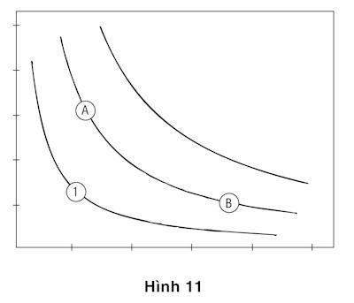

# Chương 27. Hiệu ứng sở hữu

Chắc hẳn bạn đã từng nhìn thấy biểu đồ số 11 hoặc “một người anh em thân thuộc” với nó dù cho cho bạn chưa từng học một khóa học nào về kinh doanh cả. Biểu đồ biểu diễn một “bản đồ đường đẳng dụng” riêng biệt đối với hai loại hàng hóa.

*Hình 11: Biểu đồ đường bàng quan (Hiệu ứng sở hữu)*

Những sinh viên học được từ những lớp học nhập môn kinh tế rằng mỗi điểm trên đồ thị chỉ ra thu nhập và những ngày nghỉ lễ. Mỗi “đường bàng quan” liên hệ với tổng lượng của hai loại hàng hóa đã bão hòa ham muốn – chúng có cùng sự thỏa dụng. Những đường cong sẽ chuyển sang thành những đường thẳng song song nếu người ta sẵn lòng “bán” những ngày nghỉ để đổi lấy một khoản thu nhập thêm ở cùng một mức giá bất chấp việc họ có bao nhiêu thu nhập và bao nhiêu thời gian rảnh rỗi. Hình lồi biểu thị thỏa dụng cận biên giảm dần: Bạn có càng nhiều ngày rảnh rỗi, bạn càng ít quan tâm tới ngày nghỉ thêm vào, và mỗi ngày được thêm vào lại có giá trị nhỏ hơn ngày trước đó. Tương tự như vậy, bạn càng có nhiều thu nhập, bạn càng ít quan tâm tới những đồng đô-la kiếm thêm và lượng tiền bạn sẵn sàng từ bỏ để đổi lấy thêm một ngày rảnh rỗi tăng lên.

Tất cả những vị trí trên một “đường bàng quan” có sức cuốn hút cân bằng. Đây chính là những gì sự bàng quan đề cập tới: Bạn không quan tâm mình đang ở đâu trên “một đường bàng quan”. Do vậy nếu A và B ở trên cùng một “đường bàng quan” cùng với bạn, bạn dửng dưng giữa hai điểm và sẽ không cần có động cơ để dịch chuyển từ một điểm này sang điểm khác, hoặc ngược lại. Một vài phiên bản của biểu đồ này đã từng xuất hiện ở hầu hết các giáo trình kinh tế trong hàng trăm năm qua, và hàng triệu sinh viên đã từng nhìn nó chằm chằm. Một số đã nhận ra điều còn đang thiếu. Một lần nữa, ở đây sức mạnh và sự mê hoặc của một mô hình lý thuyết đã bịt mắt các sinh viên và các học giả trước một khiếm khuyết nghiêm trọng.

Thứ còn thiếu từ biểu đồ là một sự biểu thị mức thu nhập và ngày rảnh rỗi hiện tại của cá nhân. Nếu bạn là một người làm công ăn lương, điều khoản công việc của bạn chỉ rõ một mức lương và một số ngày nghỉ, đó là một điểm trên đồ thị. Đấy chính là điểm tham chiếu của bạn, nguyên trạng của bạn, nhưng biểu đồ không chỉ ra được điều đó. Bằng việc quên biểu diễn điểm đó, các nhà lý luận đã vẽ ra biểu đồ này khuyến khích bạn tin rằng điểm tham chiếu không phải là vấn đề, nhưng cho tới giờ bạn biết được rằng tất nhiên là có. Một lần nữa đây lại là sai sót của Bernoulli. Sự thể hiện của “đường bàng quan” thừa nhận rõ ràng rằng sự thỏa dụng của bạn ở bất cứ thời điểm đưa ra nào được xác định hoàn toàn bởi tình thế hiện tại của bạn, rằng những biến cố đã xảy ra không có liên quan, và rằng sự đánh giá của bạn về một công việc hợp lý không phụ thuộc vào điều khoản công việc hiện tại của bạn. Những giả định này hoàn toàn không thực tế trong trường hợp này và trong nhiều trường hợp khác.

Việc bỏ sót điểm tham chiếu trên bản đồ đường đẳng dụng là một trường hợp gây ngạc nhiên về việc mù mờ trong lý thuyết, bởi chúng ta thường xuyên gặp phải những trường hợp mà ở đó điểm tham chiếu rõ ràng là rất quan trọng. Trong các cuộc đàm phán lao động, cả hai bên đều hiểu rằng điểm tham chiếu là bản hợp đồng hiện đang tồn tại và các cuộc đàm phán này sẽ tập trung vào những nhu cầu chung đối với những nhượng bộ có liên quan tới điểm tham chiếu. Vai trò của sự ác cảm mất mát trong cuộc mặc cả cũng là dễ hiểu: Nhượng bộ gây ra những tai hại. Bạn đã có rất nhiều kinh nghiệm bản thân về vai trò của điểm tham chiếu. Nếu bạn thay đổi công việc hay địa điểm, hoặc thậm chí đã xem xét tới một sự thay đổi kiểu như vậy, bạn chắc hẳn nhớ rằng những đặc trưng của vị trí mới đã được mã hóa như những điểm cộng hoặc trừ so với nơi bạn đang làm. Bạn cũng có thể đã từng nhận ra rằng những điểm bất lợi hiện ra rõ hơn những điểm lợi thế trong sự đánh giá ấy – sự ác cảm với mất mát đã phát huy tác dụng. Thật khó để chấp nhận những thay đổi theo chiều hướng xấu hơn. Ví dụ, mức lương tối thiểu mà những người lao động thất nghiệp sẽ chấp nhận cho công việc mới trung bình bằng 90% mức lương trước đó của họ và tụt xuống dưới 10% trong khoảng thời gian một năm.

Để hiểu rõ sức mạnh mà điểm tham chiếu tác động lên những chọn lựa, xem xét trường hợp Albert và Ben, “cặp song sinh hưởng thụ” có những thị hiếu giống hệt nhau và hiện tại có những công việc khởi đầu giống hệt nhau, với khoản thu nhập nhỏ và ít thời gian rảnh rỗi. Hoàn cảnh hiện tại của họ tương ứng với điểm được đánh số 1 trên biểu đồ số 11. Công ty tiến cử họ hai vị trí tốt hơn, A và B, và để cho họ quyết định xem ai sẽ nhận một khoản tăng 10.000 đô-la (vị trí A) và ai sẽ nhận thêm một ngày nghỉ được trả lương mỗi tháng (vị trí B). Khi cả hai người bọn họ cùng không quan trọng, họ tung một đồng xu. Albert lãnh phần tăng lương, Ben nhận thêm một ngày nghỉ. Một thời gian qua đi, cặp song sinh làm quen với những vị trí của họ, công ty tỏ ý họ có thể hoán đổi công việc nếu muốn.

Lý thuyết chuẩn tắc đã mô tả trong biểu đồ cho rằng những ưu tiên là bất biến qua thời gian. Các vị trí A và B hấp dẫn ngang nhau đối với cả hai người song sinh và họ sẽ ít cần hoặc không có động cơ để hoán đổi. Ngược lại, lý thuyết viễn cảnh xác nhận rằng cả hai anh em sinh đôi sẽ nhất định thích giữ nguyên như hiện tại. Sự ưu tiên nguyên trạng này là một hệ quả của sự ác cảm mất mát.

Chúng ta hãy tập trung vào Albert. Ban đầu anh ấy ở vị trí số 1 trên đồ thị và từ điểm tham chiếu đó anh nhận thấy hai lựa chọn sau hấp dẫn ngang nhau:

Tiến tới điểm A: Lương tăng một khoản 10.000 đô-la.

Hoặc:

Tiến tới điểm B: có thêm 12 ngày nghỉ.

Việc chấp nhận vị trí A thay đổi điểm tham chiếu của Albert, và khi anh ta xem xét tới việc hoán đổi sang điểm B, chọn lựa của anh có một kết cấu mới:

Ở nguyên tại điểm A: không thêm và không mất gì.

Hoặc:

Chuyển tới điểm B: Có thêm 12 ngày nghỉ và khoản lương 10.000 đô-la bị cắt mất.

Nếu bạn chỉ có sự trải nghiệm chủ quan về sự ác cảm mất mát, bạn có thể cảm thấy: Một khoản cắt giảm lương 10.000 đô-la là một tin rất xấu. Dù cho một sự thỏa dụng 12 ngày nghỉ cũng hấp dẫn như một khoản thỏa dụng 10.000 đô-la, sự gia tăng thời gian rảnh rỗi như vậy không đủ để bù đắp cho một mất mát 10.000 đô-la. Albert sẽ ở vị trí A bởi bất lợi của việc di chuyển nặng hơn cái có lợi. Cùng cách lý giải như vậy áp dụng với Ben, người cũng sẽ muốn giữ nguyên công việc hiện tại bởi việc mất đi thời gian rảnh rỗi quý báu hiện tại nặng hơn thỏa dụng của việc tăng thu nhập.

Ví dụ này nhấn mạnh tới hai khía cạnh của chọn lựa mà mô hình tiêu chuẩn của các đường bàng quan không dự đoán được. Trước tiên, thị hiếu không phải là cố định; chúng biến đổi cùng với điểm tham chiếu. Thứ hai, những bất lợi của một thay đổi hiện ra rõ hơn lợi thế của nó, bao gồm cả một khuynh hướng thiên về nguyên trạng. Dĩ nhiên, sự ác cảm mất mát không ngụ ý rằng bạn không bao giờ thích thay đổi vị trí hiện tại của bạn; những ích lợi của một cơ may có thể vượt quá những tổn thất. Sự ác cảm mất mát ngụ ý rằng những chọn lựa có khuynh hướng thiên về trạng thái tham chiếu một cách mạnh mẽ (và thông thường có khuynh hướng thiên về những thay đổi nhỏ hơn là thay đổi lớn).

Những bản đồ đường đẳng dụng và sự biểu diễn của Bernoulli về các kết quả như là những trạng thái về tài sản có chung một giả định sai lầm: Đó là sự thỏa dụng của bạn đối với một tình trạng của các sự việc chỉ phụ thuộc vào trạng thái đó và không bị ảnh hưởng bởi những việc đã xảy ra trong quá khứ của bạn. Việc sửa sai đã trở thành một trong những thành tựu của Kinh tế học hành vi.

### HIỆU ỨNG SỞ HỮU

Câu hỏi về việc một phương pháp tiếp cận hoặc một sự biến động khởi đầu từ khi nào thường khó trả lời, nhưng nguồn gốc là Kinh tế học hành vi có thể được xác định một cách chính xác. Vào đầu những năm 1970, Richard Thaler, sau này là một sinh viên tốt nghiệp ngành Kinh tế vô cùng bảo thủ tại trường Đại học Rochester, đã bắt đầu có những suy nghĩ dị giáo. Thaler luôn luôn có một trí thông minh sắc bén cùng với khả năng châm biếm. Khi là một sinh viên ông đã tự tiêu khiển bằng việc tổng hợp những điều quan sát được về hành vi mà mô hình Kinh tế học hành vi lý trí không thể nào giải thích. Ông đã rất thích thú khi có căn cứ về những điều không hợp lý trong Kinh tế học giữa các vị giáo sư của mình và ông đã phát hiện ra một sự việc đặc biệt nổi trội trong đó.

Giáo sư R (mà nay được tiết lộ là Richard Rosett, người đã trở thành chủ nhiệm khoa Sau Đại học của Trường Kinh doanh, Đại học Chicago) là một tín đồ trung thành vào lý thuyết kinh tế cơ bản cũng như là một người yêu thích và sành sỏi về rượu vang. Thaler đã quan sát thấy Giáo sư R đã rất miễn cưỡng khi bán một chai rượu trong bộ sưu tập của mình – ngay cả ở giá cao ngất 100 đô-la (đô-la vào năm 1975!). Giáo sư R mua rượu vang tại các cuộc đấu giá, nhưng ông không bao giờ trả nhiều hơn 35 đô-la cho một chai thuộc hạng đó. Ở mức giá giữa 35 và 100 đô-la, ông sẽ không bán mà cũng không mua. Khoảng cách lớn này là sự mâu thuẫn với lý thuyết kinh tế, ở đó vị giáo sư được kỳ vọng là đưa ra một giá trị duy nhất cho chai rượu. Nếu một chai rượu riêng lẻ có giá trị là 50 đô-la đối với ông, sau đó ông nên sẵn sàng bán chai rượu đó với khoản tiền vượt quá 50 đô-la. Nếu ông không có chai rượu nào, ông nên sẵn sàng chi ra bất cứ số tiền nào lên tới 50 đô-la để mua chai rượu đó. Giá bán chỉ có thể chấp nhận và giá mua chỉ có thể chấp nhận lẽ ra nên giống hệt nhau, nhưng trong thực tế mức giá thấp nhất để bán (100 đô-la) quá cao so với giá mua cao nhất là 35 đô-la. Việc sở hữu hàng hóa có vẻ như đã tăng giá trị của nó.

Richard Thaler đã tìm ra nhiều ví dụ về những gì mà ông gọi là hiệu ứng sở hữu, đặc biệt là đối với các loại hàng hóa không được giao thương một cách thông thường. Bạn có thể dễ dàng tự mình hình dung ra trong một trường hợp tương tự. Giả sử bạn sở hữu một tấm vé xem hòa nhạc của một ban nhạc nổi tiếng đã bị cháy vé, bạn đã mua ở mức giá thông thường là 200 đô-la. Bạn là một người hâm mộ cuồng nhiệt và sẵn lòng chi tới 500 đô-la cho tấm vé. Giờ đây bạn đã có vé và bạn tìm hiểu được trên Internet rằng những người hâm mộ giàu có hoặc những người hâm mộ cuồng nhiệt hơn đang đề xuất mức giá 3.000 đô-la. Bạn sẽ bán chứ? Nếu bạn giống với hầu hết khán giả tại các biến cố cháy vé, bạn không bán nó. Mức giá bán thấp nhất của bạn là trên 3.000 đô-la và mức giá mua cao nhất của bạn là 500 đô-la. Đây là một ví dụ về hiệu ứng sở hữu và một tín đồ của lý thuyết kinh tế tiêu chuẩn sẽ bị nó làm cho khó xử. Thaler đã tìm kiếm một bản báo cáo có thể lý giải những điều khó xử kiểu như vậy.

Sự tình cờ đã đến khi Thaler gặp một trong những sinh viên cũ của chúng tôi ở một hội thảo và đã đạt được một bản phác thảo ban đầu về lý thuyết viễn cảnh. Ông tuyên bố rằng ông đã đọc bản thảo một cách thích thú, bởi ông nhanh chóng nhận ra rằng hàm số giá trị ác cảm mất mát của lý thuyết viễn cảnh có thể lý giải hiệu ứng sở hữu và một vài điều khó xử khác trong thu thập của ông. Giải pháp đó là bỏ mặc ý niệm cơ bản mà Giáo sư R đã có một sự thỏa dụng duy nhất đối với trạng thái của việc có một chai rượu đặc biệt. Lý thuyết triển vọng đã chỉ ra rằng sự sẵn lòng mua hoặc bán chai rượu phụ thuộc vào điểm tham chiếu – liệu rằng có hay không vị giáo sư sở hữu chai rượu hiện tại. Nếu ông sở hữu nó, ông xem xét nỗi đau của việc từ bỏ chai rượu. Những giá trị này không cân bằng nhau bởi sự ác cảm mất mát: Việc từ bỏ một chai rượu ngon sẽ đau đớn hơn việc nhận về một chai rượu ngon tương đương. Hãy nhớ lại đồ thị về những tổn thất và lợi ích ở chương trước. Đường cong của hàm số dốc đứng ở phạm vi tiêu cực; phản ánh một tổn thất sẽ nặng nề hơn sự phản ánh trước một mức tăng tương ứng. Đây chính là lý giải về hiệu ứng sở hữu mà Thaler đang tìm kiếm. Và ứng dụng đầu tiên của lý thuyết triển vọng đối với một câu hỏi khó trả lời của ngành Kinh tế học giờ đây có vẻ như đã trở thành một dấu mốc quan trọng trong sự phát triển của Kinh tế học hành vi.

Thaler đã thu xếp để ở lại Standford một năm, khi ông biết được Amos và tôi sẽ ở đó. Trong suốt khoảng thời gian hữu ích đó, chúng tôi đã học hỏi lẫn nhau rất nhiều và trở thành bạn bè. Bảy năm sau, ông ấy và tôi đã có một cơ may khác để dành ra một năm cùng tiếp tục cuộc đàm luận giữa ngành Tâm lý học và Kinh tế học. Quỹ Russell Sage, nhà tài trợ chính trong một khoảng thời gian dài cho Kinh tế học hành vi, đã bỏ ra một trong những khoản hỗ trợ đầu tiên của mình cho Thaler để chi tiêu trong vòng một năm cùng với tôi ở Vancouver. Trong suốt năm đó, chúng tôi đã làm việc một cách tỉ mẩn với một nhà kinh tế học địa phương - Jack Knetsch, cùng với nhà kinh tế học này chúng tôi đã có cùng chung sự quan tâm cho hiệu ứng sở hữu, những quy tắc về tính rõ ràng trong kinh tế và gia vị thực phẩm Trung Hoa.

Điểm khởi đầu đối với nghiên cứu của chúng tôi đó là hiệu ứng sở hữu không mang tính phổ quát. Nếu ai đó đề nghị bạn đổi một tờ bạc 5 đô-la thành năm tờ bạc lẻ, bạn cầm lấy 5 năm tờ bạc lẻ mà không hề có bất cứ cảm giác mất mát nào. Và cũng không có quá nhiều sự ác cảm mất mát khi bạn đi mua một đôi giày. Người bán hàng không đổi đôi giày để lấy tiền sẽ không cảm thấy tổn thất. Thực vậy, theo quan điểm của anh ta, đôi giày mà anh ta trao tay luôn luôn là một vật đại diện cồng kềnh cho số tiền mà anh ta đang hy vọng thu về từ một số khách hàng. Thêm nữa, bạn có lẽ không cảm thấy việc trả tiền cho người bán hàng như là một tổn thất, bởi thực ra bạn đang giữ tiền như thể một vật đại diện cho đôi giày bạn có ý định mua. Những trường hợp buôn bán thường ngày này về bản chất không khác gì với việc đổi một đồng bạc 5 đô-la sang năm tờ bạc lẻ. Không hề có sự ác cảm mất mát ở cả hai mặt của những trao đổi thương mại thông thường.

Điều gì phân biệt những giao dịch thị trường này với sự miễn cưỡng của Giáo sư R khi bán đi những chai rượu vang của ông, hay sự miễn cưỡng của những người sở hữu vé giải Super Bowl phải bán lại vé ngay cả ở một mức giá rất cao? Nét đặc trưng để phân biệt đó là cả đôi giày mà người bán hàng bán cho bạn lẫn số tiền bạn trích ra từ ngân quỹ của mình để mua đôi giày đó đều có giá trị “để trao đổi.” Chúng được dùng để đổi lấy những hàng hóa khác. Những hàng hóa khác, ví dụ như rượu vang và những tấm vé giải đấu Super Bowl, có giá trị “để sử dụng,” được dùng hoặc được thụ hưởng theo một cách khác. Thời gian rảnh rỗi của bạn và mức sống tiêu chuẩn mà mức thu nhập của bạn cung cấp cũng không được dùng để bán hoặc trao đổi.

Knetsh, Thaler và tôi đã sắp đặt để phác họa một thí nghiệm nhấn mạnh tới sự tương phản giữa các hàng hóa được coi như là để sử dụng và trao đổi. Chúng tôi đã mượn khái niệm từ Vernon Smith cho bản phác họa về thí nghiệm của chúng tôi, ông là nhà sáng lập bộ môn Kinh tế thực nghiệm, người cùng tôi nhận giải Nobel nhiều năm sau đó. Trong phương pháp này, một số lượng các thẻ đổi hàng giới hạn được phát cho những người tham gia trên một “thị trường.” Bất cứ người tham gia nào vào thời điểm cuối cùng của thí nghiệm sở hữu một thẻ đổi hàng có thể mua lại nó bằng tiền mặt. Các giá trị mua lại là không giống nhau giữa những cá nhân khác nhau, để biểu thị thực tế rằng những hàng hóa được trao đổi trên thị trường đối với một số người này có giá trị nhiều hơn đối với một số người khác. Cùng một thẻ đổi hàng có thể trị giá 10 đô-la đối với bạn và 20 đô-la đối với tôi, và một sự trao đổi ở bất cứ mức giá nào giữa những giá trị này sẽ là có lợi cho cả hai chúng ta.

Smith đã tạo ra những minh chứng sống động về việc các cơ chế căn bản của cung và cầu hoạt động hiệu quả như thế nào. Từng người như thế sẽ khiến cho đám đông tiếp tục ngỏ ý mua hoặc bán một thẻ đổi hàng, và những người khác sẽ đáp lại một cách công khai để cung ứng. Tất cả mọi người quan sát những trao đổi này và thấy được mức giá mà ở đó các thẻ đổi hàng được trao tay. Các kết quả diễn ra đều đặn như những biểu hiện vật lý. Chắc chắn như thể “nước chảy chỗ trũng”, những người sở hữu một thẻ đổi hàng mà ít có giá trị đối với họ (bởi giá trị mua lại của họ thấp) đi tới việc bán thẻ đổi hàng của mình ở một mức lợi nhuận nào đó cho những ai định giá nó cao hơn. Thêm nữa, lý thuyết kinh tế dự đoán một cách chính xác cả mức giá cuối cùng mà tại đó thị trường sẽ chấp thuận và số lượng thẻ đổi hàng sẽ được trao tay. Nếu một nửa số người tham gia vào thị trường được phân phát thẻ một cách ngẫu nhiên, lý thuyết dự đoán rằng một nửa số thẻ đổi hàng sẽ được trao tay.

Chúng tôi đã sử dụng một sự biến thiên trong phương pháp của Smith cho thí nghiệm của mình. Mỗi phiên bắt đầu với một vài chu kỳ của những trao đổi các thẻ đổi hàng, một bản sao hoàn hảo phát hiện của Smith. Con số ước tính về các giao dịch thường rất gần hoặc giống hệt với số lượng được dự đoán bởi lý thuyết chuẩn. Dĩ nhiên, các thẻ đổi hàng có giá trị chỉ bởi chúng có thể được chuyển đổi sang tiền mặt của người thử nghiệm; chúng không có giá trị sử dụng. Sau đó chúng tôi đã điều khiển một thị trường tương tự cho một đối tượng mà chúng tôi kỳ vọng mọi người định đoạt giá trị sử dụng: Một cốc uống café bắt mắt, được tô điểm bằng phù hiệu các trường đại học ở bất cứ nơi nào chúng tôi đã tiến hành các thí nghiệm. Chiếc cốc sau đó có giá trị khoảng 6 đô-la (và ngày nay sẽ có giá trị gấp đôi số tiền đó). Những chiếc cốc được phân phát một cách ngẫu nhiên cho một nửa số người tham gia. Những người bán bày chiếc cốc của mình ra trước mặt và những người mua được mời xem qua chiếc cốc của hàng xóm của mình; tất cả đều chỉ ra mức giá mà họ sẽ đổi chác. Những người mua đã phải dùng tiền của chính mình để giành được chiếc cốc. Các kết quả thật ấn tượng: Mức giá bán trung bình ở khoảng gấp đôi mức giá mua trung bình, và con số ước tính về các giao dịch ít hơn một nửa con số đã dự đoán bằng lý thuyết chuẩn. Sức lôi cuốn của thị trường đã không hiệu quả đối với một hàng hóa mà những người chủ sở hữu đã dự tính sẽ sử dụng.

Chúng tôi đã tiến hành một loạt các thí nghiệm sử dụng các biến thể của cùng một quy trình, chúng luôn luôn cho các kết quả như nhau. Thí nghiệm ưa thích nhất của tôi đó là một thí nghiệm mà ở đó chúng tôi thêm vào ngoài nhóm những người bán và người mua một nhóm thứ ba – những người lựa chọn. Không giống với những người mua, những người phải bỏ tiền của mình ra để giành được món hàng, những người lựa chọn có thể nhận được hoặc một chiếc cốc hoặc một số tiền, và họ đã chỉ ra số tiền xứng với việc nhận được món hàng. Đây là các kết quả:

Người bán: 7.12 đô-la.

Người lựa chọn: 3.12 đô-la.

Người mua: 2.87 đô-la.

Khoảng cách giữa người bán và người lựa chọn là đáng chú ý, bởi vì họ thực sự phải đối mặt với cùng một lựa chọn! Nếu bạn là một người bán, bạn có thể trở về nhà với hoặc là một chiếc cốc hoặc là tiền, và nếu bạn là một người lựa chọn bạn có chính xác hai phương án tương tự vậy. Những tác động dài hạn của quyết định giống hệt với hai nhóm này. Sự khác biệt duy nhất đó là cảm xúc tại thời điểm đó. Mức giá cao mà những người bán đặt ra phản ánh sự miễn cưỡng phải từ bỏ một vật mà họ thực sự sở hữu, một sự miễn cưỡng có thể nhìn thấy ở những đứa trẻ giữ chặt một món đồ chơi và bày tỏ sự kích động mãnh liệt khi món đồ đó bị lấy đi. Sự ác cảm mất mát được xây dựng trên những đánh giá tự động của Phương thức số 1.

Những người mua và những người chọn lựa đặt ra các giá trị tiền mặt như nhau, mặc dù những người mua phải trả tiền cho chiếc cốc, trong khi lại miễn phí cho những người lựa chọn. Đây là thứ mà chúng tôi có thể dự tính nếu những người mua không trải nghiệm việc chi tiền cho chiếc cốc như là một tổn thất. Căn cứ từ hình chụp bộ não khẳng định sự khác biệt rằng: Việc bán các hàng hóa mà ai đó thường dùng sẽ kích hoạt những vùng não bộ được liên kết với sự ác cảm và nỗi đau. Việc mua cũng kích thích những khu vực này, nhưng chỉ khi nào các mức giá được nhận thức là quá cao – khi bạn cảm thấy rằng một người bán đang nhận được khoản tiền vượt quá giá trị trao đổi. Các ghi nhận não bộ cũng chỉ ra rằng việc mua ở các mức giá đặc biệt thấp là một biến cố mang lại niềm phấn khích.

Giá trị tiền mặt mà những người bán đặt ra cho chiếc cốc cao gấp so với với giá trị được đặt ra bởi những người lựa chọn và những người mua. Tỷ lệ này rất gần với hệ số sự ác cảm mất mát trong chọn lựa rủi ro, như chúng ta có thể dự tính nếu cùng một hệ số giá trị đối với những lợi ích và tổn thất tiền bạc được áp dụng cho cả những quyết định rủi ro lẫn phi rủi ro. Một tỷ lệ khoảng 2:1 đã từng xuất hiện trong các nghiên cứu của các lĩnh vực kinh tế khác nhau, bao gồm cả sự phản ứng của các hộ gia đình trước những thay đổi giá cả. Như các nhà kinh tế học có thể dự đoán, những người tiêu dùng có xu hướng tăng cường mua trứng, nước cam, hay cá khi mức giá hạ và giảm thiểu việc mua bán của mình khi mức giá tăng; tuy nhiên, ngược lại với những dự đoán của lý thuyết kinh tế, tác động của việc tăng giá (những tổn thất có liên quan tới mức giá tham chiếu) lớn hơn khoảng hai lần so với hiệu quả của những lợi ích.

Thí nghiệm về những chiếc cốc vẫn giữ nguyên luận chứng thông thường của hiệu ứng sở hữu, cùng với một thí nghiệm đơn giản hơn nữa mà Jack Knetsch đã báo cáo ở cùng thời điểm đó. Knetsch đã đề nghị hai lớp học điền vào một bảng câu hỏi và hứa thưởng công cho họ một món quà khi hoàn thiện.Trong một buổi học, phần thưởng là một chiếc bút đắt tiền; trong một buổi khác, là một thanh kẹo sô-cô-la Thụy Sĩ. Vào cuối buổi học, nhà thử nghiệm đã chỉ ra một trong hai món quà và cho phép tất cả mọi người trao đổi phần quà của anh ta hoặc cô ta cho nhau. Chỉ khoảng 10% những người tham gia đã chọn lựa để trao đổi phần quà của mình. Hầu hết những người này đã từng nhận được chiếc bút vẫn giữ nguyên chiếc bút, và những ai đã từng nhận được sô-cô-la cũng đã không hề nhúc nhích.

### SUY NGHĨ NHƯ MỘT THƯƠNG NHÂN

Những ý niệm căn bản về lý thuyết viễn cảnh là những điểm tham chiếu hiện có và những tổn thất hiện ra rõ hơn những lợi ích tương ứng. Những quan sát trên các thị trường thực thế thu thập được qua các năm là ví dụ cho sức mạnh của những khái niệm này. Một cuộc nghiên cứu về thị trường các căn hộ cao cấp tại Boston trong suốt thời kỳ suy thoái đã mang lại các kết quả rõ ràng một cách chi tiết. Các tác giả của nghiên cứu này đã so sánh hành vi của các chủ sở hữu đã mua nhà ở các mức giá khác nhau. Đối với một tác nhân có lý trí, giá mua không liên quan tới hoạt động đã diễn ra trước đó – giá trị thị trường hiện tại là tất cả vấn đề. Điều đó không diễn ra đối với con người trên thị trường nhà giá rẻ. Các chủ sở hữu có một điểm tham chiếu cao và theo cách đó đối mặt với những tổn thất cao hơn đặt ra một mức giá cao hơn dựa trên căn hộ của họ, bỏ ra một khoảng thời gian lâu hơn để nỗ lực bán căn hộ của mình và sau cùng là thu về nhiều tiền hơn.

Luận chứng ban đầu về độ vênh giữa các mức giá bán và các mức giá mua (hoặc thuyết phục hơn, giữa hoạt động bán và lựa chọn) là rất quan trọng trong tiếp nhận ban đầu về những ý niệm điểm tham chiếu và sự ác cảm mất mát. Tuy nhiên, có thể hiểu một cách sâu sắc rằng: Các điểm tham chiếu là không ổn định, đặc biệt trong các tình huống thí nghiệm không bình thường và hiệu ứng sở hữu này có thể bị loại trừ bởi việc thay đổi điểm tham chiếu.

Không hiệu ứng sở hữu nào được dự tính khi những người chủ sở hữu nhìn nhận những hàng hóa của mình là vật mang giá trị đối với những trao đổi trong tương lai, đây là một quan điểm phổ biến trong giao dịch thông thường và trên các thị trường tài chính. Nhà Kinh tế học thực nghiệm John List, người đã nghiên cứu hoạt động chuyển nhượng trên những quy định thẻ thông tin cầu thủ, đã phát hiện ra rằng những thương nhân mới vào nghề đã miễn cưỡng tách các tấm thẻ mà họ đã sở hữu ra, nhưng sự miễn cưỡng này dần biến mất cùng với kinh nghiệm giao thương. Ngạc nhiên hơn, List đã phát hiện ra một tác động to lớn của kinh nghiệm giao thương lên hiệu ứng sở hữu đối với những mặt hàng mới.

Theo một thỏa ước, List đã đưa ra nhận xét rằng: Những người được mời tham gia vào một cuộc khảo sát ngắn, theo đó họ có thể được trả công bằng một phần quà nhỏ: Một chiếc cốc café hoặc một thanh sô-cô-la có giá trị ngang bằng. Các phần quà được phân chia một cách ngẫu nhiên. Khi các tình nguyện viên chuẩn bị rời đi, List đã nói với từng người trong số họ rằng “Chúng tôi tặng cho bạn một chiếc cốc [hoặc thanh sô-cô-la], nhưng bạn có thể trao đổi lấy một thanh sô-cô-la [hoặc cốc] thay vào đó, nếu bạn muốn.” Trong một sự mô phỏng chính xác thí nghiệm ban đầu của Jack Knetsch, List đã phát hiện ra rằng chỉ có 18% những người trao đổi thiếu kinh nghiệm mới sẵn lòng đổi những món quà của mình với người khác. Trong sự tương phản một cách sắc nét, những người trao đổi có kinh nghiệm đã tỏ rõ không hề có dấu hiệu của một hiệu ứng sở hữu nào: 48% trong số họ đã đổi lại! Ít nhất trong một môi trường thị trường mà ở đó việc đổi chác là một quy chuẩn, họ đã tỏ ra không chút miễn cưỡng khi giao dịch.

Jack Knetsh cũng đã tiến hành các thí nghiệm mà ở đó những thao túng khôn khéo đã khiến cho hiệu ứng sở hữu biến mất. Những người tham gia đã bày tỏ một hiệu ứng sở hữu chỉ khi họ có trạng thái sở hữu vật lý đối với hàng hóa trong một chốc lát trước khi triển vọng của hoạt động giao thương hàng hóa đó được đề cập tới. Các nhà kinh tế học theo thuyết chính thống có thể đã bị xúi giục khi nói rằng Knetsch đã tốn quá nhiều thời gian với các nhà tâm lý học, bởi sự vận dụng thực nghiệm của ông đã cho thấy sự quan tâm tới những biến thiên mà các nhà Tâm lý học xã hội cho là quan trọng. Thực vậy, hệ phương pháp khác nhau có liên quan tới các nhà Kinh tế học thực nghiệm, và các nhà tâm lý học đã thu được nhiều căn cứ trong cuộc tranh luận đang tiếp diễn về hiệu ứng sở hữu.

Những thương nhân kỳ cựu dường như đã học được cách đặt câu hỏi chuẩn, đó là “Tôi muốn có chiếc cốc đó nhiều tới đâu, so với những thứ khác mà tôi có thể có thay vào đó?” Đây chính là câu hỏi mà các nhà Kinh tế học đặt ra. Câu hỏi này không hề gây ra hiệu ứng sở hữu, bởi độ vênh giữa sự thỏa mãn của việc đoạt được và nỗi đau của việc từ bỏ không có liên quan gì tới nhau.

Những nghiên cứu gần đây về tâm lý của “việc ra quyết định dưới tình trạng thiếu thốn” chỉ ra rằng người nghèo nằm trong một nhóm khác mà ở đó chúng tôi không dự tính tìm thấy hiệu ứng sở hữu. Người nghèo, theo lý thuyết triển vọng, hiện đang sống dưới điểm tham chiếu của một ai đó. Có những hàng hóa mà người nghèo cần và không thể chi trả nổi, do vậy họ luôn luôn “trong tình trạng mất mát”. Bởi vậy mà một số lượng nhỏ tiền bạc mà họ thu về được nhìn nhận như là một sự giảm thiểu mất mát, chứ không phải một lợi ích. Tiền bạc giúp một ai đó leo lên gần hơn một chút với điểm tham chiếu, nhưng người nghèo vẫn luôn luôn ở chân dốc của hàm giá trị.

Những người nghèo suy nghĩ như những thương nhân, nhưng những động lực thật quá khác biệt. Không giống như những thương nhân, người nghèo không bàng quan trước những khác biệt giữa việc đạt được sự thỏa dụng và việc từ bỏ. Vấn đề của họ đó là tất cả những chọn lựa của họ đều nằm giữa nhưng sự tổn thất. Số tiền tiêu tốn cho một hàng hóa là sự mất mát một hàng hóa khác, mà có thể đã được mua thay vào đó. Đối với người nghèo, các chi phí là những tổn thất.

Tất cả chúng ta đều biết rằng đối với con người, việc chi tiêu là không lấy gì làm vui vẻ, cho dù về khách quan có thể họ khá sung túc. Ở đây cũng có thể là bởi những khác biệt về văn hóa trong thái độ đối với tiền bạc, và đặc biệt là đối với việc chi tiêu tiền bạc vào những vật phẩm đắt tiền nhỏ nhặt và nảy ra bất chợt, giống như việc mua được một chiếc cốc thiết kế. Một sự khác biệt như vậy có thể lý giải sự sai biệt giữa các kết quả của “nghiên cứu những chiếc cốc” ở Mỹ và ở Anh. Các mức giá mua và bán khác nhau về căn bản trong các thí nghiệm đã được tiến hành đối với tập các mẫu sinh viên Mỹ, nhưng những khác biệt này nhỏ hơn rất nhiều giữa những sinh viên Anh. Vẫn còn nhiều điều cần phải học về hiệu ứng sở hữu.

### PHÁT NGÔN VỀ HIỆU ỨNG SỞ HỮU

> “Cô ấy không quan tâm tới văn phòng nào trong số hai cái mà cô ấy sẽ có, nhưng sau đó một ngày thông báo đã được đưa ra, cô ấy không còn sẵn lòng trao đổi nữa. Hiệu ứng sở hữu!”

“Các cuộc đàm phán này sẽ chẳng đi tới đâu cả bởi cả hai bên đều thấy khó có thể nhượng bộ.” Thậm chí ngay cả khi họ có thể đạt được điều gì đó. Tổn thất dù không rõ nhưng có thể sẽ lớn hơn lợi ích đạt được.

> “Khi họ tăng giá của họ lên, nhu cầu đã hết.”

> “Anh ấy chỉ ghét ý nghĩ về việc bán căn hộ của mình được ít tiền hơn so với giá anh ấy mua. Sự ác cảm mất mát đang diễn ra.”

> “Hắn ta là một kẻ keo kiệt, hắn coi từng đồng mình tiêu như thể một sự mất mát.”