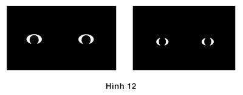

# Chương 28. Những biến cố tiêu cực

Khái niệm về “sự ác cảm mất mát” chắc hẳn có đóng góp ý nghĩa nhất của ngành Tâm lý học cho sự hình thành và phát triển của ngành Kinh tế học hành vi. Điều này nghe có vẻ kỳ lạ, bởi chúng ta thường đánh giá kết quả dựa trên những ích lợi và tổn thất, trong khi chúng ta dễ dàng nhận ra tổn thất hơn là những ích lợi, do đó phát hiện này không có gì mới lạ khiến chúng ta phải ngạc nhiên cả. Amos và tôi vẫn thường đùa cợt với nhau rằng: Chúng ta đang tiến hành nghiên cứu một đề tài mà đến những người bà của chúng ta cũng có thể hiểu rất rõ rồi. Tuy nhiên, trong thực tế, chúng ta biết nhiều hơn những người bà của mình và có thể giờ đây chúng ta đã gắn sự ác cảm mất mát vào hai hệ thống đang vận hành bên trong trí não của chúng ta. Điều đặc biệt là trí não của chúng ta phủ nhận và né tránh thực tế mà ở đó quan điểm Tâm - Sinh lý đã thống trị sự vận hành của nó. Chúng tôi cũng có thể chỉ ra những hệ quả của sự ác cảm mất mát trong những quan sát gây ngạc nhiên khác nhau: Chỉ những hàng hóa bị thất lạc trong quá trình vận chuyển mới được đền bù bằng tiền mặt; những nỗ lực cải tổ ở quy mô lớn thường hay thất bại; những tay gôn chuyên nghiệp có tỷ lệ số lần đánh nhẹ bóng vào lỗ chính xác hơn rất nhiều một tay gôn nghiệp dư. Cũng theo một cách tài tình như vậy, bà tôi sẽ phải ngạc nhiên bởi những dự đoán từ một ý niệm mơ hồ mà bà tưởng chừng nó rất chính xác.

### TIÊU CỰC VƯỢT TRỘI

*Hình 12: Biểu cảm khuôn mặt và từ ngữ cảm xúc*

Nhịp tim của bạn dồn dập hơn khi bạn nhìn vào bên trái của biểu đồ. Nó đập dồn dập ngay cả trước khi bạn có thể gọi tên thứ gì kỳ quái ở trong bức hình. Sau một thời gian bạn mới có thể nhận ra thứ kỳ quái ấy là đôi mắt của một người đang rất sợ hãi. Đôi mắt bên phải thu lại nhỏ hơn đôi mắt bên phải bởi một nụ cười híp má, nhằm diễn tả sự sung sướng nhưng không hẳn nó thể hiện sự phấn khích. Hai bức hình được đưa ra cho những người đang nằm dưới máy chụp cắt lớp xem. Mỗi bức hình được chiếu trong khoảng nhỏ hơn 2/100 giây và ngay lập tức bị che khuất bởi sự “nhiễu hình” một hiển thị ngẫu hiện các khoảng sáng tối lên bức hình. Không ai trong số những người quan sát nhận thức được rằng mình vừa được nhìn những bức ảnh chụp đôi mắt nhưng một phần não bộ của họ đã biết được là “hạch hạnh nhân’’ có vai trò là “trung khu cảnh báo” của não bộ, mặc dù nó cũng có vai trò kích hoạt các trạng thái cảm xúc khác nhau diễn ra trong trí não. Những hình ảnh đã chỉ ra một phản ứng mạnh của “hạch hạnh nhân” của não bộ người quan sát mà không thể nhận ra hình ảnh ghê rợn của bức hình mà mình đang quan sát đó. Thông tin về mối đe dọa có thể được nhận ra khi nhìn vào bức hình đó có thể di chuyển qua một rãnh thần kinh cực nhạy bằng việc quét trạng thái “nhìn” trực tiếp vào phân khu xử lý các cảm xúc của não bộ. Chu trình tương tự như vậy cũng dẫn tới việc phác họa vẻ giận dữ (một mối đe dọa tiềm ẩn) của những khuôn mặt được xử lý nhanh hơn và hiệu quả hơn so với những phác họa của khuôn mặt vui vẻ. Một số thí nghiệm đã chỉ ra rằng, một khuôn mặt giận dữ đơn lẻ có thể nổi bật hơn giữa các khuôn mặt vui vẻ nhưng một khuôn mặt vui vẻ đơn lẻ không nổi bật giữa các khuôn mặt giận dữ. Cơ chế của não bộ ở con người và ở một số loài động vật khác được thiết kế để ưu tiên chứa các tin tức xấu. Chỉ lướt qua trong một vài phần trăm của giây có thể phát hiện ra một loài động vật ăn thịt, chu trình này giúp các động vật sống sót để duy trì nòi giống. Những vận hành tự động của Hệ thống 1 phản ánh quá trình tiến hóa lịch sử của loài người. Không hề tồn tại một quy trình nhanh nhạy như thế để nhận diện những tin tốt từng được phát hiện ở não bộ của người hay các loài động vật khác. Dĩ nhiên, chúng ta và “người anh em động vật” của mình nhanh chóng được cảnh báo trước các dấu hiệu cho biết thời cơ thích hợp để giao phối hoặc để ăn thịt, và các chuyên gia quảng cáo đã áp dụng cơ chế này để thiết kế những tấm biển quảng cáo sao cho phù hợp với quy trình vận hành não bộ của con người. Tuy nhiên, các quảng cáo này ưu tiên thể hiện những mối hiểm họa hơn là những cơ may, như cách chúng vốn được thiết kế và vận hành trong não bộ của chúng ta.

Não bộ phản ứng nhanh chóng ngay cả trước những hiểm họa hoàn toàn chỉ được phác họa bằng biểu tượng chứ không phải chỉ là các hiểm họa thực sự đã xảy ra. Những từ ngữ giàu cảm xúc được nạp vào bộ não thu hút được sự chú ý của chúng ta. Những từ ngữ chỉ sự tiêu cực như chiến tranh, tội ác lôi cuốn sự chú ý nhanh hơn những từ ngữ chỉ sự tích cực như hòa bình, tình yêu. Không hề có một hiểm họa thực sự nào ở đây nhưng chỉ cần có một sự gợi nhắc về một biến cố tiêu cực trong Hệ thống 1 được xem như là mối đe dọa. Như chúng ta đã thấy ngay từ chương đầu với từ “nôn mửa”, sự hình dung liên tưởng mang tính biểu tượng gợi lên những phản ứng thực tế cảm xúc bị suy yếu, thậm chí làm chúng ta có phản ứng lùi lại hoặc ngả người về phía trước khi có liên tưởng đến từ “nôn mửa”. Độ nhạy với những hiểm họa kéo dài tới cả hoạt động xử lý những trạng thái cảm xúc cũng rất bất đồng trong trí não của chúng ta. Ví dụ, quan điểm của bạn đối với cái chết nhân đạo, não bộ của bạn sẽ mất tối đa ¼ giây để ghi nhận “sự chỉ dẫn” để đưa ra ý kiến được bắt đầu với “Tôi nghĩ cái chết nhân đạo là một … chấp nhận được/không chấp nhận được.”

Nhà tâm lý học Paul Rozin, một chuyên gia nghiên cứu về cảm xúc tiêu cực (trong tình huống này nghiên cứu về sự ghê tởm), đã quan sát thấy rằng chỉ cần một con gián sẽ làm hỏng hoàn toàn sức hấp dẫn của một bát chứa đầy quả anh đào, nhưng một quả anh đào sẽ chẳng có gì hấp dẫn khi nằm trong một bát chứa đầy những con gián. Như ông đã chỉ ra, càng rơi vào thế bí thì càng có nhiều cách thoát ra và sự “ác cảm mất mát” là một trong rất nhiều biểu hiện của một trạng thái tiêu cực điển hình. Trong một bài báo có tiêu đề “Cái xấu lấn át cái tốt”, số học giả tổng hợp như sau: “Những cảm xúc tồi tệ, những căn nguyên tệ hại, phản hồi không tốt có tác động lớn hơn những thứ tốt đẹp và tin dữ được xử lý triệt để hơn tin lành. Một người có xu hướng tránh những nhận thức xấu hơn là theo đuổi các nhận thức tốt. Những ấn tượng xấu và định kiến không tốt được tạo thành nhanh hơn và có sức kháng cự đối với sự tốt hơn của những điều tích cực.” Họ dẫn chứng các quan điểm của John Gottman, một chuyên gia nổi tiếng nghiên cứu về mối quan hệ vợ chồng: Một cuộc hôn nhân bền vững phụ thuộc rất nhiều vào việc tránh làm các hành động tiêu cực, hơn là vào việc cố gắng có nhiều hành động tích cực. John Gottman đã ước tính được rằng hôn nhân bền vững đòi hỏi những tương tác tích cực phải lấn át những tương tác tiêu cực ở mức nhỏ nhất là 5/1. Những điều bất cân xứng trong lĩnh vực xã hội thậm chí còn nổi bật hơn, như tất cả chúng ta đều biết rằng một tình bạn phải mất nhiều năm mới có thể gây dựng được cũng có khả năng bị hủy hoại chỉ bằng một hành động.

Một vài sự khác biệt giữa tốt và xấu đã được lập trình sẵn trong mỗi chúng ta. Những đứa trẻ sơ sinh, sinh ra đã phản ứng với đau đớn như là điều xấu và phản ứng với yêu thương (đến một điểm nào đó) như là điều tốt. Tuy nhiên, trong nhiều tình huống thì ranh giới giữa tốt và xấu là một điểm tham chiếu thay đổi theo thời gian và phụ thuộc vào từng hoàn cảnh. Hãy hình dung rằng bạn đang rời khỏi đất nước vào một đêm lạnh lẽo, ăn mặc phong phanh dưới cơn mưa xối xả, quần áo của bạn sũng nước. Một cơn gió lạnh buốt góp phần làm tăng thêm nỗi đau trong lòng bạn. Bạn đã lang thang khắp nơi và cuối cùng bạn cũng tìm thấy một khối đá lớn để trú ẩn. Nhà Sinh vật học Michel Cabanac gọi sự trải nghiệm trong khoảnh khắc tìm thấy tảng đá để trú ẩn ấy là cảm giác vui thích theo đặc trưng riêng của nó, như là niềm khoái lạc thông thường đem lại, chỉ ra sự cải biến về mặt sinh học quan trọng đối với tình huống ấy. Dĩ nhiên, sự bù đắp vui thú ấy chỉ trong chốc lát và bạn sẽ nhanh chóng có lại cảm giác run rẩy khi đứng phía sau khối đá và bị thôi thúc bởi nỗi đau đớn trở lại nhằm tìm ra nơi trú ẩn tốt hơn tảng đá ấy.

### CÁC MỤC TIÊU LÀ NHỮNG ĐIỂM THAM CHIẾU

“Sự ác cảm mất mát” đề cập đến sức mạnh tương quan của hai động cơ: Chúng ta bị thôi thúc một cách mạnh mẽ nhằm tránh những tổn thất hơn là đạt được những lợi ích. Một điểm tham chiếu, đôi khi ở thời điểm hiện trạng, nhưng cũng có khi là một mục tiêu trong tương lai: Việc không đạt được một mục tiêu là một mất mát, việc hoàn thành vượt mức mục tiêu là một lợi ích. Như chúng ta có thể dự tính từ sự thống trị của các cảm giác tiêu cực, hai động cơ này không có tác động đồng đều. Ác cảm trước thất bại của việc không đạt được mục tiêu mạnh mẽ hơn tham vọng vượt qua mục tiêu đó.

Mọi người thường chấp nhận những mục tiêu ngắn hạn mà họ phấn đấu để đạt được nhưng không nhất thiết phải vượt mức mong đợi. Họ có thể giảm bớt nỗ lực của mình khi họ đã đạt tới mục tiêu trước mắt, với kết quả mà đôi khi là không đúng nếu dựa vào tính logic của kinh tế. Ví dụ, những tài xế taxi ở New York có thể có một mục tiêu thu nhập lập theo từng tháng hoặc năm, nhưng mục tiêu chính chi phối nỗ lực của họ là các mức thu nhập hàng ngày. Dĩ nhiên, mục tiêu theo ngày dễ dàng đạt được (và vượt mức) vào một số nhất định. Vào những ngày mưa, người tài xế nhanh chóng đạt được mục tiêu của mình vì ngày mưa thường đông khách hơn những ngày khác; điều tương tự không xảy ra vào những ngày thời tiết dễ chịu, khi những chiếc xe taxi thường tốn thời giờ lượn lờ trên các con phố tìm khách. Lập luận kinh tế ngụ ý rằng những tài xế taxi nên làm việc nhiều giờ vào những ngày mưa và tự thưởng cho bản thân một vài ngày nghỉ vào những ngày ôn hòa, khi đó họ có thể “mua” sự thảnh thơi ở một mức giá thấp hơn. Tính logic của “sự ác cảm mất mát” cho thấy điều ngược lại: Những người tài xế có một mục tiêu hướng tới cố định hàng ngày sẽ làm việc nhiều giờ hơn khi có các khoản thỏa dụng ít ỏi và trở về nhà sớm khi các vị khách ướt sũng nước mưa đang cầu xin để được đưa tới nơi nào đó.

Các nhà kinh tế học Devin Pope và Maurice Schweitzer tại trường Đại học Pennsylvania, đã lấy một ví dụ lý tưởng về một điểm tham chiếu dựa trên môn chơi gôn: Gậy chuẩn 1. Tất cả các lỗ trên sân gôn đều có một số gậy tương ứng với con số đó; số gậy chuẩn cung cấp đường cơ bản để đạt được thành tích tốt nhưng không vượt quá con số quy định. Đối với một tay gôn chuyên nghiệp, một birdie (một gậy dưới gậy chuẩn) là một lợi thế và một bogey (một gậy trên chuẩn) là một tổn thất. Các nhà kinh tế học đã so sánh hai trường hợp mà người chơi có thể đối mặt khi gần lỗ:

- Đánh nhẹ vào lỗ nhằm tránh một điểm bogey.

- Đánh nhẹ vào lỗ nhằm đạt một điểm birdie.

Mỗi gậy được tính điểm trong sân gôn và trong sân gôn, chuyên nghiệp có giá trị rất lớn. Tuy nhiên, theo như lý thuyết viễn cảnh một số cú đánh ghi được nhiều điểm hơn những cú đánh khác. Không ghi được gậy chuẩn là một tổn thất nhưng việc đánh trượt một gậy ghi điểm birdie (một gậy dưới gậy chuẩn) là một lợi ích thấy trước, không phải là một tổn thất. Pope và Schweitzer đã lập luận rằng từ “sự ác cảm mất mát”, những người chơi gôn khi đánh gậy chuẩn (nhằm tránh một điểm bogey - một gậy trên chuẩn) sẽ cố gắng nhiều hơn một chút khi đánh bóng để ghi một điểm birdie - một gậy dưới chuẩn.) Họ đã phân tích một cách cẩn thận hơn 2.5 triệu cú đánh vào lỗ để kiểm chứng dự đoán này.

Và họ đã đúng. Cho dù cú đánh vào lỗ ở mọi khoảng cách tới lỗ gôn có dễ hay khó, những gôn thủ thành công khi ghi điểm gậy chuẩn hơn là khi ghi điểm birdie. Sự khác biệt trong tỷ lệ thành công của họ khi thực hiện gậy chuẩn (nhằm tránh điểm bogey) hoặc ghi điểm birdie là 3.6%. Sự khác biệt này không hề tầm thường chút nào. Tiger Woods là một trong số những “người tham gia” vào nghiên cứu của họ. Nếu trong năm thi đấu tốt nhất của mình, Tiger Woods đã thành công trong việc đưa bóng vào lỗ để ghi điểm gậy dưới chuẩn cũng như anh đã làm đối với gậy chuẩn, điểm số giải đấu trung bình của anh sẽ được cải thiện bởi một cú đánh và thu nhập của anh đạt gần 1 triệu đô-la mỗi mùa giải. Những đối thủ cạnh tranh ác liệt này chắc chắn không đưa ra một quyết định lý trí nào nhằm giảm bớt các cú đánh ghi điểm gậy dưới chuẩn, nhưng sự ác cảm mạnh mẽ của họ với một điểm bogey - một gậy trên chuẩn dường như góp phần vào sự tập trung vượt mức đối với nhiệm vụ trong tầm tay.

Nghiên cứu về các cú đánh vào lỗ gôn minh chứng cho lý thuyết như thể nó hỗ trợ cho hoạt động tư duy. Ai có thể nghĩ rằng bỏ ra hàng tháng trời phân tích những cú đánh ghi điểm gậy chuẩn và điểm gậy dưới chuẩn là việc đáng làm? Ý tưởng về “sự ác cảm mất mát,” chẳng thể gây kinh ngạc cho ai ngoại trừ một vài nhà Kinh tế học, đã tạo ra một giả thuyết chính xác không gì sánh kịp và đã dẫn dắt các nhà nghiên cứu tới một phát hiện đã làm chấn động tất thảy mọi người – bao gồm cả những tay gôn chuyên nghiệp.

### HOẠT ĐỘNG BẢO VỆ NGUYÊN TRẠNG

Nếu bạn bắt đầu lao vào tìm kiếm điều gì đó, cường độ không cân xứng của các động cơ nhằm tránh những tổn thất và đạt được những lợi ích gần như xuất hiện ở khắp mọi nơi. Đó là bản chất của những cuộc đàm phán, đặc biệt là của các cuộc đàm phán dựa trên một hợp đồng được ký kết trước, tình huống thường xuất hiện cho các cuộc thương lượng lao động và trong các cuộc thảo luận thương mại hoặc những hạn ngạch vũ khí quốc tế. Những điều khoản hiện hành xác định các điểm tham chiếu và bất kỳ một thay đổi nào đưa ra từ điều khoản trước, được coi như là một sự nhượng bộ của một bên dành cho đối phương. “Sự ác cảm mất mát” tạo ra một sự mất cân xứng khiến cho các thỏa thuận khó có thể đạt được. Những nhượng bộ bạn tạo cho tôi là những lợi ích của tôi nhưng chúng lại là những tổn thất của bạn, chúng gây ra cho bạn nỗi đau nhiều hơn là chúng mang lại cho tôi sự thỏa mãn. Chắc hẳn, bạn sẽ đặt ra một cái giá cho chúng cao hơn tôi đặt. Dĩ nhiên, điều tương tự cũng đúng đối với mọi nhượng bộ khó nhọc mà bạn đòi hỏi từ phía tôi, những thứ mà bạn không chừng đã đánh giá đúng đắn! Những cuộc đàm phán tiến hành trên một “cái bánh đang bị nhỏ lại” dần là đặc biệt khó khăn, bởi chúng đòi hỏi cần phải có một sự phân chia những tổn thất cho đôi bên. Con người có xu hướng dễ tính hơn nhiều khi họ thương lượng trên một “chiếc bánh đang phình ra”.

Rất nhiều thông điệp mà các nhà thương thuyết trao đổi trên bàn đàm phán là những nỗ lực nhằm truyền tải một điểm tham chiếu và đưa ra một nguồn đáng tin cậy cho đối phương. Thông điệp này không phải lúc nào cũng thẳng thắn. Các nhà thương thuyết thường làm ra vẻ quyến luyến ghê gớm với một vài loại hàng hóa (có thể là những loại tên lửa điển hình trong các cuộc thương thảo giải trừ vũ khí), mặc dù họ thực sự xem món hàng đó như là một “chiêu bài mặc cả” và cuối cùng thì có ý định “thí con tốt” trong một vụ trao đổi. Do các nhà thương thuyết bị tác động bởi một quy tắc “có đi có lại”, một sự nhân nhượng được đưa ra giống như thể những thiện chí xót xa dành cho một sự nhượng bộ đầy đau đớn tương tự (và có lẽ đều giả dối như nhau) từ phía đối phương.

Các loài động vật, bao gồm cả con người, cạnh tranh khắc nghiệt nhằm ngăn chặn những mất mát hơn là nhằm đạt tới những lợi ích. Trong phạm vi lãnh thổ của các loài động vật, nguyên tắc này giải thích sự thành công của những kẻ bảo vệ được lãnh thổ. Một nhà Sinh vật học đã quan sát được rằng “khi một loài vật chiếm giữ lãnh thổ bị thách thức bởi một đối thủ, thì nó hầu như luôn giành chiến thắng (chỉ trong vài giây) các cuộc xung đột.” Trong các vấn đề về con người, quy tắc đơn giản tương tự lý giải phần lớn về những điều xảy ra khi các thể chế cố gắng sửa đổi chính mình, trong các cuộc “cải tổ” và “tái cấu trúc” các doanh nghiệp, và trong những nỗ lực nhằm hợp lý hóa một hệ thống hành chính quan liêu, đơn giản hóa mã số thuế hoặc giảm thiểu các chi phí y tế. Như đã hình dung từ đầu, các kế hoạch cải cách gần như luôn luôn sản sinh ra những “người chiến thắng” và một số “kẻ thất bại” trong khi đạt được một sự cải biến tổng thể. Tuy nhiên, nếu các bên bị ảnh hưởng có bất cứ sự chi phối về chính trị nào thì những kẻ thua cuộc tiềm tàng sẽ trở nên chủ động hơn và quả quyết hơn những kẻ chiến thắng, kết quả sẽ bị sai lệch theo hướng có lợi cho họ và chắc hẳn sẽ tốn kém và ít hiệu quả hơn so với dự kiến ban đầu. Các cuộc cải tổ thông thường bao gồm các điều khoản nhằm bảo vệ các bên liên quan, ví dụ, khi lực lượng lao động hiện tại bị cắt giảm bởi sự suy giảm hơn là giải thể, hoặc khi sự cắt giảm lương và cắt giảm quyền lợi chỉ áp dụng đối với những công nhân ở tương lai. “Sự ác cảm mất mát” là một lực lượng kỳ cựu hùng mạnh bảo vệ cho những thay đổi rất nhỏ từ nguyên trạng cuộc sống của cả các tổ chức lẫn các cá nhân. Chủ nghĩa bảo thủ này góp phần giúp chúng ta ở yên trong khối phố, trong cuộc hôn nhân và nghề nghiệp của chúng ta; đó là lực hấp dẫn hút chặt cuộc sống của chúng ta lại với nhau gần với điểm tham chiếu.

### SỰ ÁC CẢM MẤT MÁT TRONG LUẬT PHÁP

Trong suốt một năm làm việc với nhau tại Vancouver - Richard Thaler, Jack Knetsch và tôi đã phác thảo ra một nghiên cứu về tính công bằng trong các giao dịch kinh tế, một phần là bởi chúng tôi đã say mê chủ đề đó nhưng cũng bởi chúng tôi đã có một cơ may cũng như là một bổn phận hoàn chỉnh một bảng câu hỏi mới hàng tuần. Bộ Thủy sản và Đại dương của Chính phủ Canada có một chương trình dành cho các chuyên gia bị thất nghiệp tại Toronto, những người này được trả lương để quản lý các cuộc điều tra thăm dò qua điện thoại. Một nhóm gồm phần lớn những người phỏng vấn đã làm việc hàng đêm và các câu hỏi mới liên tục được cập nhật nhằm giữ cho quá trình này luôn tiếp diễn. Thông qua Jack Knetsch, chúng tôi đã chấp thuận thiết kế một bảng câu hỏi hàng tuần, với các phiên bản được dán nhãn bốn màu. Chúng tôi có thể hỏi về bất kể điều gì, sự gò bó duy nhất đó là bảng câu hỏi phải bao gồm ít nhất một câu đề cập tới thủy sản, nhằm tạo cho nó thích hợp với sứ mệnh của Bộ Thủy Sản và Đại dương, nơi đã thuê chúng tôi. Công việc này kéo dài trong nhiều tháng và chúng tôi đã tự mình xử lý được một mớ các dữ liệu thu thập.

Chúng tôi đã nghiên cứu nhận thức của công chúng về những gì tác động đến hành hành vi không tốt của một bộ phận các thương nhân, chủ lao động và chủ đất. Câu hỏi bao quát của chúng tôi đó là liệu sự sỉ nhục đi kèm với bất công có áp đặt những hạn chế trong việc tìm kiếm lợi ích hay không. Chúng tôi đã phát hiện ra rằng điều đó có tồn tại. Chúng tôi cũng phát hiện ra rằng những quy tắc đạo đức mà theo đó dân chúng đánh giá những gì các doanh nghiệp có thể hoặc không thể rút ra sự khác biệt chủ yếu giữa những mất mát và lợi ích. Nguyên tắc cơ bản đó là mức lương, mức giá, hoặc tiền thuê hiện tại đặt ra một điểm tham chiếu, là bản chất của một đặc quyền bất khả xâm phạm. Đối với doanh nghiệp, áp đặt những thua thiệt cho các khách hàng hoặc công nhân của mình bị xem là không đúng so với giao dịch tham chiếu, trừ khi buộc phải làm vậy nhằm bảo vệ đặc quyền sở hữu của doanh nghiệp đó. Xem xét ví dụ sau:

Một cửa hàng bán đồ kim khí vẫn thường bán những chiếc xẻng xúc tuyết với giá 15 đô-la. Vào một buổi sáng sau khi có một trận bão tuyết lớn tràn qua, cửa hàng nâng giá bán lên là 20 đô-la.

Hãy xếp loại hành động này theo cấp độ:

Hoàn toàn đúng Chấp nhận được Không đúng Rất không đúng Cửa hàng bán đồ kim khí cư xử một cách thích đáng theo như mô hình kinh tế chuẩn: Đáp ứng nhu cầu đang tăng của một loại hàng hóa bằng việc tăng giá bán của loại hàng hóa đó. Những người tham gia vào cuộc khảo sát đã không tán đồng: 82% xếp hạng hành động đó là “Không đúng” hoặc “Rất không đúng”. Họ rõ ràng đã xem mức giá trước trận “bão giá” như là một điểm tham chiếu và mức giá tăng lên như một mất mát mà cửa hàng áp đặt lên khách hàng của mình. Một quy tắc cơ bản về sự công bằng mà chúng tôi đã phát hiện ra đó là sự khai thác sức mạnh thị trường nhằm áp đặt những mất mát lên những kẻ khác là không thể chấp nhận được. Ví dụ tiếp theo đây minh họa cho quy tắc này trong một bối cảnh khác (những giá trị của đồng đô-la nên được điều chỉnh lên khoảng 100% kể từ khi những dữ liệu này được thu thập vào năm 1984):

Một cửa hàng phô-tô nhỏ thuê một nhân công. Người này đã làm việc ở đây được 6 tháng và được trả 9 đô-la mỗi giờ. Công việc làm ăn tiếp tục phát đạt, nhưng một số công ty khác ở gần cửa hàng phô-tô này mới đóng cửa khiến số người thất nghiệp tăng lên. Một số cửa hiệu khác thuê những nhân công này ở mức giá 7 đô-la một giờ để làm những công việc tương tự như những gì người nhân công làm tại cửa hàng phô-tô. Người chủ cửa hàng phô-tô này giảm mức lương của người nhân công này xuống còn 7 đô-la.

Các đối tượng điều tra đã không tán đồng: 83% đã coi hành vi đó là “Không đúng” hoặc “Rất không đúng”. Tuy nhiên, một sự thay đổi nhỏ trong câu hỏi làm rõ được đặc trưng nghĩa vụ của người sử dụng lao động. Bối cảnh của một cửa hiệu phát đạt trong vùng có số người thất nghiệp cao là như nhau, nhưng bây giờ người làm công hiện tại bỏ đi và người chủ quyết định trả cho người thay thế một khoản là 7 đô-la một giờ.

Đại đa số (73%) đã coi hành động này là “chấp nhận được”. Có vẻ như là người chủ lao động không có bổn phận đạo đức phải trả 9 đô-la một giờ. Quyền ở đây mang tính cá nhân: Người nhân công hiện tại có quyền duy trì mức lương của anh ta dù cho các điều kiện thị trường sẽ cho phép người chủ lao động áp đặt một mức cắt giảm lương. Người lao động thay thế không có đặc quyền nào so với mức lương tham chiếu của người nhân công trước đó và bởi vậy người chủ được phép cắt giảm mức chi trả mà không có nguy cơ bị mang tiếng là bất công.

Doanh nghiệp có quyền riêng của mình, đó là duy trì khoản lợi nhuận hiện tại của mình. Nếu doanh nghiệp đối mặt với một nguy cơ tổn thất, nó được phép chuyển đổi tổn thất ấy sang người khác. Một số lượng lớn những đối tượng được hỏi đã tin rằng đối với một doanh nghiệp việc cắt giảm các mức lương nhân công khi lợi nhuận của doanh nghiệp đó sụt giảm không phải là không thích đáng. Chúng tôi đã mô tả các quy tắc như là việc xác định các quyền lợi kép cho doanh nghiệp và các cá nhân mà nó ảnh hưởng lẫn nhau. Khi bị đe dọa, không phải là không thích đáng khi doanh nghiệp trở nên ích kỷ. Doanh nghiệp cũng không được kỳ vọng là sẽ gánh vác một phần những tổn thất, họ có thể vượt qua chúng.

Những quy tắc khác nhau chi phối điều mà doanh nghiệp có thể làm nhằm cải thiện lợi nhuận của mình hoặc tránh cho lợi nhuận bị giảm sút. Khi một doanh nghiệp đứng trước các chi phí sản xuất thấp hơn, những quy tắc về sự công bằng không đòi hỏi doanh nghiệp phải chia sẻ khoản lợi nhuận tăng thêm cho hoặc các khách hàng hoặc cho nhân viên của doanh nghiệp. Dĩ nhiên, những người trả lời câu hỏi của chúng tôi ưa thích một doanh nghiệp tử tế hơn và đã mô tả nó như thể sẽ công bằng hơn nếu doanh nghiệp đó rộng rãi khi lợi nhuận tăng lên, nhưng họ cũng không quy chụp một doanh nghiệp là không công bằng khi không chia sẻ lợi nhuận. Họ đã thể hiện sự phẫn nộ chỉ khi một doanh nghiệp đã lợi dụng quyền năng của mình mà phá vỡ những bản hợp đồng miệng với nhân viên hoặc khách hàng và áp đặt một tổn thất lên người khác để gia tăng lợi nhuận của doanh nghiệp. Nhiệm vụ quan trọng đối với các nhà nghiên cứu sự công bằng trong kinh tế không phải là để xác định lối ứng xử nhân văn mà là nhằm tìm ra giới hạn phân cách hành xử có thể chấp nhận được với những hành động đem lại sự bất công và hình phạt.

Chúng tôi đã không lạc quan khi gửi bản báo cáo nghiên cứu này cho Tạp chí Kinh tế Hoa Kỳ (American Economic Review). Bài báo của chúng tôi đã thách thức những tri thức được thừa nhận sau đó giữa các nhà kinh tế học mà hành vi kinh tế được quy định bởi lợi ích cá nhân và rằng những mối lo về sự công bằng nói chung là không thích đáng. Chúng tôi cũng đã dựa trên các câu trả lời rõ ràng mà đã khảo sát của các nhà kinh tế nhìn chung ít có sự lưu tâm. Tuy nhiên, biên tập viên của tạp chí đã gửi bài viết của chúng tôi cho hai nhà Kinh tế học để đánh giá, hai vị này bị giới hạn bởi chính những quy ước ấy (chúng tôi sau này đã được gặp mặt họ, họ là người thân thiện nhất mà vị biên tập viên đó có thể tìm được). Vị biên tập viên đã tìm được đúng người. Một nghiên cứu gần đây hơn đã xác thực những điều nhận thấy về sự công bằng phụ thuộc tham chiếu và cũng đã chỉ ra rằng những lo âu về sự công bằng rất có ý nghĩa về phương diện kinh tế, một thực tế mà chúng tôi đã hoài nghi nhưng không đi chứng minh. Những người chủ lao động vi phạm những quy tắc về sự công bằng bị trừng phạt bởi năng suất bị sụt giảm và những thương nhân áp dụng các chính sách giá không công bằng có thể dự đoán trước được việc buôn bán thua lỗ. Những người thông qua một cuốn catalog mới đã biết được rằng người thương nhân giờ đây đang tính giá một sản phẩm thấp hơn so với sản phẩm mà họ vừa mới mua gần đây ở mức giá cao hơn đã giảm 15% lượng mua trong tương lai của họ từ nhà cung cấp đó, một tổn thất trung bình ở mức 90 đô-la mỗi khách hàng. Các khách hàng này hiển nhiên đã nhận thấy mức giá thấp hơn là một điểm tham chiếu và suy nghĩ của chính họ là sự duy trì một tổn thất qua việc chi trả nhiều hơn mức hợp lý. Hơn thế nữa, những khách hàng phản ứng mạnh mẽ nhất lại là những người mua hàng nhiều nhất với mức giá cao hơn. Những tổn thất vượt xa những lợi ích từ việc tăng giá hàng hóa sản xuất bằng các mức giá thấp hơn trong cuốn catalog mới.

Việc áp đặt không công bằng những tổn thất lên người khác là hiểm họa nếu các nạn nhân đang ở trong tư thế trả thù. Hơn thế nữa, các thí nghiệm đã chỉ ra rằng những người ngoài quan sát lối hành xử không công bằng này thường tham gia vào sự trừng phạt. Các nhà kinh tế học thần kinh (các nhà khoa học kết hợp kinh tế học với việc nghiên cứu não bộ) đã sử dụng các máy MRI để kiểm tra não bộ của những người đang thực hiện việc trừng phạt một người lạ bởi lối hành xử không công bằng với một vài người lạ khác. Đáng chú ý là hình phạt nhân đạo được đi kèm bởi hoạt động gia tăng trong “trung khu khoái lạc” của não bộ. Có vẻ việc duy trì trật tự xã hội và các quy tắc về sự công bằng theo kiểu như vậy là phần thưởng của riêng nó. Hình phạt nhân đạo có thể là chất keo dính cố định các xã hội lại với nhau. Tuy nhiên, não bộ của chúng ta không được tạo ra để tưởng thưởng sự khoan hồng một cách chắc chắn, giống như chúng trừng phạt sự hèn mạt. Ở đây thêm một lần nữa, chúng tôi phát hiện ra một sự bất cân xứng rõ rệt giữa những tổn thất và lợi ích.

Sự ảnh hưởng của “sự ác cảm mất mát” và các quyền mở rộng vượt khỏi các lĩnh vực giao dịch tài chính. Các nhà luật học đã nhanh chóng nhận ra tác động của họ lên luật pháp và trong lĩnh vực hành chính tư pháp. Trong một nghiên cứu, David Cohen và Jack Knetsch đã phát hiện ra nhiều ví dụ về một sự khác biệt sâu sắc giữa những tổn thất trong thực tế với những lợi ích thấy trước trong các quyết định dựa trên luật pháp. Ví dụ, một thương nhân có hàng hóa bị thất lạc trong quá trình vận chuyển có thể được bồi thường các chi phí mà anh ta lẽ ra phải chịu nhưng không được bồi thường cho những lợi nhuận bị mất. Thói quen thường thấy mà quyền sở hữu là 9/10 của luật xác nhận trạng thái tinh thần của điểm tham chiếu. Trong một cuộc thảo luận gần đây, Eyal Zamir tạo ra điểm kích thích mà ở đó sự khác biệt được rút ra trong luật pháp, giữa việc phục hồi thiệt hại với việc bù đắp cho những lợi ích thấy trước có thể được điều chỉnh bởi những tác động không cân bằng của họ lên hạnh phúc cá nhân. Nếu những người tổn thất bị ảnh hưởng nhiều hơn những người không đạt được lợi ích, họ đáng được bảo vệ nhiều hơn bởi luật pháp.

### PHÁT NGÔN VỀ NHỮNG TỔN THẤT

> “Sự đổi mới này sẽ không vượt qua được. Những người giữ vững quan điểm để mất sẽ chiến đấu mạnh mẽ hơn so với những người giữ vững quan điểm để có lợi ích.”

> “Mỗi người trong số họ nghĩ rằng những nhượng bộ của người khác ít đau đớn hơn. Tất cả bọn họ đều sai lầm, dĩ nhiên rồi. Đó chỉ là sự bất cân xứng của các tổn thất.”

> “Họ sẽ thấy đàm phán lại thỏa ước trở nên dễ dàng hơn nếu họ đã nhận thức được việc chiếc bánh đang thực sự mở rộng. Họ không phân bổ những tổn thất, họ đang phân bố những lợi ích.”

“Các mức giá cho thuê nhà quanh đây đã tăng lên gần đây, nhưng những người thuê nhà của chúng ta không nghĩ đó là điều công bằng khi chúng ta cũng nên tăng tiền thuê nhà của họ.”

> “Các khách hàng của tôi không hề tức giận trước việc tăng giá bởi họ hiểu được rằng các chi phí của tôi cũng đã tăng lên. Họ chấp nhận thực trạng này của tôi để giữ nguyên lợi ích.”