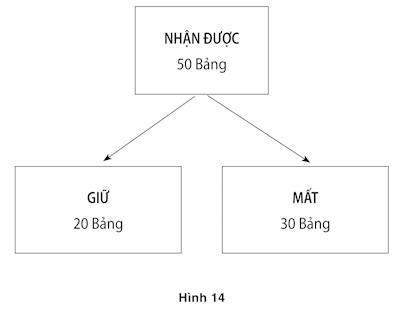

# Chương 34. Các cấu trúc và thực tế

Đội tuyển Ý và đội tuyển Pháp đã giáp mặt nhau trong trận chung kết World Cup 2006. Hai câu tiếp theo đây đều mô tả kết quả: “Ý thắng”, “Pháp thua.” Những câu này có cùng chung ý nghĩa không? Câu trả lời phụ thuộc hoàn toàn vào việc bạn định nghĩa ý nghĩa là gì trong trường hợp này.

Nhằm mục đích đưa ra lập luận hợp lý, hai mô tả về kết quả của trận đấu này có thể hoán đổi cho nhau bởi chúng chỉ rõ cùng một trạng thái của sự việc. Như các nhà triết học nói, tình trạng thật sự của họ giống hệt nhau: Nếu một trong hai câu này đúng, thì câu còn lại cũng đúng. Đó là cách mà kinh tế nhận thức mọi thứ. Những niềm tin và sự ưu ái của họ là sự giới hạn thực tế. Nói cụ thể thì những chủ thể của các chọn lựa của họ là những trạng thái của vật chất, chúng không bị tác động bởi các từ ngữ được chọn để mô tả chúng.

Có một ý nghĩa khác của từ ý nghĩa, tại đó “Ý thắng” và “Pháp thua” không có chung một chút ý nghĩa nào. Theo hướng này, ý nghĩa của một câu là điều xảy ra trong cơ chế liên kết của bạn khi bạn lĩnh hội nó. Hai câu này gợi ra những liên tưởng khác biệt rõ rệt. “Ý đã thắng” gợi ra những suy nghĩ về đội tuyển Ý và họ đã làm gì để chiến thắng. “Pháp đã thua” gợi ra suy nghĩ về đội tuyển Pháp và họ đã làm gì để dẫn tới thất bại, bao gồm cả cú “đánh đầu” đáng nhớ của cầu thủ ngôi sao người Pháp Zidane vào một cầu thủ người Ý. Trong mối quan hệ với những liên tưởng xuất hiện trong đầu – Hệ thống 1 tác động trở lại như thế nào – cả hai câu thực sự “ám chỉ” những việc khác nhau. Sự thực là những trạng thái tương đương gợi ra một cách hợp lý những phản ứng khác nhau làm cho nó không thể khiến con người có được lý trí hợp lý như kinh tế.

### CẤU TRÚC CẢM XÚC

Amos và tôi đã ứng dụng chiêu bài các hiệu ứng cấu trúc lên những tác động không được lý giải về việc cái gì tạo ra công thức dựa trên những niềm tin và sự ưu ái. Đây là một trong những ví dụ chúng tôi đã sử dụng:

Bạn sẽ chấp nhận một trò may rủi đặt ra 10% cơ may thắng 95 đô-la và 90% khả năng thua 5 đô-la chứ?

Bạn sẽ bỏ ra 5% để tham gia vào một trò xổ số đặt ra 10% thắng được 100 đô-la và 90% nguy cơ chẳng được gì chứ?

Trước hết, hãy dành ra chút thời gian để thuyết phục bản thân rằng hai vấn đề này là khác biệt. Đối với cả hai trường hợp bạn cần phải quyết định xem liệu có chấp nhận một viễn cảnh không chắc chắn mà bạn hoặc có thêm 95 đô-la hoặc mất đi 5 đô-la. Ưu tiên của một số người dựa trên giới hạn hiểu biết của họ sẽ đưa ra cùng một câu trả lời cho cả hai câu hỏi đó, tuy nhiên trên thực tế, những cá nhân như vậy rất hiếm. Một số người ưu tiên việc giới hạn đưa ra cùng câu trả lời cho cả hai câu hỏi nhưng những người như vậy rất hiếm. Thực tế, cách giải thích thu hút được nhiều câu trả lời tích cực đó là: Câu thứ hai. Một kết quả tồi sẽ trở nên dễ chấp nhận nếu nó được mô tả đơn giản như thể thua một trò may rủi. Chúng ta sẽ không ngạc nhiên: Những tổn thất gợi ra những cảm giác tiêu cực mạnh hơn những chi phí. Các chọn lựa không có giới hạn thực tế, bởi vậy Hệ thống 1 không có giới hạn thực tế.

Vấn đề mà chúng tôi đã lập ra bị ảnh hưởng bởi điều chúng tôi đã học được từ Richard Thaler, người đã nói với chúng tôi rằng khi ông còn là một sinh viên mới tốt nghiệp, ông đã đính lên bảng của mình một tấm thiệp nói rằng CHI PHÍ KHÔNG PHẢI LÀ NHỮNG MẤT MÁT. Trong bài luận đầu tiên của mình bàn về hành vi người tiêu dùng, Thaler đã mô tả cuộc thảo luận về việc liệu các trạm xăng dầu được phép tính các mức giá khác nhau đối với việc mua xăng được trả bằng tiền mặt hoặc bằng thẻ tín dụng không. Nhóm vận động cho việc mua xăng trả bằng thẻ tín dụng đã rất nỗ lực biến việc chênh lệch giá thành trái luật nhưng nó đã có một quan điểm dự phòng: Sự khác biệt, nếu được phép, sẽ được ghi nhận là một khoản chiết khấu tiền mặt, không phải một phụ phí tín dụng. Tâm lý của họ là có cơ sở: Người ta sẽ dễ dàng từ bỏ một khoản chiết khấu hơn là phải trả thêm một khoản phụ phí. Cả hai có thể là tương đương về mặt kinh tế, nhưng chúng không tương đương về mặt tâm lý.

Trong một thí nghiệm sâu hơn, một nhóm các nhà thần kinh học tại trường Đại học chuyên nghiệp London đã kết hợp với một nghiên cứu về các hiệu ứng cấu trúc với những ghi chép về phạm vi hoạt động tại các vùng khác nhau của não bộ. Để nhằm đưa ra những thước đo chính xác về phản ứng của não bộ, thí nghiệm tiến hành với nhiều thử nghiệm. Hình 14 minh họa cho hai giai đoạn của một trong những thử nghiệm này.

Trước tiên, chủ thể được đề nghị hình dung rằng cô nhận được một khoản tiền, trong ví dụ này là 50 bảng.

Chủ thể sau đó được đề nghị lựa chọn giữa một kết quả chắn chắn với một trò may rủi trên một vòng quay cơ hội: Nếu vòng quay dừng lại ở màu trắng cô, “nhận được” toàn bộ số tiền; nếu nó dừng lại ở màu đen cô chẳng có gì cả. Kết quả chắc chắn đơn giản là giá trị dự tính của trò may rủi này là một khoản lời 20 bảng.

Như được chỉ ra, kết quả chắc chắn tương tự có thể được đóng khung theo hai cách: Giống như Giữ 20 Bảng hoặc như Thua 30 Bảng. Các kết quả khách quan hoàn toàn giống hệt với hai khung và một giới hạn thực tế có thể phản ứng trước cả hai theo cùng một cách – lựa chọn điều chắc chắn hoặc không chú ý tới trò may rủi theo cấu trúc – nhưng chúng ta đều biết rằng trí óc con người không bị giới hạn trước thực tế. Các xu hướng tiếp cận hoặc né tránh được gợi ra bởi các từ ngữ, và chúng ta dự tính Hệ thống 1 có xu hướng thiên về phương án chắc chắn khi nó được định rõ như là Giữ và chống lại phương án tương tự khi nó được định rõ như là Thua.

*Hình 14: Hoạt động não bộ và hiệu ứng đóng khung*

Thí nghiệm này bao gồm nhiều thử nghiệm và từng người tham gia gặp phải một vài vấn đề lựa chọn trong cả trạng thái Giữ lẫn Thua. Như đã dự tính, mỗi người trong số 20 chủ thể đã cho thấy một hiệu ứng cấu trúc: Họ có nhiều khả năng lựa chọn điều chắc chắn trong khung Giữ và nhiều khả năng chấp nhận trò may rủi trong khung Thua. Nhưng các chủ thể đều không giống nhau. Một số rất dễ nhạy cảm với cấu trúc của vấn đề. Số khác hầu như đã đưa ra lựa chọn giống nhau bất chấp khung – như là một cá nhân giới hạn thực tế nên làm. Các tác giả đã xếp hạng 20 chủ thể một cách phù hợp và đặt cho bảng xếp hạng một nhãn ấn tượng: Chỉ số hợp lý.

Phạm vi hoạt động của não bộ đã được ghi lại khi các chủ thể đưa ra từng quyết định. Sau đó, các thử nghiệm đã bị phân tách thành hai nhóm:

1. Các thử nghiệm theo đó lựa chọn của chủ thể thích ứng với cấu trúc.

- Đã ưu tiên điều chắc chắn trong lối diễn đạt Giữ.

- Đã ưu tiên trò may rủi trong lối diễn đạt Thua.

- 2. Các thử nghiệm trong đó sự lựa chọn đã không thích ứng với cấu trúc.

Các kết quả khác thường minh chứng cho khả năng của phương pháp rèn luyện mới của các nhà thần kinh học – nghiên cứu về não bộ của một người làm gì trong lúc anh ta phải đưa ra các quyết định. Các nhà thần kinh học đã tiến hành hàng ngàn thí nghiệm như vậy, và họ đã nhận biết được để dự đoán các vùng cụ thể của não bộ “sáng lên” – cho thấy lưu lượng oxy tăng lên, nó cho thấy phạm vi hoạt động của thần kinh được nâng cao và phụ thuộc vào mục tiêu của nhiệm vụ. Các vùng khác nhau hoạt động khi cá nhân chú tâm tới một vật thể thị giác, tưởng tượng tâng một quả bóng, nhận diện một khuôn mặt hoặc nghĩ về một ngôi nhà. Các vùng khác sáng lên khi cá nhân bị khuấy động cảm xúc, trong một cuộc xung đột hoặc tập trung vào việc giải quyết một vấn đề. Mặc dù các nhà thần kinh học né tránh một cách cẩn trọng ngôn ngữ “phần này của não bộ như thế này và thế này...” họ đã lĩnh hội được nhiều về “những cá tính” của các vùng não bộ khác nhau và sự đóng góp của những phép phân tích phạm vi hoạt động của não bộ cho sự giải thích về tâm lý đã được cải thiện một cách đáng kể. Nghiên cứu cấu trúc đã mang lại ba phát hiện chính:

- Phân khu được liên kết với sự khuấy động cảm xúc (hạch hạnh) hầu như có thể chủ động khi các chọn lựa của chủ thể tương thích với cấu trúc. Điều này chỉ giống như điều chúng ta có thể dự tính nếu những từ chứa đựng cảm xúc Giữ và Thua tạo ra một xu hướng tức thì nhằm tiếp cận với điều chắc chắn (khi chúng được cấu trúc như là một lợi ích) hoặc né tránh nó (khi nó bị cấu trúc như là một tổn thất). Hạch hạnh được truy nhập rất nhanh bởi các tác nhân kích thích cảm xúc – và nó là một nghi vấn thích hợp đối với sự rắc rối trong Phương thức số 1.

- Một phân khu não bộ được biết là có liên quan tới sự xung đột và tự kiểm soát (vùng vỏ não vành đai trước) linh lợi hơn khi các chủ thể đã không thực thi điều đến một cách tự nhiên – khi họ lựa chọn điều chắc chắn, mặc dù nó đang bị gán cho là Thua. Việc cưỡng lại sự nghiêng về Hệ thống 1 dường như bao gồm cả sự xung đột.

- Những chủ thể “có lý trí” nhất – những người ít bị ảnh hưởng trước các hiệu ứng cấu trúc nhất – đã chỉ ra phạm vi hoạt động nâng cao tại một vùng trán của não bộ có liên quan trong việc kết hợp cảm xúc và lập luận để đi đến các quyết định. Đáng chú ý là: Những cá nhân “có lý trí” đã không phải là những người chỉ ra được dấu hiệu thần kinh mạnh nhất của sự xung đột. Nó cho thấy những người tham gia cao nhất này đã (thường là không luôn luôn) bị giới hạn thực tế bởi sự xung đột nhỏ.

Bằng việc tham gia vào những quan sát về các chọn lựa trong thực tế với một bản đồ khu vực hoạt động thần kinh, nghiên cứu này đã cung cấp một sự minh chứng thuyết phục về việc cảm xúc được gợi ra bởi một từ có thể “hé lộ” sự chọn lựa sau cùng như thế nào.

Một thí nghiệm mà Amos đã tiến hành cùng với các đồng sự ở Trường Y Harvard là ví dụ tiêu biểu về cấu trúc cảm xúc. Những người tham gia là bác sĩ được cung cấp những số liệu về các kết quả của hai pháp đồ dành cho bệnh ung thư phổi: Phẫu thuật và xạ trị. Tỷ lệ sống sót trong 5 năm rõ ràng thiên về phương pháp phẫu thuật, nhưng trong ngắn hạn phẫu thuật rủi ro hơn xạ trị. Một nửa số người tham gia đọc các số liệu về những tỷ lệ sống sót, số còn lại nhận được cùng một thông tin trong mối tương quan với tỷ lệ tử vong. Cả hai mô tả về các kết quả trong ngắn hạn của phương pháp phẫu thuật là:

Tỷ lệ sống sót trong một tháng là 90%.

Có 10% số bệnh nhân tử vong trong tháng đầu tiên.

Bạn ngay từ đầu biết được các kết quả là: Phương pháp phẫu thuật trong cấu trúc trước đây (84% các bác sĩ chọn nó) phổ biến hơn nhiều so với sau này (với 50% thiên về xạ trị). Sự tương đương theo logic về hai mô tả là rõ ràng và một người lập định giới hạn thực tế sẽ đưa ra quyết định giống như vậy bất chấp sự diễn đạt mà cô đã thấy. Nhưng Phương thức số 1, như chúng ta đã từng biết tới, hiếm khi bỏ qua những từ ngữ hàm xúc: Tử vong là tồi tệ, sống sót là tốt, và 90% sống sóng nghe có vẻ khích lệ nhưng ngược lại 10% tử vong thật khủng khiếp. Một phát hiện quan trọng của nghiên cứu đó là các bác sĩ cũng dễ bị ảnh hưởng bởi hiệu ứng cấu trúc giống như những người không có kiến thức y khoa (các bệnh nhân tại bệnh viện và sinh viên tốt nghiệp tại một trường kinh doanh). Rõ ràng, sự đào tạo về y khoa không có sự phòng vệ chống lại sức mạnh của cấu trúc.

Nghiên cứu Giữ - Thua và thí nghiệm sống sót - tử vong khác nhau ở một khía cạnh quan trọng. Những người tham gia trong nghiên cứu mô tả sinh động não bộ đã có nhiều thử nghiệm, trong đó họ gặp phải những cấu trúc khác nhau. Họ đã có cơ hội để nhận diện các hiệu ứng làm rối trí của các khung và đơn giản hóa nhiệm vụ của mình bằng việc chấp nhận một cấu trúc phổ biến, có lẽ bằng việc chuyển đổi số tiền Thua sang khoản Giữ tương đương. Sẽ cần phải viện tới một người nhanh trí (và một Hệ thống 2 - cảnh giác) để biết cách thực hiện điều này và một vài người tham gia mà đã làm chủ được sự thành thạo hầu như chắc chắn nằm trong số những tác nhân “có lý trí” mà các nhà thực nghiệm đã nhận ra. Ngược lại, các bác sĩ đọc các số liệu về hai liệu pháp trong cấu trúc phẫu thuật đã không có lý do gì để nghi ngờ rằng họ sẽ đưa ra một sự chọn lựa khác biệt nếu họ đã được nghe những số liệu giống nhau được cấu trúc trong mối liên quan với sự tử vong. Việc tái cấu trúc là kết quả của sự nỗ lực và Hệ thống 2 như thường lệ tỏ ra lười biếng. Trừ khi có một lý do rõ ràng để hành động khác đi, hầu hết chúng ta thụ động chấp nhận những vấn đề quyết định khi chúng được cấu trúc và bởi vậy hiếm khi có một cơ hội để khám phá ra phạm vi mà theo đó những ưu tiên của chúng ta là giới hạn khung thay vì giới hạn thực tế.

### NHỮNG TRỰC GIÁC RỖNG

Amos và tôi đã trình bày thảo luận của chúng tôi về hoạt động cấu trúc qua một ví dụ được biết tới như là “vấn đề dịch bệnh từ châu Á”:

Hãy tưởng tượng rằng nước Mỹ đang chuẩn bị cho sự bùng nổ một dịch bệnh từ châu Á bất thường, dự kiến giết chết 600 người. Hai chương trình chọn lựa nhằm chống lại dịch bệnh đã được đệ trình. Cho rằng các căn cứ khoa học chính xác về các kết quả của hai chương trình như dưới đây:

Nếu chương trình A được chấp thuận, 200 người sẽ được cứu sống.

Nếu chương trình B được chấp nhận, một phần ba khả năng là 600 người sẽ được cứu sống và hai phần ba khả năng là không có ai được cứu cả.

Đại đa số những người tham gia chọn chương trình A: Họ thích phương án chắc chắn hơn là trò may rủi.

Các kết quả của hai chương trình được cấu trúc khác đi như sau:

Nếu chương trình A’ được thông qua, 400 người sẽ chết.

Nếu chương trình B’ được thông qua, có một phần ba khả năng là không có ai chết cả và hai phần ba khả năng là 600 người sẽ chết.

Hãy nhìn nhận tỉ̉ mỉ và so sánh hai lối diễn đạt: Các kết quả của hai chương trình A và A’ là như nhau; tương tự như vậy với các kết quả của hai chương trình B và B’. Tuy nhiên, ở cấu trúc thứ hai, một lượng lớn người tham gia chọn trò may rủi.

Các sự chọn lựa khác nhau trong hai cấu trúc ăn khớp với lý thuyết triển vọng, tại đó các chọn lựa giữa những trò may rủi và những điều chắc chắn được giải quyết khác nhau, phụ thuộc vào việc liệu rằng các kết quả là tốt hay xấu. Những người đưa ra quyết định có xu hướng thích điều chắc chắn hơn trò may rủi (họ ác cảm với rủi ro) khi các kết quả là tốt. Họ có xu hướng từ bỏ điều chắc chắn và chấp nhận trò may rủi (họ đang tìm kiếm rủi ro) khi cả hai kết quả đều tiêu cực. Những kết luận này đã được củng cố vững chắc đối với những chọn lựa giữa những trò may rủi và những thứ chắc chắn trong lĩnh vực tiền tệ. Vấn đề dịch bệnh chỉ ra rằng quy tắc tương tự được áp dụng khi các kết quả được đo lường bằng những mạng sống được cứu hoặc mất đi. Trong bối cảnh này, thí nghiệm cấu trúc gợi ra rằng những ưu tiên mối ác cảm rủi ro và tìm kiếm rủi ro không phải là giới hạn thực tế. Những ưu tiên giữa các kết quả khách quan giống nhau đảo ngược bởi những sự làm thành công thức khác nhau.

Một trải nghiệm mà Amos đã cùng chung với tôi thêm một ghi chú dứt khoát vào câu chuyện. Amos được đề nghị có một bài phát biểu trước một nhóm các chuyên gia sức khỏe cộng đồng – những người đưa ra các quyết định về các liều vắc-xin và các chương trình khác. Ông đã tận dụng cơ hội để thuyết trình với họ về vấn đề dịch bệnh châu Á: Một nửa đã thấy được sự diễn đạt “cứu mạng”, số còn lại đã trả lời câu hỏi “thiệt mạng”. Giống như nhiều người khác, các chuyên gia này dễ bị ảnh hưởng bởi những hiệu ứng cấu trúc. Có một chút lo lắng rằng những viên chức đưa ra các quyết định có ảnh hưởng tới sức khỏe của mọi người có thể bị gây ảnh hưởng bởi sự lôi kéo bề ngoài nhưng chúng ta buộc phải quen với ý niệm rằng ngay cả các quyết định quan trọng cũng bị chi phối, nếu không phải là điều chỉnh, bởi Hệ thống 1.

Thậm chí điều lo lắng hơn là điều gì xảy ra khi người ta phải đương đầu với mâu thuẫn của mình: “Bạn chọn chắc chắn cứu được 200 mạng sống và bạn chọn mạo hiểm hơn là chấp nhận 400 cái chết. Giờ đây bạn biết được những chọn lựa này là mâu thuẫn, bạn quyết định như thế nào?”. Câu trả lời thường là sự im lặng bối rối. Những khả năng trực giác đã xác định chọn lựa ban đầu đến từ Hệ thống 1 và không có nền tảng đạo đức nhiều hơn so với sự ưu tiên giữ lại 20 bảng hay là mối ác cảm để mất 30 bảng. Chắc chắn cứu được các mạng sống là điều tốt, những cái chết là xấu. Hầu hết mọi người thấy được rằng Hệ thống 2 của họ không có những khả năng trực giác mang tính đạo đức của riêng nó để trả lời câu hỏi.

Tôi vô cùng biết ơn nhà kinh tế học đại tài Thomas Schelling về ví dụ ưa thích của tôi liên quan đến một hiệu ứng cấu trúc, thứ mà ông đã miêu tả trong cuốn sách của mình Choice and Consequence (Tạm dịch: Chọn lựa và Kết quả). Cuốn sách của Schelling được viết trước khi nghiên cứu về hoạt động cấu trúc của chúng tôi được công bố, và hoạt động cấu trúc không phải là vấn đề quan tâm chính của ông. Ông đã tường thuật lại từ kinh nghiệm giảng dạy một lớp học tại Trường Kennedy tại Harvard của mình, trong đó chủ đề là những sự miễn trừ gia cảnh trong mã số thuế. Schelling nói với các sinh viên của mình rằng một mức miễn trừ được thừa nhận đối với từng đứa trẻ và số lượng tiền miễn trừ độc lập với thu nhập của người nộp thuế. Ông hỏi ý kiến của họ về định đề sau:

Sự miễn trừ gia cảnh đối với người giàu có nên lớn hơn so với người nghèo hay không?

Các khả năng trực giác của bản thân bạn có thể rất giống với những sinh viên của Schelling: Họ nhận thấy rằng ý nghĩ thiên về việc người giàu nhận được một khoản miễn trừ lớn hơn là hoàn toàn không chấp nhận được.

Schelling sau đó đã chỉ ra rằng luật thuế là tùy chỉnh. Nó giả định một gia đình không có con như là trường hợp ngầm định và giảm thuế theo số lượng giảm trừ đối với từng đứa trẻ. Luật thuế dĩ nhiên có thể được làm lại với một trường hợp ngầm định khác: Một gia đình có hai đứa trẻ. Trong sự làm thành công thức này, các gia đình có số lượng trẻ nhỏ ít hơn so với số lượng trẻ ngầm định sẽ nộp thêm một khoản phí. Schelling giờ đây yêu cầu sinh viên của mình nói lên quan điểm của họ về một định đề khác:

Gia đình nghèo không con có nên nộp thêm phí nhiều bằng gia đình giàu có không con hay không?

Ở đây thêm một lần nữa bạn chắc hẳn đồng ý với phản ứng của các sinh viên với ý nghĩ này: Họ bác bỏ với cường độ mạnh mẽ tương đương như lần đầu. Nhưng Schelling đã chỉ cho lớp học của mình thấy được rằng họ không thể bác bỏ hợp lý cả hai đề xuất. Đặt cả hai sự làm thành công thức đứng cạnh nhau. Sự khác biệt giữa các mức thuế bởi một gia đình không có con với một gia đình có hai con được miêu tả như là một sự miễn trừ thuế trong sự diễn đạt đầu tiên và như một sự gia tăng trong cái thứ hai. Nếu trong lối diễn đạt đầu tiên bạn muốn người nghèo nhận được lợi ích giống (hoặc lớn hơn) như người giàu bởi việc có con, thì bạn bắt buộc phải muốn người nghèo chịu mức thiệt thòi ít nhất là giống với người giàu bởi không có con.

Chúng ta có thể nhận ra Hệ thống 1 đang vận hành. Nó sản sinh ra một phản ứng tức thì trước bất cứ câu hỏi nào về giàu và nghèo: Khi lưỡng lự, nó thiên về người nghèo. Khía cạnh gây ngạc nhiên trong vấn đề của Schelling đó là quy tắc đạo đức giản đơn bề ngoài không vận hành chắc chắn. Nó tạo ra những câu trả lời trái ngược cho cùng một vấn đề, phụ thuộc vào việc vấn đề đó được cấu trúc như thế nào. Và dĩ nhiên bạn đã biết rõ câu hỏi kế tiếp. Giờ đây khi bạn đã thấy được rằng những phản ứng của bạn trước vấn đề bị ảnh hưởng bởi cấu trúc, đâu là câu trả lời của bạn cho câu hỏi: Việc đánh thuế nên giải quyết như thế nào với trẻ em nhà giàu và nghèo?

Ở đây thêm một lần nữa, bạn bị chết lặng bởi chính bản thân mình. Bạn có những trực giác tinh thần về những khác biệt giữa giàu và nghèo, nhưng những trực giác này phụ thuộc vào một điểm tham chiếu tùy biến, và chúng không phản ánh vấn đề thực tế. Vấn đề này – câu hỏi về những trạng thái thực của thế giới quan – là các gia đình đơn lẻ phải đóng bao nhiêu thuế, phải điền vào các ô trong bảng kê mã số thuế như thế nào. Bạn không có những trực giác tâm lý thuyết phục nào để dẫn dắt bạn trong việc giải quyết vấn đề này. Những cảm giác tâm lý của bạn bị bó chặt vào các cấu trúc, vào những mô tả về thực tại hơn là với thực chất của bản thân vấn đề. Thông điệp về bản chất của hoạt động cấu trúc đơn giản là: Việc cấu trúc không nên được nhìn nhận như là một sự can thiệp che giấu hoặc bóp méo một sự ưu tiên cơ bản. Chí ít trong thí dụ này – và cũng trong các vấn đề về dịch bệnh châu Á và về phương pháp phẫu thuật so với xạ trị đối với bệnh ung thư phổi – không có sự ưu tiên cơ bản nào bị che giấu hoặc bóp méo bởi cấu trúc. Các ưu tiên của chúng ta bàn về những vấn đề bị cấu trúc và những trực giác tâm lý của chúng ta hướng về những miêu tả, không phải về thực thể.

### NHỮNG CẤU TRÚC CÓ LỢI

Không phải tất cả các cấu trúc là như nhau và một số cấu trúc rõ ràng tốt hơn so với các cách thức chọn lựa để miêu tả (hoặc để nghĩ đến) điều tương tự. Xem xét cặp vấn đề sau:

Một người phụ nữ đã mua hai tấm vé giá 80 đô-la để vào rạp. Khi đến rạp, cô mở ví ra và phát hiện hai tấm vé đã rơi mất. Liệu cô sẽ mua hai tấm vé khác để xem vở kịch?

Một người phụ nữ đi tới rạp, có ý định mua hai tấm vé với giá 80 đô-la một chiếc. Cô tới rạp, mở ví ra và hốt hoảng phát hiện ra rằng 160 đô-la mà cô dự định dùng để mua vé đã biến mất. Cô có thể sử dụng thẻ tín dụng. Liệu cô sẽ mua vé?

Những người tham gia chỉ được trông thấy một mô tả của vấn đề này đi đến những kết luận khác nhau, phụ thuộc vào cấu trúc đó. Hầu hết tin rằng người phụ nữ trong câu chuyện thứ nhất sẽ trở về nhà mà không xem buổi biểu diễn nếu cô đã mất hai tấm vé, và hầu hết tin rằng cô sẽ chi trả phí tổn cho những tấm vé để xem buổi biểu diễn nếu cô đánh mất tiền.

Sự lý giải có thể hoàn toàn tương tự - vấn đề này bao gồm giá trị tinh thần và sự lầm tưởng về chi phí đã đầu tư. Các cấu trúc khác nhau gợi ra những giá trị tinh thần khác nhau và ý nghĩa của sự tổn hại phụ thuộc vào trương mục mà theo đó nó được vào kết toán vào sổ. Khi các tấm vé dành cho một buổi biểu diễn đặc biệt bị mất, người ta tự nhiên liệt chúng vào chương mục có liên quan với vở kịch. Chi phí có vẻ như bị nhân đôi và có thể giờ đây lớn hơn giá trị trải nghiệm. Ngược lại, việc mất một số tiền mặt được tính vào trương mục “thu nhập thông thường” – khán giả thường xuyên của rạp hát nghèo hơn một chút so với cô đã từng nghĩ, và câu hỏi mà cô có thể tự hỏi bản thân là liệu mức giảm nhỏ trong số tài sản hiện có của cô sẽ thay đổi quyết định của cô về việc chi trả cho những tấm vé hay không. Hầu hết người tham gia nghĩ là không.

Tiền mặt bị mất dẫn tới hai quyết định hợp lý hơn. Đây là một cấu trúc có lợi hơn bởi tổn thất, ngay cả những tấm vé đã mất, bị “chìm” và các chi phí chìm nên được lờ đi. Việc đã xảy ra không có liên quan và kết quả duy nhất quan trọng, ví dụ này thể hiện rằng có một chuỗi các chọn lựa khán giả thường xuyên của rạp có hiện tại, và các kết quả có thể xảy ra của chúng. Bất kể thứ gì cô bị mất, thực tế có liên quan đó là cô bớt dư dả hơn so với cô từng có, trước khi cô mở ví của mình ra. Nếu những người từng bị mất những tấm vé hỏi xin lời khuyên của tôi, đây là điều tôi sẽ nói: “Liệu bạn sẽ mua những tấm vé nếu bạn đã đánh mất một khoản tiền mặt tương đương? Nếu có, hãy tiến về phía trước và mua lấy một cặp mới.” Những cấu trúc phổ quát hơn và những giá trị toàn bộ thường dẫn tới những quyết định có lý trí hơn.

Trong ví dụ tiếp theo, hai cấu trúc chọn lựa gợi ra những trực giác chính xác khác nhau và một cái hoàn hảo hơn cái còn lại. Trong một bài báo có tựa đề “Ảo tưởng MPG,” được đăng trên tạp chí Science (Khoa học) năm 2008, các nhà tâm lý học Richard Larrick và Jack Soll đã chỉ ra một trường hợp, trong đó sự chấp thuận thụ động một cấu trúc sai lạc dẫn tới những chi phí đáng kể và những hệ quả chính sách nghiêm trọng. Hầu hết những người mua xe ô tô liệt kê mức hao tốn nhiên liệu trên mỗi dặm như là một trong những yếu tố quyết định lựa chọn của họ, họ biết được rằng những chiếc xe có lợi ích cao có mức chi phí vận hành thấp hơn. Nhưng cấu trúc đã được sử dụng theo một cách truyền thống tại nước Mỹ – dặm trên mỗi ga-lông – đưa ra chỉ dẫn vô cùng nghèo nàn đối với những quyết định cho cả các cá nhân lẫn những người đưa ra chính sách. Xem xét hai chủ xe đang tìm cách giảm các chi phí sau:

Adam chuyển từ một xe ngốn nhiên liệu mức 12 mpg sang một xe ngốn ít hơn một chút chạy ở mức 14 mpg.

Về phương diện bảo vệ môi trường, Beth chuyển từ một xe chạy 30 mpg sang một chiếc khác chạy ở mức 40 mpg.

Giả định rằng cả hai tài xế di chuyển với khoảng cách bằng nhau trong một năm. Người nào sẽ tiết kiệm nhiên liệu nhiều hơn khi chuyển đổi? Bạn gần như chắc chắn rằng hành động của Beth đáng kể đến hơn hành động của Adam: Cô đã giảm chỉ số mpg được 10 dặm hơn là một phần hai, và bằng một phần ba (từ 30 lên 40) hơn là một phần sáu (từ 12 lên 14). Giờ hãy buộc Hệ thống 2 của bạn phải làm việc. Nếu hai chủ xe đều lái 10.000 dặm, Adam sẽ giảm mức tiêu thụ của mình từ mức 833 ga-lông xuống một mức 714 ga-lông vẫn gây sốc, để tiết kiệm được 119 ga-lông. Mức sử dụng nhiên liệu của Beth sẽ rơi từ mức 333 ga-lông xuống còn 250, chỉ tiết kiệm được 83 ga-lông. Cấu trúc mpg ở đây đã sai, và nó sẽ bị thay thế bởi cấu trúc ga-lông trên một dặm (hoặc lít trên 100km, chỉ số này được sử dụng ở nhiều nước khác). Như Larrick và Soll đã chỉ ra, các trực giác sai lạc được thúc đẩy bởi cấu trúc mpg có khả năng làm cho những người đưa ra chính sách hiểu sai cũng như những người mua xe.

Dưới thời Tổng thống Obama, Cass Sunstein phụng sự với vai trò Chánh văn phòng Thông tin và Quy định nội bộ. Cùng với Richard Thaler, Sunstein đã đồng sáng tạo ra Cú hích, đây là cuốn sổ tay cơ bản dành cho việc áp dụng Kinh tế học hành vi vào chính sách. Không phải ngẫu nhiên mà dòng chữ “tiết kiệm nhiên liệu và bảo vệ môi trường” sẽ phải hiển thị trên từng chiếc xe mới sử dụng lần đầu tiên bắt đầu vào năm 2013 tại nước Mỹ, bao gồm cả thông tin ga-lông trên mỗi dặm. Thật không may, công thức chính xác này sẽ được in chữ nhỏ, cùng với thông tin giống với mpg nhiều hơn với chữ lớn, nhưng biện pháp này đang đi đúng hướng. Khoảng thời gian năm năm giữa sự công bố về “Ảo tưởng MPG” và sự thi hành sự sửa sai một phần chắc hẳn là một thành tích mau chóng đối với một ứng dụng quan trọng của khoa học tâm lý tới chính sách công.

Một chỉ lệnh về hiến xác trong trường hợp chết do tai nạn được ghi chú trên giấy phép lái xe của cá nhân tại nhiều nước. Sự làm thành công thức đối với chỉ lệnh này là một trường hợp khác mà trong đó một cấu trúc rõ ràng vượt trội hơn cái khác. Một vài người sẽ biện luận rằng quyết định liệu có nên hay không nên hiến xác của một ai đó là không quan trọng, nhưng đó là căn cứ rõ ràng để hầu hết mọi người đưa ra sự chọn lựa của mình mà không suy nghĩ gì. Căn cứ này đến từ một sự so sánh về tỷ lệ hiến xác tại các nước châu Âu, nó cho thấy những khác biệt đáng chú ý giữa các quốc gia láng giềng và có sự tương đồng về văn hóa. Một bản báo cáo được công bố năm 2003 đã lưu ý rằng tỷ lệ hiến xác đạt gần 100% tại Áo nhưng chỉ đạt 12% tại Đức, 86% tại Thụy Điển nhưng chỉ 4% tại Đan Mạch.

Những khác biệt lớn này là một hiệu ứng cấu trúc, nó được gây ra bởi dạng thức của câu hỏi then chốt. Các nước có tỷ lệ hiến xác cao có dạng thức chọn lựa không tham gia, nơi các cá nhân không sẵn lòng hiến bắt buộc phải đánh dấu vào một ô tương ứng. Trừ khi họ thực hiện công việc đơn giản này, họ sẽ được coi là người hiến xác tự nguyện. Các nước có tỷ lệ hiến xác thấp có một dạng thức lựa chọn tham gia: Bạn cần phải đánh dấu vào một ô để trở thành một người hiến tặng. Tất cả chỉ có vậy. Sự dự đoán chuẩn nhất về việc liệu có hay không những người sẽ hiến các bộ phận cơ thể của mình là sự chọn lựa từ phương án ngầm định rằng sẽ chấp thuận mà không cần đánh dấu một ô nào.

Không giống như những hiệu ứng cấu trúc khác đã được tìm thấy ở những đặc trưng của Hệ thống 1, tác động của việc hiến xác được lý giải chính xác qua sự biếng nhác của Hệ thống 2. Người ta sẽ đánh dấu vào ô trống nếu họ đã thực sự quyết định điều họ mong muốn thực hiện. Nếu họ chưa sẵn sàng cho câu hỏi này, họ phải nỗ lực suy nghĩ liệu họ có muốn đánh dấu vào ô trống hay không. Tôi hình dung ra một mẫu biểu hiến xác trong đó người ta được yêu cầu giải quyết một bài toán trong ô trống tương ứng với quyết định của họ. Một trong những ô trống gồm có bài toán 2 + 2 = ? Bài toán trong một ô trống khác đó là 13 x 37 = ? Tỷ lệ hiến tặng sẽ chắc chắn thay đổi.

Khi vai trò của việc làm thành công thức được biết đến, một câu hỏi khôn khéo nảy sinh: Công thức nào sẽ được chấp thuận? Trong trường hợp này, câu trả lời thật dễ hiểu. Nếu bạn tin rằng một nguồn cung cấp lớn các bộ phận cơ thể được hiến tặng là tốt cho xã hội, bạn sẽ không đứng giữa một công thức mang lại gần như 100% sự hiến tặng với một công thức khác đưa ra sự hiến tặng từ 4% số tài xế.

Như chúng ta đã xem đi xem lại, một sự chọn lựa quan trọng bị kiểm soát bởi một đặc tính hoàn toàn không logic của tình huống. Điều này thật khiến chúng ta lúng túng – đây không phải cách mà chúng ta có thể mong muốn để đưa ra những quyết định quan trọng. Hơn thế nữa, đây không phải cách chúng ta trải nghiệm những vận động của trí não, nhưng dấu hiệu của những ảo tưởng nhận thức này không thể phủ nhận được.

Kể đến như là một quan điểm chống lại lý thuyết tác nhân lý trí. Một lý thuyết xứng với cái tên khẳng định rằng các biến cố chắc chắn không thể xảy ra được, chúng sẽ không được diễn ra nếu lý thuyết này đúng. Khi một biến cố “không thể xảy ra” được trông thấy, lý thuyết này bị làm cho sai lệch. Các lý thuyết có thể tồn tại trong một khoảng thời gian dài sau khi căn cứ xác định được làm sai lệch chúng, và hình mẫu tác nhân lý trí đã tồn tại một cách chắc chắn căn cứ mà chúng ta đã thấy và cũng như nhiều căn cứ khác.

Những người hoài nghi về sự hợp lý không bị làm cho ngạc nhiên. Họ được đào tạo để trở nên nhạy cảm với sức mạnh của những yếu tố không logic như là những định thức của sự ưu tiên - mong mỏi của tôi đó là độc giả của cuốn sách này có thể đạt được độ nhạy ấy.

### PHÁT NGÔN VỀ CẤU TRÚC VÀ THỰC TẾ

> “Họ sẽ cảm nhận tốt hơn về điều đã xảy ra nếu họ có thể cấu trúc được kết quả trong mối liên hệ với việc họ giữ được bao nhiêu tiền hơn là họ mất đi bao nhiêu.”

> “Hãy tái cấu trúc vấn đề bằng việc thay đổi điểm tham chiếu. Hình dung rằng chúng ta đã không sở hữu nó. Chúng ta có thể nghĩ nó trị giá bao nhiêu?”

> “Chuyển đổi tổn thất sang tài khoản tinh thần ‘thu nhập chung’ của bạn – bạn sẽ cảm thấy tốt hơn!”