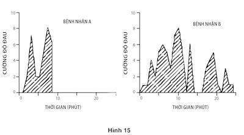

# PHẦN V. HAI BẢN THỂ

# Chương 35. Hai bản chất

Thuật ngữ thỏa dụng có hai ý nghĩa riêng biệt theo suốt chiều dài lịch sử của nó. Jeremy Bentham đã mở đầu Bài giới thiệu về các Nguyên tắc đạo đức và pháp luật của mình với một đoạn nổi tiếng “Tạo hóa đã đặt nhân loại dưới sự cai trị của hai bậc thầy tối thượng: Nỗi đau và niềm hoan lạc. Tạo hóa để cho chúng đứng riêng lẻ để chỉ ra những gì chúng ta cần phải làm, cũng như để xác định những gì chúng ta sẽ làm.” Trong lời chú thích khó xử, Bentham đã lấy làm tiếc vì việc sử dụng từ thỏa dụng cho những trải nghiệm này, ông nói rằng ông đã không thể tìm ra một từ chuẩn hơn. Để phân biệt cách hiểu của Bentham về thuật ngữ này, tôi sẽ gọi đó là độ thỏa dụng trải nghiệm.

Trong suốt 100 năm qua, các nhà kinh tế học đã sử dụng cùng một từ để ám chỉ cả những thứ khác nữa. Như cách các lý thuyết kinh tế và lý thuyết ra quyết định áp dụng thuật ngữ, nó có ý rằng “khả năng mong muốn” và tôi gọi đó là độ thỏa dụng quyết định. Ví dụ, lý thuyết thỏa dụng kỳ vọng là tất cả về các quy luật về sự hợp lý chịu ảnh hưởng từ thỏa dụng quyết định; không có gì để bàn về những trải nghiệm hưởng lạc cả. Dĩ nhiên, hai khái niệm về độ thỏa dụng này sẽ trùng khớp nhau nếu người ta muốn mình sẽ tận hưởng điều gì và tận hưởng điều mà họ lựa chọn cho bản thân mình – và giả định về sự trùng khớp này tiềm ẩn trong ý niệm chung, khiến các tác nhân kinh tế có lý. Các tác nhân có lý trí được kỳ vọng nắm được những thị hiếu của mình, cả ở hiện tại lẫn tương lai và chúng có nhiệm vụ đưa ra các quyết định hợp lý tối đa hóa lợi ích.

### ĐỘ THỎA DỤNG TRẢI NGHIỆM

Niềm đam mê của tôi với những khác biệt có thể giữa độ thỏa dụng trải nghiệm với độ thỏa dụng quyết định truy nguyên lại một quãng đường dài. Khi Amos và tôi vẫn còn đang nghiên cứu về lý thuyết triển vọng, tôi đã dựng lên một bài toán, bài toán đó như thế này: Hãy tưởng tượng một cá nhân bị một mũi tiêm gây đau đớn mỗi ngày. Ở đây không hề có sự điều chỉnh nào; nỗi đau ngày nào cũng giống ngày nào. Liệu người ta sẽ gắn cùng một giá trị cho việc giảm số lượng các mũi tiêm dự kiến từ 20 xuống 18 như thể từ 6 xuống 4 hay không? Có bất kỳ sự giải thích nào cho một khác biệt như vậy ở đây không?

Tôi đã không thu thập dữ liệu, bởi kết quả quá rõ ràng. Bạn có thể tự mình xác nhận rằng bạn sẽ trả tiền nhiều hơn để giảm số mũi tiêm đi 1/3 (từ 6 xuống 4) so với giảm 1/10 (từ 20 xuống 18). Độ thỏa dụng quyết định về việc tránh được hai mũi tiêm trong trường hợp thứ nhất cao hơn so với trường hợp thứ hai và mọi người sẽ trả cho sự giảm thứ nhất nhiều hơn so với lần thứ hai. Nhưng sự khác biệt này lại thật ngớ ngẩn. Nếu nỗi đau không hề thay đổi từ ngày này sang ngày khác, cái gì có thể giải thích cho việc áp đặt những thỏa dụng khác nhau lên một sự giảm bớt của nỗi đau gộp tổng từ hai mũi tiêm, cho việc phụ thuộc vào số lượng các mũi tiêm trước đó? Trong các thuật ngữ mà chúng ta sử dụng ngày nay, bài toán gợi ra ý niệm rằng độ thỏa dụng trải nghiệm có thể được đo lường bởi số lượng các mũi tiêm. Nó cũng chỉ ra rằng, chí ít trong một số trường hợp, độ thỏa dụng trải nghiệm chính là tiêu chuẩn mà theo đó một quyết định nên được ấn định. Một người lập định trả những khoản tiền khác nhau để đạt được cùng một lợi ích của độ thỏa dụng trải nghiệm (hoặc được dung thứ cho cùng một mất mát) đang phạm phải một sai lầm. Bạn có thể thấy lời nhận xét này là hiển nhiên, nhưng trong lý thuyết quyết định, nền tảng duy nhất để đánh giá quyết định đó là sai lại mâu thuẫn với những sự ưu tiên khác. Amos và tôi đã tranh luận về vấn đề này nhưng chúng tôi đã không theo đuổi nó. Rất nhiều năm về sau, tôi đã lật lại vấn đề này.

### SỰ TRẢI NGHIỆM VÀ KÝ ỨC

Độ thỏa dụng trải nghiệm có thể được đo lường như thế nào? Chúng ta nên trả lời các câu hỏi kiểu như: “Helen đã phải trải qua đau đớn trong suốt quá trình điều trị y tế nhiều như thế nào?” hoặc “Cô ấy đã tận hưởng sự khoan khoái nhờ 20 phút vui chơi ở trên bãi biển nhiều chừng nào?” Nhà kinh tế học người Anh Francis Edgeworth đã nghiên cứu về chủ đề này vào thế kỷ XIX và đã đưa ra ý niệm về một “máy đo niềm hoan lạc”, một công cụ tưởng tượng tương tự với dụng cụ được sử dụng tại các trạm quan trắc thời tiết, nó sẽ đo lường cấp độ niềm vui hay nỗi đau mà một cá nhân trải qua tại bất cứ thời điểm nào.

Độ thỏa dụng trải nghiệm có thể biến đổi, nhiều như thời tiết trong ngày hoặc như áp suất khí áp và các kết quả sẽ được vẽ thành biểu đồ giống như một hàm số thời gian. Câu trả lời cho câu hỏi về việc Helen đã trải nghiệm nỗi đau hoặc niềm vui nhiều như thế nào trong suốt quá trình trị liệu hoặc kỳ nghỉ của mình có thể coi là “khu vực dưới đường cong”. Thời gian đóng một vai trò quyết định trong ý niệm của Edgeworth. Nếu Helen ở trên bãi biển 40 phút thay vì 20 phút và khả năng hưởng thụ của cô vẫn ở mức cao, thì tổng độ thỏa dụng trải nghiệm của tình huống này nhân đôi, cũng như việc nhân đôi số lượng mũi tiêm khiến cho một loạt các mũi tiêm tồi tệ gấp đôi. Đó là lý thuyết của Edgeworth và giờ đây chúng ta có được một sự hiểu biết chính xác về những hoàn cảnh để đưa ra lý thuyết của ông.

Biểu đồ trong hình 15 mô tả sơ lược về những trải nghiệm của hai bệnh nhân đang chịu đựng một cuộc nội soi ruột kết đau đớn, được rút ra từ một nghiên cứu mà Don Redelmeier và tôi đã cùng nhau phác họa. Redelmeier, một bác sĩ và nhà nghiên cứu tại Đại học Toronto, đã tiến hành thí nghiệm này vào đầu những năm 1990. Quá trình này giờ đây được thực hiện thường xuyên với sự gây mê cũng như là một loại thuốc gây mất trí nhớ, nhưng những liều thuốc này không được phổ biến rộng như khi chúng tôi tiến hành thu thập dự liệu. Cứ 60 giây các bệnh nhân được nhắc nhở ra dấu về mức độ đau đớn mà họ phải chịu đựng ở thời điểm đó. Dữ liệu được chỉ ra nằm trên một hệ thống chia độ tại đó điểm 0 là “không hề đau đớn” và 10 là “đau không thể chịu đựng nổi”. Như bạn có thể thấy, sự trải nghiệm của mỗi bệnh nhân đã biến đổi đáng kể trong suốt quá trình, nó kéo dài 8 phút đối với bệnh nhân A và 24 phút đối với bệnh nhân B (số 0 cuối cùng đã được ghi lại sau khi quá trình này kết thúc). Tổng số 154 bệnh nhân đã tham gia vào thí nghiệm này; quá trình ngắn nhất kéo dài trong 4 phút, dài nhất trong 69 phút.

*Hình 15: Mức độ đau đớn qua thời gian của bệnh nhân A và bệnh nhân B*

Kế tiếp, xem xét một câu hỏi dễ: Cho rằng hai bệnh nhân đã sử dụng hệ thống đo lường nỗi đau tương tự nhau, bệnh nhân nào đã chịu đựng nhiều hơn? Không có tranh luận nào. Có một sự đồng thuận tổng thể rằng bệnh nhân B đã có khoảng thời gian tệ hơn. Bệnh nhân B ít nhất đã trải qua quãng thời gian giống như bệnh nhân A ở bất cứ cấp độ đau đớn nào, và “khu vực dưới đường cong” rõ ràng đối với B lớn hơn so với A. Dĩ nhiên yếu tố mấu chốt đó là quá trình của B diễn ra lâu hơn nhiều. Tôi sẽ gọi những thước đo dựa trên những báo cáo về nỗi đau tạm thời là những tổng lượng đo lường khoái lạc.

Khi quá trình này kết thúc, tất cả những người tham gia được đề nghị xếp hạng “tổng lượng nỗi đau” mà họ đã trải nghiệm trong suốt quá trình. Các diễn đạt nhằm để khuyến khích họ tư duy về toàn bộ nỗi đau mà họ đã thông báo, mô phỏng lại tổng lượng đo lường khoái lạc. Thật ngạc nhiên, những bệnh nhân này đã không hề làm điều gì theo kiểu đó. Các con số thống kê hé lộ hai phát hiện, chúng minh chứng cho một mô hình mà chúng tôi đã từng thấy được trong các thí nghiệm khác:

- Quy tắc đỉnh - đáy: Sự đánh giá hồi tưởng bao trùm được dự đoán đúng bởi số trung bình của mức độ đau đớn được báo cáo tại thời điểm tồi tệ nhất của sự trải nghiệm và tại điểm kết thúc.

- Bỏ qua khoảng thời gian: Khoảng thời gian thực hiện thủ thuật không có bất cứ tác động gì lên những đánh giá về tổng lượng nỗi đau.

Giờ đây bạn có thể áp dụng những quy tắc này cho những mô tả sơ lược của bệnh nhân A và B. Đánh giá tệ nhất (8 trên hệ số điểm 10) là như nhau đối với cả hai bệnh nhân, nhưng đánh giá sau cùng trước khi kết thúc quá trình là 7 đối với bệnh nhân A và chỉ 1 đối với bệnh nhân B. Do đó trị số trung bình đỉnh - đáy là 7.5 đối với bệnh nhân A và chỉ là 4.5 đối với bệnh nhân B. Như đã dự tính, bệnh nhân A nhớ được đoạn ký ức về tình huống này tồi tệ hơn nhiều so với bệnh nhân B. Đó là vận rủi của bệnh nhân A khi mà quá trình kết thúc tại thời điểm tồi tệ, để lại trong anh ta một ký ức không lấy gì làm dễ chịu.

Giờ đây chúng ta có một tình huống rối trí với tài sản: Hai thước đo độ thỏa dụng trải nghiệm – tổng lượng đo lường khoái lạc và đánh giá hồi tưởng – khác biệt về hệ thống. Các tổng lượng đo lường khoái lạc được tính toán bởi một người quan sát từ một báo cáo của cá nhân về sự trải nghiệm ở các thời điểm. Chúng tôi gọi những sự đánh giá này là khoảng thời gian ảnh hưởng, bởi sự tính toán của “khu vực dưới đường cong” phân phát các ảnh hưởng đồng đều lên tất cả các thời điểm: Hai phút đau đớn tồi tệ gấp hai lần so với một phút ở cùng cấp độ 9. Tuy nhiên, những phát hiện về sự trải nghiệm này và những điều khác cho thấy rằng những đánh giá hồi tưởng có độ nhạy với thời gian và ảnh hưởng từ hai thời điểm khác thường, đỉnh và đáy, nhiều hơn so với những thứ khác. Vậy đâu là điều quan trọng? Bác sĩ nên làm gì? Sự chọn lựa có những ý nghĩa đối với việc hành nghề y. Chúng tôi đã lưu ý rằng:

- Nếu mục tiêu là giảm ký ức của bệnh nhân về nỗi đau, việc giảm cường độ đỉnh của nỗi đau có thể quan trọng hơn so với việc giảm thiểu thời gian diễn ra liệu pháp. Với lý lẽ tương tự, sự giảm nhẹ từ từ có thể thích hợp hơn so với giảm đột ngột nếu muốn bệnh nhân nhớ được một ký ức đẹp khi cơn đau tại thời điểm kết thúc liệu trình là khá nhẹ nhàng.

- Nếu mục đích là giảm số lượng cơn đau đã trải nghiệm thực, việc thực hiện liệu trình nhanh chóng có thể thích hợp dù cho việc làm như vậy sẽ làm tăng cơn đau lên đỉnh điểm cường độ và để lại cho bệnh nhân một ký ức kinh hãi.

Bạn thấy trong hai mục tiêu này cái nào là hấp dẫn nhất? Tôi chưa từng tiến hành một cuộc khảo sát thích hợp, nhưng ấn tượng của tôi chính là đại đa số sẽ có xu hướng thiên về việc giảm thiểu ký ức về cơn đau. Tôi nhận thấy sự hữu ích khi nghĩ về tình thế tiến thoái lưỡng nan này như là một mối xung đột về lợi ích giữa hai bản thể (mà không tương tự với hai phương thức quen thuộc). Bản thể trải nghiệm trả lời cho câu hỏi: “Bây giờ có đau không?” Bản thể hồi tưởng trả lời cho câu hỏi: “Nó như thế nào, về tổng thể?” Những ký ức là tất cả những gì chúng ta thu nhận để lưu giữ từ sự trải nghiệm của chúng ta về cuộc sống và sự hồi tưởng duy nhất mà chúng ta có thể chấp nhận khi chúng ta nghĩ về cuộc sống của mình chính là bản thể hồi tưởng.

Một lời nhận xét mà tôi đã nghe được từ một thính giả sau buổi diễn thuyết chứng minh sự phức tạp của việc phân biệt các ký ức từ những sự trải nghiệm. Ông ấy kể về việc lắng nghe một cách say mê một bản nhạc giao hưởng dài trên một đĩa nhạc đã bị xước ở đoạn gần kết, sinh ra một âm thanh khó nghe và ông đã tuyên bố rằng cái kết tồi “đã hủy hoại toàn bộ sự trải nghiệm”. Nhưng sự trải nghiệm đó trên thực tế không bị hủy hoại, chỉ có ký ức về nó là có. Bản thể trải nghiệm đã có một sự trải nghiệm gần như là hoàn hảo và cái kết tồi đã không thể xóa đi điều đó, bởi nó đã thực sự diễn ra. Người chất vấn của tôi đã áp định toàn bộ tình tiết này là cấp độ thất bại, bởi nó đã kết thúc một cách rất tồi tệ, nhưng mức đó thực tế đã bỏ qua 40 phút tận hưởng âm nhạc vui thú nhất. Có phải sự trải nghiệm trong thực tế không hề có giá trị gì?

Sự trải nghiệm khó hiểu với ký ức về điều đó là một ảo tưởng về nhận thức thú vị - và đây là một sự thay thế khiến chúng ta tin rằng một sự trải nghiệm đã qua có thể bị hủy hoại. Bản thể trải nghiệm không hề có tiếng nói. Bản thể hồi tưởng đôi khi sai, nhưng nó là thứ duy nhất đeo bám được mục tiêu và kiểm soát điều chúng ta lĩnh hội được từ đời sống, và nó là thứ duy nhất đưa ra các quyết định. Điều mà chúng ta lĩnh hội được trong quá khứ là để tối đa hóa những đặc trưng của các ký ức trong tương lai của chúng ta, chứ không nhất thiết cho sự trải nghiệm trong tương lai của chúng ta. Đó chính là sự chuyên quyền của bản thể hồi tưởng.

### BẢN THỂ NÀO ĐÁNG ĐƯỢC QUAN TÂM?

Để làm sáng tỏ sức mạnh trong việc ra quyết định của bản thể hồi tưởng, tôi cùng với các đồng sự của mình đã phác thảo ra một thí nghiệm, sử dụng một hình thức tra khảo nhẹ mà tôi sẽ gọi là tình huống can đảm (tên chuyên ngành khó nghe của nó là co mạch máu/tăng áp suất máu). Những người tham gia được yêu cầu để cho nước lạnh buốt ngập tới cổ tay của mình cho tới khi họ được đề nghị rút ra và đưa cho một chiếc khăn ấm. Các chủ thể trong thí nghiệm của chúng tôi đã sử dụng bàn tay tự do còn lại của mình để điều khiển các mũi tên lên xuống trên một bàn phím nhằm cung cấp một bản ghi chép liên tục về sự đau đớn mà họ đang chịu đựng, một sự truyền đạt trực tiếp từ bản thể đang trải nghiệm. Chúng tôi chọn một mức nhiệt độ để gây ra cơn đau đáng kể nhưng vẫn có thể chịu đựng được: Những người tình nguyện tham gia dĩ nhiên có thể tự do rút tay của mình ra ở bất cứ thời điểm nào nhưng đã không có ai lựa chọn làm như vậy.

Mỗi người đã chịu đựng hai tình thế can đảm khác nhau:

Tình huống ngắn gồm có 60 giây nhúng trong nước ở mức 14°C, được trải nghiệm như là lạnh buốt, nhưng không phải không thể chịu đựng được. Vào cuối thời điểm 60 giây, người thực nghiệm đã chỉ dẫn người tham gia rút tay của mình ra khỏi nước và đưa ra một chiếc khăn ấm.

Tình huống dài, trong 90 giây. 60 giây đầu giống với tình huống ngắn. Người thực nghiệm không nói gì cả tại thời điểm hết 60 giây. Thay vào đó anh đã mở một cái van để cho dòng nước ấm hơn một chút chảy vào trong chậu. Trong suốt quãng 30 giây tiếp theo, nhiệt độ của nước tăng lên xấp xỉ 1°C, vừa đủ cho hầu hết các chủ thể nhận ra một sự giảm nhẹ trong cường độ của cơn đau.

Những người tham gia của chúng tôi đã được thông báo rằng họ sẽ có ba cuộc thử nghiệm can đảm như vậy, nhưng trong thực tế họ chỉ trải nghiệm tình huống ngắn và dài, mỗi tình huống với một tay khác nhau. Các thử nghiệm được thực hiện cách nhau bảy phút. Bảy phút sau cuộc thử nghiệm thứ hai, những người tham gia được đưa tới một lựa chọn về thử nghiệm thứ ba. Họ được thông báo rằng một trong những trải nghiệm của họ sẽ được làm lại y như cũ và được tự do chọn lựa liệu có làm lại thí nghiệm mà họ đã làm với tay trái hoặc tay phải của mình hay không. Dĩ nhiên, một nửa số người tham gia đã thực hiện thử nghiệm ngắn với tay trái, một nửa còn lại với tay phải; một nửa đã thực hiện thử nghiệm ngắn trước, một nửa đã khởi đầu với thử nghiệm dài... Đây là một thí nghiệm được kiểm soát hết sức cẩn trọng.

Thí nghiệm này được lập ra nhằm tạo nên một sự xung khắc giữa những lợi ích của bản thể đang trải nghiệm với bản thể đang hồi tưởng, và cũng là giữa độ thỏa dụng trải nghiệm với độ thỏa dụng quyết định. Từ viễn cảnh của bản thể đang trải nghiệm, thử nghiệm dài rõ ràng là tệ hơn. Chúng tôi đã dự tính bản thể hồi tưởng sẽ đưa ra một ý kiến khác. Quy tắc đỉnh - đáy dự đoán một ký ức tệ hại dành cho thử nghiệm ngắn hơn là cho thử nghiệm dài và bỏ qua khoảng thời gian dự đoán rằng sự khác biệt giữa cơn đau 90 giây với 60 giây sẽ bị lờ đi. Bởi vậy chúng tôi đã dự đoán rằng những người tham gia có thể có một ký ức có lợi (hoặc ít bất lợi) hơn về thử nghiệm dài và lựa chọn lặp lại thử nghiệm này. Họ đã làm vậy, đúng 80% số người tham gia thông báo rằng cơn đau của họ giảm dần trong suốt giai đoạn cuối của tình huống dài đã lựa chọn lặp lại nó. Họ tự mình tuyên bố sẵn lòng chịu đựng cơn đau không cần thiết thêm 30 giây trong thử nghiệm dự kiến thứ ba.

Những chủ thể ưu tiên tình huống dài không phải là những người khổ dâm và đã không lựa chọn một cách kỹ càng mà đặt bản thân vào sự trải nghiệm tồi tệ, họ đã phạm phải một sai lầm. Nếu chúng tôi đã đề nghị họ: “Bạn sẽ thích một sự ngâm mình 90 giây hay chỉ phần đầu của nó?” họ sẽ chắc chắn lựa chọn phương án ngắn. Tuy nhiên, chúng tôi đã không sử dụng cụm từ đó và các chủ thể đã hành động một cách tự nhiên: Họ lựa chọn lặp lại tình huống mà theo đó họ có ký ức chống chọi lại ít hơn. Các chủ thể đã biết được khá rõ hành động nào kéo dài hơn - chúng tôi đã hỏi họ - nhưng họ đã không sử dụng kiến thức đó. Quyết định của họ đã bị chi phối bởi một quy tắc đơn giản của sự chọn lựa trực giác: Lựa lấy phương án mà bạn thích nhất, hoặc ít không thích nhất. Các quy tắc về ký ức đã xác định họ không thích hai lựa chọn nhiều ra sao, điều đó lần lượt xác định sự lựa chọn của họ. Thí nghiệm can đảm, giống như bài toán về những mũi tiêm cũ của tôi, đã gợi ra một sự không thống nhất giữa độ thỏa dụng quyết định với độ thỏa dụng trải nghiệm.

Những sự ưu tiên mà chúng ta đã thấy được trong thí nghiệm này là một ví dụ khác về hiệu ứng càng ít càng tốt mà chúng ta đã từng bắt gặp trong một vài dịp trước đó. Một là nghiên cứu của Christopher Hsee, trong đó việc thêm những chiếc đĩa vào chuỗi 24 chiếc đĩa làm giảm tổng giá trị bởi một vài chiếc đĩa được thêm vào đã vỡ. Một ví dụ khác là của Linda, một phụ nữ năng động được đánh giá có nhiều khả năng là một nhà hoạt động vì nữ quyền hơn là một kế toán ngân hàng. Sự tương đồng ở đây không có gì là bất ngờ. Đặc trưng vận hành tương tự của Hệ thống 1 giải thích cho cả ba trường hợp: Hệ thống 1 đại diện cho các tập hợp gồm các giá trị trung bình, các quy phạm và các nguyên mẫu, không bao gồm những nội dung tổng quát. Từng tình huống can đảm là một chuỗi những khoảng thời gian ngắn mà bản thể hồi tưởng lưu giữ như là một khoảnh khắc nguyên mẫu. Chính điều này dẫn tới một sự xung đột. Đối với một người quan sát khách quan, việc đánh giá tình huống từ những thông báo của bản thể đang trải nghiệm, với giá trị là “khu vực dưới đường cong” tích tụ cơn đau theo thời gian; nó có tính chất của một hàm tổng. Ký ức mà bản thể đang hồi tưởng lưu giữ, ngược lại, là một khoảnh khắc tiêu biểu, bị tác động mạnh bởi đỉnh và đáy.

Tất nhiên, sự tiến hóa có thể đã lập ra bộ nhớ của động vật nhằm lưu trữ những cái tổng thể, giống như nó đã thực hiện một cách chắc chắn trong một số trường hợp. Điều này là quan trọng đối với một con sóc để “biết được” tổng lượng thức ăn nó đã tích trữ được và một hình dung về số trung bình các quả hạch có thể không phải là một sự thay thế đúng đắn. Tuy nhiên, số nguyên của nỗi đau hay niềm hưng phấn theo thời gian có thể ít quan trọng về mặt sinh học hơn. Ví dụ, chúng ta biết rằng những con chuột cho thấy sự bỏ qua khoảng thời gian đối với cả sự hưng phấn lẫn cơn đau. Trong một thí nghiệm, những con chuột liên tiếp bị đặt vào một chuỗi hành động, trong đó phát một luồng sáng báo hiệu rằng một cú sốc điện sẽ nhanh chóng được phóng ra. Những con chuột đã nhanh chóng nhận biết để sợ hãi luồng sáng, và cường độ nỗi sợ có thể được đo lường bởi một vài phản ứng sinh lý. Phát hiện đó là quãng thời gian diễn ra cú sốc có ít hoặc không có ảnh hưởng lên nỗi sợ - tất cả mọi vấn đề đó là cường độ đau của những tác nhân kích thích.

Những nghiên cứu kinh điển khác đã chỉ ra rằng sự kích thích bằng điện từ lên những vùng chuyên biệt trên não của chuột (và những vùng tương ứng trên não người) sinh ra một cảm giác về sự hưng phấn tột bậc, quá mạnh đến nỗi trong một số trường hợp mà có thể kích thích não những con chuột của qua việc ghì chặt một cái đòn bẩy sẽ chết đói mà không dừng lại để tự nạp thêm thức ăn. Sự kích thích hưng phấn bằng điện từ có thể được sinh ra trong sự bùng phát biến đổi về cường độ và thời gian diễn ra. Ở đây thêm một lần nữa, cường độ mới là vấn đề. Không vượt quá một điểm/có thể so sánh với một điểm, việc tăng thời lượng của một sự bùng phát kích thích không xuất hiện để làm tăng sự hăm hở của động vật nhằm đạt được nó. Các quy tắc chi phối bản thể đang hồi tưởng của con người có một lịch sử phát triển lâu dài.

### SINH VẬT HỌC ĐỐI CHỌI VỚI SỰ HỢP LÝ

Ý tưởng hữu ích nhất trong bài toán về những mũi tiêm đã ám ảnh tôi nhiều năm trước đây, đó là độ thỏa dụng trải nghiệm của một chuỗi các mũi tiêm gây đau đớn ngang bằng có thể được đo lường, bởi việc tính toán một cách đơn giản các mũi tiêm. Nếu tất cả các mũi tiêm đều gây sợ hãi như nhau, thì cả 20 mũi sẽ tồi tệ gấp đôi 10 mũi, sự sụt giảm từ 20 xuống 18 và một sự giảm từ 6 xuống 4 có trị giá ngang nhau. Nếu độ thỏa dụng quyết định không tương đương với độ thỏa dụng trải nghiệm, thì có cái gì đó sai khác với quyết định. Logic tương tự diễn ra trong thí nghiệm can đảm: Một tình huống đau đớn kéo dài 90 giây tồi tệ hơn so với 60 giây đầu tiên trong tình huống đó. Nếu người ta tự nguyện lựa chọn chịu đựng tình huống dài hơn, có cái gì đó sai khác với quyết định của họ. Trong bài toán ban đầu của tôi, sự sai khác giữa quyết định và trải nghiệm được khởi đầu từ độ nhạy giảm dần: Sự khác biệt giữa 18 và 20 ít lôi cuốn hơn, và có vẻ ít giá trị hơn, so với sự khác biệt giữa 6 và 4 mũi tiêm. Trong thí nghiệm can đảm, sự sai sót phản ánh hai nguyên tắc của ký ức: Sự bỏ qua thời gian diễn ra và quy tắc đỉnh - đáy. Các cơ chế là khác nhau nhưng kết quả thì tương tự: Một quyết định không hòa hợp chính xác với sự trải nghiệm.

Các quyết định không tạo ra sự trải nghiệm hợp lý nhất và những dự báo sai lầm về những cảm giác trong tương lai – cả hai đều là những tin xấu dành cho những người tin tưởng vào tính hợp lý của sự chọn lựa. Nghiên cứu về sự can đảm đã chỉ ra rằng: Chúng ta không thể tin tưởng hoàn toàn vào những ưu ái của mình để phản ánh những lợi ích của chúng ta, dù cho chúng có dựa trên sự trải nghiệm cá nhân, và dù cho ký ức về sự trải nghiệm đó vừa mới diễn ra trong vòng 15 phút! Những nếm trải và quyết định được định hình bởi ký ức và ký ức có thể sai. Căn cứ này đưa ra một thách thức có tầm ảnh hưởng tới ý niệm rằng con người có những ưu ái nhất quán và biết cách để tối đa hóa chúng, một nền tảng của mô hình tác nhân lý trí. Một mâu thuẫn được nhen nhóm trong sự định hình trí óc của chúng ta. Chúng ta có sự thiên vị mạnh mẽ đối với thời gian xảy ra những trải nghiệm về nỗi đau và sự hưng phấn. Chúng ta muốn nỗi đau bị rút ngắn và sự hưng phấn kéo dài. Nhưng ký ức của chúng ta, một đặc trưng của Hệ thống 1, đã được phát triển để hình dung ra thời khắc căng thẳng nhất của một tình huống đau khổ hay phấn khích (đỉnh) và những cảm giác khi tình huống ấy đạt tới điểm kết của nó. Một ký ức bỏ qua khoảng thời gian diễn ra sẽ không hậu thuẫn cho sự thiên vị của chúng ta dành cho sự hưng phấn kéo dài hay những đau đớn ngắn ngủi.