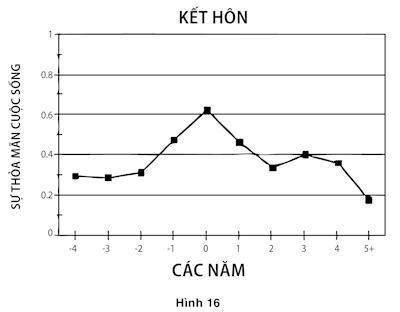

# Chương 38. Nghĩ về cuộc sống

Hình 16 được lập nên từ Andrew Clark, Ed Diener và Yannis Georgellis thuộc Hội đồng Kinh tế Xã hội Đức. Thí nghiệm cùng một thời điểm hỏi tất cả mọi người về sự thỏa mãn của họ về cuộc sống trong một năm qua. Những người tham gia cũng đã đưa ra những thay đổi chính trong các tình huống đã xảy ra với họ trong suốt một năm trước đó. Biểu đồ biểu thị mức độ thỏa mãn được báo cáo trong khoảng thời gian những người này kết hôn.

*Hình 16: Mức độ hài lòng cuộc sống quanh thời điểm kết hôn*

Biểu đồ này chắc hẳn gợi ra tiếng cười sảng khoái cho người xem và có thể cả những bồn chồn rằng: Sau tất cả, những người quyết định kết hôn làm vậy bởi họ mong đợi nó sẽ khiến họ hạnh phúc hơn hoặc bởi họ hy vọng tạo ra một ràng buộc lâu dài sẽ duy trì trạng thái đang hạnh phúc. Với thuật ngữ hữu ích được đưa ra bởi Daniel Gilbert và Timothy Wilson, cho rằng quyết định kết hôn phản ánh rằng đối với nhiều người, một lỗi hệ thống của Cảnh báo cảm xúc. Vào ngày cưới, cô dâu và chú rể biết rằng tỷ lệ ly hôn là cao và rằng tỷ lệ rơi vào trạng thái thất vọng về hôn nhân thậm chí còn cao hơn, nhưng họ không tin rằng những số liệu thống kê này ứng vào họ.

Thông tin đáng ngạc nhiên của hình 16 là sự suy giảm nghiêm trọng sự thỏa mãn cuộc sống. Đồ thị này thường được hiểu là việc phác họa một quá trình thích ứng, trong đó những niềm vui ban đầu của việc kết hôn nhanh chóng biến mất khi các trải nghiệm của cuộc hôn nhân này trở thành thói quen. Tuy nhiên, một cách tiếp cận khác là điều có thể, nó tập trung vào những phỏng đoán về sự đánh giá. Ở đây chúng ta hỏi điều gì xảy ra trong đầu mọi người khi họ được đề nghị đánh giá cuộc đời họ. Câu hỏi “Nói chung, bạn đã thỏa mãn với đời sống của mình như thế nào?” và “Bạn hạnh phúc trong những ngày này ra sao?” không hề đơn giản như “Số điện thoại của bạn là gì? Làm cách nào để những người tham gia vào cuộc điều tra xoay xở để trả lời những câu hỏi kiểu như vậy trong một vài giây, như tất cả đã diễn ra? Nó sẽ hữu ích cho việc suy nghĩ về điều này như một sự đánh giá khác. Dường như đây cũng là tình huống cho các câu hỏi khác, một số người có thể có sẵn câu trả lời, thứ họ đã tạo ra vào dịp khác, trong đó họ đã đánh giá cuộc đời mình. Những người khác, hẳn là số đông, không dễ tìm ra một sự hồi đáp cho câu hỏi chính xác mà họ đã được hỏi và tự động biến nhiệm vụ của họ trở nên dễ dàng hơn bằng việc thay thế câu trả lời cho một câu hỏi khác. Hệ thống 1 đang vận hành. Khi chúng ta nhìn vào hình 16 theo quan niệm này, nó mang một nghĩa hoàn toàn khác.

Những câu trả lời cho nhiều câu hỏi đơn giản có thể được thay thế cho một sự đánh giá toàn diện về cuộc sống. Bạn nhớ lại nghiên cứu trong đó các sinh viên chỉ được hỏi có bao nhiêu ngày mà họ đã có trong tháng trước được báo cáo về “niềm hạnh phúc trong những ngày này” của họ như thể việc hẹn hò là thực tế quan trọng duy nhất trong đời họ. Trong một thí nghiệm nổi tiếng khác tương tự như vậy, Norbert Schwarz và các đồng nghiệp của mình đã mời những người tham gia thí nghiệm tới phòng thí nghiệm để hoàn thành một bảng câu hỏi về sự thỏa mãn cuộc sống. Tuy nhiên, trước khi họ bắt đầu nhiệm vụ này ông đã đề nghị họ sao chép một tờ giấy giúp ông. Một nửa số người tham gia đã phát hiện ra một hào trong máy phô tô, được các nhà thực nghiệm để lại đó. Tình huống may mắn nhỏ bất ngờ đã dẫn tới một sự cải thiện đáng kể trong sự thỏa mãn về cuộc đời của họ như một tổng thể được báo cáo lại! Phỏng đoán là một cách để trả lời các câu hỏi thỏa mãn trong cuộc sống.

Khảo sát hẹn hò và thí nghiệm đồng tiền xu trên máy đã chứng minh rằng: Những hồi đáp cho các câu hỏi về cảm xúc hạnh phúc nói chung nên được tiến hành với một thái độ bán tín bán nghi. Nhưng dĩ nhiên, tâm trạng hiện thời của bạn không hề là đánh giá về toàn bộ cuộc đời bạn. Bạn có thể được nhắc nhở về những biến cố quan trọng trong thời gian đã qua gần đây hoặc tương lai gần, về những mối quan tâm trở đi trở lại, ví dụ như sự hạnh phúc của một cặp vợ chồng hoặc về các đồng nghiệp xấu tính mà bà còn nhớ được từ hồi còn là thanh niên; về những thành tựu quan trọng và những thất bại đau đớn. Một vài ý niệm mà có liên quan tới câu hỏi sẽ xảy đến với bạn; rất nhiều thứ khác thì sẽ không. Ngay cả khi nó không bị tác động bởi sự ngẫu nhiên, mục tiêu mà bạn nhanh chóng đặt ra cho cuộc đời mình được xác định bởi một ví dụ nhỏ về các ý niệm tốt sẵn có, chứ không phải bởi một ảnh hưởng cẩn trọng của các lĩnh vực trong đời sống của bạn.

Những người đã kết hôn gần đây, hoặc đang mong đợi kết hôn trong tương lai gần, có thể khắc phục được thực tế đó khi được hỏi một câu hỏi phổ biến về cuộc đời họ. Do hôn nhân gần như luôn luôn là tự nguyện tại nước Mỹ, gần như hầu hết mọi người được nhắc nhở về hôn lễ vừa diễn ra hoặc sắp diễn ra của anh ta hoặc cô ta sẽ cảm thấy hạnh phúc với điều ý nghĩ này. Sự quan tâm là chìa khóa cho bài toán này. Bảng 16 có thể được hiểu như là một đồ thị về khả năng mà người ta sẽ nghĩ về hôn lễ vừa mới diễn ra hoặc sắp diễn ra khi được hỏi về cuộc đời của họ. Điểm nổi bật của tư tưởng này nhất định sẽ giảm với sự trôi chảy của thời gian, như là những suy giảm tính mới lạ của nó.

HÌnh này chỉ ra một mức độ cao khác thường về sự thỏa mãn đời sống duy trì trong hai hoặc ba năm gần thời điểm kết hôn. Tuy nhiên, nếu sự tăng lên rõ ràng này phản ánh diễn tiến thời gian của một phỏng đoán dành cho việc trả lời câu hỏi, đó là chút ít mà chúng ta có thể lĩnh hội được từ nó về hoặc niềm hạnh phúc hoặc về quá trình thích ứng với hôn nhân. Chúng ta không thể suy ra từ nó rằng một cơn thủy triều hạnh phúc kéo dài trong vài năm và đang dần rút xuống. Ngay cả những người đang hạnh phúc được làm cho nhớ về hôn lễ của họ khi được hỏi một câu hỏi đề cập tới việc đời sống của họ không nhất thiết phải hạnh phúc hơn quãng đời còn lại. Trừ khi họ nghĩ những suy nghĩ hạnh phúc về cuộc hôn nhân của mình trong phần lớn cuộc đời của họ, điều đó sẽ không chi phối trực tiếp đến hạnh phúc của họ. Ngay cả những cặp vợ chồng son, những người đủ may mắn để tận hưởng một trạng thái lo âu hạnh phúc với tình yêu của họ, sau cùng sẽ trở lại với thực tế và niềm hạnh phúc được trải nghiệm của họ một lần nữa, như nó đã xảy ra trong số chúng ta, phụ thuộc vào môi trường và các phạm vi của thời điểm hiện tại.

Trong các nghiên cứu DRM, không hề có sự khác biệt toàn diện trong niềm hạnh phúc được trải nghiệm giữa các phụ nữ đã sống cùng một người chồng và những phụ nữ không như vậy. Những chi tiết về cách hai nhóm này sử dụng thời gian của họ đã lý giải phát kiến này. Những người phụ nữ có chồng có ít thời gian một mình hơn, điều đó thật tuyệt, nhưng cũng dành nhiều thời gian cho việc nhà, chuẩn bị thức ăn và chăm sóc con cái hơn, tất cả những hoạt động tương đối không phổ biến. Và dĩ nhiên, số lượng lớn thời gian của những người phụ nữ đã kết hôn chung sống với chồng đối với một số người có nhiều niềm vui hơn so với số khác. Niềm hạnh phúc được trải nghiệm trung bình không bị ảnh hưởng bởi hôn nhân, không phải bởi hôn nhân không tạo ra sự khác biệt cho hạnh phúc mà bởi nó thay đổi một số khía cạnh của đời sống theo hướng tốt hơn và số khác thì tệ đi.

Một lý do cho những mối tương quan lỏng lẻo giữa những tình huống của các cá nhân với sự thỏa mãn với đời sống của họ, đó là cả niềm hạnh phúc được trải nghiệm lẫn sự thỏa mãn cuộc sống đều được xác định trên quy mô lớn bởi các gen di truyền tính cách. Tính khí hạnh phúc có thể được di truyền như chiều cao hoặc trí thông minh, như đã được chứng minh bởi các nghiên cứu về các cặp song sinh bị chia tách ngay từ lúc mới sinh. Những người xem chừng may mắn ngang nhau có khác biệt lớn trong việc họ hạnh phúc ra sao. Trong một số trường hợp, như trong trường hợp về hôn nhân, các mối tương quan với cảm nhận hạnh phúc là thấp bởi các hiệu ứng cân bằng. Trường hợp tương tự có thể tốt đối với một vài người và xấu đối với những người khác và các tình huống mới có cả những lợi ích lẫn chi phí. Trong một vài trường hợp khác, ví dụ như thu nhập cao, các tác động lên sự thỏa mãn cuộc sống thường là tích cực, nhưng sự việc này bị làm cho phức tạp, bởi sự thực là một số người quan tâm quá mức tới tiền bạc hơn những người khác.

Một nghiên cứu trên quy mô rộng về tác động của nền giáo dục cao hơn, được tiến hành vì một chủ đích khác nữa, đã khai phá ra một căn cứ đáng chú ý của những tác động trọn đời về những mục tiêu mà người trẻ tuổi đặt ra cho bản thân mình. Số liệu có liên quan đã được đưa ra từ những bảng câu hỏi được thu thập từ năm 1995 - 1997 từ xấp xỉ 12.000 người mà đã khởi đầu khối tri thức cao hơn của mình tại các trường ưu tú vào năm 1976. Khi đó họ mới 17 hoặc 18 tuổi, những người tham gia đã điền vào một bảng câu hỏi trong đó họ đã xếp hạng mục tiêu “trở nên vô cùng dư dả về tài chính” trên thang điểm 4 xếp hạng từ “không quan trọng” tới “thiết yếu”. Bảng câu hỏi mà họ đã hoàn thiện 20 năm sau đó bao gồm cả những thước đo về mức thu nhập của họ vào năm 1995, cũng như là một thước đo tổng thể về sự thỏa mãn cuộc sống.

Các mục tiêu tạo ra một sự khác biệt lớn. 19 năm sau đó, họ đã tuyên bố về những tham vọng tài chính của mình, nhiều người trong số những người muốn một mức thu nhập cao đã đạt được điều đó. Ví dụ, trong số 597 bác sĩ và các chuyên gia y tế khác trong mẫu điều tra, từng điểm cộng thêm trên thang điểm tầm quan trọng của tiền đã được liên hệ với mức giá dựa trên 14.000 đô-la đối với mức thu nhập nghề nghiệp theo thời giá đô-la năm 1995! Những người phụ nữ đã kết hôn không làm việc cũng đã có thể được thỏa mãn những tham vọng tài chính của họ. Từng điểm trên mức điểm này đã chuyển sang thành hơn 12.000 đô-la đối với mức thu nhập hộ gia đình được cộng thêm dành cho những người phụ nữ này, hiển nhiên là thông qua các khoản thu nhập của chồng họ.

Điều quan trọng là những người mà đã trói buộc với mức thu nhập ở lứa tuổi 18 cũng đã lường trước được sự thỏa mãn với mức thu nhập của mình ở lứa tuổi trưởng thành. Chúng tôi đã so sánh sự thỏa mãn đời sống trong một nhóm thu nhập cao (thu nhập hộ gia đình cao hơn 200.000 đô-la) với một nhóm thu nhập từ thấp tới trung bình (ít hơn 50.000 đô-la). Tác động của mức thu nhập lên sự thỏa mãn đời sống là lớn hơn đối với những ai đã từng liệt việc trở nên sung túc về tài chính như là một mục tiêu thiết yếu: 57 điểm trên một thang điểm 5. Sự khác biệt tương ứng đối với những ai đã cho rằng tiền bạc không hề quan trọng đã chỉ được 12 điểm. Những người đã mong muốn có được tiền bạc và đã không có được nó đều bất mãn ghê gớm. Cùng một nguyên tắc được áp dụng cho các mục tiêu khác – một công thức dành cho một tuổi trưởng thành đầy thất vọng là việc thiết lập những mục tiêu đặc biệt khó để có thể hoàn thành. Được đo lường bởi sự thỏa mãn đời sống 20 năm sau đó, mục tiêu hứa hẹn nhỏ nhất mà một người trẻ tuổi có thể có được đó là “trở nên hoàn thiện trong một môn nghệ thuật biểu diễn.” Các mục tiêu của lứa tuổi thanh niên ảnh hưởng tới điều xảy ra với họ, điểm họ dừng lại và họ được thỏa mãn ra sao.

Một phần là bởi những phát hiện mà tôi có đã thay đổi suy nghĩ của tôi về định nghĩa của từ hạnh phúc. Các mục tiêu mà người ta đặt ra cho chính bản thân mình quá quan trọng đến điều họ đang làm và cảm nhận họ có về nó đến nỗi một trọng tâm riêng biệt lên cảm nhận hạnh phúc được trải nghiệm là không thể đứng vững được. Chúng ta không thể bảo vệ một ý niệm về cảm nhận hạnh phúc mà bỏ qua điều con người mong muốn. Mặt khác, cũng hoàn toàn đúng khi một khái niệm về cảm nhận hạnh phúc lại bỏ qua việc mọi người cảm nhận như thế nào khi họ nghĩ về đời sống của mình thì cũng không thể chấp nhận được. Chúng ta cần phải chấp nhận những phức tạp của một quan điểm lai tạp, ở đó cảm nhận hạnh phúc của cả hai bản thể đều được xem xét.

### ẢO TƯỞNG TẬP TRUNG

Chúng ta có thể suy ra từ sự may mắn mà theo đó người ta trả lời các câu hỏi về đời sống của họ và từ những tác động của tâm trạng hiện tại lên các câu trả lời của họ, mà họ không bị lôi kéo tham gia vào một bài kiểm tra kỹ lưỡng khi họ đánh giá về đời sống của mình. Họ chắc hẳn đang sử dụng các phỏng đoán, đó là các ví dụ về cả phép thế lẫn WYSIATI. Mặc dù quan điểm của họ về đời sống của bản thân bị chi phối bởi một câu hỏi về việc hẹn hò hoặc bởi một đồng xu trên máy phô-tô, những người tham gia trong các nghiên cứu này đã không quên rằng còn có nhiều điều khác trong cuộc sống hơn là việc hẹn hò hoặc cảm giác may mắn. Khái niệm về hạnh phúc không bị thay đổi đột ngột bởi việc tìm ra một hào, nhưng Hệ thống 1 luôn sẵn sàng thay thế một phần nhỏ trong tổng thể của khái niệm này. Bất cứ khía cạnh nào của đời sống mà theo đó sự chú ý được hướng tới sẽ hiển thị rõ ràng trong một đánh giá tổng thể. Đây chính là bản chất của ảo tưởng tập trung, thứ có thể được miêu tả trong một câu đơn giản sau:

Không điều gì trong đời sống quan trọng bằng việc bạn nghĩ là nó quan trọng khi nghĩ về nó.

Khởi nguyên của ý niệm này là một cuộc tranh luận trong gia đình về việc chuyển từ California tới Princeton, trong đó vợ tôi đã quả quyết rằng những người sống tại California sẽ hạnh phúc hơn so với những người sống tại bờ Đông. Tôi đã lập luận rằng khí hậu rõ ràng không thể là yếu tố quyết định quan trọng tới cảm nhận hạnh phúc, các nước thuộc Scandinavi hẳn là những nước hạnh phúc nhất trên thế giới này. Tôi đã từng nhận xét rằng các hoàn cảnh sống lâu dài có ít tác động lên cảm nhận hạnh phúc và đã cố gắng trong vô vọng nhằm thuyết phục vợ tôi rằng những trực giác của cô ấy về sự hạnh phúc của những người California là một lỗi dự đoán cảm tính.

Một thời gian ngắn sau đó, vụ tranh cãi này vẫn còn lởn vởn trong đầu tôi, tôi đã tham gia vào một buổi hội thảo khoa học bàn về sự nóng lên toàn cầu. Một đồng nghiệp đã đưa ra một tham luận mà được dựa trên quan điểm của ông đối với cảm nhận hạnh phúc của cư dân trái đất trong thế kỷ tới. Tôi đã tranh luận rằng thật ngớ ngẩn khi đi dự đoán mọi việc rồi sẽ ra sao khi sống trên một hành tinh đang nóng lên khi chúng ta thậm chí đã không biết sống ở California thì sẽ như thế nào. Ngay sau cuộc trao đổi này, đồng nghiệp David Schkade và tôi đã nhận được từ các quỹ hỗ trợ nghiên cứu hai câu hỏi: Có phải những người sống ở California hạnh phúc hơn những người khác? Và dân chúng tin tưởng vào hạnh phúc tương đối của người dân California như thế nào?

Chúng tôi đã tập hợp các mẫu lớn các sinh viên theo học tại các trường đại học thuộc các bang lớn tại California, Ohio và Michigan. Từ một số người trong số họ, chúng tôi đã thu được một bản báo cáo tường tận về sự thỏa mãn của họ với các khía cạnh khác nhau về đời sống của họ. Từ một số khác chúng tôi đã thu được một sự dự báo về việc một số người “với các lợi ích và giá trị của bạn” đã sống ở một nơi nào khác sẽ hoàn thiện bảng câu hỏi tương tự.

Khi chúng tôi phân tích dữ liệu, mọi thứ trở nên rõ ràng rằng tôi đã thắng trong cuộc tranh luận gia đình. Như dự tính, các sinh viên ở hai vùng khác nhau rất nhiều trong thái độ của họ đối với vùng khí hậu của họ: Những người California đã tận hưởng bầu khí hậu của họ và những người vùng Trung - Tây xem thường bầu khí hậu của họ. Nhưng khí hậu không phải là một yếu tố quyết định quan trọng về sự cảm nhận hạnh phúc. Thực vậy, không hề có sự khác biệt nào giữa sự thỏa mãn đời sống của các sinh viên tại California và sinh viên tại Trung - Tây. Chúng tôi cũng phát hiện ra rằng vợ tôi không phải là người duy nhất có niềm tin rằng những người California tận hưởng niềm hạnh phúc nhiều hơn những người khác. Các sinh viên tại cả hai vùng đã có cùng chung quan điểm sai lầm đó, và chúng tôi có thể truy nguyên lỗi của họ từ một niềm tin quá mức vào tầm quan trọng của khí hậu. Chúng tôi đã mô tả lỗi này như là một ảo tưởng tập trung.

Bản chất của ảo tưởng tập trung chính là WYSIATI, quá đặt nặng vấn đề khí hậu và đặt quá ít vai trò của tất cả các yếu tố quyết định khác đối với sự cảm nhận hạnh phúc. Để hiểu rõ sức mạnh của ảo tưởng này là như thế nào, hãy bỏ ra vài giây để xem xét câu hỏi sau:

Bạn nhận được bao nhiêu sự thoải mái từ chiếc xe hơi của mình?

Một câu trả lời xuất hiện trong đầu bạn ngay tức thì và bạn biết được bạn thích và hài lòng với chiếc xe của mình bao nhiêu. Giờ hãy nghiên cứu một câu hỏi khác: “Khi nào thì bạn cảm nhận được sự thoải mái từ chiếc xe của mình?” Câu trả lời cho câu hỏi này có thể làm bạn ngạc nhiên, nhưng thật dễ hiểu: Bạn thấy thỏa mãn (hoặc không thỏa mãn) với chiếc xe của mình khi bạn nghĩ tới nó, điều mà chắc hẳn là không thường xuyên lắm. Dưới các hoàn cảnh thông thường, bạn không dành quá nhiều thời gian để nghĩ về chiếc xe của bạn khi bạn đang vận hành nó. Bạn nghĩ về những thứ khác khi bạn lái xe, và tâm trạng của bạn được xác định bởi thứ mà bạn nghĩ về. Ở đây thêm một lần nữa, khi bạn đã nỗ lực để đánh giá việc bạn hài lòng với chiếc xe của mình bao nhiêu, bạn thực sự đã trả lời một câu hỏi hẹp hơn rất nhiều: “Bạn cảm thấy thoải mái với chiếc xe của mình bao nhiêu khi bạn nghĩ về nó?” Sự thay thế này đã khiến bạn bỏ qua sự thực rằng: Bạn hiếm khi nghĩ về chiếc xe của mình, một dạng thức của sự bỏ qua thời gian diễn ra. Kết quả cuối cùng là một sự ảo tưởng tập trung. Nếu bạn thích chiếc xe của mình, bạn có thể cường điệu sự thoải mái mà bạn nhận được từ nó, thứ mà sẽ làm bạn hiểu sai khi bạn nghĩ về những ưu điểm của phương tiện di chuyển hiện tại của bạn cũng như là khi bạn cân nhắc việc mua một chiếc xe mới.

Một khuynh hướng tương tự bóp méo các phán quyết về niềm hạnh phúc của người dân California. Khi được hỏi về niềm hạnh phúc của người dân California, chắc hẳn bạn sẽ nhớ đến một hình ảnh về một số người đang tham gia vào một khía cạnh đặc biệt của sự trải nghiệm California, ví dụ như đi bộ đường dài vào mùa hè hoặc ngưỡng vọng thời tiết giữa đông. Ảo tưởng tập trung xuất hiện bởi những người dân California thực sự dành ít thời gian cho việc tham gia vào những khía cạnh cuộc sống này của họ. Hơn thế nữa, những người dân California về lâu dài không chắc đã được đả động gì tới khí hậu khi được hỏi về một sự đánh giá toàn diện về đời sống của họ. Nếu bạn sống ở đây trong suốt cuộc đời mình và không đi du lịch quá nhiều, việc sinh sống ở California như thể được ủng hộ bằng cả hai tay: Đẹp, nhưng đó không phải là một số điều mà một số người nghĩ tới quá nhiều. Những ý nghĩ về bất kể khía cạnh nào của đời sống có nhiều khả năng trở nên nổi bật nếu một sự chọn lựa loại trừ tương phản luôn có sẵn.

Những người mới chuyển tới California gần đây sẽ phản ứng khác hẳn. Hãy xem xét một người mạnh dạn bỏ Ohio để tìm kiếm hạnh phúc ở một vùng khí hậu tốt hơn. Trong một vài năm sau việc di chuyển, môt câu hỏi về sự thỏa mãn của anh ta với đời sống hẳn sẽ gợi nhắc anh ta về cuộc di chuyển và cũng gợi ra những suy nghĩ về những kiểu khí hậu tương phản ở hai bang. Sự so sánh chắc chắn sẽ thiên về California, và sự quan tâm tới khía cạnh này của đời sống có thể bóp méo sức ảnh hưởng thực sự của nó trong sự trải nghiệm. Tuy nhiên, ảo tưởng tập trung có thể cũng mang tới sự thoải mái. Dù có hay không có cá nhân thực sự hạnh phúc hơn sau khi di chuyển, anh ta sẽ báo cáo với chính bản thân mình trạng thái hạnh phúc hơn, bởi suy nghĩ về kiểu khí hậu sẽ khiến anh ra tin rằng mình đang hạnh phúc hơn. Ảo tưởng tập trung có thể khiến con người ta trở nên sai lầm với trạng thái hạnh phúc hiện tại của họ cũng như là về niềm hạnh phúc của những người khác, và về hạnh phúc cá nhân của họ trong tương lai.

Vào thời điểm nào trong ngày thì những người liệt hai chi dưới trải qua tâm trạng tồi tệ?

Câu hỏi này gần như chắc chắn khiến bạn nghĩ về một người liệt hai chân dưới, người mà hiện đang nghĩ về một số trạng thái của anh ta. Sự phỏng đoán của bạn về tâm trạng của một người bị liệt hai chi dưới do vậy mà có thể trở nên chính xác vào những ngày đầu tiên sau một vụ tai nạn gây tàn tật xảy ra; đôi khi sau biến cố, các nạn nhân của vụ tai nạn không nghĩ gì nhiều. Nhưng thời gian trôi đi, với một vài biệt lệ, sự chú ý được rút ra từ một tình thế mới khi nó trở nên quen thuộc hơn. Các biệt lệ chính là cơn đau kinh niên, liên tục tiếp xúc với tiếng ồn ào và trầm cảm nghiêm trọng. Cơn đau và tiếng ồn về mặt sinh học được tạo ra để làm các tín hiệu thu hút sự chú ý và trầm cảm có liên quan tới một chu trình tự củng cố về những suy nghĩ đáng thương. Do vậy ở đâu không có sự tương thích với những trạng thái này. Liệt hai chi dưới, tuy vậy, không phải là một trong những ngoại lệ: Những quan sát chi tiết đã cho thấy rằng những người bị liệt hai chi dưới có tâm trạng khá tốt so với một nửa khoảng thời gian giống như một tháng đầu sau vụ tai nạn của họ, mặc dù tâm trạng của họ chắc chắn là ủ rũ hơn khi họ nghĩ về tình trạng của mình. Phần lớn thời gian, tuy nhiên, những người liệt hai chi dưới làm việc, đọc sách, tận hưởng những trò gây cười, kết bạn và nổi giận khi họ đọc các thông tin về đời sống chính trị trên báo. Khi họ được tham gia vào bất cứ những hoạt động này, họ không mấy khác biệt với bất cứ ai khác, và chúng ta có thể mong đợi cảm nhận hạnh phúc được trải nghiệm của những người liệt hai chi này gần với đời thường phần lớn thời gian. Sự thích ứng với tình trạng mới, dù tốt hay xấu, cốt ở phần lớn của việc suy nghĩ càng ít càng tốt về vấn đề đó. Trong trường hợp này, hầu hết các hoàn cảnh sống về dài hạn, bao gồm cả người bị liệt hai chi và người kết hôn, là những trạng thái bán thời gian mà ai đó ở vào chỉ khi ai đó chú tâm tới chúng.

Một trong những đặc quyền của việc giảng dạy tại Princeton đó là cơ hội được dẫn dắt những sinh viên sáng lạn sắp tốt nghiệp qua một luận án nghiên cứu. Và một trong những sự trải nghiệm yêu thích của tôi trong đặc trưng này, đó là một dự án trong đó Beruria Cohn đã thu thập và phân tích số liệu từ một hãng khảo sát đã đề nghị những người tham gia đánh giá tỷ lệ thời gian mà những người bị liệt hai chi dưới lâm vào một tâm trạng tồi tệ. Bà đã tách những người tham ra thành hai nhóm: Một số được nói rằng vụ tai nạn gây thương tật đã xảy ra một tháng trước đó, một số được nói rằng một năm trước đó. Ngoài ra, từng người tham gia đã làm hiệu cho biết liệu rằng bản thân anh ta hoặc cô ta đã từng biết một người liệt hai chi dưới hay không. Hai nhóm này đã trùng khít với nhau trong phán đoán của họ về những người bị liệt hai chi dưới gần đây: Những người mà từng biết một người bị liệt hai chi dưới đã ước tính 75% ở tâm trạng tồi tệ; những người mà phải hình dung ra một người bị liệt hai chi dưới cho là 70%. Ngược lại, hai nhóm này đã khác biệt một cách rõ nét trong các ước tính của mình về tâm trạng của những người liệt hai chi dưới một năm sau các vụ tai nạn: Những người từng biết một người bị liệt hai chi đã đưa ra con số 41% như là ước tính của họ về khoảng thời gian mà tại đó tâm trạng là tồi tệ. Các ước tính của những người mà chưa từng quen biết với một người bị liệt hai chi dưới đã tính trung bình là 68%. Rõ ràng, những ai đã từng biết một người liệt hai chi dưới đã quan sát thấy sự thuyên giảm dần dần đối với sự chú ý khỏi tình trạng đó, nhưng những người khác đã không đoán được rằng sự thích nghi này có thể xảy ra. Các đoán định về tâm trạng của những người trúng vé số một tháng và một năm sau biến cố đã chỉ ra đích xác cùng một mẫu hình như vậy.

Chúng ta có thể dự tính sự thỏa mãn đời sống của những người liệt hai chi dưới và những ai đau buồn vì những trạng thái mãn tính và phiền toái được liên kết lỏng lẻo với cảm nhận hạnh phúc được trải nghiệm của họ, bởi nhu cầu đánh giá cuộc sống của họ chắc sẽ gợi nhắc họ về đời sống của những người khác và về đời sống mà họ đã từng trải qua. Kiên định với ý niệm này, các nghiên cứu gần đây về các bệnh nhân làm phẫu thuật hậu môn giả đã sản sinh ra những mâu thuẫn sâu sắc giữa cảm nhận hạnh phúc được trải nghiệm của các bệnh nhân và những đánh giá của họ về cuộc sống của mình. Sự trải nghiệm chọn mẫu chỉ ra không hề có sự khác biệt nào trong niềm hạnh phúc được trải nghiệm giữa những bệnh nhân này và một nhóm người khỏe mạnh. Lại thêm các bệnh nhân làm phẫu thuật hậu môn giả có thể sẽ sẵn lòng đánh đổi một vài năm tuổi đời của mình lấy một cuộc đời ngắn ngủi hơn mà không phải làm phẫu thuật hậu môn giả. Hơn thế nữa, những bệnh nhân có hậu môn giả đã từng đánh đổi này nhớ lại quãng thời gian của họ trong trạng thái ấy như thể điều ghê sợ và họ sẽ từ bỏ thậm chí nhiều hơn thời gian sống còn lại của mình để không phải quay lại với nó. Ở đây cho thấy bản thể đang hồi tưởng là chủ thể cho một ảo tưởng tập trung ồ ạt về đời sống mà bản thể đang trải nghiệm kéo dài khá lâu.

Daniel Gilbert và Timothy Wilson đã giới thiệu từ Lỗi ham muốn để miêu tả những chọn lựa tồi nảy sinh từ các lỗi của việc dự báo cảm tính. Từ này đáng được dùng trong ngôn ngữ hàng ngày. Ảo tưởng tập trung (mà Gilbert và Wilson gọi là Khu biệt hóa) là một nguồn phong phú cho Lỗi ham muốn. Cụ thể, nó khiến chúng ta có thiên hướng thổi phồng tác động của những lực đẩy quan trọng hoặc thay đổi các tình huống với cảm nhận hạnh phúc trong tương lai. So sánh hai điều ràng buộc mà sẽ thay đổi một số khía cạnh đời sống của bạn: Việc mua một chiếc xe mới tiện nghi và việc tham gia vào một nhóm gặp mặt hàng tuần, có thể là một câu lạc bộ chơi poker hoặc câu lạc bộ sách. Cả hai sự trải nghiệm này đều sẽ thú vị và kích thích tại thời điểm khởi đầu. Sự khác biệt cốt yếu đó là rốt cuộc bạn sẽ ít chú ý tới chiếc xe khi bạn lái nhưng bạn sẽ luôn chú tâm tới sự tương tác xã hội mà theo đó bạn đã tự ràng buộc bản thân mình. Qua WYSIATI, bạn có thể thổi phồng những lợi ích dài hạn của chiếc xe, nhưng bạn không bao giờ phạm phải sai lầm đối với một cuộc hội họp xã hội hoặc đối với các hoạt động vốn đã đòi hỏi khắt khe sự chú tâm, ví dụ như việc chơi tennis hoặc học chơi cello. Ảo tưởng tập trung tạo ra một khuynh hướng thiên về những điều tốt đẹp và những trải nghiệm thú vị vào lúc đầu, dù cho sau cùng chúng sẽ mất đi sức hấp dẫn của mình. Khoảng thời gian đã bị bỏ qua, dẫn tới những trải nghiệm mà sẽ giữ lại giá trị chú ý của họ về dài hạn được đánh giá cao, ít hơn so với chúng đáng được hưởng.

### THỜI GIAN VÀ LẠI THỜI GIAN

Vai trò của thời gian đã là một điệp khúc trong phần này của cuốn sách. Nó thật hợp lý để mô tả đời sống của bản thể đang trải nghiệm như thể một chuỗi các khoảnh khắc, mỗi khoảnh khắc có một giá trị. Giá trị của một tình huống, tôi đã gọi đó là một niềm vui – đơn giản là tổng các giá trị của các khoảnh khắc cuộc đời. Nhưng đây không phải là cách mà trí não miêu tả các tình huống. Bản thể đang hồi tưởng, như tôi đã từng mô tả, cũng kể những câu chuyện và đưa ra các chọn lựa, và không phải những câu chuyện lẫn các chọn lựa miêu tả một cách hợp thức về thời gian. Trong hình mẫu người kể chuyện, một tình huống được hình dung ra bởi một vài khoảnh khắc quyết định, đặc biệt là đoạn mở đầu, cao trào và kết thúc. Thời gian diễn ra bị bỏ qua. Chúng tôi đã thấy được sự tập trung này lên các khoảnh khắc riêng lẻ cả ở tình huống can đảm lẫn ở câu chuyện của Violetta.

Chúng tôi đã thấy một dạng thức khác biệt của sự bỏ qua thời gian diễn ra trong lý thuyết triển vọng, trong đó một trạng thái được miêu tả bởi bước chuyển tiếp. Việc trúng một giải xổ số mang lại một trạng thái mới về tài sản mà sẽ tồn tại trong vài ba khoảng thời gian, nhưng độ thỏa dụng quyết định tương đương với cường độ đánh giá quá cao của phản ứng trước tin tức người nào đó đã trúng số. Việc thoái lui sự chú ý và những thích nghi khác với trạng thái mới đều bị bỏ qua, khi mà chỉ có lát cắt thời gian mỏng manh là được để mắt tới. Sự tập trung tương tự lên sự chuyển dịch sang trạng thái mới và việc bỏ qua thời gian tương tự và sự thích nghi được phát hiện trong các dự báo về phản ứng trước các chứng bệnh kinh niên và dĩ nhiên trong sự ảo tưởng tập trung. Sai lầm mà mọi người mắc phải trong ảo tưởng tập trung bao gồm cả sự chú tâm tới các khoảnh khắc được lựa chọn và sự bỏ qua điều xảy ra tại các khoảng thời gian khác. Trí não thỏa mãn với những câu chuyện, nhưng nó có vẻ không được hợp lý đối với tiến trình thời gian.

Trong suốt 10 năm qua, chúng ta đã lĩnh hội được nhiều sự thực mới về niềm hạnh phúc. Nhưng chúng ta cũng đã học được rằng từ hạnh phúc không mang một ý nghĩa giản đơn và nó không nên được sử dụng như thể nó đang được dùng. Đôi khi tiến bộ khoa học khiến cho chúng ta bối rối hơn chúng ta nghĩ.